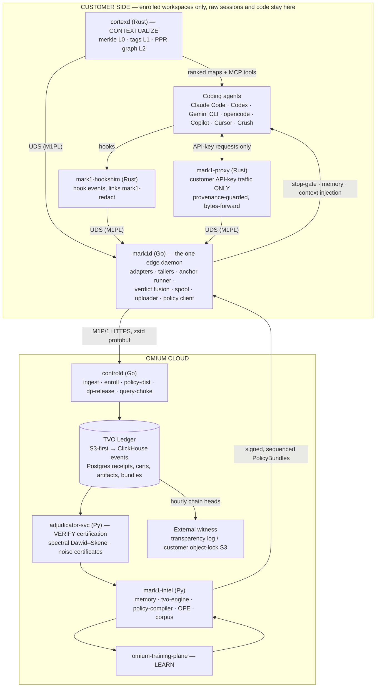

# 01 — Introduction: What Mark 1 Is and Why It Exists

**Status:** Authored 2026-08-28 against the frozen execution plan (`docs/spec/execution-plan-v2.md`) and the authoritative architecture spec v2.0 (`docs/spec/architecture-spec.md`). Where this document and either of those disagree, they win.
**Audience:** a staff engineer or technical buyer with zero prior exposure to Mark 1. After reading this you know what we are building, why, what it will and will not do, and every term the other thirteen documents use without redefining.
**Reading time:** ~40 minutes. Section 9 is the glossary; keep it open while reading documents 02–14.

---

## 1. The problem

Coding agents ship working code, and they ship it expensively — not because tokens are mispriced, but because the tokens are spent on the wrong things. Every vendor sells a smarter agent; nobody sells the layer that makes an agent economical. Coding agents are Tony Stark — brilliant, and suitless. Mark 1 is the suit. That is the last analogy in this document set; everything from here is mechanism.

### 1.1 The economics, concretely

The unit of spend everyone optimizes is **tokens per request** — compression, compaction, prompt trimming. The unit of spend that drives the bill is **tokens per verified outcome**: the total tokens consumed, across every retry, re-exploration, and model call, to reach a result that actually works — a merged PR, passing CI, a resolved issue. The gap between those two units is where the money leaks, and the leaks decompose into four channels, in descending order of magnitude:

| # | Leak | Mechanism | Who attacks it today |
|---|---|---|---|
| 1 | **Iteration waste** | wrong or incomplete output → human re-prompts 10–15× → the full context is re-processed on every round | nobody, as a product |
| 2 | **Exploration waste** | the agent re-greps, re-reads, and re-derives the same repository facts every session; it has no memory of yesterday | nobody, as a product |
| 3 | **Misallocation waste** | frontier-priced models doing work a ~10×-cheaper model does equally well; no per-step difficulty routing for coding sessions is published anywhere | static model pickers only |
| 4 | **Context waste** | bloated transcripts | everyone — auto-compact is native in Claude Code and Codex, and the compression startups (two in YC W26 alone) live here |

The fact that compression is ubiquitous and the pain persists is itself the proof that leaks 1–3 are where the money is. The verified market picture (dossier §2, every figure below survived three-vote adversarial verification):

- **Gartner, 2026-06-24:** by 2028, AI coding costs will overtake the average developer's salary, driven by rising token consumption and consumption-based licensing. The analyst's own words: *"None of the vendors have incredible features when it comes to cost optimization… there is a relation between optimization of token consumption with the output quality"* — both halves of our thesis, stated independently.
- **Enterprise spend (Gartner Peer Insights, directional):** 23% of tech leaders spend $200–500/dev/month on coding-agent tokens; 6% spend over $2,000/dev/month.
- **McKinsey (2026, n=75 qualified):** 93% of organizations exceed their AI budgets; spend grows ~4× moving to enterprise-wide adoption; only **1%** realized >30% cost savings in the trailing quarter. Any product claiming 80% is claiming to be 80× rarer than the entire realized distribution — which is why our claim discipline (§8) caps pitches at verified 40–60%.
- **The demand-side pain event:** Anthropic introduced weekly rate limits on Pro/Max subscription plans (effective 2025-08-28) specifically to curb power users. Subscription users do not have a bill; they have a **quota wall**, and they hit it. Token cost on those plans is denominated in rate-limit-window fraction, not dollars — which is why Mark 1's cost accounting carries an explicit dual cost basis (§2.4, glossary: *cost basis*).
- **Token price deflation (~5–10×/year) does not save anyone:** consumption growth outpaces it (Jevons dynamics, confirmed directionally).

### 1.2 The measurement void

Nobody can measure cost-per-verified-outcome today, including the leaderboards that rank the agents: programmatic parsing of the live SWE-bench leaderboard found **0 of 84** Lite entries reporting cost, and the only Verified entries with cost figures are the maintainers' own baseline runs. This is not an accident of reporting laziness — Paper I proves (Thm 6.1, non-recoverability) that TVO **cannot be computed** from the (pass@k, mean cost) tuples leaderboards publish, even in principle. The metric does not exist until someone instruments full sessions with verified denominators. Mark 1 is that instrument, and the metric is the product.

### 1.3 Why the retry loop specifically

The dominant leak deserves one more paragraph because it dictates the architecture. The verification literature is unanimous: **models can fix bugs they are shown; they cannot find their own** (feedback-source swaps raise repair success 2.45–4.3×; self-critique without external signal adds nothing statistically measurable). Worse, repair has a knee: marginal success per round decays geometrically, saturating at ~2 rounds for function-level tasks and 5–10 at repo scale. Every round past the knee is pure waste — full-context re-processing purchased for a success probability that no longer covers its cost. A layer that merely *observes* the loop reports the waste; a layer that **verifies each attempt and stops the loop at the computed knee** eliminates it. That is the design rule that separates Mark 1 from observability products: the suit must stop the loop, not watch it.

---

## 2. The thesis: TVO as the objective function

Mark 1 optimizes one number. Everything in the system — every plane, every gate, every signed bundle — exists to move it. This section states the number and its three governing results plainly; Paper I (`mark1-research/paper1-tvo.tex`) carries the proofs.

### 2.1 The closed form

**Tokens per verified outcome:**

```
TVO = (c + v + (1−p)·β·D) / (p·α)
```

where, per attempt:

| Symbol | Meaning |
|---|---|
| `c` | generation cost — all model tokens spent producing the candidate |
| `v` | verification cost — tokens/compute spent checking it |
| `p` | probability the candidate is actually correct |
| `α` | verifier true-accept rate, P(accept │ correct) |
| `β` | verifier false-accept rate, P(accept │ incorrect) |
| `D` | downstream damage cost of a falsely accepted outcome — rework, revert, incident |

The denominator `p·α` is the rate at which attempts become *verified, correct* outcomes; the numerator is per-attempt spend plus the expected cost of escaped defects. Every product surface maps to a term: **REMEMBER and CONTEXTUALIZE raise `p`** (the agent starts closer to right), **VERIFY raises `α−β`** (better discrimination) and controls `βD` (fewer escaped defects), **ROUTE lowers `c`** (cheapest passing rung) and `v` (judges fire only where anchors are ambiguous), **LEARN improves all of them over time**. TVO satisfies four axioms every currently published metric fails (Paper I, Prop 3.2) — pass@k has no cost, mean cost has no outcome, and per-request token counts have neither.

### 2.2 The verifier break-even

Verification is not free, so it must pay for itself. Paper I Thm 4.2 gives the break-even price:

```
v* = (1−p)·D·(α−β) − c·(1−α)
```

Verification is worth buying iff `v < v*`. Read the two terms: the first says verification's value scales with the failure rate `(1−p)`, the damage of escapes `D`, and the verifier's **Youden discrimination** `(α−β)` — a verifier that accepts everything or rejects everything earns nothing. The second term is the tax: every correct candidate the verifier wrongly rejects (rate `1−α`) forces a re-generation costing `c`. Corollary 4.3 converts this into a necessary AUC condition, and the numbers are decisive for product design: **LLM-judge verification (AUROC ≤ 0.65) fails the economic threshold; grounded rubric verification (AUC 0.886) clears break-even ~2×.** This is why Mark 1's verifier ensemble is anchored in cheap, grounded, deterministic checks (compilers, linters, type-checkers — the *anchor verifiers*) with LLM judges reserved for the ambiguous residue, and why judge economics get their own escalation ladder rather than a default-on posture.

### 2.3 The repair knee

Paper I Thm 5.1 gives the optimal stopping round for a repair loop in closed form:

```
k* = 1 + ⌊ln ρ / ln γ⌋
```

where `γ ∈ (0,1)` is the round-over-round geometric decay of repair success probability and `ρ` is the ratio at which a marginal round's expected payoff no longer covers its cost. With zero parameter fitting, this reproduces **both** published repair knees from literature parameter values — `k* = 2` at function level, `k* = 6` at repo scale — the trilogy's strongest validation. The product implication is direct: the number of retries an agent should be allowed is *computable*, per task class, from measured quantities. Mark 1's **knee governor** deploys this as a live gate: stop when `p̂_LCB(n)·V(task) ≤ c(n)`, with `c(n)` computed under the tenant's cost basis (`usd` for API-key traffic, `quota` for subscription traffic), bounded by uncircumventable local caps (≤3 consecutive blocks per task, an hourly ceiling, and `mark1 off` checked *before* any gate evaluates). At the knee, Mark 1 stops the loop and surfaces the verdict and evidence to the human — the intervention arrives *before* the eleventh re-prompt, not in a monthly report after it.

### 2.4 What the theory forces on the product

Three consequences that shape everything downstream, each stated once here and enforced structurally later:

1. **The denominator is a spec, not a heuristic.** "Verified outcome" requires deciding what one task *is* (follow-ups, abandonments, session ends). Mark 1 versions this as `task_seg.v1`, a receipted algorithm stamped on every task — because if the denominator is arbitrary, every TVO number we ever quote is arbitrary.
2. **Every TVO number carries its coverage band and its cost basis.** A metric over partially observed sessions is a different metric; a dollar number and a quota number are different numbers. Reports state both, always, and guarantee-grade reports are *refused* — not caveated — below the coverage floor.
3. **Labels must certify their own noise.** The flywheel (§3.3) trains on outcome labels; Paper II Thm 6.1 makes the label factory self-certifying (the adjudicator estimates its own error rates ρ₊, ρ₋, and the Natarajan condition ρ₊+ρ₋ < 1 becomes a measurable *noise certificate* gating everything downstream). Uncertified verdicts do not gate memory extraction or corpus admission, and their status is honestly `uncertified/bootstrapping` — never dressed up.

---

## 3. What Mark 1 is

**One sentence:** Mark 1 is an external verification–memory–routing layer that wraps coding agents (Claude Code first; seven agents at full build), cuts tokens-per-verified-outcome while raising output quality, and converts every session it touches into outcome-labeled trajectory data with calibrated error bars — data nobody else can accumulate.

It is five planes around one spine, delivered through two structurally separated capture regimes (§4), built as nine deployables plus four client crates in Rust, Go, and Python — each language where it provably wins.

### 3.1 The five planes

| Plane | Job | Mechanism |
|---|---|---|
| **VERIFY** | Catch failure before the human re-prompts; arrest retry loops at the knee; manufacture calibrated outcome labels | An ensemble of weak verifiers — client-side anchor verifiers (compilers, linters, type checkers), LLM rubric judges, reward models, escalation-scoped consistency checks — fused by oracle-free adjudication (Paper II) into four-verdict outcomes: `satisfied \| violated \| refused \| error`, each with self-certified noise rates |
| **REMEMBER** | Cross-session, cross-repo experience so the agent stops re-deriving yesterday | Typed experience artifacts (workflow templates, pitfall–remedy pairs, invariants, routing hints) distilled from certified sessions; per-tenant first; federated cross-org only behind (k,m)-intersection + differential privacy + LCB do-no-harm gates (Paper III) |
| **CONTEXTUALIZE** | Precomputed repo intelligence instead of live re-exploration | `cortexd`: a local daemon maintaining a BLAKE3 merkle file plane, tree-sitter tag plane, and a symbol graph ranked by personalized PageRank; injected as budgeted ranked maps at session start and served as scoped MCP tools on demand |
| **ROUTE** | Right model per step; escalate on verification failure; stop at the knee | Signed, sequenced policy bundles carrying cost-per-verified-success routing tables, escalation ladders (the prefix principle: prepend any stage whose cost-per-verified-success beats the incumbent's TVO), and knee tables — evaluated at the edge in nanoseconds, fail-static |
| **LEARN** | Verifiers, rankers, and routers trained on the outcome-labeled corpus | The existing `omium-training-plane` consuming certified-label exports; trained artifacts re-enter the system only through probation → shadow voting → LCB promotion → canary — the do-no-harm theorem applied to LEARN's own outputs |

### 3.2 The spine: the TVO Ledger

Every event from every capture path — hooks, transcript tails, proxied requests, anchor votes, verdicts, injections, routing decisions — lands deduplicated in an append-only ledger (S3-first ingest, ClickHouse analytics, one dedupe key across all three layers). Every *consequential* decision — verdicts, memory admissions, bundle publications, corpus exports, coverage transitions — is bound into a dual-signed (device origin + server countersign), hash-chained, externally witnessed Ed25519 receipt chain in Postgres, checkable offline by the customer with a standalone open-source verifier while Omium's servers are unreachable. The ledger is not telemetry plumbing; **coverage-banded, cost-basis-honest, offline-verifiable TVO is the product artifact** — the thing the customer buys, the thing the papers get written from, and the thing the flywheel trains on. All capture rides **M1P**, Mark 1's proprietary end-to-end protocol (schema, transport, local fabric, spool); Mark 1 takes no external telemetry framework as a dependency anywhere — the rationale is ADR-0005, the protocol is document 07.

### 3.3 The flywheel

```
capture → VERIFY labels (noise-certified) → dual-signed receipts →
REMEMBER distillation (k,m∩ + DP + LCB) → context + memory injection →
ROUTE bundles → LEARN retraining → better bundles → lower TVO →
more sessions → richer corpus → repeat
```

Each plane feeds the others signals that do not exist standalone: CONTEXTUALIZE ranks with the live recent-edit set from capture; VERIFY reuses cortex's merkle table for anti-tamper; REMEMBER's admission gate is powered by verdict joins; ROUTE's knee is fit from the ledger; LEARN's outputs are certified by the same estimator that certifies everything else. A competitor can copy any single plane; the closed loop only forms when all five share one certified spine — that is the moat argument in full (spec §11).

### 3.4 The system in one diagram



### 3.5 The component inventory in one paragraph each

**Edge (customer machines).** `mark1d` (Go) is the single long-lived daemon: seven agent adapters, workspace-allow-listed transcript tailers, the sandboxed anchor runner, verdict fusion (log-space naive Bayes from bundle-shipped confusion matrices — the stop-gate reads its cached verdict and never computes), the durable segment spool (single writer), the M1P uploader, the policy client, coverage accounting, and supervision of the other edge processes. `mark1-proxy` (Rust) is an API-key-only micro-proxy (`--mode=sidecar|gateway`): bytes-forward hot path (≤1 ms median added latency, ≤35 MB RSS), tee-on-clone parsing, inline request redaction, wire-level model rewrite. `mark1-hookshim` (Rust) is one static binary registered into every agent's hook config via fenced, checksummed fragments; per-agent field maps ship as bundle *data*, so an agent's format break is a bundle push, not a release. `cortexd` (Rust) is the per-workspace repo-intelligence daemon. Four Rust crates round out the edge: `mark1-redact` (two-axis secret scanner, linked by both proxy and shim), `mark1-receipt` (Ed25519 chain primitives), `mark1-policy` (bundle verify + decode to typed nanosecond-eval structs), `m1p-wire` (codegen + framing). The CLI is `mark1`: `enroll`, `enable`, `status`, `doctor`, `report`, `off`, `verify-receipts`.

**Cloud (Omium control plane).** Two binaries plus two Python services. `controld` (Go): ingest (S3-first, tenant stamped from the verified token, independent pre-egress secret scanner), enrollment (OIDC device-code, ≤24 h tokens, revocation), policy distribution (with ACK ledger and transparency-log publishing), differential-privacy release (with an ε ledger), and the query chokepoint — the *only* ClickHouse principal, asserting the tenant predicate on every generated query. `adjudicator-svc` (Python): judge orchestration (client-side-first), spectral Dawid–Skene behind an identifiability gate, noise certification, gold-set management. `mark1-intel` (Python): memory extraction/admission/retrieval, the TVO engine and waste taxonomy, the policy compiler, off-policy evaluation, and the corpus exporter. LEARN reuses the existing `omium-training-plane` — Mark 1 is the corpus that plane was built for and never got.

---

## 4. The two legal regimes — and why the split is structural

This is the single most load-bearing product constraint. Get it wrong and there is no product; get it merely *procedurally* right and no enterprise security team or vendor counsel will believe it. It therefore gets its own section, and the architecture enforces it in code, not policy.

### 4.1 The legal facts

Anthropic's terms prohibit routing requests through Free/Pro/Max **subscription (OAuth)** credentials, collecting or intermediating Claude.ai credentials or session tokens, modifying the Claude Code binary, and reselling usage. Enforcement is real, not theoretical: server-side OAuth blocks broke third-party tools in January 2026; a takedown precedent exists from April 2025. Two nuances matter and were adversarially verified:

- **What is foreclosed is credential intermediation specifically** — the ToS does *not* say compliant tools may only touch API-key traffic. Hooks-, MCP-, and sidecar-based tooling around an unmodified binary using the user's own credentials is compliant on **all** plans, subscriptions included.
- **Customer API-key traffic** (direct `ANTHROPIC_BASE_URL`, Bedrock, Vertex, Azure) is fully open, technically and legally, to wire-level interception — proven at scale by existing open-source routers.

### 4.2 The two regimes

| Regime | Capture | Injection | Wire proxy |
|---|---|---|---|
| **Subscription / OAuth** ($20–200/mo Pro/Max plans) | Hooks, transcript tails (deduplicated by `(message.id, requestId)` + the sidechain rule), artifact directories | Hook context, stop/tool gates, context files, MCP tools | **Never** — refusal is provenance-gated, not shape-guessed |
| **Customer API key** (`ANTHROPIC_BASE_URL` / Bedrock / Vertex / Azure) | All of the above **plus** the Rust wire proxy | All of the above **plus** wire-level model rewrite | Yes — customer credentials pass through by reference, unmodified |

Both regimes emit the **same event schema** into the same ledger — identical capture semantics means one trajectory corpus, and it means a subscription user's TVO report and an enterprise's TVO report are the same product. The regimes differ only in *which* capture surfaces are active and in cost basis (`quota` vs `usd`).

### 4.3 Why structural, not policy

A policy split says "the proxy is configured not to handle OAuth traffic." A structural split says **the proxy has no code path that can forward an unprovisioned credential.** Mark 1 is the latter, for three reasons, each of which a policy split fails:

1. **Configuration is falsifiable by accident.** A misdeployed flag, a defaults regression, or a user's creative `.env` turns a policy split into a ToS violation with the customer's account as collateral. The structural control cannot be misconfigured because there is nothing to configure: the proxy accepts only requests bearing an `M1-Cred-Ref` naming a credential `mark1d` provisioned after detecting it as an API key, HMAC-fingerprint-matched to enrollment. Unknown credential ⇒ 403. **No override path exists in the binary.**
2. **The claim must be provable to hostile reviewers.** Vendor counsel and enterprise security teams do not accept "we promise." Mark 1's refusal is *evidenced*: shape inspection runs as a secondary tripwire; an upstream subscription-marker response triggers session kill, config rollback, and a receipted `oauth_contamination` P0; a weekly token-shape canary fails CI on a classifier miss; sampled guard decisions are themselves receipted. The refusal record is an auditable artifact, which no gray-area proxy can produce.
3. **Legality-by-structure is a distribution moat.** Because Mark 1 sits only on vendor-sanctioned surfaces (hooks, MCP, transcripts) in the subscription regime and only on customer-owned credentials in the API-key regime, it can be deployed where interceptors legally cannot — including inside enterprises whose counsel would veto anything credential-adjacent.

The corollary constraints are absolute and appear again in the non-goals: no credential intermediation of any kind, no modification of any vendor binary, no usage resale. The failure posture for this entire class is **fail-closed**: when in doubt about credential provenance, refuse.

---

## 5. Personas and jobs to be done

Four buyers, four first-ten-minutes. Every flow below uses shipped surfaces only (CLI, hooks, receipts, reports); nothing depends on a dashboard that does not exist yet.

### 5.1 The individual developer — $20–200/mo subscription, quota-walled

**Job:** stop burning the weekly rate limit on retry loops; know where the quota goes.
**First ten minutes:** installs the signed package → `mark1 enroll` (OIDC device-code against their IdP or Omium-hosted auth; device key lands in the OS keychain) → `mark1 enable ~/code/project` (capture is per-workspace allow-listed; nothing outside enrolled roots is read; `.mark1ignore` honored) → `mark1 doctor` shows exactly which fenced, checksummed lines were added to the agent's hook config and which anchors were catalogued, each requiring consent. Their next Claude Code session starts with a cortex repo map injected under a token budget; the first time the agent enters a failing edit-test-edit loop, the stop-gate arrests it at the knee with the failure evidence attached as the continuation reason instead of letting rounds 3–12 burn quota. `mark1 status` shows the live read surface at any moment; `MARK1_DISABLE=1` or `mark1 off` bypasses everything, verified by byte-equality snapshot of the agent's config. After a week, `mark1 report` shows their TVO with a `quota` cost basis and a coverage band. No proxy is installed or offered — this user is in the subscription regime, full stop.

### 5.2 The engineering leader — 50–500 person company

**Job:** the coding-agent line item is growing 4× with adoption and nobody can say what it buys; make spend legible and cut it without a quality regression.
**First ten minutes:** reviews a tenant-level TVO report over the pilot cohort: TVO trend, the deterministic waste taxonomy (retry-loop tokens, re-exploration tokens cortex would have saved, over-model tokens versus the cheapest passing rung), coverage band, and cost basis per sub-cohort — `usd` for the API-key teams, `quota` for the subscription seats. Sees knee-governor interventions counted with their token deltas, and routing-table candidates ranked by cost-per-verified-success. Rolls out via managed dotfiles/MDM: the same `mark1 enroll`/`enable` flow, fleet-supervised. The decision this persona makes in week one is a routing decision — adopt the bundle's escalation ladder or keep the incumbent model — and Mark 1's answer is an evidence table, not a vibe.

### 5.3 The platform/security reviewer — the person who must approve us

**Job:** establish that Mark 1 cannot exfiltrate code, cannot touch OAuth traffic, and cannot lie about either.
**First ten minutes:** reads document 10 (threat model) and this section's regime split; then verifies rather than trusts. Runs `mark1 doctor` and diffs the fenced config fragments byte-for-byte. Confirms raw sessions and evidence live under `~/.omium/mark1/evidence/` and are never uploaded by default; default evidence on the wire is the typed `EvidenceRecord` — no paths, no excerpts, low-entropy digests per-tenant HMAC-salted. Confirms redaction's admit-to-upload axis is fail-closed **with no off switch**, and that a second, independent scanner runs at ingest. Blocks Omium's endpoints at the firewall and watches capture fail-open (agent unaffected) and policy fail-static (last-known-good bundle). Runs the standalone open-source verifier against the receipt chain and the external witness — offline, with Omium's servers unreachable — and confirms the chain validates. Checks that `mark1 off` restores the agent's config to byte-equality. The pitch to this persona is exactly one sentence: *you do not have to trust us; here is the verifier.*

### 5.4 The enterprise on Bedrock/Vertex

**Job:** govern coding-agent traffic across a fleet without granting a vendor custody of credentials or code.
**First ten minutes:** deploys `mark1-proxy --mode=gateway` plus `mark1d --fleet` inside their own VPC, fronting Bedrock/Vertex/Azure. Credentials are referenced from the customer's secret manager per request and never persisted by Mark 1; connection pools are keyed by `(upstream, credential-identity)` — no multiplexing, no identity masking, satisfying the model vendors' terms simultaneously. Bedrock's request path runs observe-only until customer-held re-signing hardens. Because everything runs inside their perimeter, E1/E2 evidence tiers (sanitized or full diffs for judge evaluation) become available under their control, and per-tenant KMS keys govern every byte at rest on our side. Developer machines still run sidecars for hooks, transcripts, and cortex — the gateway adds the wire, it does not replace the edge.

---

## 6. Scope and non-goals

Scope: everything in §3, delivered per the six assembly phases of the frozen plan (document 14), Claude Code first. The non-goals below are commitments, not omissions — several are the direct product of the legal analysis and the theory, and reversing any of them requires re-opening the frozen plan.

1. **Mark 1 is not an agent.** It never writes code, plans tasks, or executes work. It wraps agents; the agent's vendor keeps the authorship relationship.
2. **Mark 1 is not an IDE, editor, or editor plugin.** It attaches to agents' sanctioned extension surfaces; it owns no editing UX.
3. **Mark 1 is not a model provider or inference reseller.** No hosted inference, no usage resale, no markup on tokens.
4. **Mark 1 is not a proxy for subscription (OAuth) traffic — structurally.** The proxy binary has no code path that forwards an unprovisioned credential (§4.3). This is a permanent property, not a launch limitation.
5. **Mark 1 performs no credential intermediation of any kind.** It never collects, stores, forwards, or refreshes Claude.ai credentials or session tokens; gateway-mode API credentials pass by reference, unread and unpersisted.
6. **Mark 1 modifies no vendor binary.** All integration is hooks, MCP, config includes, transcripts, and (API-key regime only) the wire — surfaces the vendors ship for the purpose.
7. **Mark 1 is not a code-storage or code-search cloud service.** Raw sessions, repository contents, and evidence stay client-side by default; the default wire evidence type structurally cannot carry paths or excerpts.
8. **Mark 1 is not a compression/compaction product.** Context waste is the smallest leak, the vendors absorb it natively, and two YC startups already camp there. We attack leaks 1–3.
9. **Mark 1 is not an observability/APM platform.** Capture is a means; the product is verified-outcome economics and the interventions that improve them. (Self-monitoring exists — document 11 — built on M1P itself.)
10. **Mark 1 does not train competing coding models.** The LEARN plane trains *adjuncts* — verifiers, rankers, routers, memory — under counsel review of the vendor-terms training clause before any training-leg work ships. Cross-tenant training is contractual opt-in behind DP-SGD, ε accounting, and canary memorization gates.
11. **Mark 1 is not a general-purpose LLM gateway.** No failover multiplexing, no identity masking, no key pooling. The proxy exists to observe, redact, and route the customer's own traffic under the customer's own identity.
12. **Mark 1 is not a security scanner or SAST product.** Anchors verify *outcomes* of agent work; they do not audit the codebase. (Redaction protects egress; it is not a secrets-audit product either.)
13. **Mark 1 does not host a public leaderboard at launch.** TVO-Bench is a protocol (Paper I, rules R1–R6); operating a leaderboard is deferred until the metric has production credibility.
14. **No self-hosted control plane at launch.** Cloud-only until the stack stabilizes; self-host is a phase-gated enterprise SKU (Phase 6). `deploy/compose/` is an internal dev environment, not a product.

---

## 7. Relationship to the research

Mark 1 productizes three theory papers (the Protocol Trilogy, `mark1-research/`) and a four-phase adversarially-verified research program (`mark1-research-dossier.md`: 416 agents, 100 claims triple-verified — 94 confirmed, 6 refuted). The papers specify one machine in three publishable pieces: **Paper I defines the objective, Paper II manufactures the labels the objective needs, Paper III compounds the labels across organizations.**

### 7.1 Paper-to-plane map

| Paper | Contributes | Lands in |
|---|---|---|
| **I — Tokens-per-Verified-Outcome** | The TVO metric + four axioms (Prop 3.2); closed form (Thm 4.1); verifier break-even + AUC condition (Thm 4.2/Cor 4.3); repair knee (Thm 5.1); non-recoverability from leaderboards (Thm 6.1); Shapley waste attribution (Thm 7.1); cascade prefix principle; TVO-Bench rules R1–R6 | The spine (TVO engine, `task_seg.v1`, waste taxonomy) and ROUTE (knee governor, escalation ladders, CPVS tables) |
| **II — Verification Without Oracles** | Weak-supervision model with dependency cliques known by construction; identifiability from *unlabeled* data given ≥3 independent cliques + anchor verifiers resolving label-swap (Thm 4.1–4.2); finite-sample rate (Thm 4.3); four-verdict Bayes-optimality + Chow band (Thm 5.1–5.2); self-certifying noise rates (Thm 6.1); the ADJUDICATE algorithm; CUSUM drift detection | VERIFY end to end: anchor catalog, verdict fusion in `mark1d`, `adjudicator-svc` (spectral Dawid–Skene behind the identifiability gate), noise certificates, gold sets |
| **III — Federated Experience** | Artifacts-not-trajectories across the tenant boundary; (k,m)-anonymity by construction (Thm 4.1); ε-DP release with tenant-level composition (Thm 4.2); transfer bound (Thm 5.1); ADMIT-LCB do-no-harm (Thm 6.2) + missed-utility regret (Thm 6.3); noise-degradation link to Paper II (Prop 6.4); supercriticality condition for the flywheel (Prop 7.1); bounded poisoning | REMEMBER: artifact grammar and sanitization, per-tenant admission, the federation pipeline (intersection reconstruction, DP release, ε ledger, review queue) |

Two design decisions in the estate were *retro-proved* by the papers rather than invented by them: the four-verdict vocabulary `satisfied | violated | refused | error` already exists as a Postgres enum in the platform and Paper II proves it Bayes-optimal (and proves that conflating infrastructure failure with `violated` incurs unavoidable excess risk — which is why `error` exists); the tenant-column-free anonymized ledger design predates Paper III's Thm 4.1, which theoremizes it.

### 7.2 What is theorem and what is engineering

**Theorem (holds unconditionally, given its hypotheses):** the closed form and its axioms; the break-even and AUC thresholds; the knee formula; non-recoverability; identifiability and its finite-sample rate; four-verdict optimality; the do-no-harm admission guarantee; (k,m)/DP privacy properties. These are public the day they are published, and that is fine — reading them does not confer the ability to run them.

**Engineering (supplies the theorems' measured inputs, and is where the risk lives):** `task_seg.v1` (the denominator); confusion matrices, priors, and correlation groups estimated from production data; gold sets and the identifiability gate that decide *when* the estimator's hypotheses actually hold; coverage accounting; propensity logging with fidelity annotations that make off-policy evaluation valid; anti-tamper envelopes that keep anchor votes honest; and the entire capture fabric whose fidelity every number inherits.

**Honesty line, stated once and binding everywhere:** the papers contain **no fabricated experimental results** — every number is a closed-form computation calibrated to cited, adversarially verified literature values. The integrated end-to-end TVO-reduction number **does not yet exist, including from us**. Producing it — on our own $10–15k/month usage first, then on the design partner's traffic — is Phase 1's dogfood gate, and per §8 we do not quote it before the ledger produces it. The papers' defensibility is likewise honest: Papers II and III require cross-agent production trajectory data with verified outcome labels, which only a deployed Mark 1 generates and which model vendors are contractually barred from accumulating on enterprise traffic.

---

## 8. Claim discipline

Every number Mark 1 emits is an argument someone will try to break — a buyer's diligence team, a competitor, a vendor's counsel, a reviewer of the papers. The discipline below is normative for every report, deck, demo, doc, and support answer. Two universal rules first:

- **The coverage-band rule.** Every TVO number carries its coverage band — the receipted fraction of the cohort's sessions actually observed (enable/disable/bypass windows are attributable via `CoverageTransition` receipts). **Guarantee-grade reports are refused below the coverage floor** — refused outright, not issued with a footnote — because a TVO over unobserved sessions is a different, unverifiable metric.
- **The cost-basis rule.** Every TVO number states its cost basis: `usd` (token prices + verifier spend) for API-key cohorts, `quota` (rate-limit-window fraction × wall-clock shadow price) for subscription cohorts. The two are never averaged together.

### 8.1 Claims we MAY make — and the evidence each requires

| Claim | Required evidence |
|---|---|
| "Your TVO changed by X% over window W" | Ledger query, reproducible by the customer; coverage band ≥ floor; cost basis stated; `task_seg` version stamped |
| "N retry loops were arrested at the knee, saving Y tokens" | `VerdictEvent` + `RouteDecision` joins in the ledger; knee parameters from the tenant's bundle |
| "This verdict is certified with error rates (ρ₊, ρ₋)" | An active noise certificate — gold-set size/freshness preconditions met, identifiability diagnostics passed; otherwise the status is `uncertified/bootstrapping` and we say so |
| "Our reports are verifiable without trusting Omium" | Dual-signed receipt chain + hourly external witness + the standalone open-source verifier validating offline |
| "Cortex saved Z re-exploration tokens for your tenant" | Per-tenant verdict joins in the ledger — never the literature's +22pp/−95% prior asserted as our performance |
| "Routing rung R matches rung R′ at 1/k the cost *on your traffic*" | Off-policy evaluation over `WIRE_ENFORCED` decisions with logged propensities, or a served-model-confirmed join |
| "We never touch subscription credentials — provably" | The receipted guard-decision record, the CI token-shape canary history, and the absence of any override path in the shipped binary |
| Literature results, cited as literature | Exact citation, original scope stated (benchmark, model, domain), never restated as Mark 1 performance |
| Pitch-grade savings language | **Verified 40–60%, never 80%.** Calibration: only 1% of orgs realized >30% savings (McKinsey); a verified 40–60% is already extraordinary and survives diligence; 80% invites diligence death |

### 8.2 Claims we MAY NOT make

| Forbidden claim | Why |
|---|---|
| Any TVO number without its coverage band and cost basis | Violates the two universal rules; the number is meaningless without them |
| A guarantee-grade report below the coverage floor | Refused by the product itself; a human quoting one anyway is overriding a designed refusal |
| The integrated end-to-end reduction number, before the ledger produces it | It exists nowhere yet, including from us (§7.2); quoting it is fabrication |
| "Bills jumping 20–50× to $2,000–5,000/dev/month" | Adversarially refuted (dossier §2.4); never in any artifact |
| FrugalGPT's "98% cost reduction" for coding economics | Best-case on news-headline classification at 2023 prices; zero coding content |
| Competitor "100×" compression figures, or the vendor's "84% token reduction" as coding-relevant | Marketing walk-backs and vendor-internal web-search-domain results respectively; both quarantined |
| LongLLMLingua quality-improvement numbers; Agentless v1 figures as headline results | Refuted 0–3 and version-confused respectively; cite Agentless v2 only |
| Best@N quality gains presented as token savings | The hybrid best-of-N literature costs ~26× rollouts; it is a quality-per-outcome result, never an efficiency one |
| Uncertified verdicts sold as certified, or used to gate memory/corpus admission | Structurally prevented (C5); claiming otherwise contradicts the shipped system |
| Any capability claim about intercepting, optimizing "on the wire," or proxying subscription traffic | No such capability exists, by design (§4.3, non-goal 4) |
| Compliance certifications (SOC 2, ISO, HIPAA) before they are held | Claims require the certificate, not the roadmap |

One operational sentence closes this section, quoted from the frozen plan because it is the enforcement mechanism: *every claim made to a customer traces to a ledger query, and every number in a customer report carries its coverage band and cost basis.*

---

## 9. Glossary

Alphabetized. Terms used in documents 02–14 without redefinition. Cross-references in *italics*.

**ADMIT-LCB** — Paper III's admission algorithm for experience *artifacts*: admit an artifact only when the lower confidence bound (*LCB*) of its measured utility is strictly positive, giving the do-no-harm guarantee (Thm 6.2) that the federated pool never underperforms private memory with probability 1−δ. Also applied to LEARN's own outputs before promotion.

**adjudicator** — the component (`adjudicator-svc`, Python) implementing Paper II's ADJUDICATE algorithm: fusing weak verifier votes into calibrated four-*verdict* posteriors via weighted majority at bootstrap and spectral Dawid–Skene once the *identifiability gate* passes; also owns certification, *noise certificates*, and *gold sets*.

**anchor verifier** — a deterministic, grounded, client-side check (compiler, linter, type checker, opt-in test run) whose failure mode is known by construction — e.g. compile failure is a perfect-precision rejection. Anchors resolve the label-swap ambiguity general weak-supervision theory cannot (Paper II Thm 4.2). Enabled only from a locally derived, user-consented catalog by ID — bundles cannot name commands.

**artifact** — a typed unit of distilled experience (workflow template, pitfall–remedy pair, invariant, routing hint) extracted from certified sessions by REMEMBER. Artifacts, not trajectories, are the only thing that may cross the tenant boundary, and only through the federation pipeline (*k,m gate*, DP, *ADMIT-LCB*).

**bundle (PolicyBundle)** — the signed, sequenced (monotonic per tenant × channel), canonical-CBOR policy unit distributed to edges: `verify` (confusion matrices, priors, correlation groups, anchor enables by catalog ID), `route` (CPVS tables, ladders, knee tables, *cost basis*), `memory`, `cortex`, `gates`, `agent_maps` sections. Carries no command strings and no code — any command string fails decode. Verified at the edge (signature + sequence + *transparency log* inclusion proof); *fail-static*.

**Chow band** — the posterior interval, with endpoints `(A/R, 1−A/D)` in Paper II's cost notation, within which abstaining (verdict `refused`) is Bayes-optimal; the abstaining rule strictly dominates every binary verifier (Thm 5.1). The formal reason the *verdict* vocabulary has four values, not two.

**controld** — the single Go control-plane binary: ingest (S3-first, token-stamped tenancy, pre-egress secret scanner), enroll (OIDC device-code, ≤24 h tokens, revocation), policy-dist (Etag poll + SSE push, ACK ledger, transparency-log publisher), dp-release (DP mechanisms + *ε ledger*), and *query chokepoint*.

**cortex / `cortexd`** — the CONTEXTUALIZE plane and its Rust daemon: per-workspace repo intelligence layered as L0 (BLAKE3 merkle file plane — whose root hash double-serves anchor anti-tamper), L1 (tree-sitter tags), L2 (symbol graph with personalized PageRank), L3 (opportunistic SCIP precision). Pushes budgeted ranked maps at session start; serves session-scoped MCP pull tools.

**cost basis** — the denomination of cost in a knee table or TVO report: `usd` (token prices + verifier spend) for API-key tenants, or `quota` (rate-limit-window fraction × wall-clock shadow price) for subscription tenants. Every quoted TVO number states its basis; the two are never mixed.

**coverage band** — the receipted fraction of a cohort's sessions Mark 1 actually observed over the reporting window, computed from `CoverageTransition` events. Attached to every TVO number.

**coverage floor** — the minimum *coverage band* below which guarantee-grade reports are refused rather than issued with caveats.

**Dawid–Skene (spectral)** — the estimator recovering each verifier's confusion law and the class prior from *unlabeled* votes, given ≥3 independent correlation groups (Paper II Thm 4.1/4.3); activates only behind the *identifiability gate*, with global estimation and hierarchical shrinkage at low volume.

**dedupe key** — the single identity discipline across all three storage layers: transcript `(message.id, requestId)` at the edge → `event_id` idempotent upsert at ingest → ClickHouse replacing-merge on `event_id`. One key, three enforcement points, so at-least-once delivery never double-counts.

**`Dropped{}`** — the M1P event `Dropped{reason, durability_class, quantity}` emitted whenever the edge sheds, quarantines, or loses data (spool full, CRC failure, unsupported agent version). `durability_class` names the contract the *lost* records were under (`billing_grade` or `diagnostic`), not the family they belonged to — it is what decides whether a drop pages and whether it narrows the coverage band's lower edge. Loss is *accounted*, never silent — `Dropped{}` feeds the *coverage band* and is first-class product telemetry.

**event_id** — the UUIDv7 identifier stamped on every M1P event; simultaneously the server dedupe key, a ClickHouse ordering component, the *spool* cursor, and the *receipt checkpoint* leaf.

**evidence tier (E0/E1/E2)** — what judge-facing evidence may leave the client. **E0** (default): the typed `EvidenceRecord` only — tool, diagnostic code, category, counts, path role, HMAC digest; no paths, no excerpts. **E1** (per-tenant opt-in): sanitized diff hunks, redaction-receipted. **E2** (VPC/self-host only): full diffs. Default judge execution is client-side through the customer's own key, so evidence never leaves at all.

**fail-open / fail-static / fail-closed** — the normative failure-posture matrix. *Fail-open* for availability: capture and hooks degrade silently, the agent is never blocked by Mark 1's absence. *Fail-static* for policy: if the control plane vanishes, edges run the last-known-good *bundle* indefinitely, falling to conservative built-in defaults past `max_age`. *Fail-closed* for legality and secrets: the OAuth *provenance guard*, redaction's upload admission, and revocation checks refuse when uncertain.

**fidelity** — the annotation on every `RouteDecision` stating how binding the decision was: `WIRE_ENFORCED` (the proxy rewrote the request), `CONFIG_STEERED` (config nudged the agent), or `ADVISORY` (suggestion only). Off-policy evaluation consumes `WIRE_ENFORCED` (or served-model-confirmed) decisions exclusively — the guard against learning from decisions that never happened.

**gold set** — a server-selected, edge-indistinguishable, size- and freshness-gated set of tasks with known outcomes, used to tether *noise certificates* to ground truth. Below its preconditions, certification status is honestly `uncertified/bootstrapping`.

**guarantee-grade report** — a customer TVO report offered with contractual weight. Requires an active *noise certificate* and *coverage band* ≥ *coverage floor*; otherwise refused.

**hookshim (`mark1-hookshim`)** — the single static Rust binary registered into every agent's hook configuration via fenced, checksummed fragments; translates per-agent hook JSON into M1P events using field maps shipped as *bundle* data; stamps UUIDv7 + `seq`; 50 ms fire-and-forget for observers, bounded deadlines for gates; links `mark1-redact` so even its emergency spill file is sanitized.

**idem_key** — the idempotency key on `Usage` events: `HMAC_tenant(session_id, message.id, request_id)`. Bakes the streaming-overcount defense (the verified ~2.5× duplication risk) into the protocol itself rather than parser etiquette.

**identifiability gate** — the diagnostic precondition (enough votes, ≥3 effectively independent correlation groups, spectral diagnostics) that must pass before spectral *Dawid–Skene* estimates are trusted; below it, the adjudicator uses weighted majority with priors and says so.

**(k,m)-intersection gate** — federation's publication rule: an *artifact* publishes only if ≥k contributors (default 25) exist and its body is **intersection-reconstructed** from spans that ≥m (default 5) billing/domain-verified organizations independently produced — so a span unique to fewer than m tenants structurally cannot publish. Enforced as a `HAVING` clause plus trigger constraint, with collusion collapse.

**knee governor** — the ROUTE control that stops repair loops at the economically optimal round: stop when `p̂_LCB(n)·V(task) ≤ c(n)` under the bundle's *cost basis*, bounded by local hard caps (≤3 consecutive blocks per task, hourly ceiling) and preempted by `mark1 off`. The deployed form of the *repair knee*.

**LCB** — lower confidence bound. Used wherever Mark 1 must act on an estimate without being fooled by variance: memory admission (*ADMIT-LCB*), knee stopping (`p̂_LCB`), and promotion of learned components.

**M1-Cred-Ref** — the request header naming a credential that `mark1d` provisioned after detecting it as an API key, HMAC-fingerprint-matched to enrollment. The *provenance guard* accepts only requests bearing it; its absence ⇒ 403 with no override path.

**M1P** — Mark 1 Protocol: the proprietary capture fabric, end to end — the `m1p.v1` protobuf schema (Buf-governed, breaking change ⇒ new package), the M1P/1 HTTPS transport (`POST /m1p/v1/ingest`, zstd protobuf batches, bearer device token, at-least-once with idempotent upsert, tenant stamped server-side from token claims and never trusted from the envelope), and the local fabric + *spool*. Mark 1's entire telemetry path; no external telemetry framework is a dependency anywhere (ADR-0005).

**M1PL framing** — the local wire framing on the UDS fabric (named pipe on Windows): `magic 'M1PL' | u8 version | u32 bounded length | payload`, socket perms 0600. Writers (hookshim, proxy, cortexd, tailers) frame final `m1p.v1` events to `mark1d`. Decoder fuzzed in CI.

**mark1 (CLI)** — the Go command-line surface: `enroll` (OIDC device-code), `enable` (per-workspace consent), `status` (live read surface), `doctor` (provisioned config lines + consented anchor catalog), `report`, `off`, `verify-receipts`.

**`mark1 off`** — the uncircumventable kill switch (with `MARK1_DISABLE=1` as its environment form), checked *before* any gate evaluation; completeness verified by byte-equality snapshot of the agent's configuration and behavior. Every off window is a receipted `CoverageTransition`.

**`.mark1ignore`** — per-workspace exclusion file honored by all tailers and cortex; nothing outside `mark1 enable`d roots is read at all.

**mark1d** — the one long-lived Go edge daemon: seven agent adapters, workspace-allow-listed transcript tailers, the sandboxed anchor runner, *verdict fusion*, the single-writer *spool*, the M1P uploader, the policy client, coverage accounting, and supervision of proxy/cortexd/shim.

**mark1-intel** — the Python cloud service with five job modules: memory (extraction/admission/retrieval), tvo-engine (the metric + *waste taxonomy*), policy-compiler (CPVS/knee/ladders → signed *bundles*), OPE, and corpus-exporter (receipted training exports).

**mark1-proxy** — the Rust micro-proxy (`--mode=sidecar|gateway`) for **customer API-key traffic only**: bytes-forward hot path (≤1 ms median added latency, ≤35 MB RSS), tee-on-clone parsing, inline request redaction, wire-level model rewrite, *provenance guard* in front of everything.

**noise certificate** — the *adjudicator*'s self-certification of its own output label noise (ρ₊, ρ₋) with the measurable Natarajan condition ρ₊+ρ₋ < 1 (Paper II Thm 6.1); preconditioned on *gold set* freshness and the *identifiability gate*; verdicts without one do not gate memory extraction or corpus admission.

**OPE (off-policy evaluation)** — scoring candidate routing policies against logged decisions (doubly-robust / self-normalized importance sampling) without deploying them; valid only over decisions with logged *propensity* and `WIRE_ENFORCED` *fidelity*.

**plane** — one of the five functional subsystems: VERIFY, REMEMBER, CONTEXTUALIZE, ROUTE, LEARN. Planes share the one spine (the TVO Ledger) and feed each other signals that do not exist standalone.

**propensity** — the probability with which the deployed policy chose the logged action, recorded on every `RouteDecision` from the first routed request. ε (exploration) defaults to 0 — propensity 1.0, logged honestly; nonzero ε is per-tenant contractual opt-in. Without propensities, off-policy learning is statistically unusable — logging them from day one is the moat's substrate.

**provenance guard** — the proxy's admission control: forward only requests bearing a valid *M1-Cred-Ref*; refuse everything else with 403. Shape inspection is a secondary tripwire only; an upstream subscription-marker response triggers session kill + config rollback + a receipted `oauth_contamination` P0. Sampled guard decisions are receipted, making refusal provable.

**query chokepoint** — `controld.query-choke`, the only principal allowed to query ClickHouse; its query builder provably appends the tenant predicate to every generated query, with fuzz and negative tests on every PR. The structural answer to the estate's decorative-RLS lesson.

**receipt** — a dual-signed (device origin key + server countersign), hash-chained Ed25519 attestation binding a decision or a *checkpoint* of events into a per-tenant, gap-free sequence in Postgres; chain heads are witnessed externally hourly; a standalone open-source verifier validates the chain offline.

**receipt checkpoint** — the high-volume receipt model: batch N events / T seconds → Merkle root → one chained receipt; individual events carry `checkpoint_seq + inclusion_path`. Per-event receipts are reserved for rare, high-stakes items (noise certs, memory admissions, bundle publications, corpus exports, coverage transitions, guard contamination).

**repair knee** — Paper I Thm 5.1's optimal stopping round, `k* = 1 + ⌊ln ρ / ln γ⌋`; reproduces the published function-level (k*=2) and repo-scale (k*=6) knees from literature parameters with zero fitting. Deployed as the *knee governor*.

**sidechain rule** — the transcript-tailer dedupe discipline for Claude Code: usage lines are identified by `(message.id, requestId)` and sidechain (sub-agent) replays are excluded, preventing double-counted `Usage` events. A protocol invariant, not parser etiquette.

**spool** — `mark1d`'s durable local queue: 64 MiB append-only segments (`bounded len | crc32c | record_id | payload`, leading 16 bytes = *event_id* so the spool cursor is the wire idempotency key), mmap'd ledger, fsync 250–500 ms, mandatory drain on session end/shutdown, ~2 GiB cap with a 95%-disk hard stop. Per-class policy: usage/verdict/receipt-checkpoint classes **block on full** (billing-grade); diagnostics drop-newest; every shed emits *`Dropped{}`*.

**`task_seg.v1`** — the versioned, receipted task-segmentation algorithm defining the TVO **denominator** (a follow-up within N turns touching the same files is the same task; session-end-without-verdict falls into an `unresolved` denominator class); its version stamps every `TaskOpen`. Fixed by ADR-0002 before code exists, because it defines every number Mark 1 will ever quote.

**tenant** — the isolation unit: an organization (or individual account) whose data is partitioned by construction — token-stamped at ingest, RLS-policied in Postgres, predicate-asserted through the *query chokepoint*, per-tenant S3 prefixes and KMS keys, per-tenant HMAC salts on digests, per-tenant receipt chains and ε budgets.

**transparency log** — the append-only public log where bundle publications and receipt-chain heads are recorded; edges verify inclusion proofs before applying a *bundle*, closing the "control plane silently serves a different policy to one victim" attack.

**TVO** — tokens per verified outcome: `TVO = (c + v + (1−p)βD)/(pα)` (§2.1). The objective function, the product artifact, and the ledger's reason to exist. Always quoted with *coverage band* and *cost basis*.

**verdict** — the four-valued outcome label, exactly `satisfied | violated | refused | error`. `refused` is the Bayes-optimal abstention inside the *Chow band*; `error` separates infrastructure failure from code failure because conflating them incurs provably unavoidable excess risk (Paper II Thm 5.2). Adopted verbatim from the platform's existing enum. `VerdictEvent`s carry a stage: `PROVISIONAL` (edge fusion), `CERTIFIED` (adjudicated under a *noise certificate*), or `REVISED` (slow-anchor correction).

**verdict fusion** — the edge-side combination of verifier votes: log-space naive Bayes over bundle-shipped confusion matrices, priors, correlation groups, and abstention models, computed in `mark1d` and cached per task as `VerdictEvent{PROVISIONAL}`. **The stop-gate reads this cache; it never computes** — fast anchors refresh it on debounce; slow anchors yield `REVISED` verdicts plus next-turn corrections.

**waste taxonomy** — the deterministic decomposition of session waste shipped in TVO engine v1: retry-loop tokens, re-exploration tokens cortex would have saved, and over-model tokens versus the cheapest passing rung. Ships before any Shapley attribution (Paper I Thm 7.1), which requires a game-definition ADR (ADR-0003) first.

**witness (external witness)** — the hourly anchoring of per-tenant receipt-chain heads into an external transparency log and/or a customer-controlled object-lock bucket, converting "trust Omium" into "verify Omium". Without it the receipt product is decoration; with it, the chain is checkable against Omium itself.

**ε (epsilon) ledger** — the per-tenant differential-privacy budget account: every DP release and every DP-SGD training run debits it under tenant-level composition accounting; exhaustion blocks further release, not further capture.

---

## 10. Reading order for the rest of the documentation set

The set is dependency-ordered; each document assumes only this one plus its listed predecessors. The one-line audience tag tells you whether to skip.

| # | Document | Read this if you are… |
|---|---|---|
| 00 | `README.md` | anyone — the index, doc status table, and how docs and code stay in sync |
| **01** | **`01-introduction.md` (this document)** | **everyone, first** |
| 02 | `02-requirements.md` | defining or accepting scope — numbered FR-*/NFR-*, hard legal constraints, and the acceptance criterion that makes each assembly-phase gate objectively checkable |
| 03 | `03-hld.md` | an engineer or architect wanting the system shape — C4 context/containers, the five planes and flywheel in full, the per-agent capability matrix, and sequence diagrams for the nine core flows |
| 04 | `04-lld-edge.md` | building or reviewing anything that runs on a customer machine — `mark1d`, `mark1-proxy`, `mark1-hookshim`, `cortexd`, the four crates: module trees, types, concurrency, state machines, failure postures |
| 05 | `05-lld-cloud.md` | building or reviewing the control plane — `controld`'s five modules end to end, enrollment/revocation, policy distribution, DP release, the query chokepoint's construction proof |
| 06 | `06-lld-intelligence.md` | building or reviewing VERIFY/REMEMBER/ROUTE/LEARN logic — ADJUDICATE, spectral Dawid–Skene and its gate, noise certificates, TVO computation, the policy compiler, OPE, memory, corpus export |
| 07 | `07-data-model.md` | writing any schema-touching code — the actual `m1p.v1` protobufs, complete Postgres and ClickHouse DDL (with RLS), PolicyBundle CBOR, the spool binary layout, corpus schemas |
| 08 | `08-api-contracts.md` | integrating anything with anything — the M1P/1 HTTP contract, control-plane REST, MCP tool schemas, per-agent hook contracts, the CLI surface, the UDS frame protocol, one error taxonomy |
| 09 | `09-infrastructure.md` | deploying or costing it — AWS/EKS/RDS/ClickHouse topology, S3+KMS layout, IAM, GitOps wiring, capacity model with scaling triggers, DR, edge packaging and signing |
| 10 | `10-security-threat-model.md` | the security reviewer (persona §5.3) — trust boundaries, STRIDE, the OAuth guard in detail, key ceremony, DP/(k,m) controls, and the compliance control matrix mapping each in-code enforcement point to its test |
| 11 | `11-observability-and-slo.md` | operating it — self-monitoring built on M1P itself, SLIs/SLOs/error budgets, alerting, runbooks, and `Dropped{}`/coverage as first-class product telemetry |
| 12 | `12-testing-and-quality.md` | anyone writing or gating code — conformance suites (golden SSE, hook fixtures, token-shape canary), fuzz targets, chaos suites, tenant-isolation negative tests, per-phase gate checklists |
| 13 | `13-repo-scaffold.md` | setting up the repo — the exact file-by-file scaffold, cargo/go/uv/buf tooling, lint and release configuration, CODEOWNERS |
| 14 | `14-delivery-plan.md` | planning or tracking execution — workstreams mapped to the six assembly phases, dependency graph, milestones, risk register |
| — | `adr/0001–0008` | making or contesting a fixed decision — ClickHouse ordering key (the one irreversible choice), `task_seg.v1`, the Shapley game, key ceremony, why M1P exists, language boundaries, spool durability classes, client-side-first judges |

**Suggested paths.** Staff engineer joining the build: 01 → 02 → 03 → 07 → 08 → your LLD (04/05/06) → 12 → 13. Technical buyer: 01 → 03 → 10. Security reviewer: 01 §4/§6 → 10 → 12 → 08. Founder/PM: 01 → 02 → 14.
