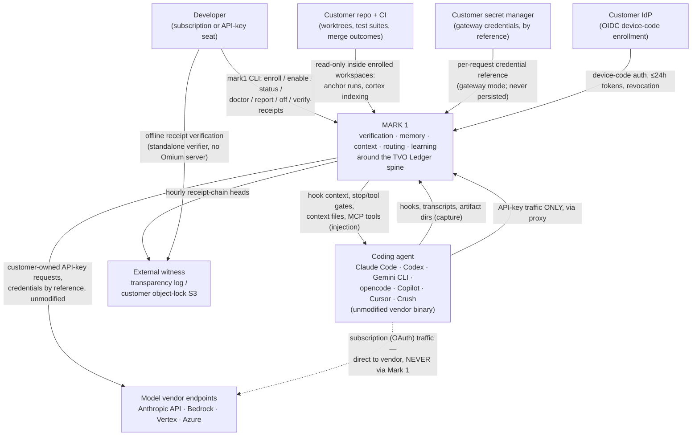
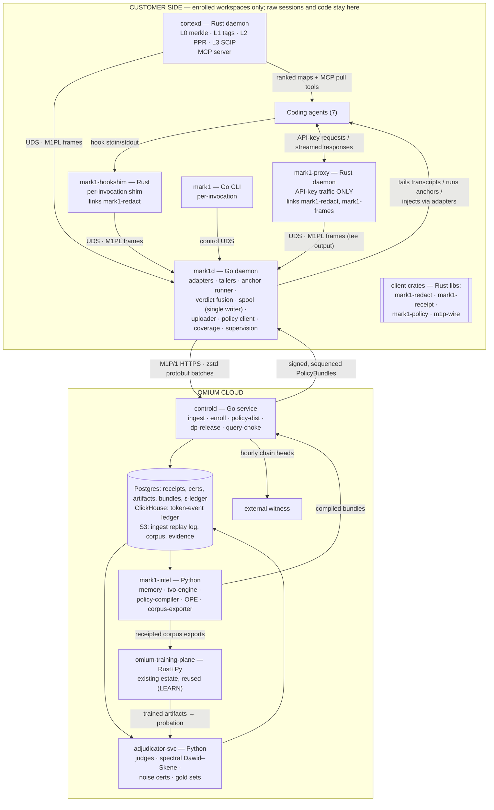
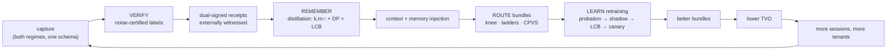
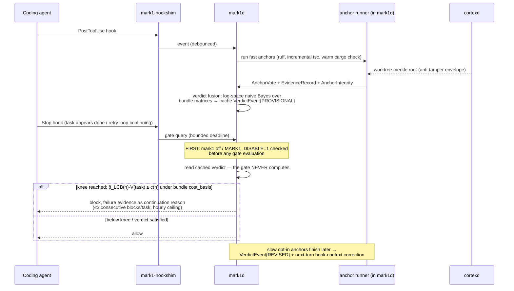
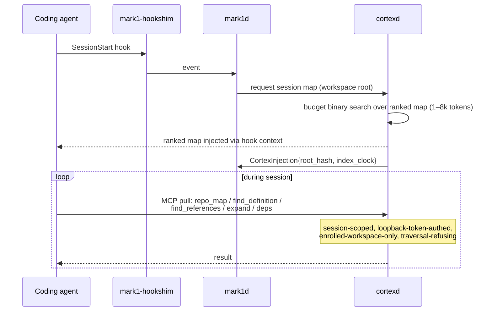
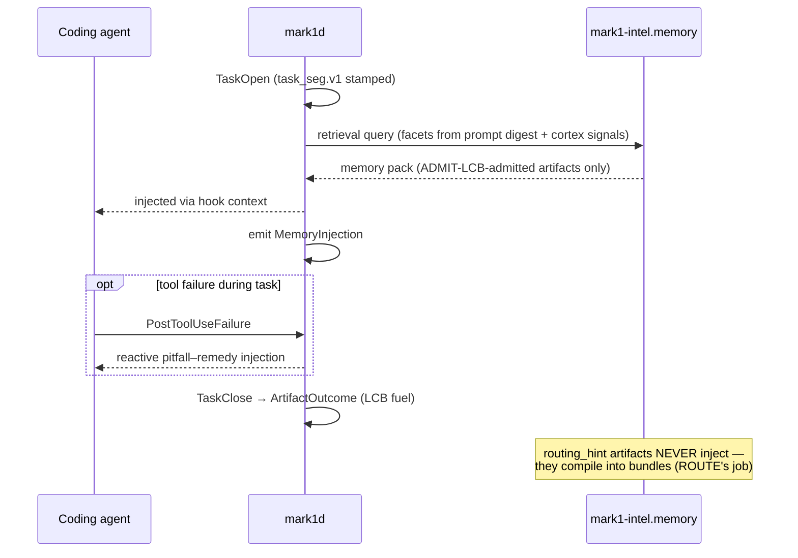
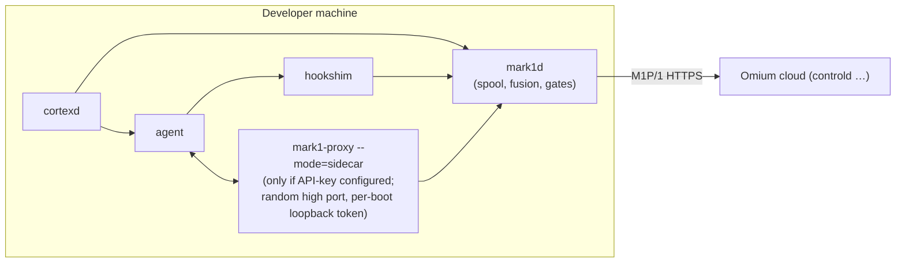
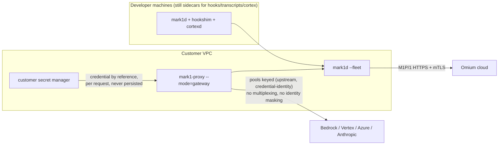
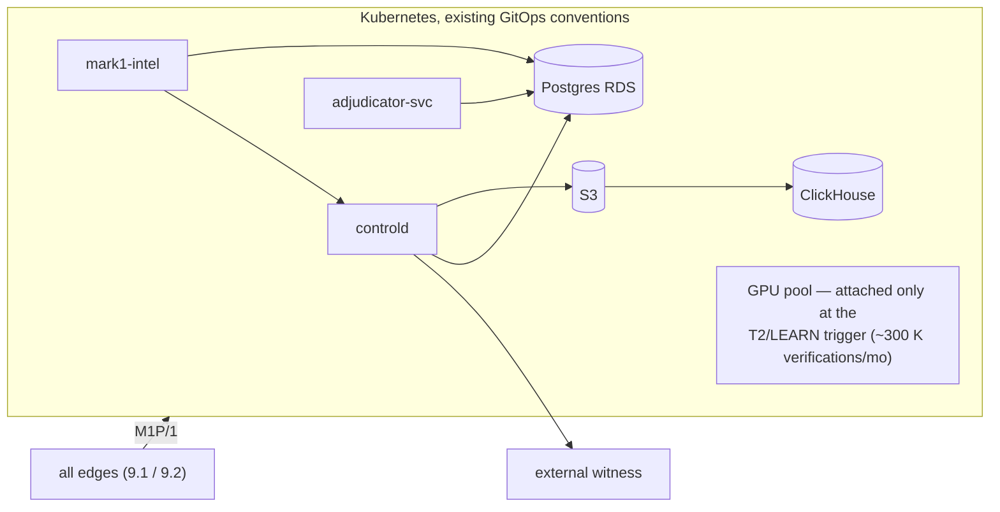

# 03 — High-Level Design

**Status:** Authored 2026-08-28 against the frozen execution plan (`docs/spec/execution-plan-v2.md`) and the authoritative architecture spec v2.0 (`docs/spec/architecture-spec.md`). Where this document and either of those disagree, they win.
**Predecessors assumed:** `01-introduction.md` (all glossary terms — *TVO*, *anchor verifier*, *verdict*, *bundle*, *artifact*, *plane*, *M1P*, *knee governor*, *coverage band*, *cost basis*, *fail-open/fail-static/fail-closed* — are used here exactly as defined there and never redefined) and `02-requirements.md`.
**Audience:** an engineer or architect who needs the system shape — components, responsibilities, boundaries, and flows — before opening an LLD.

---

## 1. Purpose and scope of this document

### 1.1 What this document decides

- The **component boundary map**: which of the 9 deployables and 4 client crates owns which responsibility, and the trust boundary each sits behind (C4 L1/L2, §2–§3).
- The **plane realization**: which components realize VERIFY / REMEMBER / CONTEXTUALIZE / ROUTE / LEARN and the TVO Ledger spine, and what each plane consumes and emits (§4).
- The **structural form of the two legal regimes** — what physically differs between the subscription path and the API-key path, and the per-agent capability matrix with honest verification status (§5–§6).
- The **nine core flows** as sequence diagrams, each with its failure posture (§7).
- **Cross-cutting invariants** — identity/dedupe, the failure-posture matrix applied per component, backpressure, time, coverage-as-product (§8).
- The **three deployment topologies** and the config-not-code invariant that keeps one corpus (§9).
- The **decision record** — every settled architectural choice, its rejected alternatives, and the ADR that fixes it (§10) — plus the top architectural risks (§11).

### 1.2 What this document defers

| Deferred detail | Owner |
|---|---|
| Module trees, key types/traits, concurrency and ownership models, state machines, per-function failure modes | `04-lld-edge.md`, `05-lld-cloud.md`, `06-lld-intelligence.md` |
| Exact `m1p.v1` protobuf definitions, Postgres/ClickHouse DDL, PolicyBundle CBOR schema, spool binary layout, Parquet/KTO corpus schemas | `07-data-model.md` |
| M1P/1 HTTP contract, control-plane REST, MCP tool schemas, per-agent hook contracts, CLI surface, UDS frame protocol, error taxonomy and status codes | `08-api-contracts.md` |
| AWS topology, EKS/RDS/ClickHouse deployment shape, IAM, GitOps wiring, capacity, DR, edge packaging | `09-infrastructure.md` |
| STRIDE per boundary, the OAuth guard control in depth, key ceremony, the compliance control matrix | `10-security-threat-model.md` |

Where a flow below needs a message or endpoint, it is named at the level the plan names it (e.g. "a `Usage` event", "the M1P ingest endpoint"); **field-level contract in `07`/`08`**. This document stops at the component boundary; anything smaller is an LLD's to decide, and an LLD contradicting this shape is the bug.

### 1.3 How to read the diagrams

- Diagrams are **Mermaid**, versioned as text. C4 Level 1 (§2) shows Mark 1 as one system among external actors; C4 Level 2 (§3) opens the box into containers split by the customer-side / cloud-side trust boundary. There is no C4 L3 here — component-internal structure belongs to `04`–`06`.
- Solid arrows are data flows; the label states what moves. Where direction matters legally (the proxy) or cryptographically (receipts), the label says so.
- Sequence diagrams (§7) name components by their canonical registry names and messages by their `m1p.v1` event-family names.
- All terms in *italics* on first use are glossary entries defined in `01-introduction.md` §9; this document does not redefine them.

---

## 2. C4 Level 1 — System context

Mark 1 is one system with two halves (edge, cloud) that the L2 diagram separates; at L1 it is a single box. Every external actor below interacts with Mark 1 on a vendor-sanctioned or customer-owned surface — that property is the legal posture (01 §4) made visible at the outermost level.



The dashed arrow is the load-bearing one: subscription (OAuth) traffic flows from the agent to the vendor **without transiting any Mark 1 component**, ever. Mark 1 sees that regime only through hooks and transcripts — surfaces the vendor ships for the purpose.

| External actor | Nature of interaction | Direction | Trust notes |
|---|---|---|---|
| **Developer** | Operates the `mark1` CLI: enrollment, per-workspace consent, live read-surface inspection (`status`), config-diff inspection (`doctor`), reports, the *`mark1 off`* kill switch, offline receipt verification | Bidirectional | The developer is the consent authority; nothing is captured outside `mark1 enable`d roots, and every off window is a receipted `CoverageTransition` |
| **Coding agent** | Emits hook events and transcript files (capture); receives hook context, gate decisions, context files, and MCP tool results (injection). API-key-configured agents may additionally route requests through the proxy | Bidirectional | The binary is never modified; all integration rides its native extension surfaces via fenced, checksummed config fragments |
| **Model vendor endpoints** | Receive the customer's own API-key requests forwarded bytes-forward by `mark1-proxy`; subscription traffic reaches them directly, untouched | Outbound (API-key regime only) | Credentials pass by reference, unmodified; no multiplexing, no identity masking; the *provenance guard* fail-closes on any credential it did not provision |
| **Customer repo + CI** | Read by `cortexd` (indexing) and the anchor runner (sandboxed, network-denied, read-only outside the worktree) inside enrolled workspaces only; CI/merge outcomes inform `ArtifactOutcome` labels | Inbound (read-only) | `.mark1ignore` honored; raw code never leaves the machine by default — wire evidence is the typed `EvidenceRecord` |
| **Customer secret manager** | Gateway-mode upstream credentials fetched by reference per request | Inbound (reference only) | Never persisted, never logged; `Secret<T>` custody discipline (spec §9.2) |
| **Customer IdP** | OIDC device-code flow at `mark1 enroll`; token refresh and revocation | Bidirectional | Tokens ≤24 h; device key in OS keychain/TPM, 0600 file floor; revocation is fail-closed for secret-bearing deliveries |
| **External witness** | Receives hourly per-tenant receipt-chain heads; serves inclusion/consistency proofs to the offline verifier | Outbound | Deliberately outside Omium's control — it converts "trust Omium" into "verify Omium"; without it the receipt product is decoration |

---

## 3. C4 Level 2 — Containers

Nine deployables plus four client crates (the plan's canonical registry), split across the one trust boundary that matters: customer side vs Omium cloud. The crates are libraries, not processes — they appear because they carry product-critical invariants (redaction, signing, bundle verification, wire framing) that must be identical wherever they are linked.



### 3.1 Container registry

| Container | Responsibility (one sentence) | Lang | Why this language | Talks to | Lifecycle |
|---|---|---|---|---|---|
| **mark1d** | The one long-lived edge daemon: seven agent adapters, workspace-allow-listed transcript tailers, the sandboxed anchor runner, *verdict fusion*, the single-writer *spool*, the M1P uploader, the policy client, coverage accounting, and supervision of the other edge processes | Go | Tailscale/lefthook-shaped daemon work is Go's home turf; putting the spool in the single writer kills the cgo distribution tax; fusion is cheap math and belongs where the gates fire | hookshim/proxy/cortexd (UDS), agents (transcripts, adapters), controld (M1P/1) | Long-lived daemon (per dev machine; `--fleet` supervised in gateway topology) |
| **mark1-proxy** | API-key-only micro-proxy (`--mode=sidecar\|gateway`): bytes-forward hot path, tee-on-clone dialect parsing, inline request redaction, wire-level model rewrite, *provenance guard* in front of everything | Rust | tokio+hyper1+tower+rustls; linkerd2-proxy proves the ≤1 ms / 15–30 MB budget; Pingora rejected (§10) | agents (loopback/gateway listener), vendor endpoints (upstream), mark1d (UDS tee) | Long-lived daemon |
| **mark1-hookshim** | One static binary registered into every agent's hook config; translates per-agent hook JSON to M1P events using field maps shipped **as bundle data**; stamps UUIDv7+seq; links `mark1-redact` so even emergency spill is sanitized | Rust | Static single binary with millisecond cold start — it runs once per hook fire under a 50 ms fire-and-forget / bounded-gate deadline | agents (stdin/stdout), mark1d (UDS) | **Per-invocation shim** |
| **cortexd** | Per-workspace repo intelligence — L0 BLAKE3 merkle, L1 tree-sitter tags, L2 petgraph+PPR symbol graph, L3 opportunistic SCIP — pushed as budgeted ranked maps and served as scoped MCP pull tools | Rust | Vendored tree-sitter, petgraph, and redb are Rust-native; the indexing hot loop is CPU-bound; the L0 root hash double-serves anchor anti-tamper | agents (maps/MCP), mark1d (UDS events), local redb/SQLite CAS | Long-lived daemon, session-scoped serving |
| **mark1** (CLI) | Human control surface: `enroll`, `enable`, `status`, `doctor`, `report`, `off` (uncircumventable), `verify-receipts` | Go | Shares identity/config/spool client code with mark1d; single toolchain for the Go edge | mark1d (control UDS), controld (enroll), witness (verify) | Per-invocation |
| **controld** | The one cloud control-plane binary, five modules: **ingest** (S3-first, token-stamped tenancy, pre-egress scanner), **enroll** (OIDC device-code, revocation), **policy-dist** (poll+push, ACK ledger, transparency-log publisher), **dp-release** (ε ledger), **query-choke** (the only ClickHouse principal) | Go | Same consolidation logic as mark1d — one binary, five modules beats five services at pilot scale; Go is the estate's existing service language for this shape | edges (M1P/1, bundle distribution), Postgres, ClickHouse, S3, witness, IdP | Long-lived service (Kubernetes) |
| **adjudicator-svc** | Judge orchestration (client-side-first), spectral Dawid–Skene behind the *identifiability gate*, verdict certification, *noise certificates*, gold-set management | Python | EM/spectral estimation is dense numpy matmuls (~500 LoC); platform service conventions (FastAPI, asyncpg) reused verbatim | Postgres, ClickHouse (via query-choke), model APIs (cloud-judge path, consent-gated) | Request-scoped service + batch re-adjudication jobs |
| **mark1-intel** | One service, five job modules: memory (extraction/admission/retrieval), tvo-engine (metric + waste taxonomy), policy-compiler (→ signed bundles), OPE (DR/SNIPS over `WIRE_ENFORCED`), corpus-exporter (receipted exports) | Python | Analytics/ML-adjacent batch work; embedded DuckDB for heavy batch; same platform conventions | Postgres, query-choke, S3, controld.policy-dist, training plane | Batch jobs + request-scoped APIs (memory retrieval) |
| **omium-training-plane** | Existing estate, reused: data-refinery gains a `mark1-parquet` source; KTO/QLoRA trainer; outputs re-enter only via probation → shadow → LCB promotion → canary | Rust+Py | Reuse, not rebuild — the corpus is the input this plane was built for | S3 corpus exports, adjudicator-svc (promotion) | Batch (GPU pool attached at the T2/LEARN trigger) |
| **mark1-redact** (crate) | Two-axis secret scanner — mutate-in-transit (default off) and admit-to-upload (**fail-closed, no off switch**) — linked by both proxy and shim so no capture path escapes it | Rust | rust/regex ≈100 MB/s worst case = 100× stream headroom; one implementation, two hosts | linked into mark1-proxy, mark1-hookshim | Library (inherits host lifecycle) |
| **mark1-receipt** (crate) | Vendored Ed25519 chain primitives with `key_id`/rotation — one signing discipline product-wide | Rust | Cryptographic invariants must not fork per language; Go/Python carry conformance-vector-validated counterparts | linked into mark1d path (device origin signing), verifier | Library |
| **mark1-policy** (crate) | Bundle verify (signature + monotonic seq + transparency-log inclusion proof) + decode into typed nanosecond-eval structs; any command string fails decode | Rust | Decode-time rejection is the anti-RCE control — it belongs in one audited crate | linked into edge bundle consumers | Library |
| **m1p-wire** (crate) | prost codegen for `m1p.v1` + M1PL framing (bounded `len`, fuzzed decoder) | Rust | One wire implementation for every Rust writer; Go carries a parallel decoder validated by shared conformance vectors | linked into shim, proxy, cortexd | Library |

`mark1-frames` (the per-dialect SSE/eventstream parsers) is an internal crate of `mark1-proxy`, independently versioned per dialect; it is not in the client-crate registry because nothing outside the proxy links it. Module-level structure of every container: `04`–`06`.

---

## 4. The five planes and the spine

A *plane* is a functional subsystem; a container is a process. The mapping is many-to-many by design — `mark1d` hosts pieces of three planes because the gates must fire where the latency budget lives, not where the org chart would put them.

### 4.1 VERIFY

- **Does:** catches failure before the human re-prompts; arrests retry loops at the knee; manufactures calibrated four-verdict labels (`satisfied | violated | refused | error`) with self-certified noise rates.
- **Realized by:** `mark1d` (anchor runner, anti-tamper envelope, verdict fusion, the stop-gate's cache read), `adjudicator-svc` (judges, spectral Dawid–Skene, certification, gold sets), bundle `verify` sections (confusion matrices, priors, correlation groups).
- **Consumes:** anchor votes with `EvidenceRecord`s, judge/RM/consistency votes, cortexd's merkle roots (anti-tamper), gold-set outcomes.
- **Emits:** `AnchorVote`, `JudgeVote`, `VerdictEvent{PROVISIONAL|CERTIFIED|REVISED}`, *noise certificates*.
- **Switched off:** Mark 1 degrades to a metering product — TVO still computes but its outcome labels vanish, so there is no stop-gate, no certified corpus, no memory admission, and no LEARN fuel. The moat stops accruing; the meter keeps running.

### 4.2 REMEMBER

- **Does:** distills certified sessions into typed experience *artifacts* (workflow templates, pitfall–remedy pairs, invariants, routing hints) so the agent stops re-deriving yesterday; federates cross-org only behind (k,m)-intersection + DP + ADMIT-LCB.
- **Realized by:** `mark1-intel.memory` (extraction, admission, retrieval), `controld.dp-release` (federation release + ε ledger), `mark1d` (injection delivery at TaskOpen and on tool failure).
- **Consumes:** certified verdicts (uncertified verdicts structurally cannot gate extraction), `ArtifactOutcome` joins (LCB fuel), prompt-digest facets, cortex signals.
- **Emits:** `MemoryInjection`, `ArtifactOutcome`, per-event admission receipts, DP releases debited against the ε ledger.
- **Switched off:** exploration waste (leak #2) returns in full; each session re-greps the same repo facts. TVO reports still work; the cross-session compounding claim dies.

### 4.3 CONTEXTUALIZE

- **Does:** replaces live re-exploration with precomputed repo intelligence — budgeted ranked maps at session start, scoped MCP pull tools on demand.
- **Realized by:** `cortexd` entirely (L0 merkle / L1 tags / L2 PPR graph / L3 SCIP), with `mark1d` supervising it and carrying its events.
- **Consumes:** the enrolled worktree (read-only, `.mark1ignore`-honoring), the live recent-edit set from capture (the signal aider never had).
- **Emits:** ranked maps and MCP tool results toward the agent; `CortexInjection{root_hash, index_clock}` and localization-hit events toward the ledger; merkle roots toward VERIFY's anti-tamper.
- **Switched off:** the agent works, sessions cost more (re-exploration tokens return), and VERIFY loses its cheapest anti-tamper substrate — anchors fall back to slower whole-tree hashing. Uplift is measured per tenant via verdict joins, so a switched-off cortex is visible in the ledger, not hidden.

### 4.4 ROUTE

- **Does:** right model per step (cost-per-verified-success tables, escalation ladders under the prefix principle), stop-at-the-knee governance, all evaluated at the edge in nanoseconds.
- **Realized by:** `mark1-intel.policy-compiler` (compiles ledger evidence into signed bundles), `controld.policy-dist` (distribution, ACK ledger, transparency log), `mark1-policy` crate (verify+decode), `mark1d` (the single choice point; gate enforcement), `mark1-proxy` (wire-level model rewrite — the only `WIRE_ENFORCED` fidelity source).
- **Consumes:** the ledger's TVO/knee evidence, bundle sections, `cost_basis` per tenant.
- **Emits:** `RouteDecision{propensity, fidelity}` from the first routed request, `GuardDecision` samples, knee-governor blocks with evidence.
- **Switched off:** misallocation waste (leak #3) and iteration waste past the knee (leak #1) go unattacked; and because OPE consumes only propensity-logged `WIRE_ENFORCED` decisions, every day ROUTE is off is a day the routing corpus — the part of the moat a copier cannot retrofit — does not grow.

### 4.5 LEARN

- **Does:** trains verifiers, rankers, and routers on the outcome-labeled corpus; nothing it produces re-enters except through probation → shadow voting → LCB promotion → canary.
- **Realized by:** `omium-training-plane` (data-refinery `mark1-parquet` source, KTO/QLoRA trainer), `mark1-intel.corpus-exporter` and `.ope` (fuel and evaluation), `adjudicator-svc` (measures the learned member's confusion like any other verifier — no self-promotion).
- **Consumes:** receipted corpus exports (certified-only, tamper-excluded); `WIRE_ENFORCED` decision logs for router training.
- **Emits:** trained artifacts entering the verifier registry at `status='probation'`; eventually better bundles.
- **Switched off:** the system stays static at its hand-tuned ceiling. Everything still works — LEARN is the compounding term, not the availability term. (It is also last in the assembly order for exactly this reason.)

### 4.6 The spine — the TVO Ledger

- **Does:** lands every event from every capture path, deduplicated, in S3→ClickHouse; binds every consequential decision into a dual-signed, externally witnessed receipt chain in Postgres; computes coverage-banded, cost-basis-honest TVO. It is the product artifact, not plumbing.
- **Realized by:** the M1P fabric end to end (`m1p-wire`, spool, uploader, `controld.ingest`), ClickHouse behind `controld.query-choke`, the Postgres receipt chain (`mark1-receipt` + vendored platform primitives), the external witness, `mark1-intel.tvo-engine`, and the standalone offline verifier.
- **Consumes:** everything every plane emits.
- **Emits:** TVO reports with coverage bands and cost bases; `ReceiptCheckpoint`s; witnessed chain heads; the corpus.
- **Switched off:** there is no product. Every plane's output becomes an unverifiable assertion; every claim in 01 §8 becomes unmakeable. This is why the spine is Phase 1 and everything else follows it.

### 4.7 The flywheel — and the condition under which it compounds



**The elasticity condition, stated honestly.** The loop compounds only if it is *supercritical* (Paper III Prop 7.1): the measured per-cycle uplift — admitted-artifact utility × transfer gain × coverage — must exceed the cycle's dilution (artifact staleness, noise-certificate degradation, agent-surface drift). Three things can keep it subcritical, and the architecture admits all three rather than assuming them away: (1) with exploration ε defaulting to 0, routing improvements are learnable only from `WIRE_ENFORCED` volume, which only API-key tenants generate — a subscription-heavy population feeds LEARN slowly; (2) below the (k,m) thresholds, federation publishes nothing, so single-tenant pools compound only against themselves; (3) below the coverage floor and gold-set preconditions, verdicts are `uncertified/bootstrapping` and structurally barred from feeding REMEMBER and LEARN at all. If the condition never fires, Mark 1 remains a linearly-accruing metering + verification product with a per-tenant memory — commercially real, but the compounding moat claim is then false and the ledger will say so. The flywheel is a measured hypothesis, not an assumption.

---

## 5. The two legal regimes, architecturally

01 §4 states the legal facts and the product argument; this section states what is physically different in the built system. The split is **structural, not policy**: no configuration value, bundle section, environment variable, or code path selects "proxy subscription traffic" — the capability is absent from the binary, not disabled in it.

### 5.1 What physically differs

| Physical property | Subscription / OAuth path | Customer API-key path |
|---|---|---|
| **Processes in the request path** | None. Requests go agent → vendor directly; Mark 1 has no network position at all | `mark1-proxy` (sidecar or gateway), and only after the *provenance guard* admits the credential |
| **How Mark 1 sees tokens** | Transcript tailers (deduped by `(message.id, requestId)` + the *sidechain rule*) and hook events, after the fact | `ModelRequest/Response` + `Usage` events teed on-clone from the live wire, plus everything the subscription path has |
| **How Mark 1 influences the session** | Hook context, stop/tool gate decisions, context files, MCP tools — agent-mediated, vendor-sanctioned | All of that **plus** wire-level model rewrite — the only source of `WIRE_ENFORCED` *fidelity* |
| **Credential contact** | Zero. Mark 1 never reads, stores, or forwards an OAuth credential or session token | Customer-owned keys pass through by reference, unmodified; gateway mode fetches from the customer's secret manager per request, never persists |
| **Cost basis** | `quota` (rate-limit-window fraction × wall-clock shadow price) | `usd` (token prices + verifier spend) |
| **Failure posture of the boundary itself** | Not applicable — there is no boundary component to fail | **Fail-closed**: unknown credential ⇒ 403; guard uncertainty ⇒ refuse |

Both paths emit the same `m1p.v1` event schema into the same ledger — one corpus, one report product (01 §4.2).

### 5.2 Capability matrix per regime

| Capability | Subscription / OAuth | Customer API key |
|---|---|---|
| Capture — hooks, transcript tails, artifact dirs | Yes | Yes |
| Capture — wire tee (`ModelRequest/Response`) | **Never** | Yes |
| Injection — hook context, stop/tool gates, context files, MCP | Yes | Yes |
| Injection — wire-level model rewrite | **Never** | Yes |
| Proxy in the request path | **Never** | Yes |

### 5.3 The provenance-gated refusal design

The guard is an allow-list over credential **provenance**, not an inspection of credential **shape**:

1. `mark1d` detects each configured credential at provisioning time; only a credential whose detection result is `apikey` is provisioned into the proxy, HMAC-fingerprint-matched to enrollment.
2. The proxy forwards only requests bearing an `M1-Cred-Ref` naming a provisioned credential. Anything else — including a perfectly valid-looking API key it was never told about — gets 403. **No override path exists in the binary**: no flag, no env var, no bundle section can widen admission, and bundle `gates` sections may only move closed→open for availability gates, never for the guard.
3. Shape inspection is retained but **demoted to a secondary tripwire**: an upstream response carrying subscription markers triggers session kill, config rollback, and a receipted `oauth_contamination` P0. A weekly token-shape canary fails CI on a classifier miss.
4. Sampled `GuardDecision`s are receipted — refusal is *provable to hostile reviewers*, not asserted (this is the auditable artifact 01 §4.3 promises).

WHY structural: configuration is falsifiable by accident, and the blast radius of one accident is the customer's vendor account; a capability that does not exist cannot be misconfigured into existing. Detail of the guard's construction and its tests: `10` and `12`.

---

## 6. Per-agent capability matrix

Seven agents, six capabilities, two regimes. Markers: **verified** — a grounding artifact exists today (estate scan, adversarially verified research finding, or a documented surface the plan builds on without a gating spike); **unverified — [spike]** — the plan gates this adapter slot on a named go/no-go spike, and the cell stays unverified until that spike's artifact exists; **n/a** — structurally inapplicable. **No cell below may be upgraded to verified except by the named spike's artifact.** The wire-proxy and model-rewrite columns are API-key regime only for every agent (§5.2 — this is the structural split, so it needs no per-agent restatement); all other columns behave identically in both regimes.

| Agent | Capture: hooks | Capture: transcript/usage | Injection: stop/tool gates | Injection: context/MCP | Wire proxy (API-key only) | Model rewrite (API-key only) |
|---|---|---|---|---|---|---|
| **Claude Code** (Phase 1) | verified — reference hook vocabulary; fixtures pinned per version | verified — 2026-08-28 estate scan confirmed on-disk transcript shape (`message.id`, `requestId`, full `usage` block) | verified — hook decision surface; stop-gate is the Phase 2 build target | verified — hook context, context files, MCP | verified — `ANTHROPIC_BASE_URL` interception proven at scale by existing open-source routers (adversarially verified, 01 §4.1) | verified — same wire surface; Anthropic dialect is the first `mark1-frames` target |
| **Codex** (Phase 2) | verified — ~80% vocabulary overlap with Claude Code (R6 §0.1 research finding) | **unverified — spike: Codex `TokenCountEvent`** (named in the frozen plan; gates the adapter slot) | unverified — closed by the Codex adapter go/no-go artifact | unverified — closed by the Codex adapter go/no-go artifact | unverified — spike: openai-responses/chat dialect golden transcripts | unverified — same dialect spike |
| **Gemini CLI** (Phase 3) | **unverified — spike: Gemini `BeforeModel` in OAuth mode** (named in the frozen plan) | unverified — closed by the same spike | unverified — closed by the same spike | unverified — closed by the same spike | unverified — spike: gemini dialect golden transcripts; Vertex dialect lands Phase 5 | unverified — plan targets `BeforeModel` routing; wire rewrite gated on the dialect spike |
| **opencode** (Phase 4) | unverified — spike: opencode adapter go/no-go (slot exists; spike not yet scheduled) | unverified — same spike | unverified — same spike | unverified — same spike | unverified — dialect coverage via existing frames; go/no-go per credential surface | unverified — same |
| **Copilot** (Phase 5) | unverified — closed by the Copilot adapter go/no-go artifact | **unverified — spike: Copilot `events.jsonl` usage** (named in the frozen plan) | unverified — same adapter artifact | unverified — same adapter artifact | unverified — spike: Copilot BYOK provenance detection (BYOK is the plan's Phase 5 entry) | unverified — same BYOK spike |
| **Cursor** (Phase 5) | unverified — spike: Cursor observe/gate adapter go/no-go (plan scopes Cursor to observe/gate) | unverified — same spike | unverified — same spike | unverified — same spike | unverified — spike: Cursor BYOK surface survey (subscription-routed traffic transits Cursor's backend and is out of reach regardless) | unverified — same |
| **Crush** (post-Phase-5 slot) | unverified — spike: Crush adapter go/no-go (nothing verified anywhere yet) | unverified — same | unverified — same | unverified — same | unverified — same | unverified — same |

Two structural notes. First, adapter risk is bounded by design: per-agent field maps and tailer parser rules ship as **bundle data** (`agent_maps` section), so a verified cell that an agent's release breaks degrades to `Dropped{unsupported_agent_version}` and is repaired by a bundle push, not a binary release. Second, the matrix is deliberately conservative — the honest cost of the plan's "spike-gated roadmap slots" rule is that six of seven agents are majority-unverified today, and the delivery plan (`14`) schedules the spikes accordingly.

---

## 7. Core flows

Nine flows, one sequence diagram each, each closing with *what can go wrong and what posture applies*. Message names are `m1p.v1` event families; field-level contract in `07`/`08`.

### 7.a Subscription-mode capture — hook → shim → mark1d → spool → uploader → ingest

```mermaid
sequenceDiagram
    participant AG as Coding agent
    participant SH as mark1-hookshim
    participant D as mark1d
    participant SP as spool (in mark1d)
    participant CT as controld.ingest
    participant ST as S3 → ClickHouse

    AG->>SH: hook fires (JSON on stdin)
    Note over SH: field map from bundle data<br/>stamp UUIDv7 + seq<br/>mark1-redact pass
    SH->>D: M1PL frame over UDS (≤50 ms fire-and-forget)
    par transcript path
        AG-->>D: tailer reads transcript JSONL
        Note over D: dedupe (message.id, requestId)<br/>+ sidechain rule → Usage event
    end
    D->>D: admit-to-upload redaction (fail-closed)
    D->>SP: append (single writer; crc32c; fsync 250–500 ms)
    D->>CT: POST M1P ingest endpoint (zstd protobuf batch, bearer device token)
    CT->>ST: land in S3 first, then ack; async-insert to ClickHouse
    CT-->>D: ack → whole-segment delete
```

**What can go wrong / posture.** Shim missing or timing out ⇒ the agent proceeds untouched (**fail-open** for availability; the hook deadline is bounded by construction). Spool full ⇒ billing-grade classes (`Usage`, verdicts, `ReceiptCheckpoint`) block admission until drained, diagnostics drop-newest; every shed emits `Dropped{}` — loss is accounted, never silent. Ingest unreachable ⇒ retry with backoff+jitter then park; 4xx ⇒ quarantine-and-report. A secret detected at admission ⇒ span becomes `⟨redacted:class:hash⟩` before the spool ever sees it (**fail-closed**, no off switch); controld's independent second scanner quarantines anything that slips.

### 7.b API-key-mode proxied request — guard, tee, frames

```mermaid
sequenceDiagram
    participant AG as Coding agent
    participant PX as mark1-proxy
    participant UP as Vendor upstream
    participant FR as mark1-frames (in-proxy)
    participant D as mark1d

    AG->>PX: request with M1-Cred-Ref
    PX->>PX: provenance guard: credential provisioned<br/>after Detect()==apikey? HMAC match?
    alt unknown credential
        PX-->>AG: 403 (no override path exists)
    else admitted
        PX->>PX: inline request redaction; model rewrite per bundle
        PX->>UP: bytes-forward (customer credential by reference, unmodified)
        UP-->>PX: streamed response
        PX-->>AG: bytes-forward (client write never held)
        PX->>FR: tee-on-clone (explicit field allow-list, never a request clone)
        FR->>D: ModelRequest/Response + Usage over UDS
        Note over PX: subscription marker in response?<br/>tripwire: kill session, roll back config,<br/>receipted oauth_contamination P0
    end
```

**What can go wrong / posture.** Guard uncertainty ⇒ 403 (**fail-closed** — legality). Upstream stall, mid-stream reset, slow client ⇒ passthrough semantics preserved; the tee is structurally unable to hold the client write, so parsing failure costs capture fidelity, never the stream. Proxy crash ⇒ automatic receipted bypass; capture degrades to the transcript path (**fail-open** — no Mark 1 component may be a single point of failure for the customer's ability to code). Model rewrite only ever applies a bundle-verified table (**fail-static** if the bundle is stale).

### 7.c Anchor run → verdict fusion → cached verdict → stop-gate at the knee



**What can go wrong / posture.** No cached verdict, stale cache, or gate deadline exceeded ⇒ allow (**fail-open** — availability beats governance). Tamper detected (mutated worktree, PATH-shimmed binary, suppression directive) ⇒ vote flagged `tamper`, excluded from fusion, receipted. Bundle expired past `max_age` ⇒ conservative built-in defaults: knee=1, gates open, verdicts flagged `stale_cert` (**fail-static**). The hard caps and the pre-gate kill-switch check are local and bundle-independent — no bundle can raise them.

### 7.d Cortex session-start map and MCP pull



**What can go wrong / posture.** cortexd down or index cold ⇒ no map, agent proceeds (**fail-open**); the miss is visible in the ledger as absent `CortexInjection`s, so uplift accounting stays honest. Stale index ⇒ `root_hash`/`index_clock` let every consumer detect it; anchors fall back to their own hashing. An MCP call escaping the workspace ⇒ refused by construction (path traversal rejection is in the tool layer, not a policy).

### 7.e Memory retrieval and injection



**What can go wrong / posture.** `mark1-intel` unreachable ⇒ no injection, session proceeds (**fail-open**); locally cached packs may serve if fresh. A secret-bearing or artifact delivery re-checks device revocation first (**fail-closed** — the one exception inside an otherwise fail-static policy plane). Uncertified verdicts structurally cannot have fed extraction, so a degraded VERIFY plane starves REMEMBER rather than poisoning it. Every delivery is a `MemoryInjection` event — injections that helped or hurt are attributable through verdict joins.

### 7.f Policy bundle publication → distribution → verification → ACK → fail-static fallback

```mermaid
sequenceDiagram
    participant PC as mark1-intel.policy-compiler
    participant PD as controld.policy-dist
    participant TL as transparency log
    participant MP as mark1-policy (crate, at edge)
    participant D as mark1d

    PC->>PC: compile CPVS/knee/ladders/agent_maps →<br/>canonical CBOR, monotonic seq per (tenant, channel)
    PC->>PD: signed bundle (section-split KMS keys)
    PD->>TL: publish inclusion entry
    PD-->>D: Etag poll / SSE push
    D->>MP: verify: signature + monotonic seq + inclusion proof
    alt all three pass
        MP-->>D: typed eval structs (any command string fails decode)
        D->>D: apply; persist last-known-good
        D->>PD: ACK (seq, hash) → ACK ledger
        Note over PD: canary cohort widens only on<br/>ACK evidence + ledger-observed TVO
    else any check fails
        D->>D: keep last-known-good (fail-static); receipt the rejection
    end
```

**What can go wrong / posture.** Control plane vanishes ⇒ edges run last-known-good indefinitely; past `max_age` ⇒ conservative built-in defaults (single-rung ladder, knee=1, detect-only redaction, gates open, `stale_cert` flags) — **fail-static** end to end, with one carve-out: memory-artifact and secret-bearing deliveries re-check revocation, **fail-closed**. A compromised control plane serving one victim a different bundle ⇒ the inclusion-proof check makes the divergence detectable at the edge (WHY the transparency log exists). Rollback is the previous content republished under a *higher* seq — seq never moves backwards, so a replayed old bundle fails the monotonicity check.

### 7.g Receipt checkpoint → chain append → external witness → offline verification

```mermaid
sequenceDiagram
    participant D as mark1d
    participant CT as controld
    participant PG as Postgres receipt chain
    participant W as external witness
    participant CU as Customer (standalone verifier)

    D->>D: batch N events / T seconds → Merkle root
    D->>D: sign origin tuple with device key
    D->>CT: ReceiptCheckpoint (device-signed)
    CT->>CT: countersign (server chain key, key_id'd)
    CT->>PG: append — per-tenant gap-free seq, locked head row
    Note over PG: events carry checkpoint_seq + inclusion_path;<br/>per-event receipts only for noise certs, memory admissions,<br/>bundle publications, corpus exports, coverage transitions,<br/>guard contamination
    CT->>W: hourly per-tenant chain heads
    CU->>W: fetch witnessed heads (Omium not in the loop)
    CU->>CU: run open-source verifier offline:<br/>chain integrity + dual signatures + inclusion paths
```

**What can go wrong / posture.** Server unreachable ⇒ checkpoints are billing-grade spool class, block-on-full, drained on reconnect — the chain gets gaps in *time*, never in *sequence*. Omium attempting to rewrite history ⇒ dual signatures mean forging requires both the device key and the server key, and the witnessed heads pin the chain externally — the verifier reports the exact defect and the intact prefix. Witness outage ⇒ heads queue; verification degrades to "chain-consistent, not yet witnessed", stated as such. This flow is **fail-closed on integrity**: a checkpoint that cannot be signed correctly is not emitted at all.

### 7.h Corpus export → training-plane hand-off

```mermaid
sequenceDiagram
    participant CE as mark1-intel.corpus-exporter
    participant PG as Postgres (certs, receipts)
    participant S3 as S3 (per-tenant prefix, KMS)
    participant DR as data-refinery (mark1-parquet source)
    participant TR as KTO/QLoRA trainer
    participant ADJ as adjudicator-svc

    CE->>PG: select: certified-only, tamper-excluded,<br/>label_confidence = f(posterior, noise cert)
    CE->>S3: write receipted export — Parquet (analytics)<br/>+ KTO JSONL+manifest pair (trainer)
    Note over CE: one export receipt covers both forms;<br/>checkpoint lineage recorded (erasure → retrain path)
    S3->>DR: mark1-parquet source reads (per-tenant sets by default)
    DR->>TR: training rows
    TR->>ADJ: trained artifact + eval card →<br/>verifier_registry status='probation'
    ADJ->>ADJ: shadow votes → measured confusion →<br/>LCB promotion → canary
```

**What can go wrong / posture.** Uncertified or tamper-flagged trajectories ⇒ excluded at selection, structurally — a degraded VERIFY plane shrinks the corpus, it cannot poison it. Cross-tenant sets ⇒ **fail-closed on legality**: contractual opt-in + DP-SGD with ledgered ε + contribution caps + a per-tenant canary memorization test as a checkpoint release gate; absent any one, the export is per-tenant only. The trainer consumes the JSONL+manifest pair because Arrow shards carry no label column (grounding delta 1) — `06`/`07` own both schemas. No trained artifact reaches production except through probation → shadow → LCB → canary; LEARN cannot self-promote.

### 7.i Kill switch — `mark1 off` / `MARK1_DISABLE=1` and byte-equal restoration

```mermaid
sequenceDiagram
    participant U as Developer
    participant CLI as mark1 CLI
    participant D as mark1d
    participant AG as Agent config

    U->>CLI: mark1 off   (or exports MARK1_DISABLE=1)
    CLI->>D: off command (control UDS)
    Note over D: the flag is checked BEFORE any gate evaluation —<br/>no bundle, cache, or policy is consulted first
    D->>D: stop gates, anchors, injection; tailers stop reading
    D->>AG: remove fenced, checksummed fragments —<br/>only lines Mark 1 exclusively owns
    D->>D: verify byte-equality snapshot of agent config
    D->>D: emit CoverageTransition{disable} → receipted
    Note over D: spool drains pending billing-grade events;<br/>nothing new is captured
```

**What can go wrong / posture.** None permitted — `off` is **uncircumventable by design**: it is checked before any gate evaluates, it is bundle-independent, and its completeness is verified by byte-equality snapshot of the agent's configuration and behavior (a CI-tested property, per the frozen plan's cross-cutting verification). The cost is honest and accounted: every off window is a receipted `CoverageTransition`, lowers the *coverage band*, and — below the *coverage floor* — costs the tenant guarantee-grade reporting. Mark 1's leverage against being switched off is the report, never friction.

---

## 8. Cross-cutting concerns

### 8.1 Identity and dedupe across three layers

One identity discipline, enforced three times, so at-least-once delivery never double-counts:

| Layer | Key | Enforcement |
|---|---|---|
| Edge (transcript) | `(message.id, requestId)` + the *sidechain rule*; `Usage` carries `idem_key = HMAC_tenant(session_id, message.id, request_id)` | The verified ~2.5× streaming-overcount defense is a **protocol invariant**, not parser etiquette |
| Ingest | UUIDv7 `event_id` idempotent upsert | Replayed batches (S3-first replay log, retries) collapse to one row |
| ClickHouse | `ReplacingMergeTree` on `event_id` | Merge-time convergence even if an upsert races |

The `event_id` quadruple-serves — server dedupe key, ClickHouse ordering component, spool cursor, receipt-checkpoint leaf — WHY: one identity means the spool's durability guarantee, the wire's idempotency guarantee, and the receipt's inclusion proof are the *same* guarantee, checkable end to end.

### 8.2 The failure-posture matrix, component by component

The normative rule (frozen plan): **fail-open for availability, fail-static for policy, fail-closed for legality and secrets.** Applied:

| Component / function | Failure | Posture |
|---|---|---|
| mark1-hookshim (capture) | missing, crash, deadline | **fail-open** — agent never blocked |
| mark1d gates (stop/tool) | no cached verdict, deadline, daemon down | **fail-open** — allow |
| mark1d spool, billing-grade classes | disk full | **block-on-full** (durability over freshness); shed → `Dropped{}` |
| mark1d spool, diagnostics | disk full | drop-newest, accounted |
| mark1-proxy availability | proxy crash, upstream chaos | **fail-open** — receipted bypass, capture degrades to transcripts |
| mark1-proxy provenance guard | unknown/uncertain credential | **fail-closed** — 403, no override |
| mark1-redact admit-to-upload | any detection | **fail-closed** — no off switch exists |
| mark1-policy bundle intake | bad signature/seq/proof, control plane gone | **fail-static** — last-known-good; conservative defaults past `max_age` |
| memory/secret-bearing delivery | revocation state unknown | **fail-closed** |
| controld.ingest | pre-egress scanner hit | **fail-closed** — quarantine + tenant alert |
| controld.enroll / revocation | IdP unreachable at token refresh | **fail-closed** for new grants; existing capture fail-open until token expiry |
| adjudicator certification | gold set stale, identifiability gate unmet | **fail-honest** — status `uncertified/bootstrapping`; downstream gates (memory, corpus) treat it as closed |
| guarantee-grade reports | coverage below floor | **refused**, not caveated |
| `mark1 off` | — | absolute; checked before every gate |

### 8.3 Backpressure and load shedding

Pressure is absorbed edge-out, never reflected into the agent: hook deadlines are bounded (50 ms fire-and-forget observers, bounded gate deadlines); the spool absorbs uplink outages up to ~2 GiB with a 95%-disk hard stop; the uploader retries only on network/5xx/429 with exponential backoff + full jitter (base 6 s, cap 30 min, ~10 attempts) then parks; the server signals per-category rate limits which the edge honors per class. Cloud-side, S3-first ingest means the ack is a durability statement, and ClickHouse `async_insert` absorbs bursts without a broker (the no-bus-at-pilot decision, §10). Anchors are activity-aware and resource-capped so verification never competes with the developer's build. Every shed anywhere emits `Dropped{reason, durability_class, quantity}` — backpressure is *visible in the product* (§8.5), not an ops secret.

### 8.4 Time and clock skew

Dev clocks drift, so **nothing correctness-critical trusts a client wall clock**: causal order within a session rides the **pair `(session_epoch, seq)`** — `seq` is a per-session counter living in `mark1d`'s memory, so it restarts at 1 when the daemon does, and the boot epoch is what keeps a restart from inverting order (07 §2, normative); cross-event identity rides UUIDv7 with an RFC 9562 Method-1 counter per daemon (monotonic even under clock regression); batches carry `sent_at` and the server computes and records skew rather than correcting it silently. Receipt-chain ordering is the Postgres per-tenant gap-free sequence — server-side, transactional. ClickHouse's `toDate(occurred_at)` ordering component tolerates skew because dedupe never depends on time, only on `event_id`. Knee/TVO wall-clock terms (`quota` shadow price) use durations, not absolute stamps. Witness anchoring is hourly by *server* clock; the offline verifier checks chain consistency, not timestamps.

### 8.5 Coverage as first-class product data

The coverage metric is not observability garnish — it is a term in every number the product emits. `CoverageTransition` events (enable/disable/bypass, receipted per §7.i) and `Dropped{}` accounting compose into the *coverage band* attached to every TVO figure; guarantee-grade reports are **refused below the coverage floor**. Architecturally this means the accounting path shares the **receipt chain** — every `CoverageTransition` is per-event receipted, so an enable/disable/bypass window is attributable and non-repudiable, because a TVO number whose denominator's observability is itself unverifiable would be exactly the kind of claim 01 §8 forbids. It does **not** share the billing-grade spool class: the billing-grade set is closed at exactly `{usage, verdict_event, receipt_checkpoint}` (07 §6) and `CoverageTransition` is diagnostic — spool class byte 2, drop-newest on a full spool, never blocking a writer. Those are orthogonal axes, and conflating them is a real error: a transition that *blocked* the edge writer would let a coverage record stall the very capture it exists to describe. A dropped transition is not a silent hole either — it emits `Dropped{}` like any other loss, which is precisely how the band widens honestly instead of lying narrow. Self-monitoring of Mark 1's own components rides the same M1P fabric (`11`); there is no second telemetry system.

---

## 9. Deployment topologies

Same binaries, three profiles — **config, not code**. The invariant that justifies the discipline: identical capture semantics in all three ⇒ one trajectory schema ⇒ one corpus. A topology that captured differently would fork the moat.

### 9.1 Dev sidecar (default)



Enrollment: `mark1 enroll` (OIDC device-code, device key in keychain/TPM) then `mark1 enable` **per workspace**; `.mark1ignore` honored; nothing outside enrolled roots is read. Budgets: proxy ≤1 ms median added latency / ≤35 MB RSS; anchors network-denied, env-scrubbed, resource-capped, activity-aware. macOS/Linux/Windows from day one.

### 9.2 VPC gateway (enterprise)



What changes: proxy mode flag, fleet supervision, credential source (referenced from the customer's secret manager), mTLS to the cloud. Bedrock's request path stays observe-only until customer-held re-signing hardens. E1/E2 judge evidence tiers unlock here because evidence stays inside the customer perimeter. The gateway **adds the wire; it does not replace the edge** — hooks, transcripts, and cortex still run on dev machines.

### 9.3 Omium cloud (control plane)



Cloud-only at launch; `deploy/compose/` is internal dev; self-host is a phase-gated enterprise SKU (Phase 6). Topology detail, sizing, and the ClickHouse deployment shape: `09`.

| Delta across topologies | Sidecar | VPC gateway | Notes |
|---|---|---|---|
| Proxy mode | `sidecar` (loopback) | `gateway` (fleet) | one flag |
| Credential source | developer's own env/config | customer secret manager, by reference | never persisted in either |
| Evidence tiers available | E0 (E1 opt-in) | E0/E1/E2 | perimeter, not code, unlocks tiers |
| Supervision | mark1d local | `mark1d --fleet` | same binary |
| Transport hardening | HTTPS + device token | + mTLS | config |
| **Capture semantics & event schema** | **identical** | **identical** | the invariant; one corpus |

---

## 10. Architectural decisions and their alternatives

Settled decisions only — each is frozen by the plan and recorded (or to be recorded) where the last column says. Contesting one means reopening its ADR, not this document.

| Decision | Alternatives considered | Why rejected | Recorded in |
|---|---|---|---|
| **Proprietary M1P fabric** end to end | Any third-party telemetry framework as the token source or transport | A generic telemetry pipeline cannot carry Mark 1's invariants natively — billing-grade idempotency (`idem_key`), receipt-checkpoint leaves, per-class spool durability, provenance-gated legality events; bolting those on yields two schemas and a translation layer that is itself a fidelity risk. The founder directive (plan v2 context) makes this explicit | **ADR-0005** (why M1P exists) |
| **Rust proxy on tokio+hyper1+tower+rustls** | Cloudflare Pingora; River; Go proxy | Pingora: pre-1.0, no tier-1 Windows, CVE-2025-4366; River stalled. Go: GC jitter risks the ≤1 ms median budget that linkerd2-proxy proves attainable in Rust | **ADR-0006** (language boundaries) + spec §2 registry evidence |
| **Graph-guided localization (tree-sitter + petgraph PPR) over embeddings** in cortexd | Embedding retrieval; stack-graphs; mtime-based invalidation | Embeddings lose 77.4 vs 58.8 Acc@10 (LocAgent); stack-graphs is archived; mtime races. BLAKE3 content hashing additionally double-serves anchor anti-tamper — one table, two planes | spec §2 (cortexd row); no separate ADR — research-settled, cited in `04` |
| **No event bus at pilot** | NATS JetStream / Kafka from day one | `async_insert=1, wait_for_async_insert=1` + S3-first landing gives durability and replay without a broker; a bus with one consumer is pure operational tax. Trigger is explicit: the *second independent* ledger consumer. The estate's existing MSK is evaluated before NATS when it fires | bus-introduction ADR, authored with `09` (grounding delta 3) |
| **Postgres for the receipt chain, ClickHouse for the ledger** | One store for both (all-CH or all-PG); Qdrant for vectors | Chain integrity needs transactional, gap-free, read-your-writes ordering — ClickHouse structurally cannot provide it; PG cannot serve the event-volume analytics economically. Qdrant rejected: a second stateful system for a 90%-relational 10⁴–10⁶-row workload (one pgvector column suffices) | **ADR-0001** (CH ordering key — the one irreversible decision, signed before first production write) + spec §5 |
| **Verdict fusion at the edge, in mark1d** | Fusion in the cloud (adjudicator computes, edge polls) | The stop-gate has a bounded hook deadline; a cloud round-trip inside it fails the deadline or the availability posture. Fusion is cheap math (log-space naive Bayes over bundle-shipped matrices) — it belongs where the gates fire; the cloud still owns *certification* (C5), so calibration authority is not decentralized | spec §4 C3 / C1.14; concurrency detail in `04` |
| **Spool in Go inside mark1d, single writer** | Shared cgo spool library used by all edge processes | The cgo distribution tax across three Rust writers; single-writer keeps one durability implementation and makes the spool cursor the wire idempotency key | **ADR-0007** (spool durability classes) |
| **task_seg.v1 as a versioned, receipted algorithm** | Heuristic task splitting in the TVO engine | The denominator defines every number ever quoted; an unversioned heuristic makes every TVO figure unauditable retroactively | **ADR-0002** |
| **Deterministic waste taxonomy before any Shapley attribution** | Ship Shapley first | Shapley without a defined game (players, v(S)) is numerology; the taxonomy is deterministic, explainable, and ships in Phase 1 | **ADR-0003** (the Shapley game — precondition for any Shapley code) |
| **Split signing keys, KMS-resident; update key ≠ bundle key; dual-signed receipts** | Single product signing key | One key compromise would collapse policy distribution, release integrity, and receipt trust simultaneously; the witness model requires the server key to be *insufficient* to forge history | **ADR-0004** (key ceremony) |
| **Client-side-first judge execution** | Cloud judges by default | Evidence then never leaves the customer; the cloud path survives as consent-gated fallback with subprocessor disclosure + region pinning | **ADR-0008** |
| **`wasm_module` deleted from v1, not sandboxed** | Signed wasm policy modules with a second HSM key | The bundle→RCE branch is worth more deleted than mitigated; a future `PolicyBundle v2` can reintroduce it behind a differently-held key at one field number of cost | spec §0 (S1-5.4 disposition); enforced by `07`'s schema |
| **Hook field maps and tailer parsers as bundle data** | Compiled per-agent adapters only | Seven agents with monthly surface churn would make every format break a binary release; as data, it is a bundle push | spec §2 (hookshim row) / C1.13; contract in `07` |

---

## 11. Known architectural risks

Ordered by product severity; each names its blast radius and the mitigation already designed in (not aspirational). The full register with owners lives in `14`; the security-specific expansion in `10`.

| # | Risk | Blast radius | Designed-in mitigation |
|---|---|---|---|
| 1 | **Anchor reward-hacking** — the agent (or a hostile user) games the verifiers, poisoning labels | The corpus and every certified claim; the moat is unerasable if poisoned | Effective-execution hashing, env/PATH pinning, suppression-directive tracking, whole-tree merkle + diff classification, `tamper` flags receipted and excluded, anchor-vs-T3 divergence monitored per tenant as an adversarial-ML metric — an evolving defense, not a rule set |
| 2 | **Subscription contamination** — one OAuth-credentialed request transits the proxy | The customer's vendor account; the legal posture; the company | Provenance allow-list (§5.3), tripwire, weekly token-shape canary failing CI, receipted refusals; the binary has no code path that forwards an unprovisioned credential |
| 3 | **Bundle / update supply chain = fleet RCE** | Every enrolled dev machine simultaneously | No server-named commands, no code in v1 bundles (decode-time rejection), split KMS keys, edge-verified transparency-log inclusion proofs, SLSA-attested releases, no default self-update on managed fleets |
| 4 | **Streaming regression** — the proxy visibly degrades the developer's session even once | Trust in the entire wire path; sidecar adoption | Bytes-forward/parse-on-clone invariant, golden-transcript + chaos suites per dialect, tee structurally unable to hold the client write, automatic receipted bypass with capture degrading to transcripts |
| 5 | **Statistically fictional noise certificates** — certifying before the estimator's hypotheses hold | Every "certified" claim; the papers' credibility | Identifiability-gated spectral activation, global estimation + hierarchical shrinkage, size- and freshness-gated gold sets, honest `uncertified/bootstrapping` status that structurally blocks memory and corpus gating |
| 6 | **TVO credibility attack** — a diligence team breaks the denominator, coverage, or cost basis | The metric that *is* the product | Versioned receipted `task_seg`, receipted coverage transitions, dual cost basis never averaged, self-reported loss accounting — the metric ships with its own error bars and an offline verifier |
| 7 | **Agent-surface drift** — seven agents, monthly churn, one format break silences capture | Coverage band, adapter matrix (§6), corpus growth rate | Field maps/parsers as bundle data, runtime version sniffing with `Dropped{unsupported_agent_version}`, spike-gated adapter slots, conformance fixtures per pinned agent version |
| 8 | **Dev-machine UX blowback** — gates or anchors make Mark 1 feel like friction, users run `mark1 off` permanently | Coverage collapses below the floor; the flywheel goes subcritical (§4.7) | Static-only default anchors, activity-aware pausing, hard block caps, fail-open gates, visible kill switch with byte-equal restoration — plus the honest incentive: the report degrades with coverage, and the product says so |
| 9 | **Flywheel subcriticality** — the loop never compounds (ε=0, subscription-heavy population, sub-(k,m) tenancy) | The moat narrative; not availability | Stated as a measured hypothesis (§4.7); per-tenant value (metering, verification, memory) is real independently; `WIRE_ENFORCED` volume, artifact LCBs, and coverage are all ledger-visible leading indicators |
| 10 | **Team-capacity overrun** — nine deployables is still a lot of machine | Delivery schedule; quality of the trust-critical paths | Consolidation enforced in the registry (one edge daemon, two cloud binaries), dependency-ordered assembly where every phase ships a working receipted system, and explicit triggers (NATS, T3, self-host, Shapley) that admit complexity only when its precondition fires |

---

*End of 03. Next in reading order: `04-lld-edge.md` for everything that runs on a customer machine, or `07-data-model.md` / `08-api-contracts.md` for the exact shapes every flow above names.*
