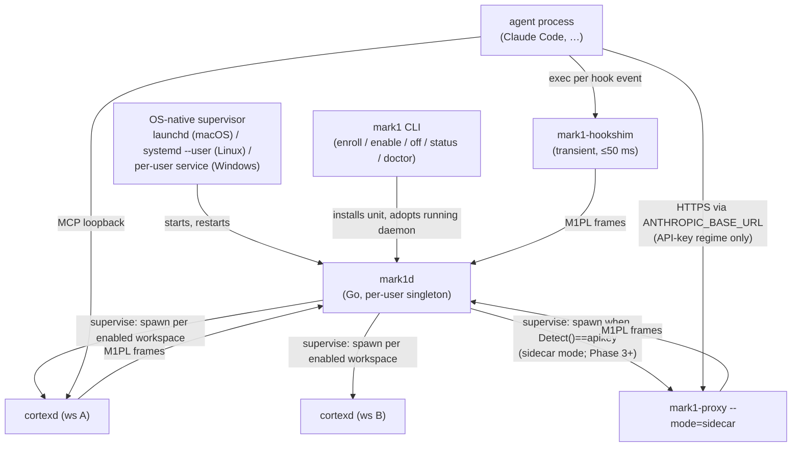

# 04 — Low-Level Design: The Edge

**Status:** Authored 2026-08-28 against the frozen execution plan (`docs/spec/execution-plan-v2.md`) and the architecture spec v2.0 (`docs/spec/architecture-spec.md`). Where this document and either of those disagree, they win.
**Scope:** the four edge processes — `mark1d` (Go), `mark1-proxy` (Rust), `mark1-hookshim` (Rust), `cortexd` (Rust) — the four client crates (`mark1-redact`, `mark1-receipt`, `mark1-policy`, `m1p-wire`) and the proxy-internal crate `mark1-frames`. Cloud internals are 05; intelligence services are 06.
**Code blocks are illustrative design detail**, not compiled code: they fix names, signatures, ownership and semantics; the implementation may differ in mechanics but not in contract.

## 0. Scope, conventions and how to read this

### 0.1 What this document fixes vs what 07 and 08 fix

| Concern | Owner | This document |
|---|---|---|
| `m1p.v1` protobuf, M1PL framing bytes, spool segment binary layout, cross-layer dedupe | **07** (`07-data-model.md`) | Cites; never restates a byte offset |
| M1P/1 HTTP contract, control-plane REST, hook contracts, MCP tool schemas, CLI surface, `M1E-*` error taxonomy, provisioning/fence algorithms | **08** (`08-api-contracts.md`) | Cites; never restates a schema or status table |
| Module trees, exported types/interfaces, goroutine/task/ownership models, state machines, hot-path budgets, backpressure, failure modes and their postures | **this document** | Normative here |

A failure mode named here always carries an existing `M1E-*` code from 08 §9; this document introduces no new codes.

### 0.2 Notation

- **State machines** are Mermaid `stateDiagram-v2`; every transition is labeled `trigger / action`. An unlabeled action means "none beyond the state change".
- **Budgets** are written `value @ enforcement point` — e.g. `≤1 ms median @ proxy self-timer + CI bench threshold (12)`. A budget without an enforcement point is a wish, so none appears here without one.
- **Postures** use the frozen matrix verbatim: **fail-open** for availability (capture, hooks, gates), **fail-static** for policy, **fail-closed** for legality and secrets (OAuth guard, upload admission, revocation).
- Go code follows the estate conventions: `cmd/main.go` + `internal/`, an `obs` package, go 1.25, no OTel. Rust follows the estate build: virtual Cargo workspace, all versions in `[workspace.dependencies]`, release profile `opt-level=2, lto="thin", strip=true`, `rust:1.91-slim-bookworm` builder → `gcr.io/distroless/cc-debian12:nonroot` (glibc, not musl) for anything containerized.

### 0.3 Edge-wide invariants (restated once, relied on everywhere)

1. **`mark1d` is the only spool writer.** Every other producer (shim, proxy, cortexd, tailers, loopback listener) reaches durability only through `mark1d`'s single admission path. One durability implementation, one redaction chokepoint, by construction.
2. **`mark1 off` / `MARK1_DISABLE=1` is checked before any gate evaluation** — before any policy read, bundle read, or verdict-cache read, in every component that gates (shim, `mark1d`, proxy). No bundle, server, or config state can re-enable gating while off (08 §7.6).
3. **Nothing outside an enabled workspace is read.** Tailers, cortexd, and anchors operate only inside `mark1 enable`'d roots, honor `.mark1ignore`, and the live read surface is auditable via `mark1 status`.
4. **Verdict vocabulary is `satisfied | violated | refused | error`**, and `posterior[4]` is ordered exactly that way (07 §4). Infrastructure failure is `error`, never `violated`.
5. **No pre-redaction plaintext persistence exists anywhere.** The admit-to-upload axis is fail-closed with no off switch; even emergency spill is post-redaction.
6. **Zero OpenTelemetry anywhere.** Edge self-observation is the `obs` package, `Dropped{}` accounting, and coverage transitions — product telemetry, not ops noise (11).
7. **Registry discipline:** 9 deployables + 4 client crates per the frozen plan; `mark1-frames` is a proxy-internal crate listed separately. (The spec §2 heading reading "2 crates" is a known spec typo; the plan wins. Likewise the spec §0 C1.7 disposition placing the proxy in "Phase 2 of assembly" is a known spec error: the proxy is built in **Phase 3**, gateway mode in **Phase 5**, per the plan.)

### 0.4 Reconciliation flags found while authoring (for the lead's contradiction pass)

These are disagreements between already-written documents. This document takes the stated side but does not resolve them — resolution belongs to the reconciliation pass.

| # | Disagreement | Sides | Side taken here |
|---|---|---|---|
| R-1 | M1PL frame `len` bound | 07 §5: `len ≤ 4 MiB` (and spool record bound derived from it); 08 §4.2 *as originally written*: `len ≤ 1 MiB` with `HelloAck{max_frame: 1048576}` | **07** — it owns the framing bytes; 08's `max_frame` value follows. **RESOLVED (D-A):** 08 §4.2 now reads `0 < len ≤ M1PL_MAX_FRAME = 4_194_304` and §4.3 `HelloAck{max_frame: M1PL_MAX_FRAME}`. One symbolic constant, one owner; the literal `1048576` survives nowhere but this row's history. Kept, not deleted — a reader arriving from §5.2's pointer needs to learn the bound was contested and how it settled |
| R-2 | Fabric endpoint path/name | 07 §5: `$XDG_RUNTIME_DIR/omium-mark1/m1p.sock` (fallback `~/.omium/mark1/m1p.sock`), Windows `\\.\pipe\omium-mark1-<user-SID>`; 08 §4.1: `~/.omium/mark1/mark1d.sock`, Windows `\\.\pipe\omium-mark1d` | **07** — the SID-qualified pipe name closes a squatting collision 08's name does not |
| R-3 | cortexd MCP tool set | 08 §6: `repo_map / find_definition / find_references / deps / ranked_files / memory_recall`; spec §4 C6: `repo_map/find_definition/find_references/expand/deps` (has `expand`, lacks `ranked_files`/`memory_recall`) | **08** — per instruction; `expand` does not exist in the wire contract |
| R-4 | Who stamps `seq` | plan/spec §2: hookshim "stamps UUIDv7 + seq"; 07 §2: per-session `seq` is "assigned by mark1d at admission" | **07** — one authority for causal order; the shim stamps `event_id` only. A shim-local counter cannot be session-monotonic across the shim's many short-lived processes |

---

## 1. Edge process topology and supervision

### 1.1 Process tree and scoping



**Scoping decisions, with WHY:**

- **`mark1d` is per-machine-per-user, not per-workspace.** One spool, one uplink identity, one device key, one fabric socket, one policy client. Workspaces are *data* (an allow-list the tailers/coverage consult), not processes — a per-workspace daemon would mean N spools with N durability implementations and N device identities, recreating the cgo-era distribution tax in another axis.
- **`cortexd` is per-workspace.** Index size, memory ceilings, and session scoping are per-repo properties; a panic or OOM while indexing one monorepo must not stall another workspace's map serving. The per-workspace process is also what makes MCP session scoping (08 §6) enforceable by construction: the process literally has no other workspace's shards open.
- **`mark1-proxy` sidecar is per-user, spawned on demand** (an API-key-regime agent is enabled), one listener for all API-key agents. In gateway mode the customer deploys and supervises it; `mark1d --fleet` only distributes policy to it.
- **`mark1-hookshim` is not a process to supervise** — it is exec'd by the agent per hook event and exits. Its "restart policy" is the next hook event.

### 1.2 Who starts whom, restart policy

| Process | Started by | Restart policy | Crash-loop breaker |
|---|---|---|---|
| `mark1d` | OS supervisor (installed by `mark1 enroll`); `mark1` CLI adopts a running instance via pidfile + binary-hash check | supervisor-native: `KeepAlive` / `Restart=on-failure`, supervisor backoff | supervisor-native; additionally `mark1 status` surfaces restart count |
| `cortexd` | `mark1d.supervise` at `mark1 enable` and on session activity in an enabled root | exponential backoff, base 500 ms, ×2, cap 60 s, decorrelated jitter | >5 restarts in 60 s ⇒ child marked `FAILED`, indexing off for that workspace, MCP tools refuse (`M1E-6404`), **capture unaffected** |
| `mark1-proxy` (sidecar) | `mark1d.supervise` when an enabled adapter reports `Detect()==apikey` | same backoff as cortexd | >5/60 s ⇒ `FAILED` + **receipted `CoverageTransition{BYPASS, reason_code:"proxy_failed"}`**, agent base-URL fragment reverted so traffic flows direct — capture degrades to transcripts, the developer is never blocked |
| `mark1-hookshim` | the agent, per hook event | n/a | n/a — a persistently failing shim shows up as missing hook events, surfaced by `mark1 doctor` |

**Crash isolation is directional and deliberate:** capture (tailers, spool, uplink — all inside `mark1d`) depends on nothing else. A `cortexd` panic costs ranked maps and the anchors' merkle-root freshness (anchor votes then carry an incomplete integrity envelope and never certify — §2.3), nothing more. A proxy crash costs wire capture and `WIRE_ENFORCED` routing; the client's next request bypasses (fail-open, receipted). A `mark1d` crash is the only one that pauses capture admission — and the shim's spill ring plus the on-disk transcripts mean the events are not lost, only delayed (§1.4).

### 1.3 Resource ceilings

| Process | Ceiling | Enforced at |
|---|---|---|
| `mark1d` | ≤200 MB RSS steady state @ self-watchdog (obs gauge; >300 MB ⇒ controlled restart with drain); ≤2 GiB spool + 95%-disk hard stop @ spool (07 §6) | self-watchdog + spool policy |
| `mark1-proxy` | **≤35 MB RSS and ≤1 ms median added latency** @ proxy self-timer, `mark1d.supervise` RSS poll, CI bench threshold (12) | the frozen-plan budget, verbatim |
| `cortexd` | ≤500 MB RSS per workspace @ self-watchdog (over ⇒ shed L3 SCIP, then coarsen L2 shards, then refuse with `M1E-6404`); full-index passes at idle priority (§6.6) | self-watchdog |
| `mark1-hookshim` | ≤50 ms wall fire-and-forget, ≤10 ms cold start @ its own deadline timers (§5.3); transient RSS ~5 MB | shim-internal deadlines |
| anchors | per-catalog-entry: CPU-seconds, `memory.max` 512 MiB default, `pids.max`, wall timeout (60 s fast / 600 s slow class) @ sandbox (§2.3) | sandbox, kill-switched |

### 1.4 What happens when — machine sleep, network death, SIGKILL

**Machine sleeps.** All timers are monotonic-clock based, so a wake does not fire a burst of "missed" retries; the uplink treats wake (network-change signal) as a park re-queue trigger (08 §2.5). Tailers re-`stat` their files on wake and resume from persisted cursors. The anchor scheduler treats wake as an activity burst: slow anchors stay deferred until the session idles again. On macOS, launchd may terminate `mark1d` during sleep — indistinguishable from SIGKILL, handled identically (below).

**Network dies.** Capture is untouched (fail-open): tailers, hooks, anchors, fusion, and gates all run local. The spool accumulates; billing-grade classes block-on-full rather than shed (07 §6). The uplink runs the 08 §2.5 automaton to PARKED. Policy is fail-static: last-known-good bundle runs indefinitely; past `max_age`, conservative built-ins with `stale_cert` flagging (`M1E-3006`). Token refresh failure does not stop capture — tokens gate egress only. The one hard dependency on the network is enrollment itself.

**`mark1d` is SIGKILLed.**
- *Spool:* recovery per 07 §6 — A/B ledger slot selection, forward scan, torn-tail truncation; billing-grade loss is bounded by the fsync cadence (250 ms when billing-grade records are pending) and accounted as `Dropped{CRC_LOSS}` in the first batch after restart. Never silent.
- *hookshim:* connect fails in ≤100 ms ⇒ sanitized encrypted spill ring; replayed by `mark1d` after restart (§5.4). Gate queries fail-open to allow with `Dropped{gate_timeout}`.
- *tailers:* transcripts are files on disk; the restart resumes from the persisted cursor, and `idem_key` dedupe makes any re-read harmless (07 §7).
- *proxy:* keeps serving — the client path never depends on `mark1d`. Tee events go to its own spill ring; the guard keeps its last registry snapshot (fail-static for the registry, fail-closed per request: an unprovisioned credential is still refused).
- *cortexd:* keeps running orphaned; the restarted `mark1d` adopts it via pidfile + binary-hash check, or kills and respawns on mismatch. MCP serving continues throughout.
- *Restart:* OS supervisor brings `mark1d` back with supervisor backoff; children are adopted; parked batches re-queue.

**`mark1 off`** is not a failure but is listed for symmetry: off-marker written first, fragments reverted to byte-equality, tailers stopped, proxy detached, cortexd idled, `CoverageTransition{disable}` receipted (08 §7.6). Works with the network down; no server round-trip on the critical path.

---

## 2. `mark1d` (Go) — module tree and internals

```
go/mark1d/
├── cmd/main.go                  # flag parse, config load, obs init, run loop — nothing else
├── adapters/
│   ├── claudecode/              # Phase 1: hooks + transcript tailer + sidechain dedupe
│   ├── codex/                   # Phase 2 (spike-gated)
│   ├── gemini/                  # Phase 3 (spike-gated)
│   ├── opencode/                # Phase 4 (spike-gated)
│   ├── copilot/                 # Phase 5 (spike-gated, BYOK)
│   ├── cursor/                  # Phase 5 (spike-gated, observe/gate)
│   └── crush/                   # roadmap slot; registry completeness only
└── internal/
    ├── capture/                 # the single admission pipeline into the spool
    ├── tailers/                 # workspace-allow-listed transcript tailing
    ├── anchors/                 # catalog, consent, sandboxed runner, anti-tamper
    ├── verdict/                 # log-space NB fusion + the gate-read cache
    ├── spool/                   # 07 §6 made code; the single writer
    ├── uplink/                  # batching, zstd, the 08 §2.5 retry automaton
    ├── policy/                  # bundle fetch/verify/decode (Go parallel decoder), fail-static
    ├── coverage/                # attributable enable/disable/bypass windows
    ├── supervise/               # child lifecycle (§1.2)
    ├── identity/                # device key custody, token refresh, revocation
    ├── fabric/                  # M1PL server (UDS/named pipe) + loopback fallback listener
    └── obs/                     # slog structured logging + atomic counters; no OTel
```

`fabric` is listed beyond the plan's ten-package enumeration because the M1PL server must live somewhere and belongs to none of the ten; it is transport, not policy. Everything else matches the plan's `internal/{capture,tailers,anchors,verdict,spool,uplink,policy,coverage,supervise,identity}` exactly.

### 2.0 `capture` — the single admission pipeline

Every producer converges here; this is what makes invariants 1 and 5 (§0.3) structural.

```go
package capture

// Admitter is the ONLY path to the spool. The constructor is called once in
// cmd/main.go and the write side of the spool is moved into it — no other
// package can obtain a spool write handle.
type Admitter interface {
    // Admit runs: normalize → redact-admit (fail-closed) → seq-stamp →
    // class-tag → spool append. Billing-grade events block under backpressure;
    // diagnostics return ErrShed (accounted, never silent).
    Admit(ctx context.Context, ev *m1pv1.Event) error
}

var ErrShed = errors.New("capture: diagnostic event shed under backpressure")

// redactAdmit is the Go implementation of mark1-redact's admit-to-upload axis:
// same ruleset source, validated bit-identical against the Rust crate by shared
// conformance vectors in CI — the same discipline the plan mandates for the Go
// bundle decoder. There is no parameter, config field, or build tag that
// disables it. Scanner failure ⇒ the event is locally quarantined
// (Dropped{LOCAL_QUARANTINE}), never admitted raw.
func redactAdmit(ev *m1pv1.Event) (admitOutcome, error)
```

Stage order is load-bearing: redaction runs **before** the seq stamp and spool append, so no pre-redaction bytes ever reach disk; `seq` is assigned here (one authority, per R-4) from a per-session atomic counter; the durability class byte (07 §6 `record_id[16]`) is tagged here from the event family so the spool applies full-spool policy without decoding protobuf.

Goroutine model: `Admit` is called on the caller's goroutine (fabric connection readers, tailer goroutines, adapter goroutines); it sends into the spool goroutine's bounded channel (cap 1024). Billing-grade sends block (backpressure propagates to the fabric read loop, which stops reading its socket — 08 §4.4); diagnostic sends use `select`/`default` and shed to `ErrShed`.

### 2.1 `tailers` — transcripts in, Usage out

```go
package tailers

// WorkspaceSet answers "may I read this path?" — the §0.3 invariant 3 oracle.
// Canonicalized enabled roots + .mark1ignore (gitignore syntax, evaluated at
// the workspace root). Consulted on every file DISCOVERY, not just once.
type WorkspaceSet interface {
    Allowed(absPath string) bool
    Roots() []string
}

// Cursor is persisted after every emitted Usage flush (atomic write+rename,
// fsync'd), keyed by file identity — not path — so rotation is detectable.
type Cursor struct {
    Path     string
    FileID   FileID // (dev, inode) on unix; volume+file index on Windows
    Offset   int64  // byte offset of the first unconsumed line
    SavedAt  time.Time
}

// Tailer follows one transcript stream (a session's main transcript or one
// subagent transcript, each its own stream under the parent session_id).
type Tailer struct { /* file handle, cursor, pending Usage map, line scanner */ }

// pendingKey implements the dedupe rule as a protocol invariant.
type pendingKey struct{ MessageID, RequestID string }
```

**Behavioral contract, point by point:**

- **Discovery.** Primary source is the `transcript_path` field on hook payloads (08 §5.1); fallback is the derived `~/.claude/projects/<munged-cwd>/` path. Every discovered path is checked against `WorkspaceSet` — a transcript whose `cwd` resolves outside an enabled root is not opened, full stop.
- **`(message.id, requestId)` sidechain dedupe.** One *pending* `Usage` per unique key, last-write-wins: streaming rewrites of one assistant message replace the pending entry rather than appending (the verified ~2.5× overcount defense). A pending entry is emitted when a newer key appears on the stream, on the `Stop` hook, or after a 2 s quiesce debounce — whichever first. **Post-emission rewrites of an already-emitted key** — a late transcript line after the quiesce flush — are resolved by identity, not suppression: identical numbers are suppressed (the true duplicate), *updated* numbers re-emit once under the SAME `idem_key`, and the ledger's `Usage` rollup keeps the latest by `max(event_id)` (`07` §7's worked example is explicit about this shape). A strictly-once reading here would silently drop corrected cumulative counts and under-bill, which is worse than the duplicate it prevents. Sidechain (subagent replay) lines in the parent transcript are dropped before emission; subagent transcripts are tailed as their own streams. Even a dedupe bug here cannot double-bill: `idem_key` upsert at ingest is the backstop (07 §7).
- **Rotation.** The tailer holds its file handle open. On a poll where the path's `FileID` changed: drain the old handle to EOF, close, open the new file at offset 0. Nothing is lost because the old inode stays readable while held.
- **Truncation.** Same `FileID`, size < cursor offset ⇒ the file was truncated/rewritten: reset to offset 0 and re-scan. Replays are safe (idempotency), so the cheap response is the correct one.
- **Resume-after-restart.** Load cursors; `stat` each file; if the cursor's `FileID` no longer matches or the file shrank, re-scan from 0. A missing file (vendor retention sweep — transcripts auto-delete per `cleanupPeriodDays`, 08 §5.1) is a **coverage gap, never a silent hole**: emit `CoverageTransition{BYPASS, reason_code:"transcript_retention_gap"}` when the gap is attributable to tailer downtime longer than the retention window.
- **Failure posture: fail-open.** An I/O error on one stream logs, emits `Dropped{}`, and never stops sibling tailers.

Goroutine model: one fsnotify-class watcher per workspace root (for discovery) + one goroutine per tailed stream. Watcher overflow degrades to periodic (5 s) directory polls — tailing is latency-tolerant; the dedupe and idempotency layers absorb any resulting burst.

### 2.2 `anchors` — catalog, consent, sandboxed runner, anti-tamper

```go
package anchors

// CatalogEntry is LOCALLY DERIVED — never server-named. Derivation probes the
// worktree (ruff config present, tsconfig.json, Cargo.toml, …) and the PATH
// for the matching tool. Bundles enable entries by ID only; any command
// string in a bundle fails decode upstream (M1E-3005).
type CatalogEntry struct {
    ID          string   // "ruff@cat-3" — stable per (tool, derivation rule)
    Tool        string   // public tool name, EvidenceRecord.tool vocabulary
    Argv        []string // derived locally, shown verbatim in `mark1 doctor`
    Class       Class    // Fast | Slow (test anchors are always Slow, per-repo opt-in)
    BinaryPath  string   // resolved at consent time
    BinaryHash  []byte   // BLAKE3 at consent time — the PATH-shim reference
    ConsentedAt time.Time
}

// Registry mirrors the platform's PROBE_HANDLERS discipline: a map of anchor
// kind → handler, with an init-time assert that handled kinds == registered
// kinds. An unimplemented kind is REFUSED (vote never emitted), never faked.
type Registry map[Kind]Handler

type Handler func(ctx context.Context, e CatalogEntry, sb Sandbox) (Vote, error)

// Sandbox is the security boundary, not a convenience wrapper.
type Sandbox interface {
    Run(ctx context.Context, spec RunSpec) (RunResult, error) // kill-switched via ctx
}

type RunSpec struct {
    Argv       []string
    WorktreeRO string            // read-only outside this path; RW only in scratch
    Env        map[string]string // the allow-list, nothing inherited
    Limits     Limits            // cpu, memory.max, pids.max, wall timeout
}
```

**The sandbox, per platform mechanics (§11 has the deltas):** network-denied (Linux: new net namespace via `unshare` or seccomp deny; macOS: `sandbox-exec` deny-network profile; Windows: job object + WFP block — weakest, see §11.5), env scrubbed to an explicit allow-list (`PATH` set to the resolved catalog directories only, `HOME` to a scratch dir, plus `LANG`/`TZ`; nothing else inherited), read-only outside the worktree, resource-capped per `Limits`, kill-switched (context cancel ⇒ SIGKILL the process group; `mark1 off` cancels all running anchors immediately, before its other steps).

**Consent catalog lifecycle:** derived at `mark1 enable`, consented per entry (interactive, or `--anchors`/`--no-anchors`), persisted at `~/.omium/mark1/anchors/catalog.json` (0600), re-consent required on any derivation change (argv, binary path, tool version) — the changed entry is disabled until re-consented and `mark1 doctor` shows the diff. Test-class anchors additionally require the per-repo opt-in and the sandbox precondition: if the sandbox cannot be established on this platform, test anchors refuse to run rather than run unsandboxed.

**Activity-aware scheduling:** fast anchors (ruff, incremental tsc, warm `cargo check`) run on PostToolUse debounce (300 ms, coalesced per `(task, anchor)` — only the latest matters); slow anchors run only when the session is idle (no tool events for 30 s) or at `Stop`, are deferred on battery-saver and on sustained high load, and are paused entirely by an activity burst. WHY: the developer's machine is the substrate; an anchor that makes typing lag is a product-killer regardless of its statistical value.

**The anti-tamper envelope** (fills `AnchorIntegrity`, 07 §4) — computed per run, device-signed at origin:

| Field | How it is computed | What it defeats |
|---|---|---|
| `resolved_binary_hashes` | BLAKE3 of the file at the **resolved** exec path (post env-scrub, so `PATH` is only catalog dirs), compared to the consent-time `BinaryHash` | PATH shims and swapped binaries — "effective-execution hashing, not glob hashing" |
| `worktree_merkle_root` | cortexd's L0 root, cached in `mark1d` from cortexd's push on every index-clock bump (§6.7) | worktree mutation between what the agent edited and what the anchor saw |
| `env_scrub_attestation` | hash of the exact env map passed to `RunSpec` | env-var-based tool suppression (`RUFF_NO_CACHE`, `SKIP=`, …) |
| `diff_classification` | classifier over the task's touched-file set (src/test/config/suppression) | test-gaming and config-gaming detection input |
| `suppression_directive_delta` | count delta of lint-suppression directives (`# noqa`, `// eslint-disable`, `#[allow]`, …) across the attempt | the cheapest reward-hacking tell |
| `tamper` | true if any of the above fails its check | tampered votes never certify, downstream |

If cortexd is down and no fresh L0 root exists, the envelope is **incomplete**: the vote is still emitted (fusion is fail-open for availability) but carries `tamper`-unknown semantics — the adjudicator treats incomplete-integrity votes as low-power and they never feed certification. Honest degradation beats a fabricated root.

**Failure posture:** an anchor that crashes, times out, or cannot start its sandbox produces `AnchorVote{vote: VERDICT_ERROR}` with an `EvidenceRecord` naming the failure category — `error`, never `violated` (§0.3 invariant 4). The run loop is fail-open: one anchor's failure never blocks another's schedule.

### 2.3 `verdict` — fusion and the gate cache

```go
package verdict

// Fuser is pure math over bundle data. It is NOT exported to the fabric or
// gate paths — structurally, the gate cannot compute.
type Fuser struct {
    m BundleMatrices // confusion matrices, priors, correlation groups
    // (syntactic ∪ {tests} as its own group), abstention models — all from
    // the bundle's verify section; nothing here is edge-invented.
}

// Fuse: log-space naive Bayes. Votes are first collapsed WITHIN each
// correlation group (group-majority with the group's joint confusion row),
// then treated as independent ACROSS groups:
//   score(v) = log prior(v) + Σ_g log P(collapsed_vote_g | v)
// Absent/abstaining members contribute their abstention likelihood, not
// silence. Output posterior[4] is softmax(score), ordered
// [satisfied, violated, refused, error].
func (f *Fuser) Fuse(taskID TaskID, votes []AnchorVote) m1pv1.VerdictEvent

// Cache is what gates read. A lock-free snapshot: writers publish via
// atomic.Pointer swap; readers never block and never trigger computation.
type Cache struct{ p atomic.Pointer[map[TaskID]Cached] }

type Cached struct {
    Verdict   m1pv1.VerdictEvent // stage: PROVISIONAL (or REVISED, superseding)
    Knee      KneeState          // p̂_LCB(n), V(task), c(n) under the bundle cost_basis
    Blocks    BlockCounters      // consecutive-per-task and hourly counters
    ComputedAt time.Time
}

// Reader is the ONLY interface the fabric's GateQuery handler receives.
// It has no method that computes anything.
type Reader interface{ Get(TaskID) (Cached, bool) }
```

**The hard rule, mechanically enforced:** the stop-gate reads a cached `VerdictEvent{PROVISIONAL}` and **never computes**. The fabric server's `GateQuery` handler is constructed with a `verdict.Reader`, and `Fuser` is unexported beyond the recompute goroutine — a future engineer cannot wire fusion into the gate path without a visible API change. The `GateQuery`→`GateVerdict` round-trip is a map lookup: **≤5 ms @ the 08 §4.2 budget, asserted in the 12 gate-latency test**.

**Fast/slow split:** fast anchors refresh the cache on the PostToolUse debounce; slow anchors (opt-in tests) complete asynchronously and publish `VerdictEvent{REVISED}` — the cache entry is superseded and a next-turn hook-context correction is queued for the shim (08 §5.1 PostToolUse row). A gate that fired on the provisional verdict before the revision is correct by contract, not a bug: that is what PROVISIONAL means, and the REVISED event repairs the ledger.

**Knee evaluation at the gate:** stop when `p̂_LCB(n)·V(task) ≤ c(n)`, `c(n)` under the bundle's `cost_basis` (`usd` | `quota`). Evaluated at cache-publish time and stored in `KneeState`, so the gate read stays a lookup. Local hard caps are checked in the gate handler itself, before the cache read and after the off-check: `MARK1_DISABLE=1`/`mark1 off` first (invariant 2), then ≤3 consecutive blocks per task, then the hourly block ceiling (`M1E-5002` ⇒ allow).

**Failure posture: fail-static then fail-open.** No bundle matrices (never received, or `max_age` exceeded) ⇒ conservative built-ins: gates answer allow, verdicts flagged `stale_cert` (`M1E-3006`). Cache miss for a task ⇒ `GateVerdict{ALLOW}` + `Dropped{gate_timeout}` accounting (`M1E-5001`). A verdict subsystem failure can never block a developer.

### 2.4 `spool` — the single writer

Binary layout, ledger format, bounds, and the six-step unclean-shutdown recovery are **07 §6**, cited not restated. This section fixes the Go internals around those bytes.

```go
package spool

// New is called exactly once, in cmd/main.go, and the returned writer handle
// is moved into capture.Admitter. That is the single-writer discipline: not a
// convention, a possession. The reader side (uplink) gets a separate
// read-only handle over sealed bytes.
func New(dir string, caps Caps) (w *Writer, r *Reader, err error)

type Writer struct { /* owned by exactly one goroutine; in via bounded chan */ }
type Class uint8   // Billing = 1, Diagnostic = 2 — mirrors record_id[16] (07 §6)

// Append semantics by class:
//   Billing:    blocks when the spool is at cap — backpressure, never shed.
//   Diagnostic: returns ErrFull when at cap — caller sheds, Dropped{SPOOL_SHED}.
func (w *Writer) Append(rec Record) error

type Reader struct { /* ack cursor advance; whole-file ack-then-delete */ }
func (r *Reader) Next(max int, maxBytes int64) (BatchView, error) // zero-copy view over mmap'd segments
func (r *Reader) Ack(through Cursor) error                        // advances ledger ack slot; deletes fully-acked segments
```

- **Single-writer goroutine** consumes the capture channel, appends, and runs the adaptive fsync loop (250 ms with billing-grade pending, 500 ms diagnostics-only — 07 §6). Group commit: many appends per fsync; the fsync is off the admission path, which is what keeps `Admit` cheap.
- **`Dropped{}` accounting** is an atomic counter table keyed `(reason, category)` in this package, incremented by every shed, CRC loss, and local quarantine anywhere in `mark1d`; `uplink` drains it into each batch's `dropped[]` (07 §2 `Batch.dropped`). Silence is the one failure the ledger can't price, so the counters have no reset path except a successful drain.
- **Caps:** ~2 GiB spool, 95%-disk hard stop @ a pre-append statfs check; at the hard stop capture degrades and `CoverageTransition{BYPASS, reason_code:"disk_hard_stop"}` is emitted (07 §6). Mark 1 never gets to be why a laptop's disk fills.
- **Drain barriers:** `SessionEnd` and daemon shutdown force fsync + upload attempt (`Flush{}`/`FlushAck` on the fabric, 08 §4.2), regardless of cadence.

### 2.5 `uplink` — batching, zstd, the retry automaton

```go
package uplink

// Batcher composes batches from the spool read cursor: ≤32 MiB decoded
// (08 §2.1), zstd level 3, per-category composition respecting the last
// M1P-Rate-Limits header. The spool IS the queue — no second in-memory copy.
type Batcher struct{ /* ... */ }

// Sender runs the 08 §2.5 automaton per batch. States:
//   IDLE → SENDING → (2xx) ACK → spool.Ack
//                  → (net/5xx/429) BACKOFF(n) → SENDING   n ≤ ~10
//                  → (exhausted)   PARKED                  re-queued on restart,
//                                                          network-change, every 6 h
//                  → (4xx, except 401-with-refresh) QUARANTINED
type Sender struct{ /* ... */ }
```

Behavior is 08 §2.4/§2.5 verbatim; the edge-side specifics worth fixing:

- **Park** leaves bytes in the spool (they are already durable there); PARKED is uploader state, not data state. Billing-grade classes therefore survive arbitrarily long outages at the cost of spool space, and the block-on-full policy converts a *very* long outage into visible backpressure rather than loss.
- **Quarantine** moves the batch out of the spool to `~/.omium/mark1/quarantine/` (0600, encrypted with the device spill key §5.4), emits `Dropped{reason: quarantined}` in the next successful batch, surfaces in `mark1 status`, and is never auto-retried. WHY out of the spool: a poison batch must not head-of-line-block billing-grade drainage.
- **401** triggers `identity.Refresh()` then one re-send (the sole retryable 4xx); **413** splits deterministically and re-sends halves; **409** quarantines with a spool-corruption warning (`M1E-2003`).
- The sender is one goroutine; batching is one goroutine. Upload order follows spool order (billing-grade never overtaken by diagnostics from a later segment; within a segment, record order).

### 2.6 `policy` — the Go parallel decoder, fail-static

```go
package policy

// Client: jittered 5-min ETag poll (correctness path) + SSE listener
// (advisory latency path, 08 §3.2). A dead stream degrades latency, never
// correctness.
type Client struct{ /* ... */ }

// Decode is the Go PARALLEL decoder of PolicyBundle v1, validated
// bit-identical in verdict against the Rust mark1-policy crate by shared
// conformance vectors in CI (a Go/Rust disagreement on any vector fails the
// build). Verification order: section-split signatures → monotonic seq →
// transparency-log inclusion proof → schema decode. ANY command string in
// verify ⇒ the whole bundle rejects (M1E-3005) — invalid is a security event,
// unknown is a compatibility event (08 §10.3 ladder, applied per section).
func Decode(raw []byte, keys KeyManifest, lastSeq uint64) (*Bundle, RejectCode)

// Current is the read side: an atomic.Pointer[Bundle] swap on apply.
// Consumers (verdict, anchors, adapters/agent_maps, gates) load it lock-free;
// no consumer ever blocks on a policy fetch.
func Current() *Bundle
```

- **Fail-static:** last-known-good persisted at `~/.omium/mark1/bundle/` (bytes + seq + applied-at); control plane gone ⇒ run it indefinitely. Past `max_age` ⇒ conservative built-ins compiled into the binary (single-rung ladder, knee=1, detect-only redaction, gates open, verdicts flagged `stale_cert`) — `M1E-3006`, surfaced as `stale: true` in `mark1 status`.
- **ACK** per 08 §3.2, including `sections_skipped` for the skip-and-retain ladder; rollback is previous content under a higher seq, so no seq exception exists.
- **Gate-direction constraint** enforced at decode: a `gates` section may downgrade closed→open only; any fail-closed tightening requires the local on-disk tenant opt-in artifact, else the section is rejected.

### 2.7 `coverage` — attributable windows

```go
package coverage

// Transition is the SINGLE chokepoint: any state change anywhere in mark1d
// that reduces or restores capture MUST route through it. That is the whole
// design — coverage integrity is a property of having exactly one door.
func Transition(kind m1pv1.CoverageKind, workspaceID []byte, reason string) error

// Tracker holds open windows (start, kind, reason); Close stamps duration_ms.
// Open windows survive restart (persisted 0600 JSON) so a crash inside a
// bypass window still closes it attributably on the next boot.
type Tracker struct{ /* ... */ }
```

Callers and their reason codes: `mark1 enable`/`off` (`"user_enable"`, `"mark1_off"`), spool hard stop (`"disk_hard_stop"`), proxy auto-bypass and supervision failure (`"proxy_bypass"`, `"proxy_failed"`), adapter version drop (`"unsupported_agent_version"`), tailer retention gap (`"transcript_retention_gap"`). Every transition is a per-event-receipted `CoverageTransition` (contract C13) — that receipting is what lets TVO reports carry an honest coverage band and refuse guarantee-grade issuance below the floor (`M1E-5004`). The edge's duty is narrow and total: **no capture-affecting state change without a transition event.** The band itself is computed server-side.

### 2.8 `supervise` — children (§1.2 fixed here as API)

```go
package supervise

type Child struct {
    Name     string
    Start    func(ctx context.Context) (*exec.Cmd, error)
    Backoff  Backoff        // base 500 ms, ×2, cap 60 s, decorrelated jitter
    Breaker  Breaker        // >5 restarts / 60 s ⇒ FAILED
    OnFailed func()         // e.g. proxy: revert base-URL fragment + coverage.Transition
    Adopt    AdoptSpec      // pidfile path + expected binary BLAKE3 — restart-survivable
}

type Supervisor struct{ /* one goroutine per child; owns child state exclusively */ }
```

Adoption on `mark1d` restart: read pidfile, verify the process's binary hash and start time; match ⇒ adopt (cortexd keeps its warm index), mismatch ⇒ kill and respawn. `OnFailed` is where crash isolation becomes user-visible truth: a FAILED proxy reverts the agent's base-URL fragment (agent talks direct — developer unblocked) and receipts the bypass; a FAILED cortexd only flips MCP to refusals and marks anchor integrity incomplete.

### 2.9 `identity` — key custody, tokens, revocation

```go
package identity

// DeviceKey: Ed25519 origin-signing key. Custody ladder, best first:
//   macOS Keychain → Windows TPM via CNG KSP (DPAPI fallback) →
//   Linux secret-service/TPM2 where present → 0600 file under
//   ~/.omium/mark1/ (the floor, never skipped-below).
// The private key never leaves custody; Sign() is the only operation.
type DeviceKey interface {
    Sign(domainPrefixed []byte) ([]byte, error) // "mark1-label-v1\0" prefix applied by caller (mark1-receipt discipline)
    KeyID() string                              // "ed25519:" + sha256(pub)[:16]
}

// TokenSource: device token (≤24 h), refreshed at 80% of expires_in with
// jitter via the proof-of-possession flow (08 §3.1). Refresh failure NEVER
// stops capture — tokens gate egress only. 30 d of failures ⇒ DORMANT
// (bookkeeping); success resumes ACTIVE.
type TokenSource interface{ Token(ctx context.Context) (string, error) }

// Revocation handling — the fail-closed class. On any M1E-1003:
//   1. uplink stops (egress closed), spool retained (data outlives identity;
//      the old chain stays attributable to the old device_id),
//   2. the synced memory-artifact cache is PURGED (secret-bearing delivery is
//      fail-closed on revocation, spec §6.3),
//   3. capture continues local-only; `mark1 status` surfaces re-enrollment.
func OnRevoked()
```

Also here: the per-tenant HMAC key material for digests/`idem_key` (delivered at enrollment, custody same ladder) and the X25519 device spill keypair (§5.4) — the private half exists only inside `mark1d`, which is why the shim and proxy can encrypt spill they cannot read back.

### 2.10 `adapters/*` — seven agents, one interface

```go
package adapters

type Adapter interface {
    Name() string                       // "claudecode" | "codex" | ...
    Detect() (Detection, error)         // installed? version? regime?
    Provision(ws Workspace, m agentmaps.Maps) error // via 08 §8 fragments ONLY
    Surfaces() []CaptureSurface         // hook registration, transcript globs, artifact dirs
}

type Detection struct {
    Installed bool
    Version   string // runtime-sniffed; selects the agent_maps field map
    Regime    Regime // Subscription | APIKey — drives proxy eligibility (the guard's Detect()==apikey input)
}
```

Rules, all from 08 §5 and binding on every adapter: field maps live in `agent_maps` bundle data, never code; a sniffed version with no map ⇒ the adapter goes inert and emits `Dropped{UNSUPPORTED_AGENT_VERSION}` + a coverage bypass — it never guesses a field; an adapter slot opens only when its go/no-go spike fixture lands in `conformance/`. Phase order: claudecode (1), codex (2), gemini (3), opencode (4), copilot + cursor (5), crush (roadmap). Only `claudecode` contains real logic at Phase 1 — including the transcript-tail contract of 08 §5.1 wired into `tailers`.

### 2.11 `obs` — self-observation without OTel

Estate-convention `obs` package: `slog` structured logging to a rotating local file (0600), atomic counter/gauge tables read by `mark1 status --json`, and nothing exported over the network as telemetry — the product's operational signals travel as `Dropped{}` events and `CoverageTransition`s in the ledger itself (11 owns the catalog). No Prometheus endpoint on the edge: a laptop daemon exposing a metrics port is attack surface with no scraper.

---

## 3. `mark1-proxy` (Rust) — built in Phase 3; gateway mode in Phase 5

tokio + hyper 1 + tower + rustls. API-key traffic **only** — the subscription regime never touches this binary; the guard is what makes that structural.

```
rust/mark1-proxy/src/
├── main.rs          # runtime init; RLIMIT_CORE=0 + PR_SET_DUMPABLE=0 set BEFORE any
│                    # credential can be loaded; mode select (sidecar|gateway)
├── guard/
│   └── provenance.rs  # the OAuth non-interception control — §3.1, in full
├── router/          # listener setup; sidecar loopback rules vs gateway mTLS
├── request/         # header handling, M1-Cred-Ref extraction, redact-in-transit
│                    # (default off), model rewrite (RouteDecision, WIRE_ENFORCED)
├── upstream/        # pools keyed (upstream, credential-identity); rustls; hostname allow-list
├── response/        # bytes-forward return path; subscription-marker tripwire scan
└── tee/             # explicit-field-allow-list observation → mark1-frames → fabric; spill ring
```

### 3.1 The provenance guard, in full

The request path, in order, before a single byte goes upstream:

1. **Off-check.** `MARK1_DISABLE=1` / off-marker ⇒ the proxy is a pure pass-through this request… except it is not even that: `mark1 off` detaches the proxy (reverts the base-URL fragment), so in practice traffic no longer arrives. The in-binary check exists for the race window.
2. **`M1-Cred-Ref` presence.** Every request must carry `M1-Cred-Ref: <ref-id>` naming a credential that `mark1d` provisioned **after `Detect()==apikey`**. Absent header ⇒ `403 M1E-8001`. The header is injected by the provisioned agent config fragment, so a legitimate client always has it.
3. **HMAC fingerprint match to enrollment.** The guard holds a registry `ref-id → HMAC-SHA256 fingerprint` recorded at provisioning. It extracts the actual credential from the request (`x-api-key` / `Authorization`), computes the HMAC under the device-local guard key, and compares constant-time to the enrollment fingerprint. Unknown ref, mismatch, or any parse ambiguity ⇒ **`403 M1E-8001`**, and a sampled `GuardDecision{REFUSED, reason_code:"unprovisioned_cred"}` is emitted with its `sample_rate` — refusal is provable, not asserted.
4. **No override path is compiled into the binary.** There is no env var, config key, CLI flag, bundle section, or debug build feature that causes forwarding of an unprovisioned credential. The negative test in 12 proves no code path forwards one; a grep gate rejects any `cfg`/flag whose name matches an override pattern in this crate. WHY this severity: the alternative — an "operator escape hatch" — converts a legal guarantee into a policy, and policies get overridden under deadline pressure.
5. **Shape-inspection tripwire (secondary signal).** A classifier over credential shape (API-key grammar vs OAuth token grammar). A provisioned credential that classifies OAuth-shaped ⇒ refuse + P1 (the provisioning path has a bug). The weekly token-shape canary in CI fails on any classifier miss — the classifier is allowed to age only loudly.
6. **Upstream-subscription-marker kill path (tertiary, on the response).** `response/` scans upstream response headers/shape for subscription-billing markers. A hit means an OAuth credential got through everything — the P0 case — and triggers, in order: **session kill** (client connection closed, all further requests for that session refused), **config rollback** (`mark1d` instructed over the fabric to revert the base-URL fragment immediately, so the very next agent request bypasses the proxy entirely), and a **per-event-receipted `oauth_contamination` event** (`M1E-8002`, one of C13's per-event receipt kinds). Nothing about this path is rate-limited or sampled.

### 3.2 Hot path and the tee

**Bytes-forward:** the client's request body and the upstream's response body are streamed chunk-by-chunk with no full-message buffering; header edits are the minimum set (Host, credential pass-through, `M1-Cred-Ref` stripped before upstream). Model rewrite (the one legitimate mutation, producing `RouteDecision{WIRE_ENFORCED}`) parses only the JSON prefix needed to rewrite `"model"`, streams the rest.

**Tee-on-clone, from an explicit field allow-list:** the tee task is handed a struct built field-by-field — method, path, requested/served model, byte counts, timings, status — plus response chunks via a bounded channel for `mark1-frames` parsing. **Never a request clone**: `Request::clone()` (or any wholesale copy) would carry headers, and headers carry credentials; the allow-list is the compile-visible proof that the tee cannot see a secret.

**The tee provably cannot hold a client write:** the client-facing forward loop `try_send`s chunks to the tee channel (cap 1024 × 64 KiB) and **never awaits it**. Channel full ⇒ the chunk is not teed, parsing degrades for that stream (`mark1-frames` reports `ParseDegraded`), transport-level `ModelRequest/Response` counters still emit, and the client byte stream proceeds untouched. The 12 chaos suite (upstream stall, mid-stream reset, slow client) asserts zero client-visible deltas with the tee saturated.

### 3.3 Credential custody in the binary

- `Secret<T>` newtype: no `Debug`/`Display`/`Serialize` impls exist (compile-time — the CI grep gate rejects any derive or manual impl on it), zeroize-on-drop.
- `RLIMIT_CORE=0` + `PR_SET_DUMPABLE=0` in `main` before credential load (platform equivalents in §11.6).
- Gateway mode: credentials are **referenced from the customer's secret manager per request** — fetched, used, zeroized; never persisted, never cached beyond request scope, never written to the spill ring (the tee's allow-list already excludes them).

### 3.4 Pools, budgets, modes

- **Connection pools keyed `(upstream, credential-identity)`; no multiplexing, no identity masking.** Requests under different credentials never share a connection (not even h2 streams), so the upstream always sees the true caller identity — this is what satisfies OpenAI/Google/GitHub terms simultaneously.
- **Budgets:** `≤1 ms median added latency @ per-request self-timer (t_client_byte_in → t_upstream_byte_out), enforced as a CI bench threshold (12)`; `≤35 MB RSS @ supervise poll + CI bench`. linkerd2-proxy is the existence proof the budget is honest.
- **Sidecar vs gateway:** sidecar binds `127.0.0.1:<random high port>` with a per-boot loopback token, rejects any `Origin`, and pins upstreams to the bundle-declared hostname allow-list; gateway binds an mTLS listener on customer infra, takes fleet policy via `mark1d --fleet`, and unlocks E2 evidence. Same binary, config not code.
- **Bedrock stays observe-only until customer-held re-signing hardens:** SigV4 signs the request body, so any mutation (model rewrite, redact-in-transit) invalidates the signature; re-signing requires the customer's AWS credentials at the proxy, a custody expansion that is not taken casually. Until then: forward untouched, tee/observe only, `RouteDecision` on Bedrock is never `WIRE_ENFORCED`.

### 3.5 Failure postures

| Failure | Posture |
|---|---|
| Guard cannot verify (registry unreadable, HMAC key missing) | **fail-closed** — refuse the request; legality beats availability here and only here |
| Tee/frames/spill failure | fail-open — client stream unaffected; parse degrades; `Dropped{}` accounting |
| Upstream connect failure | pass the error to the client verbatim; the proxy adds no retry (the agent owns retries) |
| Proxy crash | fail-open at the topology level — supervision reverts the fragment, traffic flows direct, `CoverageTransition{BYPASS}` receipted (§1.2) |

---

## 4. `mark1-frames` (Rust) — dialect parsers, proxy-internal

Not one of the four client crates; a proxy-internal crate, listed separately in the registry. Five dialects, **independently versioned** (each module carries its own `DIALECT_REV`, bumped on any vendor grammar change, so a Gemini format churn never forces an Anthropic parser release):

```
rust/mark1-frames/src/
├── lib.rs                     # DialectParser trait + registry
├── anthropic_sse/             # message_start/delta/stop; usage blocks incl. cache fields
├── openai_responses/
├── openai_chat/
├── gemini/
└── bedrock_eventstream/       # AWS event-stream binary framing (observe-only upstream, §3.4)
```

```rust
pub trait DialectParser {
    /// Feed a teed chunk. Returns zero or more typed wire observations
    /// (ModelRequest/ModelResponse/Usage inputs). NEVER sees the client
    /// stream — only the tee's clone.
    fn feed(&mut self, chunk: &[u8]) -> Result<Vec<WireObservation>, ParseDegraded>;
    fn finish(&mut self) -> Result<Vec<WireObservation>, ParseDegraded>;
    fn dialect_rev(&self) -> &'static str;
}

/// ParseDegraded is NOT an error the request path can see.
pub struct ParseDegraded { pub at_byte: u64, pub reason: DegradeReason }
```

**The parse-tee contract:** parsers consume only the tee clone (§3.2); a parse failure degrades that stream to opaque passthrough — the client's bytes were never dependent on the parser, so "degrades" means *observation* narrows to transport-level counters (`ModelRequest`/`ModelResponse` still emit with sizes/timings/status; wire `Usage` for that response is lost and accounted via `Dropped{}`). In the common deployment the transcript tailer still captures usage — `idem_key` collapses the overlap, so the fallback can never double-bill (07 §7). **A parse failure never affects the client** is a theorem of the topology, not a promise of the parser.

**Golden-transcript conformance obligation:** every dialect ships recorded transcripts in `conformance/` per pinned vendor version; CI asserts (a) byte-exact passthrough — output bytes ≡ input bytes for the forwarded stream, and (b) parsed-observation snapshots match. A vendor format change is detected as a fixture failure, answered by a `DIALECT_REV` bump + new fixture — and until that ships, production behavior is the safe one: degrade to passthrough, count the loss.

---

## 5. `mark1-hookshim` (Rust) — one static binary, per-agent maps as data

One self-contained binary (no runtime deps) registered into every agent's hook config by the 08 §8 provisioning path. It is exec'd per hook event and must be *boring*: read stdin, map, hand off, exit 0.

```
rust/mark1-hookshim/src/
├── main.rs        # off-check FIRST; then stdin read, map, dispatch; total-deadline timer
├── maps.rs        # per-agent field maps: loaded from the daemon-materialized cache of
│                  # the bundle's agent_maps section (~/.omium/mark1/maps/<agent>.bin,
│                  # pre-compiled by mark1d so the shim parses no CBOR on the hot path)
├── emit.rs        # m1p.v1 Event construction; event_id (UUIDv7) stamped here; seq is NOT (R-4)
├── fabric.rs      # M1PL client: 100 ms connect, 250 ms write deadline (08 §4.4)
├── gate.rs        # GateQuery/GateVerdict; deadline = agent hook budget − 10 ms
└── spill.rs       # sanitized emergency spill ring — links mark1-redact
```

**Execution order, every invocation:**

1. **Off-check before everything** (`MARK1_DISABLE=1`, off-marker file): if off, exit 0 with no output and no I/O beyond the marker stat — invariant 2.
2. Read stdin JSON; select the field map for `(agent, sniffed version)`. No map ⇒ emit nothing speculative; write a `Dropped{UNSUPPORTED_AGENT_VERSION}` marker via the fabric if reachable, exit 0.
3. Map to an `m1p.v1.Event`; stamp `event_id`.
4. **Observer events (the 50 ms fire-and-forget path):** connect (≤100 ms), write frame (≤250 ms deadline), exit 0. Any failure ⇒ spill (§5.4) and exit 0. Total wall budget **≤50 ms @ the shim's own deadline timer** — the timer, not hope, is what bounds it: at 45 ms the shim abandons the fabric attempt and spills.
5. **Gate events (bounded deadlines):** send `GateQuery{deadline_ms}` where `deadline_ms` = the agent's configured hook timeout − 10 ms (the shim, not the daemon, owns the agent-facing deadline — 08 §4.4). Reply → the vendor-schema response (e.g. Claude Code `{"decision":"block", …}`, 08 §5.1). Timeout/unreachable ⇒ **return allow** (fail-open, `M1E-5001`) and record `Dropped{gate_timeout}` via spill.

**Cold-start budget:** ≤10 ms to first syscall-after-setup @ measured in the 12 bench — achieved by being static (no dynamic linker surprises), parsing no config (maps are pre-compiled binary, mmap-read), and initializing no runtime (no tokio; the shim is synchronous — an async runtime is startup cost with zero concurrency to spend it on).

**Daemon-unreachable: the event is not lost.** The shim appends to its **sanitized spill ring** and exits 0; `mark1d` drains the ring on the shim's next successful connect (the `Hello` handshake advertises ring non-emptiness) or on its own restart scan, admits the events through the normal capture pipeline, then truncates the ring.

### 5.4 The sanitized spill ring (shared design with the proxy's tee spill)

- Path `~/.omium/mark1/spill/hookshim.ring`, 0600, append-only ring, ≤24 h TTL with receipted expiry.
- **Sanitized:** the shim links `mark1-redact` and runs the **admit-to-upload axis in-process before any byte hits the ring** — no pre-redaction plaintext persistence exists, even in the emergency path (invariant 5). Scanner failure ⇒ the event is dropped and counted, never spilled raw.
- **Encrypted such that the writer cannot read it back:** sealed to the device X25519 spill public key; the private half lives only in `mark1d.identity` (§2.9). A compromised or debugged shim process can therefore leak at most the single in-flight event it was handed, never the ring's history.
- Ring overflow (daemon down for a very long time): v1 behavior is **stop-appending at the cap with a counted shed** — the shim appends one byte per refused entry to a `.shed` sidecar (O_APPEND, concurrent-shim safe) and the daemon's drain converts the count to `Dropped{RING_EVICTED}`, so overflow loss is accounted, never vanished. This clause originally promised oldest-diagnostic-first eviction; drop-newest-with-accounting shipped instead because in-place eviction inside a sealed append-only ring means rewriting frames the crash model assumes immutable, and the loss ledger — not the eviction order — is what the guarantee rests on. Oldest-first eviction remains the upgrade path if replay value at the tail ever proves to matter; billing-grade hook events are tiny and effectively never hit the cap inside the TTL either way.

**Per-agent JSON field maps loaded from bundle data** is the load-bearing distribution decision: when a vendor renames a hook field, the fix is an `agent_maps` bundle push reaching the fleet in minutes — not a shim release reaching it in weeks. The shim binary changes only when *semantics* change (a new gate type, a new spill rule), which is exactly the cadence a signed, SLSA-attested binary can afford.

---

## 6. `cortexd` (Rust) — per-workspace repo intelligence

```
rust/cortexd/src/
├── main.rs         # workspace root bind; session/loopback token setup
├── l0_merkle/      # notify watcher + BLAKE3 file-plane merkle tree
├── l1_tags/        # vendored tree-sitter grammars + tags queries (per-language)
├── l2_graph/       # petgraph symbol graph + personalized PageRank
├── l3_scip/        # opportunistic SCIP precision (strictly best-effort)
├── cas/            # SQLite content-addressed store of derived artifacts
├── shards/         # redb graph shards
├── map/            # budgeted ranked map assembly (budget binary search, 1–8k tokens)
├── mcp/            # MCP server over the loopback rules (08 §4.5 + §6)
├── fabric/         # M1PL client → mark1d: CortexInjection events + L0 root pushes
└── session/        # session scoping, index_clock, memory-artifact recall cache
```

### 6.1 The four layers and the incremental update path

```
notify event ──debounce 50 ms──▶ L0: BLAKE3 rehash changed files, merkle path
                                  update, root recompute            (µs–ms)
        │ changed set
        ▼
L1: re-run tree-sitter tags on changed files ONLY — CAS hit skips the parse
        │ tag deltas
        ▼
L2: petgraph delta — remove the file's nodes/edges, insert new; PPR is NOT
    eagerly recomputed: it is evaluated lazily at query time, seeded per
    query, memoized per (seed-set, index_clock)
        │
        ▼
L3: SCIP indexer scheduled opportunistically (idle, budget available); its
    output upgrades edge confidence from "tags" to "scip" (08 §6.2) and is
    always SKIPPABLE — no answer ever waits on L3
        │
        ▼
index_clock += 1; L0 root pushed to mark1d over the fabric
```

**CAS key `(path, content_hash, grammar_rev, query_rev, indexer_rev)`** — the full provenance of a derived artifact. Bumping a grammar, a tags query, or the SCIP indexer invalidates exactly the derived layers, never the content hashes; an unchanged file after a grammar bump costs one CAS probe + one re-parse, not a merkle recompute.

### 6.2 Storage layout

`~/.omium/mark1/cortex/<workspace_id>/`: `cas.sqlite` (derived artifacts, keyed as above), `graph/` redb shards, `l0.merkle` (persisted tree for warm restart). **Shards are keyed by top-level directory hash**, bounding the blast radius of one corrupt shard to one subtree — a corrupt shard is deleted and reindexed (refusals `M1E-6404` until rebuilt), never repaired in place. redb gives MVCC read transactions, so queries read a consistent snapshot while the single writer task advances.

### 6.3 Concurrency model

One **writer task** owns all index mutation (L0→L2 pipeline above) — the single-writer discipline again, chosen for the same reason as the spool: one owner means torn state is impossible by construction. MCP query tasks and the map assembler read redb snapshots + the atomic `index_clock`. A query whose snapshot clock lags the live clock beyond tolerance refuses (`M1E-6401`, `retry_after_ms`) — **refusal beats fabrication**, the estate's probe-registry rule applied to code intelligence.

### 6.4 The budgeted session-start map

Precomputed at index settle (not at query time): PPR over L2 seeded by the live recent-edit set, files ranked, per-file symbol signatures emitted richest-first, then **binary search over inclusion depth** until the rendering fits the token budget (default 2k, ceiling 8k, bundle-tunable via the `cortex` section). Served on `SessionStart` as a read (10 s hook deadline is comfortable because assembly already happened). Every serve emits `CortexInjection{root_hash, index_clock, token_budget, tokens_used}`.

### 6.5 MCP surface

Cite 08 §6 for the schemas and the scoping/refusal/budget rules: `repo_map / find_definition / find_references / deps / ranked_files / memory_recall`, loopback transport with per-session bearer token, literal-loopback `Host`, `Origin` rejection, path canonicalization inside the session's workspace root (`M1E-6402` refusal on anything else). **Reconciliation note R-3 applies:** the spec's C6 row names `expand` and omits `ranked_files`/`memory_recall`; this document and the wire contract follow 08. `memory_recall` serves from the locally-synced tenant artifact cache (`session/`), which is purged on revocation (§2.9).

### 6.6 Backpressure under a large monorepo

- Full-index passes run at idle priority (`nice 19` + `IOPRIO_CLASS_IDLE` on Linux; `QOS_CLASS_BACKGROUND` on macOS; `IDLE_PRIORITY_CLASS` on Windows) and are chunked so a foreground query is never starved.
- The notify→writer queue is bounded; **watcher overflow** (inotify queue overflow, FSEvents coalescing, RDCW buffer overrun) is handled identically everywhere: schedule a full rescan, serve refusals (`M1E-6401`) for stale-affected queries until caught up. Never guess which events were lost.
- Memory ceiling ladder (§1.3): shed L3 first, then coarsen L2 (drop per-symbol edges for vendor/generated trees), then refuse. `.mark1ignore` and vendor-dir heuristics keep the default graph tractable.
- Fabric pushes (map refreshes, root updates) are droppable: recomputable, `Dropped{fabric_unavailable, DIAGNOSTIC}` (08 §4.4).

### 6.7 The L0 root double-serve — anti-tamper anchor

The same L0 merkle table serves (a) cortex provenance — every map/tool answer carries `root_hash` so ledger joins know exactly what tree the answer described — and (b) the anchors' anti-tamper envelope: cortexd pushes the root to `mark1d` on every index-clock bump; `mark1d.anchors` stamps the latest root into `AnchorIntegrity.worktree_merkle_root` (§2.2). One hash table, two consumers, zero duplicate hashing — and a mismatch between the root an anchor ran under and the root the verdict was later evaluated against is a `tamper` signal. cortexd down ⇒ envelope incomplete ⇒ votes never certify (§2.2); capture continues.

---

## 7. The four client crates

All four live in the virtual Cargo workspace, versions pinned in `[workspace.dependencies]`, committed codegen, no `build.rs` (07 §1).

### 7.1 `mark1-redact` — the two-axis scanner

```rust
/// Compiled ruleset: teddy/aho-corasick prefilter → regex confirm →
/// randomness (entropy) test. Streaming with a carry-over window of
/// max_pattern_len − 1 bytes so a secret split across chunks is still caught.
pub struct Scanner { /* ... */ }

pub enum SecretClass { ApiKey, OauthToken, PrivateKey, Password, HighEntropy /* … */ }
pub struct Finding { pub class: SecretClass, pub span: Range<usize>, pub confidence: Confidence }

impl Scanner {
    /// DETECT axis (mutate-in-transit; default OFF, bundle-enableable).
    pub fn scan(&self, chunk: &[u8], carry: &mut Carry) -> Vec<Finding>;

    /// ADMIT-TO-UPLOAD axis — fail-closed, NO OFF SWITCH. There is no config
    /// field, feature flag, or parameter that bypasses it: the absence of an
    /// off switch is an API property, not a policy. Flagged spans are
    /// replaced IN PLACE with ⟨redacted:class:hash⟩ (hash = per-tenant HMAC
    /// of the span — equal secrets correlate within a tenant, reveal nothing)
    /// BEFORE spool admission; the pre-image is never persisted anywhere.
    pub fn admit(&self, event_bytes: &mut Vec<u8>) -> AdmitOutcome;
}

pub enum AdmitOutcome {
    Clean,
    Redacted { substitutions: u32 },
    /// Any internal failure (ruleset load, regex engine, panic-caught) lands
    /// here: the event is quarantined locally, never admitted raw.
    Quarantine,
}
```

Linked by the proxy (both axes) and the shim (admit axis, §5.4); `mark1d` carries the conformance-vector-validated Go admit implementation (§2.0). **Budget: ~100 MB/s worst case @ CI bench (12)** — rust/regex's worst-case throughput, giving ~100× headroom over any single edge stream; the headroom is the design margin that lets the admit axis sit synchronously on every path with no bypass lane "for performance".

### 7.2 `mark1-receipt` — chain primitives

```rust
pub const DOMAIN_PREFIX: &[u8] = b"mark1-label-v1\0";

/// canonical.py vendored discipline: sort_keys, compact separators, ascii —
/// byte-stable across languages, verified by shared vectors.
pub fn canonical_bytes(payload: &serde_json::Value) -> Vec<u8>;
pub fn receipt_hash(prev_hash: &[u8; 32], canonical_payload: &[u8]) -> [u8; 32];

pub trait Signer {                       // the keys.py Protocol, in Rust
    fn sign(&self, msg: &[u8]) -> [u8; 64];
    fn key_id(&self) -> String;          // "ed25519:" + sha256(pub)[:16]
}

/// Checkpoint model (C13): N events / T seconds → BLAKE3 Merkle root over
/// event_id leaves → chained, dual-signed receipt.
pub fn merkle_root(leaves: &[[u8; 16]]) -> [u8; 32];
pub fn inclusion_path(leaves: &[[u8; 16]], index: usize) -> Vec<[u8; 32]>;

/// KeyRing: key_id → pubkey with not_before/not_after and cross-signatures;
/// rotation verification is here so mark1d, the proxy, and tools/verifier
/// share one implementation of "is this signature from a then-valid key".
pub struct KeyRing { /* ... */ }
```

One signing discipline product-wide: `mark1d.identity` uses this crate's semantics (via the Go mirror, conformance-vector-validated) for origin signatures; `tools/verifier` consumes the same primitives so "verify offline" and "sign at origin" cannot drift.

### 7.3 `mark1-policy` — bundle verify + decode to typed eval structs

```rust
/// Full verification order: section-split signatures (against KeyRing) →
/// monotonic seq per (tenant, channel) → transparency-log inclusion proof →
/// canonical-CBOR schema decode. Returns typed, allocation-final structs
/// designed for nanosecond evaluation — no map lookups or string compares on
/// the gate/route path after decode.
pub fn verify_and_decode(
    raw: &[u8], keys: &KeyRing, last_applied_seq: u64,
) -> Result<Bundle, Reject>;   // Reject carries M1E-3001/3002/3003/3005

pub struct Bundle {
    pub seq: u64, pub max_age: Duration, pub prev_hash: [u8; 32],
    pub verify: VerifySection,   // confusion matrices, priors, correlation groups,
                                 // abstention models, anchor ENABLES BY CATALOG ID
    pub route: RouteSection,     // CPVS tables, ladders, knee tables, cost_basis
    pub memory: MemorySection, pub cortex: CortexSection,
    pub gates: GatesSection,     // may downgrade closed→open ONLY
    pub agent_maps: AgentMaps,   // hookshim field maps, tailer parser rules
}
```

**Any command string fails decode:** the `verify` section's schema has no field where an executable string can live — anchor references are catalog IDs validated against the grammar `^[a-z0-9-]+@cat-[0-9]+$`; a token containing whitespace, a path separator, or a shell metacharacter fails the grammar and rejects the **whole bundle** (`M1E-3005` — invalid is a security event, never applied piecewise). Fail-static behavior (last-known-good persistence, `max_age` → conservative built-ins) is implemented here once and consumed by cortexd, the proxy, and — through the conformance-vector-validated Go decoder — `mark1d`.

### 7.4 `m1p-wire` — codegen + M1PL framing

```rust
pub mod pb { include!(concat!(env!("CARGO_MANIFEST_DIR"), "/gen/m1p.v1.rs")); } // committed, no build.rs

pub fn encode_frame(ev: &pb::Event, out: &mut Vec<u8>) -> Result<(), FrameError>;

/// Incremental, bound-enforcing decoder. Bounds per 07 §5: `0 < len ≤ 4 MiB`,
/// checked from the 9-byte header BEFORE any allocation (R-1, resolved — 08
/// §4.2 now names the same constant).
/// The maximum allocation reachable from any hostile length prefix is the
/// bound, which is what makes the fuzz target meaningful memory-safety
/// evidence rather than an OOM lottery.
pub struct FrameDecoder { /* ... */ }
impl FrameDecoder {
    pub fn feed(&mut self, bytes: &[u8]) -> Result<Vec<pb::Event>, FrameError>;
}
```

Fuzz target `fuzz_targets/frame_decode.rs` runs in CI; the same corpus doubles as the shared conformance vectors against the Go decoder in `mark1d.fabric` — a Go/Rust disagreement on any vector fails the build (08 §4.2).

---

## 8. Concurrency, ownership and backpressure — the edge-wide model

### 8.1 State ownership (exclusive owner; everyone else reads snapshots)

| State | Exclusive owner | Access for everyone else |
|---|---|---|
| Spool segments + ledger | `mark1d.spool` writer goroutine | `uplink` via the read handle over sealed bytes; nobody else touches the files |
| Verdict cache + knee state | `mark1d.verdict` recompute goroutine | lock-free `atomic.Pointer` snapshot via `verdict.Reader` |
| Applied policy bundle | `mark1d.policy` apply path | `atomic.Pointer[Bundle]` load; consumers never block on a fetch |
| Tailer cursors + pending Usage maps | each tailer goroutine, its own | persisted files; nobody reads another tailer's state |
| `Dropped{}` counter table | atomic adds from anywhere | drained (read-and-reset) only by `uplink` at batch composition |
| Child process states | `mark1d.supervise`, one goroutine per child | status snapshots for `mark1 status` |
| Device/HMAC/spill keys | `mark1d.identity` | `Sign()`/`Seal()` operations only; key bytes never cross a package boundary |
| Guard credential registry | proxy `guard`, `ArcSwap` on provisioning updates | per-request lock-free load |
| cortexd index (L0–L3, shards, CAS) | the single writer task | redb MVCC read snapshots + atomic `index_clock` |
| Coverage open-window table | `mark1d.coverage` | via `Transition()` only — the single door |

The pattern is uniform and deliberate: **every mutable thing has exactly one writer; readers get immutable snapshots.** Locks that remain are read-mostly and never held across I/O.

### 8.2 Bounded channels and what happens at full

| Channel | Bound | At full |
|---|---|---|
| fabric connection read → capture | 4 MiB buffered per connection (08 §4.4) | stop reading the socket — TCP-style backpressure to the writer (which spills per its §4.4 rules) |
| capture → spool writer | 1024 events | billing-grade: sender **blocks** (backpressure chain: spool full → capture → fabric read stop → writer spill). diagnostics: shed + `Dropped{SPOOL_SHED}` |
| anchor work queue | 16 | coalesce per `(task, anchor)` — only the newest request matters; nothing queues twice |
| verdict recompute trigger | 1 (latest-wins) | debounce by design; fusion over stale votes is corrected by the next trigger |
| proxy tee channel | 1024 × 64 KiB chunks | `try_send` drop — parse degrades, client stream untouched (§3.2) |
| cortexd notify → writer | 4096 fs events | overflow ⇒ full-rescan scheduled + stale refusals (§6.6) |
| shim → fabric | n/a (one frame per exec) | deadline ⇒ spill ring (§5.4) |

The chain to internalize: **spool-full for billing-grade data propagates backpressure all the way to the producer's spill ring; nothing billing-grade is ever silently shed anywhere on the edge.** Diagnostics shed early and loudly (`Dropped{}`). This is the per-class durability policy made into a topology.

### 8.3 The no-network-on-hot-paths rule

Paths that must never block on the network, and what they touch instead:

- **Gate path** (shim → fabric → `verdict.Reader` → reply): memory only. Budget ≤5 ms; the off-check is a file `stat` (cached 1 s).
- **Proxy client path**: client socket + upstream socket only — no fabric await (tee is `try_send`), no policy fetch (bundle is a loaded pointer), no guard network call (registry is local).
- **Capture admission**: memory + eventual spool append; fsync is group-committed off-path; redaction is in-process (~100 MB/s, §7.1).
- **MCP answers**: redb snapshot reads; index staleness refuses rather than waiting on the writer.

Network I/O exists in exactly three places on the edge — `uplink`, `policy.Client`, `identity` refresh — and all three are retry-automaton background loops whose failure degrades to park/fail-static/local-only respectively. WHY this rule is absolute: every SLO the edge owes the developer (hook deadline, gate deadline, proxy latency) is a local-time promise, and a promise that transitively awaits a WAN is a lie waiting for a bad Tuesday.

---

## 9. State machines

Every transition labeled `trigger / action`. Terminal states are double-circled by Mermaid's `[*]` convention.

### 9.1 Session lifecycle (owned by the active adapter + `capture`)

```mermaid
stateDiagram-v2
    [*] --> DISCOVERED : SessionStart hook OR transcript file appears / emit SessionStart, start tailers, serve cortex map
    DISCOVERED --> ACTIVE : first event admitted / open task_seg context
    ACTIVE --> ACTIVE : hooks, tool events, Usage lines / capture; fast-anchor debounce
    ACTIVE --> DRAINING : SessionEnd hook / Flush{} barrier, close open tasks as UNRESOLVED, emit SessionEnd{EXIT, drained}
    ACTIVE --> DRAINING : idle timeout (no events, 2 h) / same, EndReason IDLE_TIMEOUT
    ACTIVE --> DRAINING : tailer sees session die without exit / EndReason CRASH_DETECTED
    DRAINING --> CLOSED : FlushAck received / mandatory spool drain + upload attempt
    DRAINING --> CLOSED : drain deadline (30 s) exceeded / SessionEnd{drained:false} — next boot replays (07 §6)
    CLOSED --> [*]
```

### 9.2 Task lifecycle (`task_seg.v1`; the TVO denominator, contract C1)

```mermaid
stateDiagram-v2
    [*] --> OPEN : task_seg.v1 mints task_id / emit TaskOpen{task_seg_version, prompt_digest, file_set_digest}
    OPEN --> ACTIVE : first tool/turn event under the task
    ACTIVE --> ACTIVE : anchor votes / fusion recompute, cache PROVISIONAL verdict
    ACTIVE --> CLOSED_VERDICT : closing VerdictEvent / emit TaskClose{RESOLUTION_VERDICT, final_verdict_id}
    ACTIVE --> MERGED_FORWARD : follow-up ≤ N turns touching same files / emit TaskClose{RESOLUTION_MERGED_FORWARD}; successor carries parent_task_id
    ACTIVE --> CLOSED_UNRESOLVED : session end without verdict / emit TaskClose{RESOLUTION_UNRESOLVED_SESSION_END} — a first-class denominator class, never excluded
    MERGED_FORWARD --> [*]
    CLOSED_VERDICT --> [*]
    CLOSED_UNRESOLVED --> [*]
```



### 9.3 Enrollment — the edge-local view (server machine is 08 §3.1; not restated)

```mermaid
stateDiagram-v2
    [*] --> UNENROLLED
    UNENROLLED --> PENDING : mark1 enroll / generate device key in custody ladder (§2.9), POST enroll/start, print user_code
    PENDING --> ACTIVE_LOCAL : poll returns active / persist enrollment doc 0600, install supervisor unit, start mark1d
    PENDING --> UNENROLLED : device_code expires (M1E-1004) OR IdP denial (M1E-1005) / report; rerun to retry
    ACTIVE_LOCAL --> ACTIVE_LOCAL : token 80% of expires_in / proof-of-possession refresh (§2.9); failure parks uploads, capture unaffected
    ACTIVE_LOCAL --> REVOKED_LOCAL : any M1E-1003 / OnRevoked() — stop uplink, PURGE memory-artifact cache, capture local-only, surface re-enroll
    REVOKED_LOCAL --> [*] : re-enroll creates a NEW device_id + key; old chain stays attributable to the old identity
```



### 9.4 Policy-bundle application (`mark1d.policy` + `mark1-policy`)

```mermaid
stateDiagram-v2
    [*] --> RUNNING_LKG : boot / load persisted last-known-good (or built-ins if none)
    RUNNING_LKG --> FETCHED : ETag poll 200 OR SSE hint→GET / bytes in hand
    FETCHED --> RUNNING_NEW : verify sigs + monotonic seq + tlog proof + decode OK / atomic.Pointer swap, persist LKG, ACK applied
    FETCHED --> RUNNING_LKG : M1E-3001|3002|3003 / keep LKG, ACK rejected(code), report via doctor
    FETCHED --> RUNNING_LKG : command string anywhere (M1E-3005) / reject WHOLE bundle, ACK rejected — security event, compiler bug is P1
    FETCHED --> RUNNING_PARTIAL : unknown section version / skip-and-retain per 08 §10.3, ACK applied + sections_skipped
    RUNNING_NEW --> RUNNING_LKG : note — RUNNING_NEW simply becomes the new LKG
    RUNNING_LKG --> BUILTINS : max_age exceeded, control plane unreachable (M1E-3006) / conservative built-ins; verdicts flagged stale_cert; status shows stale true
    BUILTINS --> RUNNING_LKG : any valid bundle fetched / normal apply path
```



### 9.5 Spool segment lifecycle (bytes per 07 §6)

```mermaid
stateDiagram-v2
    [*] --> ACTIVE : segment created / header written, records append
    ACTIVE --> ACTIVE : append / group-committed fsync 250–500 ms adaptive
    ACTIVE --> SEALED : next record would overflow 64 MiB OR drain barrier / final fsync, rotate to new ACTIVE
    SEALED --> UPLOADING : uplink cursor reaches segment / batches composed ≤32 MiB decoded
    UPLOADING --> ACKED : 200/202 for all records / ledger ack slot advanced
    UPLOADING --> UPLOADING : net/5xx/429 / 08 §2.5 backoff; PARKED leaves the segment in place
    UPLOADING --> QUARANTINED_PART : non-retryable 4xx / offending batch moved to quarantine dir, Dropped{} accounting, rest continues
    ACKED --> [*] : whole file acked / DELETE segment (whole-file ack-then-delete)
    ACTIVE --> TRUNCATED_TAIL : unclean shutdown, torn final record / recovery scan truncates to last good boundary, Dropped{CRC_LOSS} in first batch
    TRUNCATED_TAIL --> ACTIVE : recovery complete / appends resume
```



### 9.6 Guard decision path (proxy, per request — §3.1 as a machine)

```mermaid
stateDiagram-v2
    [*] --> RECEIVED : client request arrives
    RECEIVED --> NOOP_FORWARD : off-marker present / pass through untouched (race window only; off normally detaches the proxy)
    RECEIVED --> REFUSED : no M1-Cred-Ref (M1E-8001) / 403; sampled GuardDecision{REFUSED}
    RECEIVED --> FP_CHECK : M1-Cred-Ref present
    FP_CHECK --> REFUSED : unknown ref OR HMAC mismatch (M1E-8001) / 403; sampled receipt — NO override path exists
    FP_CHECK --> TRIPWIRE : fingerprint matches enrollment
    TRIPWIRE --> REFUSED : credential shape classifies OAuth / 403 + P1 (provisioning bug); canary CI guards the classifier
    TRIPWIRE --> FORWARDING : shape consistent with apikey / bytes-forward; tee try_send; pool (upstream, credential-identity)
    FORWARDING --> MARKER_SCAN : upstream response streaming / response/ scans for subscription markers
    MARKER_SCAN --> DONE : no marker / GuardDecision{FORWARDED} (sampled)
    MARKER_SCAN --> CONTAMINATION : subscription marker (M1E-8002) / KILL session + ROLLBACK base-URL fragment via fabric + per-event-receipted oauth_contamination P0
    REFUSED --> [*]
    DONE --> [*]
    CONTAMINATION --> [*]
```

---

## 10. Failure-mode catalog

The point of this document. Posture column uses the frozen matrix (open = availability, static = policy, closed = legality/secrets). The final column names the proving test with a stable slug for `12-testing-and-quality.md` to adopt; 12 owns the test definitions.

| # | Failure | Detection | Posture | User-visible effect | Recovery | Test in 12 |
|---|---|---|---|---|---|---|
| F-01 | `mark1d` SIGKILL / crash | OS supervisor; shim connect failure | open | none (agent unaffected); capture delayed | supervisor restart; spool recovery 07 §6; spill rings drained; children adopted | `12/chaos-daemon-kill9` |
| F-02 | `mark1d` crash-loop | supervisor restart counter | open | `mark1 status` degraded; capture gap | supervisor backoff; gap is a coverage window once daemon returns | `12/chaos-daemon-crashloop` |
| F-03 | cortexd panic / OOM | `supervise` breaker | open | MCP tools refuse (`M1E-6404`); maps stale; anchors' integrity incomplete | backoff restart; warm index from CAS/redb; reindex if corrupt | `12/chaos-cortexd-kill` |
| F-04 | cortexd shard/CAS corruption | redb/SQLite open error, checksum | open (refusal) | refusals until rebuilt | delete shard, reindex subtree | `12/cortex-shard-corrupt` |
| F-05 | proxy crash mid-stream | client conn reset; `supervise` | open | one failed request (agent retries); then direct-to-vendor traffic | fragment reverted; `CoverageTransition{BYPASS,"proxy_failed"}` receipted | `12/chaos-proxy-kill-midstream` |
| F-06 | proxy over latency/RSS budget | self-timer histogram; supervise RSS poll | open | none (budget breach ≠ outage) | CI bench blocks release; runtime breach alarms via status | `12/bench-proxy-latency-rss` |
| F-07 | upstream stall / mid-stream reset / slow client | chaos conditions on the wire | open | exactly what the vendor would show without Mark 1 — zero added regression | passthrough semantics; tee degrades independently | `12/chaos-proxy-stream-suite` |
| F-08 | tee channel saturated | `try_send` failure count | open | none | parse degrades; transport counters still emit; `Dropped{}` | `12/proxy-tee-saturation` |
| F-09 | `mark1-frames` parse failure (vendor drift) | golden fixture failure in CI; `ParseDegraded` in prod | open | none | opaque passthrough; wire Usage lost → transcript fallback; `DIALECT_REV` bump + fixture | `12/frames-golden-per-dialect` |
| F-10 | shim: daemon unreachable (event path) | connect timeout 100 ms | open | none (exit 0 within budget) | sanitized encrypted spill ring; drained on next connect | `12/shim-spill-replay` |
| F-11 | shim: gate query timeout | `GateQuery` deadline | **open — allow** | agent proceeds; no gating this turn | `Dropped{gate_timeout}` (`M1E-5001`); cache warms on next debounce | `12/gate-timeout-allows` |
| F-12 | shim: unknown hook payload shape | field-map miss for sniffed version | open | adapter inert; `mark1 status` shows `dropped:unsupported_agent_version` | `Dropped{UNSUPPORTED_AGENT_VERSION}` + coverage bypass; `agent_maps` bundle push | `12/adapter-version-sniff-drop` |
| F-13 | transcript rotation | `FileID` change at path | open | none | drain old handle to EOF, switch | `12/tailer-rotation` |
| F-14 | transcript truncation | size < cursor offset, same `FileID` | open | none | rescan from 0; `idem_key` collapses replays | `12/tailer-truncation-replay` |
| F-15 | tailer cursor lost/stale | cursor-file corrupt or `FileID` mismatch | open | none | full rescan; dedupe absorbs | `12/tailer-cursor-loss` |
| F-16 | transcript deleted by vendor retention before tail | file missing on resume | open | coverage gap in reports | `CoverageTransition{BYPASS,"transcript_retention_gap"}` — attributable, never silent | `12/tailer-retention-gap` |
| F-17 | spool full — billing-grade class | `Append` blocks | open (backpressure, **never shed**) | writers stall → spill rings absorb; status shows depth | uplink drains; block releases | `12/spool-billing-blocks-on-full` |
| F-18 | spool full — diagnostics | `ErrFull` | open | none | drop-newest + `Dropped{SPOOL_SHED}` | `12/spool-diag-shed-accounted` |
| F-19 | disk 95% hard stop | pre-append statfs | open | capture degrades; status warns | `CoverageTransition{BYPASS,"disk_hard_stop"}`; resumes when space returns | `12/spool-disk-hardstop` |
| F-20 | torn spool tail after `kill -9` | CRC/bounds fail on recovery scan | open | none | truncate to last good record; `Dropped{CRC_LOSS}`; loss bounded by fsync cadence | `12/spool-kill9-taillos-accounted` |
| F-21 | mid-file spool corruption | CRC fail on read during upload | open | none | record skipped + `Dropped{CRC_LOSS}`; segment still drains around it | `12/spool-midfile-crc` |
| F-22 | network down (uplink) | send errors | open | status shows parked | 08 §2.5 automaton → PARKED; re-queue on restart/network-change/6 h | `12/uplink-park-requeue` |
| F-23 | non-retryable 4xx from ingest | status code | open | status shows quarantined | quarantine dir, `Dropped{quarantined}`, never auto-retried | `12/uplink-4xx-quarantine` |
| F-24 | 409 batch divergence (`M1E-2003`) | ingest response | open | spool-corruption warning | quarantine; never overwrite a landed batch | `12/uplink-409-divergence` |
| F-25 | token expired / refresh failing | 401; refresh errors | open (capture) / closed (egress) | none until 30 d (then DORMANT note) | re-auth once per 401; park otherwise; capture never stops | `12/identity-refresh-outage` |
| F-26 | device revoked (`M1E-1003`) | 403 on any endpoint | **closed** | uplink stops; re-enroll prompt | `OnRevoked()`: purge memory-artifact cache, local-only capture, new identity on re-enroll | `12/identity-revoked-purge` |
| F-27 | bundle sig/seq/proof invalid (`M1E-3001/2/3`) | `verify_and_decode` | **static** | doctor note | keep last-known-good; ACK rejected | `12/bundle-invalid-keeps-lkg` |
| F-28 | command string in bundle (`M1E-3005`) | decode-time grammar | **static** (+ security event) | doctor + ACK rejected | whole-bundle reject; compiler bug escalated P1 | `12/bundle-command-string-rejects` |
| F-29 | bundle past `max_age`, control plane gone (`M1E-3006`) | age timer | **static → built-ins** | status `stale: true`; verdicts flagged `stale_cert` | conservative built-ins until any valid bundle | `12/bundle-maxage-builtins` |
| F-30 | unknown bundle section version | decode | static (per section) | ACK `sections_skipped` | skip-and-retain; LKG section keeps running | `12/bundle-skip-and-retain` |
| F-31 | anchor crash / timeout / sandbox-setup failure | runner result; sandbox error | open | none | `AnchorVote{VERDICT_ERROR}` — never `violated`; schedule continues | `12/anchor-error-not-violated` |
| F-32 | PATH shim / swapped binary | `resolved_binary_hashes` mismatch vs consent | integrity | none visible; vote flagged | `tamper: true` — vote never certifies; doctor surfaces | `12/antitamper-path-shim` |
| F-33 | worktree mutated around anchor / suppression-directive spike | merkle root mismatch; `suppression_directive_delta` | integrity | none | tamper flag; anchor-vs-T3 divergence feeds the adversarial-ML metric | `12/antitamper-worktree-suppression` |
| F-34 | cortexd absent when anchor runs | no fresh L0 root in cache | open | none | integrity-incomplete vote; never certifies | `12/anchor-integrity-incomplete` |
| F-35 | redact scanner internal failure | `AdmitOutcome::Quarantine` | **closed** | none | event locally quarantined + `Dropped{LOCAL_QUARANTINE}`; never admitted raw | `12/redact-fails-closed` |
| F-36 | secret detected in event | admit axis hit | **closed, no off switch** | none | span → `⟨redacted:class:hash⟩` before spool admission | `12/redact-substitution-pre-spool` |
| F-37 | unprovisioned credential at proxy (`M1E-8001`) | guard steps 2–3 | **closed** | agent request 403s | sampled receipted refusal; NO override path — negative test proves it | `12/guard-no-forward-path` |
| F-38 | OAuth marker in upstream response (`M1E-8002`) | response marker scan | **closed** | session killed; traffic reverts to direct | config rollback + per-event-receipted `oauth_contamination` P0 | `12/guard-contamination-killpath` |
| F-39 | loopback bad `Host` / `Origin` present (`M1E-4004/5`) | listener validation | **closed** | caller 403s | security event; DNS-rebinding structurally inert | `12/loopback-host-origin` |
| F-40 | fabric socket path is a symlink / bad perms (`M1E-4001`) | startup check | **closed** (start refusal) | daemon refuses to start; doctor explains | operator fixes path; refusal beats a hijackable socket | `12/fabric-symlink-refusal` |
| F-41 | oversized/garbage M1PL frame (`M1E-4002/3`) | bounds/handshake check | open | none | connection closed; writer spills; fuzz corpus grows | `12/fuzz-m1pl-frames` |
| F-42 | keychain/TPM unavailable at runtime | custody API errors | closed (secrets) | enroll fails loudly, or falls to 0600 file floor with doctor warning | never silently downgrade below the floor | `12/custody-floor` |
| F-43 | machine sleep/wake | monotonic clock; network-change signal | open | none | §1.4: cursors re-stat, parks re-queue, slow anchors deferred | `12/chaos-sleep-wake` |
| F-44 | clock skew | server computes from `sent_at` | open | none | the pair `(session_epoch, seq)` carries causal order; wall time is display-only (07 §2) | `12/skew-ordering-invariance` |
| F-45 | user edits inside a managed fragment (`M1E-7102`) | fence checksum mismatch | refusal | doctor shows FRAGMENT-DAMAGED | repair only via explicit `doctor --fix` (08 §8.3) | `12/fragment-user-edit-refusal` |
| F-46 | `mark1 off` under any of the above | off-marker check precedes every gate | n/a | everything stops gating; byte-equality revert | `CoverageTransition{disable}` receipted; snapshot test | `12/off-byte-equality` |

Reading rule: every fail-**closed** row protects legality or secrets and is allowed to cost availability; no fail-**open** row is allowed to lose billing-grade data (it parks, blocks, or spills instead); every gap any row creates must surface as `Dropped{}` or a `CoverageTransition` — the two accounting channels are the difference between a failure and a lie.

---

## 11. Cross-platform notes (macOS / Linux / Windows differences that change the design)

CI runs on all three from day one (frozen plan §Deployment); these are the places where "the same design" needs different mechanics — or honestly weaker guarantees, stated as such.

### 11.1 Local fabric

| | Linux | macOS | Windows |
|---|---|---|---|
| Endpoint | UDS per 07 §5 (see flag R-2) | UDS, same | named pipe `\\.\pipe\omium-mark1-<user-SID>` — SID in the name prevents squatting; the DACL (owner SID only) is the actual boundary |
| Peer verification | `SO_PEERCRED` UID == daemon UID | `LOCAL_PEERCRED` | `GetNamedPipeClientProcessId` + client token SID check |
| Perms | socket 0600, parent 0700 | same | DACL: current user only; no Everyone, no NETWORK |

### 11.2 Key custody (the §2.9 ladder, per platform)

- **macOS:** Keychain (`kSecAttrAccessibleAfterFirstUnlock`, non-synchronizable — device keys must never ride iCloud Keychain to another machine: the key *is* the device identity).
- **Windows:** CNG with the Platform (TPM) KSP where present; DPAPI-protected file otherwise.
- **Linux:** secret-service (GNOME Keyring/KWallet) where a session bus exists; TPM2 via tpm2-tss on capable headless machines; else the 0600 file floor. The floor is universal and never skipped-below (F-42).

### 11.3 File watching

`notify`-crate/fsnotify abstractions with one shared overflow contract (§6.6): **FSEvents** (macOS) coalesces to directory granularity — treat every callback as "rescan this dir"; **inotify** (Linux) has a finite queue — `IN_Q_OVERFLOW` ⇒ full rescan; **ReadDirectoryChangesW** (Windows) has a finite buffer — `ERROR_NOTIFY_ENUM_DIR` ⇒ full rescan. The design consequence: nothing on the edge is allowed to *require* per-event watch fidelity; every watcher consumer (tailers, cortexd L0) must be rescan-correct, which they are because content hashing and idempotency make rescans cheap and safe.

### 11.4 Process supervision and sleep

- **Linux:** systemd user unit (`Restart=on-failure`); survives sleep; lingering enabled so the daemon runs without an open session where the distro allows.
- **macOS:** launchd LaunchAgent (`KeepAlive`); launchd may kill during sleep/pressure — handled as SIGKILL (§1.4), which is why the spool recovery path is not an edge case but a routine.
- **Windows:** per-user service (or Task Scheduler logon task where service install is not permitted); Fast Startup/hibernate resume re-triggers the network-change re-queue.

### 11.5 Anchor sandbox — the honest asymmetry

- **Linux (strongest):** namespaces (net/mount) + cgroup v2 (`cpu.max`, `memory.max`, `pids.max`) + seccomp; read-only outside the worktree via mount namespace.
- **macOS:** `sandbox-exec` profile (network deny, FS read-only outside worktree) + `setrlimit`; deprecated-but-functional, re-validated per OS release in CI.
- **Windows (weakest):** job objects (memory/CPU/process caps, kill-on-close) + restricted token + WFP network block — no mount-namespace equivalent, so "read-only outside the worktree" is best-effort. **Design consequence, recorded as a decision:** on Windows, test-class anchors are disabled by default until sandbox parity; static-analysis anchors (side-effect-free by nature) run under the job-object caps. Weaker isolation gets a smaller privilege, not a waiver.

### 11.6 Core-dump / memory-disclosure suppression (proxy §3.3)

Linux: `RLIMIT_CORE=0` + `prctl(PR_SET_DUMPABLE, 0)`. macOS: `RLIMIT_CORE=0` (dumpable flag n/a). Windows: `WerAddExcludedApplication` + no unhandled-exception minidump handler; DPAPI-scoped secrets reduce exposure of anything that leaks anyway.

### 11.7 Path handling

All allow-list and `.mark1ignore` comparisons run on **canonicalized** paths (symlinks resolved, then compared) — the same canonicalize-then-check discipline as the MCP scope rule (08 §6). macOS and Windows default volumes are case-insensitive: comparisons are case-normalized per volume probe, not per OS assumption. Windows: long-path (`\\?\`) prefixing for spool/CAS files; UNC paths are refused for workspace roots in v1 (a watched, tailed, sandboxed workspace on a network share breaks three subsystems' assumptions — refuse loudly rather than degrade quietly). The transcript `<munged-cwd>` derivation is vendor-defined per agent and lives in `agent_maps`, not in code (08 §5.1).

---

*End of 04 — Low-Level Design: The Edge. Cloud internals: 05. Intelligence services: 06. Bytes and schemas: 07. Contracts and error codes: 08. Tests named here: 12.*
