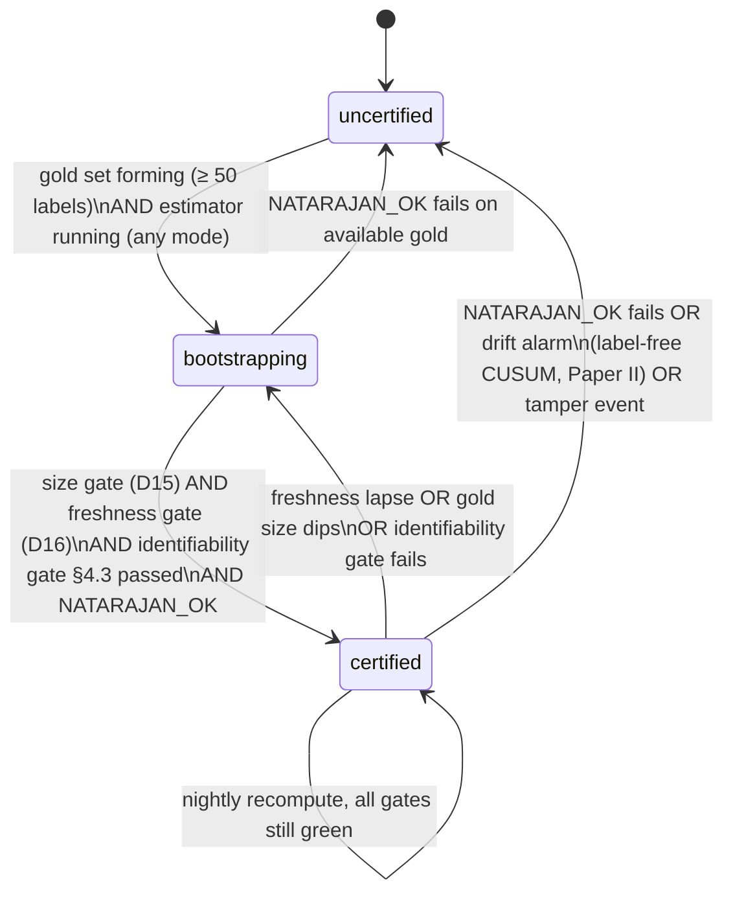

# 06 — Low-Level Design: Adjudication, Intelligence and the Learning Seam

**Status:** LLD for `adjudicator-svc` and `mark1-intel` (the two Python cloud services) plus the training-plane seam. Normative inputs: the frozen execution plan (`docs/spec/execution-plan-v2.md`), the architecture spec §4 contracts C1/C3/C4/C5/C9/C13, the three papers (`mark1-research/`), and doc `07` (data model), which owns every schema this document consumes: the ClickHouse DDL and TVO rollup MVs, `task_seg.v1`, the PolicyBundle CBOR schema, and both corpus formats. Where this document and `07` describe the same object, `07` wins.

---

## 0. Scope and the theory-to-code map

These two services are where the trilogy's mathematics becomes running code. The map below is the honesty ledger for the whole document: every algorithm is tagged **PROVED** (a theorem in the papers guarantees the property, given its preconditions), **CALIBRATED** (numbers taken from adversarially-verified literature values, correct until our own ledger replaces them), or **DESIGN** (an engineering choice with no theorem behind it — it could have gone another way, and one clause says why it went this way).

| Theory | Becomes | Where | Status |
|---|---|---|---|
| Paper I Thm 4.1 — `TVO = (c + v + (1−p)βD) / (pα)` | `tvo.closed_form()` | `intel/tvo/` §8 | PROVED (closed form; its *inputs* are measured) |
| Paper I Thm 4.2 / Cor 4.3 — break-even `v* = (1−p)·D·(α−β) − c(1−α)` | `tvo.verifier_break_even()` + the judge design rule in §6 | `intel/tvo/`, `adjudicator/judges/` | PROVED (the rule); the AUROC≤0.65 vs AUC 0.886 gap that operationalizes it is CALIBRATED |
| Paper I Thm 5.1 — repair knee `k* = 1 + ⌊ln ρ / ln γ⌋` | `policy_compiler.knee_table()` cross-check | `intel/policy_compiler/` §10 | PROVED (form); `ρ̂`, `γ̂` are fitted ledger quantities |
| Paper I Thm 7.1 — Shapley waste decomposition | **not implemented** — ADR-0003 (game definition) is unsigned | — | PROVED but gated; the deterministic taxonomy (§8) ships first and stays forever as the audit floor |
| Paper II Thm 4.1–4.2 — identifiability with ≥3 independent cliques + anchor label-swap resolution | the identifiability gate + anchor step | `adjudicator/spectral/`, §3–4 | PROVED given preconditions; the gate exists to *check* the preconditions rather than assume them |
| Paper II Thm 4.3 — `O(√(log/N))` recovery via spectral reduction | spectral Dawid–Skene | `adjudicator/spectral/` §4 | PROVED (rate); the shrinkage prior τ is DESIGN |
| Paper II Thm 5.1–5.2 — Chow band `(A/R, 1−A/D)`; conflating infra failure with `violated` incurs unavoidable excess risk | ADJUDICATE's abstention band and the `error` verdict path | `adjudicator/adjudicate/` §3 | PROVED; the default A/R/D cost values are DESIGN |
| Paper II Thm 6.1 — self-certified noise rates, Natarajan `ρ₊+ρ₋ < 1` | noise certificates | `adjudicator/certs/` §5 | PROVED (the certificate is *measurable*); gold-set size/freshness gates are DESIGN |
| Paper III Thm 6.2 — ADMIT-LCB do-no-harm (`P ≥ 1−δ` every admitted artifact has strictly positive utility) | `memory.admit()` | `intel/memory/` §9 | PROVED given bounded, honestly-attributed outcome samples — which §9's quotas enforce |
| Paper III Thm 5.1 — transfer bound via discrepancy distance | divergence-aware retrieval | `intel/memory/` §9 | PROVED (bound); the `d̂` feature set is DESIGN |
| Paper III bounded-poisoning prop — adversarial influence `≤ φB/p_min` | contribution quotas + clipping | `intel/memory/` §9 | PROVED given the quota; the quota values are DESIGN |
| DR / SNIPS estimators | `ope` module | `intel/ope/` §11 | Standard results; the ESS floor and the `WIRE_ENFORCED` filter are DESIGN choices that make the estimators' preconditions true |

**Engineering with no theorem behind it, named honestly:** the job scheduler and idempotency model (§7), the gold-set selection/rotation mechanics (§5 — the *certificate math* is proved, the *sampling design* is not), `task_seg.v1` (a receipted convention, owned by `07`), the deterministic waste-taxonomy channel definitions (§8 — deterministic accounting, deliberately theorem-free so it can be audited by arithmetic), the 5-stage sanitization pipeline (§9), judge rubric content and caching (§6), the entire verifier catalog's cost/latency classes (§2 — measured, not derived), and every default threshold in this document. Defaults are numbered `Dn` and collected where they appear; changing one is a config change, changing a PROVED item's *form* is an ADR.

**What these services do not do:** verdict *fusion* at gate time (that is `mark1d`, contract C3 — the stop-gate reads a cache, it never calls the cloud); anchor *execution* (edge-only, consented local catalog); bundle *distribution* (controld.policy-dist). This document specifies the offline/asynchronous intelligence: certification-grade adjudication, the estimators, the metric, the memory, the compiler, and the corpus seam.

---

## 1. `adjudicator-svc` — service shape

One FastAPI service following the estate skeleton exactly (recovery-orchestrator is the template; the conventions are grounding facts in the frozen plan, not choices remade here).

### 1.1 Module tree

```
python/adjudicator/
├── app/
│   ├── main.py            # configure_logging() BEFORE config import; lifespan owns
│   │                      #   the asyncpg pool + one httpx.AsyncClient; deliberate
│   │                      #   un-caught boot refusals (missing signing key, missing DSN,
│   │                      #   unreachable migrations table ⇒ crashloop, never limp)
│   ├── config.py          # pydantic-settings; DSNs as @property with sslmode=require;
│   │                      #   *_app role DSN — the service NEVER holds a superuser DSN
│   ├── logging.py         # configure_logging (structured JSON, no OpenTelemetry)
│   ├── db.py              # asyncpg pool factory; tenant_guc_setup as pool setup=;
│   │                      #   set_local_tenant for job-context writes
│   ├── errors.py          # install_exception_handlers; TimeoutError/InterfaceError → 503 + Retry-After
│   ├── receipts/          # → python/shared/mark1_receipts (vendored canonical.py/keys.py
│   │                      #   + checkpoint Merkle + dual-signature + key_id)
│   ├── registry/          # §2: verifier/anchor registry — handlers.py, catalog.py, integrity.py
│   ├── adjudicate/        # §3: ADJUDICATE — algorithm.py, chow.py, likelihoods.py
│   ├── spectral/          # §4: spectral D-S — moments.py, tensor.py, shrinkage.py,
│   │                      #   identifiability.py  (numpy only; ~500 LoC total, enforced by review)
│   ├── certs/             # §5: noise certificates — compute.py, state_machine.py
│   ├── gold/              # §5: gold sets — select.py, rotate.py, score.py
│   ├── judges/            # §6: orchestration — specs.py, cloud_path.py, cache.py, costing.py
│   └── jobs/              # batch runner + advisory-lock singleflight (shared shape with §7)
├── migrations/            # adj_0NN_*.sql — numbered, idempotent, service-prefixed
└── tests/                 # flat; python -m pytest tests -o asyncio_mode=auto;
                           #   real-PG suites gated on an env DSN (skipif), no testcontainers
```

### 1.2 Job model — what is synchronous, what is batch

**Synchronous (request/response, latency-bounded):**

| Route | Does | Budget |
|---|---|---|
| `GET /v1/registry/verifiers` | registry read for the policy compiler and `mark1 doctor` | 100 ms |
| `GET /v1/certs/{tenant_id}/current` | current noise-certificate status — the check every downstream consumer (§5.4) makes | 50 ms |
| `POST /v1/adjudicate/preview` | run ADJUDICATE on supplied votes without persisting (debug/conformance tooling) | 500 ms |
| `GET /v1/verdicts/{task_id}` | certified/revised verdict lookup (reads the ledger via controld.query-choke, never ClickHouse directly) | 500 ms |

Nothing latency-critical to a coding session ever calls this service: the edge gate reads `mark1d`'s fused cache (C3). If `adjudicator-svc` is down, sessions degrade to `PROVISIONAL` verdicts and certification lags — fail-open for availability, per the normative posture matrix.

**Batch (the real work; scheduler shape shared with `mark1-intel`, §7.2):**

| Job | Cadence | Output |
|---|---|---|
| `readjudicate` | hourly, per (tenant, window) | `VerdictEvent{CERTIFIED\|REVISED}` events → ingest; per-verdict rows |
| `spectral_estimate` | nightly, per tenant + one global pass | confusion matrices + priors → `verifier_registry`, → policy compiler input |
| `gold_score` | nightly | gold-set agreement stats → certificate inputs |
| `cert_recompute` | nightly, after `gold_score` | noise-certificate rows (per-event receipted — C13's rare class) |
| `judge_batch` | nightly (Anthropic Batch API window) | `JudgeVote` events for re-adjudication of ambiguous tasks (cloud path only, §6.5) |

**Every batch job is a deterministic function of (ledger window, params).** Same inputs ⇒ same outputs; re-running is always safe (idempotent upserts keyed by the job's identity, §7.3 semantics apply verbatim here).

### 1.3 Postgres tables owned

DDL, indexes and RLS policies live in `07`; this is the ownership list. All tables `ENABLE`+`FORCE ROW LEVEL SECURITY` with the estate's two-arg `current_setting('app.tenant_id', true)` policy and `adjudicator_app` NOBYPASSRLS role, except the two marked global.

| Table | Purpose |
|---|---|
| `verifier_registry` | one row per `verifier_id@version`: kind, tier, correlation group, status (`active\|probation\|quarantined\|retired`), current confusion estimate + its provenance (`spectral\|shrunk-global\|prior`), effective-execution hash (§2.4). Global + per-tenant override rows. |
| `noise_certificates` | ρ₊/ρ₋ point estimates + CIs, Natarajan margin, status, gold-set snapshot ref, validity window. Per-event receipted. |
| `gold_sets` / `gold_members` | server-selected gold task refs, strong labels, label source (`t3\|human\|batch-readjudication`), freshness timestamps, rotation state |
| `judge_rubrics` | content-addressed rubric text + version lineage + evidence-tier requirement + grounding declaration (§6.3) |
| `adjudication_jobs` | the job ledger (§7.3 shape): idempotency key, lease, attempt count, watermarks |

The pgvector `halfvec` HNSW column for error-signature fuzz lives on `mark1-intel`'s `memory_artifacts` table (`07`), not here — the adjudicator has no vector case.

---

## 2. The verifier / anchor registry

The registry is one fact stated in two places, kept in lockstep the same way the estate keeps `PROBE_HANDLERS` and `_PROBE_HANDLED_KINDS` in lockstep (`recovery-orchestrator/app/verify/probes.py` — the pattern is adopted verbatim, including its asserts and its refusal discipline):

1. **The `verifier_registry` table** — the durable identity: `verifier_id@version`, kind, tier, correlation group, status, confusion provenance.
2. **The handler dict** — the code-side statement of which kinds this build can actually interpret. In `adjudicator/registry/handlers.py` the handlers are per-kind *vote normalizers* (raw `AnchorVote`/`JudgeVote`/`RmScore` events → the canonical `NormalizedVote` ADJUDICATE consumes); the edge's per-kind *runners* live in `mark1d`'s Go local catalog and are validated against the same conformance vectors.

### 2.1 Handler signature and the completeness assert

```python
# adjudicator/registry/handlers.py

@dataclass(frozen=True)
class NormalizedVote:
    verifier_id: str            # "ruff@0.6", "judge:rubric-a1f3@2", ...
    kind: str                   # catalog kind, one of _HANDLED_KINDS
    task_id: UUID
    attempt_id: UUID
    vote: Literal["accept", "reject", "abstain"]
    evidence_digest: bytes      # HMAC-salted; joins to EvidenceRecord.output_hmac
    integrity: IntegrityFlags   # tamper / env_scrub_ok / merkle_match (§2.4)
    tier: Literal["T0", "T1", "T2", "T3"]

VoteHandler = Callable[[RawVoteEvent, RegistryEntry], Awaitable[NormalizedVote]]

VOTE_HANDLERS: dict[str, VoteHandler] = {
    KIND_LINT:        _normalize_lint,         # ruff, eslint-class
    KIND_TYPECHECK:   _normalize_typecheck,    # incremental tsc, mypy-class
    KIND_COMPILE:     _normalize_compile,      # warm cargo check, go build
    KIND_TEST:        _normalize_test,         # opt-in test anchors
    KIND_JUDGE:       _normalize_judge,        # §6
    KIND_RM:          _normalize_rm,           # T2 reward model (Phase 6; registered, gated)
    KIND_CONSISTENCY: _normalize_consistency,  # escalation-scoped only (C1.16)
}

# The registry and the handled set are the same fact stated twice (probes.py rule).
assert set(VOTE_HANDLERS) == set(_HANDLED_KINDS)
assert not (set(VOTE_HANDLERS) & _REFUSED_KINDS)
```

### 2.2 Unimplemented kinds are refused, never faked

A vote whose kind is not in `VOTE_HANDLERS` produces **no synthetic vote and no silent drop**. It is recorded as a refusal — `{refusal: true, reason: "refused_unimplemented_kind:<kind>", detail: <why, verbatim>}` — excluded from the ensemble, and counted into a `verifier_votes_refused_total` metric. This is `probes.py`'s hard-won rule imported whole: a handler that never reads anything is a refusal wearing a handler's registration, and a fabricated vote is a lie in the evidence trail that ADJUDICATE would then launder into a posterior. The refusal is a statement about Mark 1; a `reject` vote is a statement about the customer's code; the two must never be confusable in the record.

### 2.3 Versioning

`verifier_id@version` is the estimation unit: a version bump (new ruff release, new rubric revision, new RM checkpoint) creates a **new registry row starting in `probation`** with no inherited confusion matrix — it inherits only the shrunk global prior for its kind (§4.4). WHY: a verifier's error law is an empirical property of a specific binary/rubric; letting `[email protected]` trade on `[email protected]`'s certificate is exactly the label-quality laundering the certificates exist to prevent. Old versions are `retired`, never deleted (their votes remain interpretable in historical re-adjudication).

### 2.4 Effective-execution hash (anti-tamper)

Each `AnchorVote` arrives with `AnchorIntegrity` (contract C2). The registry stores, per `verifier_id@version`, the **effective-execution hash**: `blake3(resolved_binary_hash ‖ canonical_args ‖ env_allowlist_hash ‖ config_file_hashes ‖ suppression_directive_set)` — a hash of what *actually executes and what could change its answer*, not a glob over the repo. On every vote:

- integrity envelope's hash ≠ registry hash and no version bump ⇒ vote flagged `tamper`, quarantined from fusion and estimation, receipted (guard-contamination class);
- `suppression_directive_delta` non-empty (someone added `# noqa`, `@ts-ignore`, `#[allow(...)]` in the same diff) ⇒ vote *stands* but is annotated; the spectral estimator gets it as a feature, and a per-tenant divergence monitor (anchor-vs-T3, spec risk #1) watches the trend. WHY not quarantine: suppressions are sometimes legitimate; lying about their presence is not.

### 2.5 Initial catalog

Enabled by local-catalog ID only (bundles cannot name commands — decode-time rejection, `07`). Tiers: T0 deterministic local, T1 judge, T2 learned, T3 certified run. Latency classes: `fast` refreshes the C3 cache on PostToolUse debounce; `slow` produces `REVISED` verdicts + next-turn corrections.

| `catalog_id` | Kind | Tier | Cost/run | Latency class | Abstains when | Notes |
|---|---|---|---|---|---|---|
| `ruff` | lint | T0 | ~0 (local CPU) | fast (≤300 ms debounced) | no `.py` in the diff | syntactic correlation group |
| `tsc-incremental` | typecheck | T0 | ~0 | fast (0.5–5 s warm) | no TS in diff, or no `tsconfig.json` | abstains rather than cold-starts; a cold full check is `slow` and opt-in |
| `cargo-check-warm` | compile | T0 | ~0 | fast (1–15 s warm target dir) | no `Cargo.toml`, or target dir cold | **anchor property**: `check` failure is a perfect-precision rejection (§3.2) |
| `go-build` | compile | T0 | ~0 | fast (1–10 s with build cache) | no Go in workspace | anchor property, as above |
| `pytest-scoped` | test | T0 | local CPU, minutes | slow | repo not opted in, or sandbox precondition unmet | per-repo opt-in behind the sandbox precondition (C1.6); same correlation group as the syntactic anchors (`07`, normative) |
| `cargo-test` / `go-test` | test | T0 | local CPU, minutes | slow | as above | as above |
| `judge:grounded-rubric` | judge | T1 | model tokens (§6.4) | slow (seconds–minutes; batch for re-adjudication) | evidence tier below the rubric's requirement, or cert-blocked (§6) | client-side execution default |

Abstention is a first-class output everywhere in this table: an anchor that cannot run *honestly* (wrong language, cold cache, unmet precondition) votes `abstain`, and ADJUDICATE models abstention likelihoods from the bundle (C3) — silence is information, never imputed as accept or reject. The catalog is user-consented, re-consented on change, and visible in `mark1 doctor`; anchor execution is network-denied, env-scrubbed, read-only outside the worktree, resource-capped, kill-switched (enforcement point 4 — edge-owned, stated here because the registry's tier/cost columns assume it).

---

## 3. ADJUDICATE — the algorithm

Paper II's algorithm, implemented in `adjudicator/adjudicate/algorithm.py`. The same math, with the same bundle-supplied parameters, runs in two places: log-space naive Bayes at the edge (`mark1d` fusion, producing `PROVISIONAL` — contract C3) and this certification-grade pass in the cloud (producing `CERTIFIED`/`REVISED`, with the noise-certificate join). One algorithm, two deployment points, shared conformance vectors — divergence between them is a CI failure, not a runtime surprise.

**Latent classes.** The posterior is over the four verdict classes, ordered `[satisfied, violated, refused, error]` — the arity and order are frozen in the wire type (`posterior[4]`) and the four CH columns (`07`). Semantics, stated as the DESIGN choice it is: latent `refused` covers "not adjudicable in principle" (the agent declined, the task was withdrawn or out of scope); latent `error` covers "the outcome is unobservable because infrastructure failed" (tamper, sandbox failure, missing runtime). The **emitted verdict** `refused` additionally covers the Chow abstention — "the ensemble declines to issue a confident satisfied/violated claim". This overload is deliberate and matches the estate's usage (a refusal is a statement about the verifier plane, never about the customer's code); the `posterior[4]` always disambiguates which kind of `refused` this was.

### 3.1 Pseudocode

```
ADJUDICATE(task_id, votes, bundle, cert) -> VerdictEvent
  Inputs:
    votes   : list[NormalizedVote]           # accept | reject | abstain, with integrity flags
    bundle  : { priors: π[4],                # base rates over [S,V,R,E]
                confusion[v]: 4x3 matrix,    # P(accept|t), P(reject|t), P(abstain|t) per verifier v
                groups: correlation groups,  # cliques known BY CONSTRUCTION (Paper II's structural edge)
                costs: { A, R, D } }         # abstain / false-reject / false-accept costs
    cert    : current noise certificate      # status stamped onto the output, never consulted for math

  # Step 0 — integrity partition (Thm 5.2: infra failure ≠ violated)
  tampered   := votes where integrity.tamper
  votes      := votes − tampered             # tampered votes NEVER enter the likelihood
  if coverage(votes) < MIN_EVIDENCE:         # D1: fewer than 1 non-abstaining verifier
      return VerdictEvent(verdict=error if tampered else refused,
                          posterior=degenerate, reason="insufficient_evidence")

  # Step 1 — anchor step (Thm 4.2: label-swap resolution)
  # A compile-anchor REJECT is a perfect-precision rejection: P(reject | satisfied) ≈ ε_anchor (D2: 0.02).
  # It anchors the labeling — no relabeling of {S↔V} can explain the data — and in practice
  # clamps the satisfied posterior via its likelihood row. No special-case branch is needed:
  # the clamp IS the likelihood; the design point is that anchor confusion rows are never
  # smoothed toward symmetry by the estimator (§4.5), because their asymmetry is the identifying fact.

  # Step 2 — log-space posterior with clique collapse
  for t in [S, V, R, E]:
      logp[t] := log π[t]
      for g in groups(votes):                     # one term PER GROUP, not per member:
          o := group_observation(g)               # a linter and a test failing on the same diff
          logp[t] += log P(o | t; bundle)         # is ONE observation about the diff (07, normative)
      for v in votes not in any group:
          logp[t] += log P(vote_v | t; bundle)    # abstentions contribute their abstain likelihood
  posterior := softmax(logp)                      # normalize in log space (logsumexp)

  # The stage is EARNED, not asserted. CERTIFIED requires BOTH a stamped certificate and
  # every fused likelihood row actually measured (spectral / shrunk-global); a row still on
  # its literature default is not evidence about THIS tenant's verifiers. Weakest input wins,
  # so a step-0 degenerate verdict — which fuses nothing — can never claim CERTIFIED.
  # This line used to read `stage=CERTIFIED` unconditionally, which contradicted §5.4 below
  # and the "degrades faster than it upgrades" rule at §5; the implementation follows §5.
  stage := CERTIFIED    if cert.status = certified and all_rows_measured(likelihoods)
        else BOOTSTRAPPING if cert exists
        else UNCERTIFIED

  # Step 3 — the error path
  if posterior[E] > θ_error (D3: 0.5) or infra_dominant(votes):
      return VerdictEvent(stage, verdict=error, posterior, cert.id)
      # Folding this into `violated` incurs provably unavoidable excess risk (Thm 5.2).

  # Step 4 — Chow band (Thm 5.1): abstention strictly dominates every binary folding
  η := posterior[S]
  if   η ≥ 1 − A/D:  verdict := satisfied
  elif η ≤ A/R:      verdict := violated
  else:              verdict := refused           # η ∈ (A/R, 1 − A/D) — the Chow band

  return VerdictEvent(stage, verdict, posterior=[S,V,R,E], noise_cert_id=cert.id)
```

Default costs (D4, DESIGN — bundle-overridable per tenant): `A = 1` (a refusal costs one human look), `R = 3` (a false rejection wastes a retry loop), `D = 9` (a false acceptance ships a bad outcome). Band: `(A/R, 1−A/D) = (0.333, 0.889)`. WHY these ratios: they encode "shipping a wrong outcome is 3× worse than blocking a right one, which is 3× worse than asking a human" — a defensible starting asymmetry that the tenant's own `V(task)` economics later refine; any binary folding of the band is strictly dominated regardless of the exact values (Thm 5.1).

**The certificate is stamped, never consulted.** `noise_cert_id` rides on every `VerdictEvent`; if the certificate status is `uncertified`/`bootstrapping`, the verdict still exists and still gates the *session* (provisional loop value), but every downstream consumer in §5.4 must check the status before treating the label as certified fuel. The math does not change with the status; the *claims permitted about the math* do.

### 3.2 Worked numeric example

Rust task; priors from the bundle `π = [0.55, 0.30, 0.10, 0.05]`. Three verifiers report:

| Verifier | Vote | P(vote \| S) | P(vote \| V) | P(vote \| R) | P(vote \| E) |
|---|---|---|---|---|---|
| `cargo-check-warm` (compile anchor) | **accept** (it compiled) | 0.98 | 0.60 | 0.50 | 0.50 |
| `ruff` | **abstain** (no Python in diff) | 0.70 | 0.70 | 0.70 | 0.70 |
| `judge:grounded-rubric` (E1) | **reject** | 0.15 | 0.70 | 0.40 | 0.40 |

No test anchor ran, so the syntactic∪tests group contributes its one member (`cargo-check-warm`); ruff's abstention likelihood is symmetric here, so it cancels in normalization — honest silence changes nothing.

Unnormalized `u(t) = π(t) · P(compile=accept|t) · P(judge=reject|t)`:

```
u(S) = 0.55 × 0.98 × 0.15 = 0.08085
u(V) = 0.30 × 0.60 × 0.70 = 0.12600
u(R) = 0.10 × 0.50 × 0.40 = 0.02000
u(E) = 0.05 × 0.50 × 0.40 = 0.01000
Σ    = 0.23685
posterior = [0.3414, 0.5320, 0.0844, 0.0422]
```

Step 3: `posterior[E] = 0.042 < 0.5`, no infra flags — not `error`. Step 4: `η = 0.3414`. Band check: `0.333 < 0.3414 < 0.889` ⇒ **`refused`** — by 0.008. Output:

```
VerdictEvent{ stage: CERTIFIED, verdict: refused,
              posterior: [0.3414, 0.5320, 0.0844, 0.0422], noise_cert_id: <current> }
```

This is the band doing its job: a binary verifier would have been forced to call this `violated` at 53% confidence and be wrong nearly half the time; the ensemble instead surfaces verdict + evidence to the human (the knee governor's stop action). Two counterfactuals worth writing down: **(a)** had the compile anchor *rejected*: `u(S) = 0.55 × 0.02 × … ` — the satisfied mass collapses ~50-fold and the verdict is `violated` at ≥0.95 regardless of what the judge said; that is the perfect-precision rejection resolving label-swap ambiguity with no special-case code. **(b)** Paper II's own §9 worked example lands at `η = 0.612 → refused` through the anchor-accept path — the conformance fixture reproduces that table exactly (Phase 2 verification gate).

---

## 4. Spectral Dawid–Skene

Where the bundle's confusion matrices come from. `adjudicator/spectral/` — numpy only, ~500 LoC, no EM library, no pandas. It estimates every verifier's confusion law and the class prior **from unlabeled votes**, which is the whole point: Paper II Thm 4.1–4.3 says this is possible given ≥3 independent cliques plus an anchor, and impossible-to-know-if-you're-wrong without checking those preconditions — hence the identifiability gate.

### 4.1 The estimator, stage by stage

```
SPECTRAL_DS(votes over N tasks, groups) -> (confusion[v] for all v, prior π)

  # 1. Clique aggregation. Partition verifiers into their correlation groups
  #    (known BY CONSTRUCTION from the bundle: syntactic∪tests, judges, RMs —
  #    the structural advantage code verification has over crowdsourcing, Thm 4.1).
  #    Each group g emits one categorical observation X_g per task
  #    (accept / reject / abstain, majority-of-members with abstain floor).

  # 2. Moment construction. Pick three groups (a,b,c). Over the N tasks compute
  #    empirical cross-moments:
  #      M2 = E[X_a ⊗ X_b]          (pairwise co-occurrence matrices, all pairs)
  #      M3 = E[X_a ⊗ X_b ⊗ X_c]    (the triple tensor)
  #    after the standard symmetrization that re-expresses X_a, X_b in X_c's basis.

  # 3. Spectral reduction. Whiten: W = eigendecomposition of M2 restricted to its
  #    top-k (k=4 classes) eigenspace; T = M3(W, W, W). Tensor power iteration on T
  #    recovers k robust eigenpairs -> per-group conditional means (columns of the
  #    group confusion matrices) and the prior π, up to label permutation.

  # 4. Anchor alignment. Resolve the label permutation with the compile anchor's
  #    known asymmetry: the column in which the anchor's reject-rate is ~ε_anchor
  #    IS `satisfied` (Thm 4.2). No anchor votes in the window -> the permutation is
  #    NOT resolvable from data -> identifiability gate fails (§4.3), never guessed.

  # 5. Per-verifier recovery. With group confusions and π fixed, each member
  #    verifier's 4x3 confusion (accept/reject/abstain columns) is a conditional
  #    frequency estimate given the posterior-weighted labels — one regularized
  #    least-squares per verifier, closed form.

  # 6. One EM refinement pass (optional, D5: on) initialized at the spectral point —
  #    spectral initialization is what makes EM's fixed point the RIGHT fixed point;
  #    EM from random init is exactly the estimator the papers reject.
```

Finite-sample guarantee: parameter error `O(√(log/N))` (Paper II Thm 4.3, PROVED) — at `N = 2,000` adjudicated tasks the confusion entries carry roughly ±0.06; the certificate CIs (§5) inherit this rate rather than inventing their own.

### 4.2 Global estimation with hierarchical shrinkage

Per-tenant volumes will not clear identifiability early (critique C1.4, accepted). So estimation runs at two levels every night:

- **Global pass:** all tenants' votes pooled per `verifier_id@version` (votes are typed records — no content crosses tenants, only vote outcomes; digests are per-tenant salted and are not joined). Produces `C_global[v]` and `π_global`.
- **Per-tenant shrinkage:** `Ĉ_tenant[v] = (n_t · Ĉ_t[v] + τ · C_global[v]) / (n_t + τ)` with `τ = 200` (D6, DESIGN — the prior is worth 200 tasks; chosen so a tenant with a week of real volume dominates its own estimate). Same shrinkage for priors.
- **Deviation alarm:** a tenant whose unshrunk `Ĉ_t` deviates from global by more than `0.25` total variation in any row (D7) is flagged for manual review before its bundle updates — a tenant-local confusion collapse is more often a broken anchor or gaming than a real distribution shift (spec C5 note).

### 4.3 The identifiability gate

Spectral output is **used** only when all of the following hold; the diagnostics are computed and stored with every run either way:

| # | Precondition | Diagnostic | Threshold (default) |
|---|---|---|---|
| G1 | ≥ 3 correlation groups each with ≥ 1 non-abstaining vote on ≥ 60% of window tasks | group coverage | 0.60 (D8) |
| G2 | every group informative about the latent label | `σ_min(M2 pair)` for all pairs | ≥ 0.05 (D9) |
| G3 | enough data for the rate to mean anything | N adjudicated tasks in window | ≥ 2,000 (D10; per-tenant unshrunk use ≥ 500 with shrinkage) |
| G4 | label permutation resolvable | anchor votes present, anchor reject-column separation ≥ 10× | (D11) |
| G5 | estimate stable | max column-permutation distance across B=50 bootstrap resamples | ≤ 0.15 (D12) |
| G6 | moments well-conditioned | condition number of whitened M2 | ≤ 10³ (D13) |

**When the gate fails** (any of G1–G6): the run **degrades to weighted-majority with bundle priors** — the Phase 2 estimator, still principled, just not self-calibrating — and the noise certificate for the window is labeled `bootstrapping` (or stays `uncertified`). Nothing downstream pretends otherwise: the certificate status is the honest, machine-checkable statement that "these confusion matrices are priors and pooled history, not identified from your data." The gate result and all six diagnostics are persisted on the certificate row so the claim is auditable, not asserted.

### 4.4 New-verifier bootstrap

A `probation` verifier (§2.3) shadow-votes with no fusion weight until it has ≥ 500 shadow votes measured against the running ensemble's certified verdicts, then enters estimation with the global-prior shrinkage; promotion to `active` requires its measured confusion to beat the abstain-always baseline at 95% LCB (this is contract C12's "no self-promotion" applied uniformly, not just to learned members).

### 4.5 crowd-kit is a test oracle only — never a runtime dependency

`tests/test_spectral_against_crowdkit.py` generates synthetic vote matrices with known ground truth and asserts our estimator recovers confusions within tolerance of both the truth and crowd-kit's `DawidSkene`. Three reasons crowd-kit stays out of the runtime, in order: (1) its DS is EM-from-random-init with no anchor constraint, no abstention model and no clique structure — it cannot express the model we actually fit, so "using the library" would mean maintaining a fork; (2) it drags pandas and a scikit-ecosystem dependency tree into a service whose entire numeric surface is deliberately numpy-only; (3) an external library's silent behavior change would alter certified labels — the one artifact whose provenance we contractually attest. As a CI oracle it costs nothing and catches real regressions; as a dependency it would be an unattributed author of our certificates.

---

## 5. Gold sets and noise certificates

The spectral estimator certifies itself from unlabeled data; the gold set is the independent tether that keeps that self-certification honest. Contract C5: certificates are gated on a **size- and freshness-gated, server-selected, edge-indistinguishable** gold set plus the §4.3 identifiability diagnostics.

### 5.1 Gold-set lifecycle

- **Selection is server-side and post-hoc.** Every night, `gold/select.py` samples already-completed tasks from the ledger — stratified across verdict classes, agents, and repos (per-tenant HMAC repo digests; ≤ 30% of a set from any one repo digest, D14) — and queues them for a **strong label**: T3 certified re-run where available, cloud Batch-API strong-ensemble re-adjudication otherwise, human label for the residue. The strong label's source is recorded on the row.
- **Edge-indistinguishable by construction, not by secrecy.** Nothing marks a task as gold *before or while it runs* — selection happens after completion, from ordinary ledger rows, and no gold-related message ever goes to a device. An edge (or a gaming tenant) cannot special-case gold tasks because at execution time gold tasks do not exist yet. This is the anti-gaming property, and it is structural: there is no wire field to sniff, no timing signal, no sampling seed to steal.
- **Size gate:** a certificate may reach `certified` only when the scoring window holds ≥ 200 gold labels (D15) for the scope (tenant, or global when shrinkage supplied the matrices).
- **Freshness gate:** ≥ 50% of gold labels within the last 30 days (D16); a gold label older than 90 days leaves the scoring window entirely (D17). WHY: verifier error laws drift with toolchain versions; a certificate tethered to last quarter's ruff is a fictional certificate with a real signature.
- **Rotation:** oldest-out as new labels land, preserving the stratification quotas; a task whose repo was offboarded is dropped immediately (its digests die with the tenant HMAC key — `07` deletion path).

### 5.2 Certificate computation

On the binary satisfied-vs-violated projection (the projection Paper II's Thm 6.1 certifies; `refused`/`error` gold rows are held out of ρ but reported as abstention mass):

```
ρ₊ = P( certified verdict = violated  | gold = satisfied )   # false-reject noise
ρ₋ = P( certified verdict = satisfied | gold = violated )    # false-accept noise
```

Both are Wilson-interval estimates over the gold window; the certificate stores point estimates, 95% CIs, the **Natarajan margin** `1 − (ρ₊ + ρ₋)` with its lower confidence bound, and the full §4.3 diagnostic vector. The checkable condition:

```
NATARAJAN_OK  ⇔  LCB₉₅( 1 − (ρ₊ + ρ₋) ) > 0        # i.e. ρ₊ + ρ₋ < 1, provably at 95%
```

This is the condition under which learning from these labels is possible at all (Thm 6.1, PROVED — the certificate makes it *measurable*, which is the product claim). Certificates are per-event receipted (C13's rare class) and immutable; a recomputation is a new certificate row superseding the old by validity window.

### 5.3 The status state machine



There is no path that skips `bootstrapping` on the way up, and the two downward paths are deliberately asymmetric: quality-of-evidence problems demote one step; validity problems (Natarajan violated, drift, tamper) demote to the floor. The status is a claim about what may be *asserted*, so it degrades faster than it upgrades.

### 5.4 Every consumer that must check the status before acting

The settled rule: below-threshold verdicts **must not** gate memory extraction or corpus admission. The full consumer matrix — each row is a named check with a named negative test in `12`:

| Consumer | Reads status where | Behavior when not `certified` |
|---|---|---|
| `intel.memory` extraction (§9.1) | task filter join | task excluded from extraction — no artifact is distilled from an uncertified verdict |
| ADMIT-LCB (§9.3) | outcome-sample filter | `ArtifactOutcome` rows joined to uncertified verdicts do not count as utility evidence |
| `intel.corpus` exporter (§12.1) | `noise_cert_id` resolution per row | row withheld from BOTH corpus forms (the Parquet schema makes `noise_cert_id` required — `07`) |
| `intel.policy_compiler` (§10) | knee/CPVS fitting inputs | fits proceed on certified rows only; if none, the bundle keeps its previous tables and the publication note says so |
| `intel.ope` (§11) | reward joins | uncertified rewards excluded; ESS accounting reflects the exclusion |
| `intel.tvo` guarantee-grade reports (§8.5) | report assembly | report is issued as `indicative`, never `guarantee-grade`; the status string appears on the report |
| LEARN promotion (C12) | eval-card gate | a learned member cannot be promoted on shadow confusion measured against uncertified verdicts |
| Federation publication (Paper III path) | artifact eligibility | tenant-scope artifacts from uncertified windows never enter the (k,m)∩ pipeline |

WHY a matrix rather than one chokepoint: the consumers live in two services and read at different grains (task, row, window, artifact). Each check is cheap (`noise_certificates` current-status lookup, cacheable for its validity window); a single gateway would be a new single point of dishonesty.

---

## 6. Judge orchestration

Contract C4, resolved the way the critique disposition fixed it: **default judge execution is client-side, through the customer's own key** — evidence never leaves the machine. `adjudicator/judges/` orchestrates *which* judges run, with *which* rubric, on *which* evidence tier; it does not, in the default path, execute anything.

### 6.1 The economic design rule, first

Paper I Thm 4.2: verification pays iff `v < v* = (1−p)·D·(α−β) − c(1−α)`. Cor 4.3 converts this to a necessary AUC condition and computes both sides from adversarially-verified literature values: **unstructured LLM-judging (AUROC ≤ 0.65) fails break-even; grounded rubric verification (AUC 0.886) clears it 2×** (CALIBRATED — these are the trilogy's cited values, replaced by our own ledger measurements per tenant once volume exists). The resulting rule is normative for this module:

> **A judge may ship only with a grounded rubric bound to typed evidence.** Every rubric row must reference concrete, machine-supplied facts (anchor outputs, diff structure, `EvidenceRecord` fields, task acceptance criteria). Free-form "rate this code" judging is banned from the default ensemble — not on taste, but because it consumes `v` without clearing `v*`, making TVO strictly worse (the metric would indict its own verifier). `judge_rubrics.grounding` (§1.3) is a structured declaration checked at registration: a rubric with zero typed-evidence bindings cannot be registered.

### 6.2 The client-side execution path, in detail

```
adjudicator (nightly / on-ambiguity)                    edge (mark1d)
────────────────────────────────────                    ─────────────
1. select tasks where anchors are ambiguous
   (fused |η − band edges| < margin D18: 0.10)
   — judges fire ONLY where anchors are ambiguous:
   the prefix principle applied to the verifier
   plane itself (C4)
2. publish judge spec via bundle `verify` section:
   { verifier_id: "judge:<rubric_hash>@<v>",
     rubric_ref, evidence_tier_required,
     model_rung, token_budget }                   ──►   3. bundle verified (sig+seq+inclusion)
        (rubric text is DATA — prompt content,          4. evidence assembled LOCALLY at the task's
        no commands; it distributes like field maps,       consented tier (E0/E1/E2); redaction
        never like code)                                   admit-to-upload axis applies to nothing —
                                                           nothing is uploaded
                                                        5. model call through the CUSTOMER'S OWN
                                                           credential (their key via mark1-proxy, or
                                                           their subscription agent surface where the
                                                           regime permits) — same custody rules as all
                                                           agent traffic; Mark 1 never holds the key
                                                        6. JudgeVote{vote, rubric_id@v, model,
                                                           tokens, evidence_digest} ──► spool ──► ingest
7. votes land in the ledger; ADJUDICATE consumes
   them as T1 ensemble members with their own
   confusion rows (§4)
```

**What crosses the boundary at each tier** (C4, restated as the wire truth):

| Tier | Judge sees (locally) | What leaves the machine | Ensemble treatment |
|---|---|---|---|
| E0 | typed `EvidenceRecord` only — tool, diagnostic codes, categories, counts, path roles | the `JudgeVote` (vote + digests + token counts). No paths, no text. | modeled as a **low-power ensemble member** — its confusion rows are honestly wide |
| E1 | sanitized diff hunks + prompt digest | still only the `JudgeVote`; the sanitized hunks were assembled locally and stay local. The redaction receipt for the sanitization is emitted. | standard T1 power |
| E2 | full diff | nothing beyond the vote (E2 is VPC/self-host only; even there, evidence stays inside the customer boundary) | full T1 power |

### 6.3 Rubric and prompt versioning

Rubrics are content-addressed: `rubric_id = "judge:" + hex(sha256(canonical_rubric_bytes))[..8]`, and the registry unit is `rubric_id@version` where a version bump means *any* change to rubric text, evidence-tier requirement, or model rung. A changed rubric is a new verifier (§2.3): new probation, no inherited confusion. The rubric's static prefix is structured for prompt caching — `cache_read_input_tokens > 0` on judge calls is an SLO (C4), because a judge that re-pays its rubric on every call has its `v` inflated for no discrimination gain.

### 6.4 Cost accounting and caching

- Judge tokens are metered into the ledger like all usage (the edge's normal `Usage` events cover the proxy/API-key path; hook-observed usage covers the rest) and attributed to the task as **verifier spend `v`** — the same `v` in the break-even formula, so §8 can compute whether each rubric is paying for itself per tenant. A rubric whose measured `(α, β)` stops clearing `v*` is flagged for retirement; that check is the design rule of §6.1 running continuously rather than once.
- **Verdict-level cache:** keyed `(rubric_id@v, evidence_digest)`. Identical evidence re-judged (retry loops re-present unchanged diffs constantly) is a cache hit at the edge — no model call, the prior `JudgeVote` is re-emitted with `cached: true`. TTL: the rubric version's lifetime (content-addressed evidence cannot go stale under a fixed rubric).

### 6.5 The cloud-judge path

Exists for tenants without a usable client-side execution surface, and for nightly Batch-API re-adjudication (§1.2). Hard preconditions, all machine-checked at job admission, none waivable in code: (1) tenant consent flag (a receipted, revocable settings row); (2) the subprocessor register lists the model vendor for this tenant; (3) region pinning honored on the API call; (4) evidence tier ≤ the tenant's consented cloud tier (E2 never goes to the cloud path — VPC/self-host only, structurally: the job builder has no E2 branch). Execution: Haiku-class cascade with cached rubric prefix; escalation to a stronger rung only for votes still inside the ambiguity margin — the cascade exists because Cor 4.3's economics apply to *our* spend too; Batch API for everything non-interactive (it is all non-interactive: cloud judging is re-adjudication, never in a session's gate path).

---

## 7. `mark1-intel` — service shape and the five job modules

One FastAPI service, same estate skeleton as §1.1 (configure_logging before config import; lifespan owns the asyncpg pool, the httpx client, **and the scheduler task**; `intel_app` NOBYPASSRLS role; boot refusals crashloop). Five job modules, one scheduler, one job ledger:

```
python/intel/
├── app/
│   ├── main.py / config.py / logging.py / db.py / errors.py     # as §1.1
│   ├── scheduler.py       # the ONE scheduler (§7.2)
│   ├── jobs.py            # job ledger access: lease, complete, retry (§7.3)
│   ├── memory/            # §9: extract.py, sanitize.py, admit.py, retrieve.py, grammar.py
│   ├── tvo/               # §8: closed_forms.py, engine.py, waste.py, coverage.py, report.py
│   ├── policy_compiler/   # §10: cpvs.py, knee.py, ladders.py, compile.py, publish.py, canary.py
│   ├── ope/               # §11: estimators.py, filters.py, diagnostics.py
│   └── corpus/            # §12: export.py, kto.py, parquet.py, receipts.py
├── migrations/            # in_0NN_*.sql
└── tests/                 # flat, as §1.1
```

WHY one service and not five: the modules share every seam (pool, ledger reads via query-choke, receipts, scheduler) and none has an independent scaling or failure profile at pilot; five deployables would be five copies of the same lifespan. The module boundary is a package boundary, which is the cheapest boundary that still keeps ownership legible — split only when a module earns its own SLO. (`ponytail:` one deployment unit; split per-module when one of them saturates a worker or needs its own release cadence.)

### 7.2 The scheduler

An asyncio loop in `lifespan` (no Celery, no cron sidecar — the estate runs schedulers in-process, and a second orchestration system is a second failure domain):

- ticks every 60 s; for each due job spec, attempts to **lease** via `SELECT … FOR UPDATE SKIP LOCKED` on `intel_jobs` — multiple replicas coexist safely; exactly one wins each job;
- job specs are rows, not code: `(module, kind, schedule, params)`; adding a nightly job is an INSERT (or a migration), not a deploy;
- schedules: `tvo.rollup_verify` hourly; `memory.extract`, `memory.admit`, `policy_compiler.compile`, `ope.score`, `corpus.export` nightly, dependency-ordered by a `runs_after` column (extraction before admission; admission before compile; compile before export is NOT required — they are independent);
- a lease carries a deadline (2× the job's p99 runtime, floor 15 min, D19); an expired lease is reclaimable — the idempotency model (§7.3) is what makes reclaim safe.

### 7.3 Idempotency and re-run semantics

The invariant every module must satisfy, checked by a shared test harness: **a job is a deterministic, idempotent function of `(kind, window, params_hash, input_watermark)` — running it 0.5 times or 3 times must be indistinguishable from running it once.** Mechanically:

1. **Identity.** `job_key = (kind, window_start, window_end, params_hash)`, UNIQUE in `intel_jobs`. A retry is the same row (attempt counter increments); a re-run request for a completed job is a no-op unless explicitly forced as a *new* job with a new params_hash (which then writes new, distinctly-keyed outputs — history is never restated in place, the `task_seg` version-bump discipline generalized).
2. **Reads are watermarked.** Every module reads ledger windows by `(tenant, day)` ranges plus an explicit watermark recorded on the job row — a re-run reads exactly the same input set even if new events have since arrived (late events belong to the next window; `ingested_at` vs `occurred_at` skew is the ledger's problem and is why windows close with a 2 h grace lag, D20).
3. **Writes are idempotent upserts or new-identity objects.** Postgres outputs: `INSERT … ON CONFLICT (natural key) DO UPDATE` where the natural key includes the job identity. S3/exports: a new `export_id` per job run, never a rewrite (`07`). Receipted outputs: the receipt is emitted in the same transaction that marks the job step complete, so a crash between "wrote output" and "emitted receipt" cannot occur in that order.
4. **No partial visibility.** Multi-statement outputs land in one transaction, or via staging-table-then-swap for large ones. A consumer never sees a half-written night.
5. **Failure and retry without double-counting.** On exception: attempt++, exponential backoff (1 min base, ×4, cap 1 h, max 5 attempts, D21), then status `parked` + alert. Because of (1)–(4), the retry re-reads the identical inputs and overwrites its own keyed outputs; counters that accumulate (e.g. a cursor's `rows_ingested`) advance only through watermark-guarded upserts (the `CorpusCursor.already_seen` discipline from the training plane, §12.3, is the house pattern). **The forbidden shape** is an unkeyed `UPDATE x SET n = n + delta` from job code — that is how a retry double-counts, and the shared harness greps for it.

---

## 8. `tvo` — the metric engine

The product artifact. Inputs: the ClickHouse rollups and base table (via query-choke only) and the Parquet mirrors; the rollup tables, their MV definitions, and the per-channel waste arithmetic are **normative in `07`** (§Materialized views) — this engine implements the closed forms, verifies the rollups, and assembles reports. The MVs are the cheap first pass; any number that leaves the building is re-verified against the base table by this engine (the `07` audit-path rule).

### 8.1 The three closed forms (`closed_forms.py`)

```python
def tvo(c, v, p, alpha, beta, D) -> float:
    """Paper I Thm 4.1. Tokens per verified outcome."""
    return (c + v + (1 - p) * beta * D) / (p * alpha)

def verifier_break_even(c, p, alpha, beta, D) -> float:
    """Paper I Thm 4.2. Max verifier spend v* that still pays."""
    return (1 - p) * D * (alpha - beta) - c * (1 - alpha)

def repair_knee(rho, gamma) -> int:
    """Paper I Thm 5.1. k* = 1 + floor(ln ρ / ln γ)."""
    return 1 + math.floor(math.log(rho) / math.log(gamma))
```

Where each input comes from, honestly sourced:

| Param | Meaning | Source |
|---|---|---|
| `c` | mean generation tokens per attempt | ledger (`tvo_task` sums / attempts) — MEASURED |
| `v` | verifier spend per attempt (judge tokens + amortized anchor cost) | ledger — MEASURED |
| `p` | per-attempt success probability | certified pass rate per task class — MEASURED, certified-only |
| `α, β` | verifier ensemble TPR / FPR: `α = P(accept\|good) = 1 − ρ₊`-side, `β = P(accept\|bad) = ρ₋`-side, taken from the current noise certificate's binary projection | certificate (§5.2) — MEASURED when `certified`, else literature-CALIBRATED and the output is so labeled |
| `D` | downstream cost of a delivered false accept | tenant-configured, default CALIBRATED from Paper I's table — never claimed as measured |
| `γ` | geometric decay of per-attempt success, `p_k ≈ p_1·γ^(k−1)` | fitted from attempt-indexed certified pass rates — MEASURED (`γ̂`) |
| `ρ` | attempt-1 cost-to-expected-value ratio, `c(1)/(p_1·V)` | fitted (`ρ̂`); `V` from bundle `v_default` or task-class estimate |

`repair_knee` is a **cross-check**, not the governor: the edge gate runs on the bundle's knee *table* (rows of `(n, c_n)`, `07`), which encodes non-geometric realities the closed form cannot; the engine asserts the table's implied knee is within ±1 of `k*(ρ̂, γ̂)` and flags the compiler when it is not. Paper I's zero-fit reproduction of both published knees (function-level k*=2, repo-scale k*=6) is the conformance fixture.

### 8.2 Coverage band

Computed exactly as `07` specifies (normative there): `coverage = observed_ms / (observed_ms + bypass_ms + disabled_ms)` from `CoverageTransition` durations, with the lower edge narrowed by shed accounting: `coverage_lower = coverage × (1 − dropped_billing / (dropped_billing + events_billing_ingested))`. The engine's addition is placement: **every number in every report carries `(coverage_lower, coverage)` and its `cost_basis`** — a TVO without its band is not an output type in this module (the report dataclass has no band-less constructor, deliberately).

### 8.3 Deterministic waste taxonomy

Three channels; the per-channel arithmetic is normative in `07` (`tvo_tenant_day` columns and the paragraph beneath them) and is deliberately **counterfactual-free** — each channel counts only tokens with a ledger-witnessed alternative:

- **`retry_loop_tokens`** — attempt-n tokens (n ≥ 2) where attempt n−1's fused verdict was `violated`. First attempts are never waste; the taxonomy charges the loop, not the work.
- **`reexploration_tokens`** — read/grep/list/glob tokens whose target digest was already in the session's `CortexInjection` served-set (digest-to-digest join, both sides tenant-HMAC-salted). Claimable only where a `CortexInjection` exists — no counterfactual model.
- **`over_model_tokens`** — for certified-satisfied tasks, the output-token delta vs the cheapest ladder rung *with an actual passing signal on this same task*; zero when no cheaper rung was exercised. The taxonomy refuses to guess what a cheaper model would have done.

Shapley attribution of *savings* across planes is deliberately absent until ADR-0003 defines the game; when it arrives it is presentation over these columns, never a replacement (`07`, restated because people will ask this module for it first).

### 8.4 Dual `cost_basis`

Every cost in a report is computed under exactly one basis, stamped per cohort (C1.9):

- **`usd`** (API-key tenants): `Σ(input_tokens × price_in + output_tokens × price_out + cache_creation × price_cc + cache_read × price_cr)` at the model's pinned price row, **plus verifier spend** `v`. Prices live in a versioned `model_prices` table; a report pins the price-table version it used.
- **`quota`** (subscription tenants): `quota_cost = (tokens_consumed / window_limit_tokens) × S`, where `window_limit_tokens` is fitted from transcript-observed rate-limit events (the only honest source — vendors don't publish it) and `S` is the **wall-clock shadow price**: the tenant-configured value of one fully-consumed rate-limit window (default: engineer-hours blocked × loaded rate; D22 default $200/window, explicitly a placeholder the tenant must confirm before guarantee-grade issuance). WHY a shadow price at all: a subscription token has no invoice line, but exhausting the window has a real cost — the developer waits; pretending subscription tokens are free would make the knee governor never stop.

### 8.5 Batch engine and the refusal rule

Heavy batch analytics (multi-month recomputes, report regeneration, `task_seg` re-segmentation verification) run in **embedded DuckDB over the Parquet corpus mirrors** — never against the hot ClickHouse path (`07` data-stores rule). DuckDB is in-process (no new stateful system), reads the S3 Parquet directly, and its results are cross-checked against the CH rollups on overlap windows as a standing consistency probe.

**The refusal rule (normative):** guarantee-grade report issuance is **refused** when `coverage_lower < 0.95` (D23, the coverage floor) — the report is still produced, labeled `indicative`, with the band printed and the refusal reason stated. Same refusal for: uncertified noise certificate (§5.4), unresolved `cost_basis` (no confirmed `S` for a quota tenant), or a `task_seg_version` boundary crossing the report window without both series shown. A refused guarantee is a receipted event; the product's honesty is itself in the ledger.

### 8.6 Paper I worked-example reconciliation (Phase 1 verification)

`tests/test_paper1_reconciliation.py` carries the trilogy's worked accounting table as a fixture (`tests/fixtures/paper1_worked_example.json`): the engine must reproduce, to the cent and token, every row of Paper I's Table 1 — including the two corrected cells from the trilogy's corrections log (AUROC-0.537 row: TVO 360.0k / +20%, `v* = −7.2k`) — plus both published repair knees from `repair_knee()` with literature parameters. This is the Phase 1 gate's "TVO output matches hand-computed values" made executable; the fixture is the papers' numbers, not ours, so the test also detects silent drift between the papers and the code.

---

## 9. `memory` — extraction, admission, retrieval

Paper III instantiated tenant-first. Artifacts, never trajectories, are the unit; utility is denominated in TVO; the do-no-harm gate is the reason a customer can turn this on without fearing it.

### 9.1 Nightly Batch-API extraction cascade

Runs over **certified-`satisfied` tasks only** (§5.4 check first — an uncertified verdict extracts nothing) plus certified-`violated` tasks for pitfall mining:

1. **Candidate pass (cheap rung, Batch API):** per task, a Haiku-class model with a typed extraction prompt proposes 0–3 artifacts in the grammar below. Batch API because nothing here is interactive and it halves the spend.
2. **Validation pass (stronger rung, Batch API):** each candidate is checked for grammar validity, grounding (every step must cite a ledger-witnessed event digest from its source task), and non-triviality; ungrounded candidates die here — an artifact that cannot point at the events it came from is a hallucination with a schema.
3. **Dedup/merge:** candidates fuzzy-match against existing artifacts via the error-signature `halfvec` HNSW column (the estate's one vector case, `07`); a match increments the existing artifact's support instead of minting a duplicate.

### 9.2 Artifact grammar and the 5-stage sanitization pipeline

Grammar (Paper III's abstraction operator, instantiated):

```
artifact := { artifact_id, type: workflow_template | pitfall_remedy | invariant | routing_hint,
              trigger:  { error_sig_digest? , repo_features?, task_class? },   # when to surface
              body:     typed steps / claim — NO verbatim code spans > 40 tokens (D24),
                        identifiers abstracted to roles,
              scope:    tenant | federated,          # always born `tenant`
              provenance: [event digests], support_n, created_from_cert_id }
```

`routing_hint` artifacts never inject into context — they compile into bundles (contract C8); `invariant` artifacts are excluded from federation by schema (enforcement point 7).

Sanitization, in order, each stage receipted as a pass/mutate/kill count:

1. **Redaction scan** — the server twin of `mark1-redact`'s ruleset; any flagged span ⇒ `⟨redacted:class:hash⟩` or kill.
2. **Identifier abstraction** — paths → path roles, symbols → placeholder roles, literals → typed holes; the artifact must remain executable *as advice* without any source identifier.
3. **Provenance check** — every body step maps to a grounding digest; steps that lost grounding in abstraction are dropped, and an artifact below 1 grounded step dies.
4. **Grammar validation** — strict schema; unknown keys kill (the bundle decoder's strictness rule, applied to our own data).
5. **Review queue routing** — anything the first four stages *mutated* (not merely passed) goes to the human queue when destined for federation; tenant-scope artifacts skip the queue (their blast radius is their own tenant).

### 9.3 ADMIT-LCB (Paper III Thm 6.2 — do-no-harm, PROVED)

```
ADMIT_LCB(artifact a, outcomes O_a, δ=0.05):                      # D25: δ
  Inputs: O_a = ArtifactOutcome utility samples for a — per injected task,
          u_i = TVO_matched_control − TVO_with_injection            (positive = helped)
          computed on CERTIFIED tasks only (§5.4), clipped to [−φ, φ] (D26: φ = one
          task's median token cost) — clipping is a precondition of §9.6, not hygiene
  n := |O_a|
  if n < n_min (D27: 8):            return HOLD                    # not enough evidence either way
  LCB := empirical_bernstein_lcb(O_a, δ)   # mean − √(2·Var̂·ln(2/δ)/n) − 7φ·ln(2/δ)/(3(n−1))
  if LCB > 0:                       return ADMIT                   # with prob ≥ 1−δ, u(a) > 0 strictly
  if UCB(O_a, δ) < 0:               return RETIRE                  # provably harmful — remove from serving
  else:                             return HOLD                    # keep shadow-serving at low propensity
```

The guarantee, verbatim from Thm 6.2: **with probability ≥ 1−δ, every admitted artifact has strictly positive utility** — the pool provably never underperforms private memory, which is the theorized answer to the published anti-signal (naive trajectory mixing degrading 15.3%→8.7%). Empirical-Bernstein over Hoeffding because utility variance is small when an artifact is genuinely good, and EB converts that into earlier admission at the same δ.

**Tenant-scope admission precedes any cross-tenant step, structurally:** the admission job runs per tenant on tenant-scope artifacts; only an artifact already ADMITted in its home tenant is *eligible* for the federation pipeline (k,m∩ → DP → its own cross-tenant ADMIT-LCB with fresh, target-side outcomes → review queue). There is no code path from extraction to federation that does not pass a tenant-scope admit first.

### 9.4 Divergence-aware retrieval (Paper III Thm 5.1)

At `TaskOpen`, candidate artifacts are scored:

```
score(a, task) = LCB_utility(a) − λ · d̂(source_context(a), target_context(task))     # D28: λ = 1.0
```

where `d̂` is the discrepancy-distance estimate from **unlabeled repo features** (language mix, dependency-graph summary stats, repo-size bucket, cortex L2 degree distribution — all computable without labels, which is what makes the bound usable pre-deployment). Thm 5.1 guarantees cross-context utility drift ≤ the discrepancy distance, so subtracting `d̂` is subtracting a bound, not a vibe: an artifact is served only where its guaranteed-net utility remains positive. The feature set is DESIGN; the bound is PROVED.

### 9.5 Injection rules

- **Memory pack at TaskOpen** (contract C8): top-scoring artifacts by §9.4, within the bundle's `pack_tokens_max` budget.
- **Reactive pitfall injection:** `pitfall_remedy` artifacts fire on `PostToolUseFailure` whose error signature matches the artifact's trigger (exact digest, else HNSW fuzz within distance 0.15, D29) — the remedy arrives at the moment of the mistake, which is when it is worth tokens.
- **Interaction-bounded multi-artifact retrieval** (Paper III): at most `m_inject = 3` artifacts per task (D30), and utility attribution (`ArtifactOutcome`) is recorded per artifact only for injection sets of size ≤ m_inject. WHY: ADMIT-LCB's samples assume near-additive utility; unbounded co-injection makes `u_i` unattributable and quietly voids the do-no-harm precondition. Larger packs are a research toggle, off in production.

### 9.6 Bounded poisoning — the theorem and the quota that makes it true

Paper III's threat-model proposition: total adversarial influence on the pool is **≤ φB/p_min**. The three quantities are enforced, not assumed:

| Symbol | Meaning | Enforcement |
|---|---|---|
| `φ` | per-observation influence cap | utility clipping in ADMIT_LCB (D26) — an outcome sample cannot claim more than one median task of effect |
| `B` | per-tenant contribution budget | quota: a single tenant's outcomes count ≤ B = 20 samples per artifact per 30-day window (D31); excess samples are recorded but not counted |
| `p_min` | retrieval propensity floor | serving never drops an admitted artifact's propensity below 0.02 (D32), so an adversary cannot amplify influence by starving honest samples |

With all three enforced, do-no-harm survives quota inflation attacks (the proposition's restoration result). Drop any one — say, unclipped utilities — and the bound is void; that is why clipping lives inside `ADMIT_LCB` rather than in a preprocessing step someone can skip.

---

## 10. `policy_compiler`

Turns ledger evidence into the signed, sequenced PolicyBundle v1 the edge evaluates in nanoseconds. The bundle's CBOR schema, section grammar, and decode-time rejection rules are **normative in `07`** (§PolicyBundle v1); this module is the producer that must satisfy that decoder.

### 10.1 CPVS scoring (`cpvs.py`)

Cost-per-verified-success per `(task_class, model)`:

```
CPVS(task_class, m) = E[cost per attempt under basis] / p̂_LCB(task_class, m)
```

- numerator under the tenant's `cost_basis` (§8.4);
- denominator is the **95% LCB** of the certified pass rate (Wilson), not the point estimate — a model with 3 lucky passes must not top the table (D33: minimum 30 certified attempts per cell; below that the cell inherits the global estimate and is marked `inherited`);
- certified rows only (§5.4); `unresolved` tasks appear in neither side.

### 10.2 Model ladders (`ladders.py`)

The prefix principle (Paper I §7, with its honest correlation correction): a candidate rung is **prepended** to a ladder iff its correlation-corrected cost-per-verified-success index beats the incumbent ladder's measured TVO — cheap rungs earn their place by clearing outcomes before the expensive rung ever runs, and the correction term exists because a cheap rung's failures are not independent of the expensive rung's (a task the small model fails is disproportionately one the large model finds hard too; uncorrected, the prefix principle over-prepends). `keep_prefix` flags per rung ride into the bundle so the edge preserves cache-friendly prompt prefixes across rung switches.

### 10.3 Knee tables under both cost bases (`knee.py`)

Per `(tenant, task_class)`, two tables when the tenant has both regimes:

```
rows: [(n, c_n)]  where  c_n = E[cost of attempt n | basis]        n = 1..8 (D34)
```

- `usd` basis: attempt-indexed token costs from `tvo_task`, priced (§8.4).
- `quota` basis: attempt-indexed `quota_cost` (§8.4) — the rate-limit-window fraction × shadow price, which makes the knee *earlier* near window exhaustion, which is exactly the behavior a subscription user wants from a governor.
- Sanity gate before publication: implied table knee within ±1 of the closed-form `k*(ρ̂, γ̂)` (§8.1) — a violated gate blocks publication and pages, because it means either the fit or the ledger is wrong. The edge's gate then evaluates `p̂_LCB(n)·V(task) ≤ c(n)` per C3; local hard caps (≤3 consecutive blocks etc.) are edge-owned and a bundle may only lower them (`07` gates-section).

### 10.4 Compilation and signing (`compile.py`, `publish.py`)

Sections produced, per `(tenant, channel)`: `verify` (confusion matrices + priors from §4's current estimates, correlation groups, abstention models, quarantine list, anchor enables **by local-catalog ID + thresholds only**), `route` (CPVS tables, ladders, knee tables, `cost_basis`, exploration ε — default 0), `memory` (injection rules + budgets from §9.5), `cortex` (map budgets, channels), `gates` (stop-gate config, caps), `agent_maps` (field maps/parser rules — maintained by the adapter team, compiled through, not authored here).

Safety rules, all machine-enforced in the publish path:

1. **No command strings can be emitted — proven by round-trip, not by review.** The publish step decodes its own output through the `mark1-policy` Rust reference decoder (invoked as a conformance subprocess in CI and staging; the Go twin in nightly) — a bundle that fails the strict decode **never publishes**. Since the decoder structurally rejects any string that is not a constrained identifier, JSON pointer, or closed enum (`07`), the compiler cannot smuggle a command even by bug.
2. **Section-split signing:** each section signed independently, Ed25519, KMS-resident keys, one key per section class; the compiler holds zero private keys — it submits canonical section bytes to controld's signing endpoint, which enforces per-key rate limits.
3. **Seq monotonicity:** the publisher reads the bundle catalog's `(tenant, channel)` head `FOR UPDATE`, writes `seq+1`, `prev_hash` = last bundle's canonical hash; the transaction that inserts the catalog row also emits the per-event publication receipt (C13 rare class). A crashed publish retries as the same job (§7.3) and cannot mint a gap or a fork.
4. **Canary plan attached to every publication:** `{canary_cohort: device set (doubles as the OPE randomization unit), widen_criteria: ACK coverage ≥ 95% AND 48 h ledger TVO non-regression AND zero guard-contamination events, rollback: previous content republished under a higher seq}`. Rollback is a *forward* publication — the edge's anti-rollback seq check is never fought, it is used.

---

## 11. `ope` — off-policy evaluation

Scores candidate `route` sections against the incumbent from logged decisions, without serving them. Estimators are standard (Dudík et al. DR; SNIPS); everything Mark-1-specific is in the *input filter* and the *refusal thresholds* — OPE is easy to run and easy to run dishonestly, and this module is built around the second fact.

### 11.1 Estimators (`estimators.py`)

For logged decisions `(x_i, a_i, r_i, p_i)` — context, action (model/rung choice), reward (certified task outcome joined via the ledger, weighted by `label_confidence`), logged propensity — and candidate policy π:

```
w_i    = π(a_i | x_i) / p_i                                   # importance weight

SNIPS(π) = Σ w_i·r_i / Σ w_i                                  # self-normalized IPS: biased O(1/n),
                                                              # variance-safe under weight skew
DR(π)    = (1/n) Σ [ q̂(x_i, π(x_i)) + w_i·(r_i − q̂(x_i,a_i)) ]
                                                              # doubly robust: unbiased if EITHER
                                                              # q̂ or the propensities are right
```

`q̂` is a deliberately small reward model (regularized logistic on task-class × model features — not a learned deep model; its job is variance reduction, not prediction, and a fancy q̂ is a new unaudited opinion inside a promotion gate). Both estimators are computed and reported together; DR is the decision value, SNIPS the cross-check — disagreement beyond the joint CI is itself a diagnostic failure.

### 11.2 The input filter (`filters.py`) — `WIRE_ENFORCED` only

Contract C9, implemented as a WHERE clause plus a join, in that order:

1. `fidelity = 'wire_enforced'` rows enter directly: the proxy rewrote the model on the wire, so the logged action **is** the executed action and `p_i` is the true propensity of what actually happened.
2. `fidelity = 'config_steered'` rows enter **only after the served-model confirmation join**: the decision's intended model must match the model observed on the subsequent `Usage` events for that request window. Confirmed ⇒ the action executed as logged; unconfirmed or contradicted ⇒ excluded. WHY: config steering is a suggestion — the agent, the user, or a fallback may have overridden it, and an OPE row whose action didn't happen poisons both estimators in a direction nobody can sign.
3. `fidelity = 'advisory'` rows **never** enter. An advisory decision has no enforcement and usually no observable to confirm; its propensity describes an intention, not an event. Excluding it is not conservatism — including it would simply be wrong.

Rewards join certified verdicts only (§5.4); a decision whose task's certificate is not `certified` contributes no reward row and is excluded (not zero-filled — zero-filling would encode "uncertified = failed").

### 11.3 Variance diagnostics and the promotion floor (`diagnostics.py`)

Computed on every candidate scoring run and stored with it:

```
ESS = (Σ w_i)² / Σ w_i²                # effective sample size
max_w, w_p99                           # weight-tail exposure
overlap = fraction of rows with π(a_i|x_i) > 0
```

**Promotion floor (normative, fail-closed):** a candidate `route` section **cannot be promoted** unless `ESS ≥ 200` (D35) **and** `ESS/n ≥ 0.05` (D36) **and** `max_w ≤ 100` after clipping at 100 with the clipped mass reported (D37) **and** `DR_LCB₉₅(π_candidate) > DR_point(π_incumbent)`. Below the floor the verdict is `insufficient_evidence` — the candidate stays in shadow, and no amount of point-estimate advantage overrides it. The floor is DESIGN; what is not negotiable is that it exists and fails closed.

### 11.4 The ε = 0 problem, stated honestly

Default exploration is ε = 0: propensities are logged honestly as 1.0 on the incumbent's choice (settled fact; exploration is a per-tenant contractual opt-in). Consequences, without euphemism:

- **What OPE can conclude at ε = 0:** the value of candidate policies **on the region where they agree with the incumbent** (`w_i = 1` where actions match, `w_i = 0` — undefined support — where they differ). Concretely: it can detect that a candidate *would not regress* on the traffic it would leave unchanged, and it can evaluate candidates that only re-route contexts the incumbent itself routes differently across its own deterministic variation (task classes, ladders) — a thin but real overlap.
- **What it cannot conclude:** the value of any action the incumbent never took, in any context. There is no statistical technique that recovers this; DR's `q̂` term will *extrapolate* there, and that extrapolation is a model opinion, not a counterfactual estimate — it is therefore reported separately as `DM_extrapolated` and is **never** part of the promotion criterion.
- **What promotion evidence actually is at ε = 0:** shadow scoring for regression detection (this module) + the canary cohort (§10.4) as the real experiment. The canary IS the exploration, run at fleet-cohort granularity with receipted coverage instead of per-request randomization. When a tenant opts into ε = 0.03–0.05, this module's estimators become fully counterfactual on that tenant's traffic and the promotion floor tightens accordingly (same thresholds, honest support).

The module refuses to produce a "candidate beats incumbent" claim from ε = 0 data alone; the strongest emittable claim is `non-regression on overlap, ESS = <n>` — and that string, not a rounded-up victory, is what lands in the eval card.

---

## 12. `corpus` — the exporter and the training seam

### 12.1 The exporter: two forms, one receipt

Per nightly job (§7.3 identity), per tenant, the exporter emits **both corpus forms under one `export_id` and one receipt** — the schemas, the S3 layout (`t/<tenant>/parquet/v1/…` and `t/<tenant>/kto/v1/…` under the same `export=<export_uuidv7>` key), the label mapping, and the receipt's object manifest are all **normative in `07`** (§Corpus schemas):

- **(a)** the receipted Parquet mirror `mark1_trajectory.v1` — analytics form, DuckDB-native;
- **(b)** the KTO `rows.jsonl` + `manifest.json` pair — the label-bearing form the trainer actually reads, byte-compatible with `training_jobs.rows.KtoRow` / `training_jobs.dataset.DatasetManifest`.

Admission filter, applied before either form is written (each exclusion counted and printed in the export receipt): verdict stage ∈ {certified, revised}; noise-certificate status `certified` (§5.4 — the load-bearing check); tamper-flagged tasks excluded; label mapping `satisfied → desirable/reward=1`, `violated → undesirable/reward=0`; **`refused` and `error` rows are not exported to KTO at all** (Paper II Thm 5.2's lesson applied to training: infrastructure failure is not a preference signal). Mark 1 stamps its attempt UUID into `recovery_attempt_id` (the trainer treats it as an opaque join key), inlines `completion` (the wire shape's dataset-assembler extension field — Mark 1 has no orchestrator WORM rows for the trainer's deref rung), and sets `holdout_bucket` per the tenant's split policy with only `"train"` ever trainable (the trainer's own fail-closed gate).

### 12.2 The `mark1-parquet` source in `data-refinery` — exactly what is added, and where

**There is no pluggable source trait.** The source in `services/data-refinery/src/corpus/mod.rs` is the concrete `CorpusReader` struct; its corpus read today is `scan_worm` / `read_train_rows` (currently Option A: HTTP against the orchestrator's `export-rlvr` endpoint, with the S3 client and both pools retained as seams). The Mark 1 source is **an added constructor + method pair on that concrete struct**, matching the existing signatures — the full normative signatures (`new_mark1`, `scan_mark1`, `read_mark1_train_rows`) are in `07` (§The `mark1-parquet` source) and are restated here only by name. What is added, and where, exhaustively:

| Addition | Where | Shape |
|---|---|---|
| `CorpusReader::new_mark1(s3, worker, app, mark1_prefix: Option<String>) -> Self` | `corpus/mod.rs`, same `impl` block | constructor twin of `new`; `None` prefix ⇒ fail-closed (finds nothing, never fabricates) — the orchestrator-seam posture mirrored |
| `CorpusReader::scan_mark1(&self, tenant, sigs, since, max_keys) -> RefineryResult<ScanReport>` | same | signature-identical twin of `scan_worm`: lists `t/<tenant>/kto/v1/export=*/` (S3, not HTTP — this source revives the S3-decode path shape), decodes `rows.jsonl` via `VerifiedTrajectory::from_jsonl` fail-soft, folds per-object `DecodeReport`s through the existing `fold_report` (currently `#[allow(dead_code)]` — it goes live here), applies the existing `filter_by_sigs`, respects `CorpusCursor` with **consumer = `"data-refinery-mark1"`** so the cursor never collides with the orchestrator source's |
| `CorpusReader::read_mark1_train_rows(&self, tenant, sigs, window) -> RefineryResult<Vec<EnrichedTrajectory>>` | same | signature-identical twin of `read_train_rows` (fresh cursor, `MAX_REBUILD_KEYS` bound) |

No new struct, no new trait, no trainer change intended — `rows.jsonl` is the `VerifiedTrajectory` wire shape, and Mark 1's rows carry `decisive_step_source`/`propensity` inline, so the DB-join fallback arm never fires for this source.

**Two deltas found by reading the real files, resolved here rather than discovered in code review:**

1. **`VerifiedTrajectory` (in `omium-vrr-common::trajectory`) carries no inline `completion` field.** The Python `KtoRow` mirror has `completion: str | None` as an explicit extension; the Rust struct — as constructed throughout `corpus/mod.rs` — does not. Any Mark 1 row round-tripped through the refinery today would silently *lose its inlined completion*; the trainer's ladder would then fall through deref (no `jsonl_ref` exists for Mark 1) to `render_completion(fix_class)` or drop the row entirely. **Resolution (normative):** one additive, serde-defaulted `completion: Option<String>` field on `VerifiedTrajectory`, faithfully round-tripped — the Rust mirror catching up to the Python mirror's already-documented extension. This is the single `omium-vrr-common` change the seam requires; without it §12.1(b)'s inlined completions are dead weight.
2. **`filter_by_sigs` drops rows whose `failure_signature_hash` is `None` when a non-empty signature set is passed.** Mark 1 populates `failure_signature_hash` with the per-tenant HMAC error-signature digest where the task had one and `None` otherwise — so per-cluster scoped builds see only signature-bearing Mark 1 rows (correct: a row with no signature cannot belong to a failure cluster), and whole-tenant passes (`sigs = []`, the `index_tenant` shape) see everything. Existing semantics, no change; stated so nobody "fixes" it.

### 12.3 Watermark discipline

`scan_mark1` inherits `CorpusCursor` whole, including the F3 lesson already encoded in the training plane: `advance_cursor` must persist the batch-max `created_at` as `last_occurred_at` (monotonic via `GREATEST`), or the time-watermark arm of `already_seen` never fires and every restart re-reads history. Mark 1's export keys are `export_uuidv7`-prefixed, so lexicographic S3 listing ≈ chronological replay — the same property the ingest layout has (`07`), reused.

### 12.4 The promotion pipeline: probation → shadow → LCB → canary

How anything trained on this corpus re-enters the system (contract C12; no self-promotion — the do-no-harm posture applied to LEARN's own outputs):

| Stage | What runs | Gate to advance | On failure |
|---|---|---|---|
| **Probation** | trained artifact + eval card registered as `verifier_registry(kind='learned', status='probation')`; serves nothing | eval card complete; training receipt lineage resolves to certified exports (checkpoint_seq join, `07`) | registration refused |
| **Shadow** | shadow votes on live traffic, zero fusion weight, zero gate influence | ≥ 500 shadow votes (D38); D-S-measured confusion (§4) — measured against **certified** verdicts only (§5.4) | stays in shadow; retired after 60 d without advancement (D39) |
| **LCB promotion** | — | 95% LCB of the candidate's Youden discrimination (α−β) beats the incumbent member it would augment/replace; for routers: §11.3's full promotion floor | `insufficient_evidence`, stays in shadow |
| **Canary** | enters the bundle's canary channel with the §10.4 canary plan | widen criteria: ACK ≥ 95%, 48 h TVO non-regression, zero guard contamination | **rollback trigger:** TVO regression beyond the floor, any guard-contamination event, or a certificate demotion in the cohort ⇒ previous bundle content republished under a higher seq (forward rollback), candidate returns to shadow with the incident on its eval card |

The pipeline is the same four gates whether the artifact is a T2 reward model, a learned Cortex ranker, or a learned router — one promotion law, because the failure mode it prevents (a model grading its own homework into production) is the same in all three.

---

## 13. Failure-mode catalog

Postures follow the normative matrix: fail-open for availability, fail-static for policy, fail-closed for legality/label-integrity. Every row names its test in `12-testing-and-quality.md` (names are the contract; `12` owns the implementations).

| Failure | Detection | Posture | Effect | Recovery | Test in `12` |
|---|---|---|---|---|---|
| **Uncertified verdict leaks into corpus admission** | exporter's `noise_cert_id → status` join (§12.1); independent CI negative test feeding an `uncertified` cert through a full export | fail-closed | rows withheld from BOTH forms; export receipt records the exclusion count | rows export naturally once the certificate reaches `certified` | `test_corpus_refuses_uncertified_labels` |
| **Judge returns garbage** (malformed, inverted, prompt-injected) | JudgeVote schema validation at normalization (§2.1); gold-set disagreement CUSUM (§5.3); spectral confusion drift on the rubric's registry row | fail-closed for the member, fail-open for the session | rubric version quarantined via bundle `verify.quarantine`; fusion proceeds without it; certificate demotes if the window's labels depended on it | fixed rubric = new version = new probation (§6.3) | `test_judge_garbage_quarantine_path` |
| **Spectral D-S fails to converge / identifiability gate fails** | §4.3 diagnostics G1–G6, persisted per run | fail-static | degrade to weighted-majority + bundle priors; certificate honestly `bootstrapping`/`uncertified`; all §5.4 consumers throttle themselves | next nightly window; more volume or restored anchor coverage re-opens the gate | `test_identifiability_gate_degrades_honestly` |
| **OPE promotes on insufficient ESS** | §11.3 promotion floor evaluated inside the promotion transaction, not by the caller | fail-closed | verdict `insufficient_evidence`; candidate stays in shadow; no bundle change | more overlap data, tenant ε opt-in, or canary-based evidence | `test_ope_ess_floor_blocks_promotion` |
| **Memory admission with a stale certificate** | admission-time freshness check: the certificate backing an outcome sample must be `certified` **and within its validity window at sample time** (§9.3) | fail-closed | affected samples excluded from `O_a`; artifact HOLDs rather than admits | samples re-count when a fresh certificate covers their window | `test_admit_lcb_rejects_stale_cert_samples` |
| Gold set undersized / stale | nightly size+freshness gates (D15–D17) | fail-static | certificate demotes per §5.3; downstream consumers degrade per §5.4 | rotation + new strong labels | `test_cert_state_machine_transitions` |
| Extraction/export job crash mid-run | lease expiry (§7.2) | fail-open (retry) | reclaimed and re-run; §7.3 identity makes the re-run byte-idempotent; partial exports are unreferenced `export_id`s, never served | automatic, ≤5 attempts then parked + alert | `test_job_rerun_is_idempotent` |
| Compiler emits an undecodable bundle | mandatory round-trip through the `mark1-policy` reference decoder in the publish path (§10.4) | fail-closed | publication refused; previous bundle stays live (edge is fail-static anyway) | fix, recompile, new seq | `test_bundle_roundtrip_gate` |
| ClickHouse lagging or down | query-choke errors / watermark staleness | fail-open (delayed, never wrong) | batch jobs wait on watermarks; DuckDB-over-Parquet covers report regeneration; certification lags, sessions unaffected (edge cache) | CH recovers or S3 replay rebuilds (`07` ADR-0001 migration path) | `test_jobs_stall_not_corrupt_on_ledger_lag` |
| Tenant poisons memory via outcome inflation | quota accounting (§9.6): clipping φ, budget B, propensity floor p_min | fail-closed (bounded by theorem) | influence ≤ φB/p_min regardless of intent; excess samples recorded-not-counted | quarantine tenant's contributions pending review | `test_poisoning_influence_bound` |
| `VerifiedTrajectory` round-trip drops `completion` (§12.2 delta 1 regression) | conformance vector: Mark 1 `rows.jsonl` → refinery decode → re-emit → byte-compare `completion` | fail-closed in CI | seam blocked before it ships silent row-drops to the trainer | the additive serde field (§12.2) | `test_mark1_row_roundtrip_preserves_completion` |

---

*End of 06. Schema truth lives in `07`; API surfaces in `08`; the tests named above are specified in `12`.*


