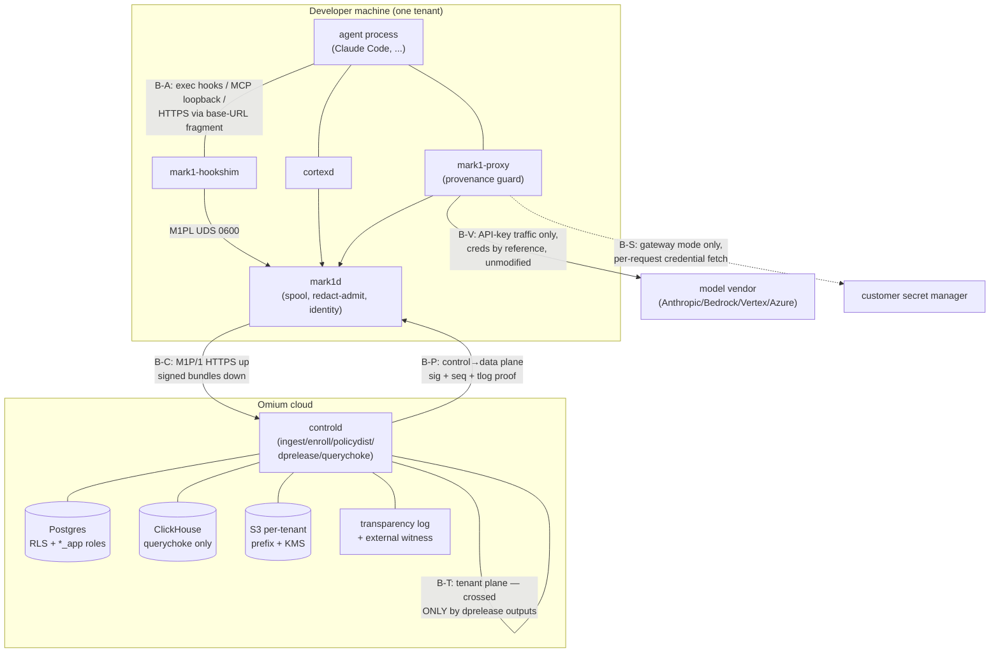

# 10 — Security and Threat Model

**Status:** Authored 2026-08-28 against the frozen execution plan (`docs/spec/execution-plan-v2.md`) and the architecture spec v2.0 (`docs/spec/architecture-spec.md`). Where this document and either of those disagree, they win.
**Inputs:** the edge LLD (`04-lld-edge.md`, esp. §3 provenance guard, §7.1 redact, §10 failure catalog, §11 per-OS deltas) and the cloud LLD (`05-lld-cloud.md`, esp. §3 enroll, §6 querychoke construction proof, §7 RLS, §10 trust inventory). Cited, never restated.
**Discipline:** a control with no test is a lie. Every control row in §12 names its test in `12-testing-and-quality.md`; where a control is only policy-enforced, or a test does not yet exist, this document says so in plain text rather than hiding it in a footnote.
**Numbering note (reconciliation flag for the lead):** the plan's "Compliance enforcement — in code, not policy" has seven points; spec §9 has ten. The three spec-only points are **§9.4 (evidence typing), §9.8 (training) and §9.9 (auditability)** — not §9.8–§9.10 as some earlier planning notes state; spec §9.10 (scope of reading) is the plan's point 7. §12's matrix uses the actual spec numbering.

## 0. Scope, method and adversary model

### 0.1 In scope

- The nine deployables and four client crates of the frozen plan's registry, on all three platforms, in all three deployment profiles (dev sidecar, VPC gateway, Omium cloud).
- The data they move: M1P events, policy bundles, receipts, memory artifacts, corpus exports, federation releases.
- The keys, tokens and salts that authenticate and seal all of the above (§9).
- The supply chain that produces the binaries and the update channel that distributes them (§8).
- The scrutiny of a hostile auditor — the design must not merely be safe but *demonstrably* safe from receipts, logs and tests alone.

### 0.2 Out of scope

- Vulnerabilities in the coding agents themselves (Claude Code, Codex, …) and in the model vendors' services. Mark 1 must not *add* attack surface to them; it does not remediate theirs.
- The customer's own endpoint security. A rooted developer laptop is modeled as the "compromised device" adversary, not defended against as a platform duty.
- Omium-platform (the recovery product). Mark 1 is a separate repo, separate blast radius, separate AWS surface (`09`); the only inheritance is conventions and the training plane in Phases 5–6.
- Physical and personnel security beyond the key ceremony's custody requirements.

### 0.3 Method

STRIDE per trust boundary (§2), plus three deep dives where STRIDE's granularity is too coarse: the OAuth non-interception control (§3), credential custody (§4), and tenancy (§6). Abuse/economics analysis for the incentive-shaped attacks STRIDE misses (§11). The output artifact is the control matrix (§12) and the honest residual list (§13).

### 0.4 Adversary classes

| Adversary | Capabilities | Motivation | Explicitly cannot |
|---|---|---|---|
| **Curious Omium employee** | Read access to prod stores through sanctioned paths: `querychoke` templates, Postgres via the `controld_app`/`controld_worker` roles, S3 with Omium IAM, deploy pipelines. Can read code and configs. | Curiosity, career pressure ("just check what the customer is doing"), or coercion. | Cannot read customer code, prompts or raw sessions — those never leave the edge by default (typed evidence, E0). Cannot execute a tenant-less ClickHouse query (§6.1 of `05`: not checked, *unconstructible*). Cannot silently rewrite receipts (device origin signature + external witness). |
| **Compromised device** | Full control of one enrolled developer machine: the device key's *use* (not export where TPM/keychain-held), the spool, the local provision table, ability to patch or replace every edge binary, emit arbitrary M1P events *as that device*. | Whoever rooted the laptop: malware, a malicious insider at the customer. | Cannot mint another device's identity or another tenant's token. Cannot make the server accept envelope identity (stamped from token claims, disagreement ⇒ 403 + security event). Cannot read any other tenant's data. Cannot forge server countersignatures or witnessed chain heads. |
| **Malicious tenant** | Everything a legitimate customer can do, at scale: many devices, crafted workloads, gamed metrics, poisoned artifacts submitted toward federation. | Look efficient to their own management; sabotage the shared pool; extract other tenants' patterns. | Cannot see any cross-tenant output except `dprelease` releases (the only route across the tenant plane). Cannot push a span into a published artifact unless ≥ m verified orgs independently produced it. |
| **Malicious co-tenant** | The same as above, aimed sideways: attempts cross-tenant reads via API parameters, envelope fields, query shaping, timing. | Industrial espionage. | Cannot name another tenant in any request that matters — tenant identity comes only from verified token claims; `TenantID` has no `FromString`. |
| **Network attacker** | On-path between edge and cloud, or on the local network: intercept, replay, reorder, inject, block. | Data theft, denial, substitution of policy. | Cannot forge bundles (Ed25519 section signatures + monotonic seq + tlog inclusion proof, all verified at the edge). Cannot replay batches into double-billing (`event_id`/`idem_key` idempotency). Cannot read M1P (TLS) or the local fabric (UDS 0600 / SID-DACL'd pipe). |
| **Supply-chain attacker** | Compromise a dependency, a build step, a registry, or the update channel. | Fleet-wide code execution — the highest-value target in the system. | Cannot ship code through a policy bundle (no command strings, no code, no `wasm_module` field exists to abuse — the branch is deleted, not mitigated). Cannot sign an update with a bundle key (update key ≠ bundle key, boot refusal R5). |
| **Compromised model vendor** | Controls upstream responses on the API-key path; already sees the customer's prompts (that is the pre-existing relationship, not one Mark 1 creates). Could inject hostile content into completions. | Assumed rarely; modeled because the proxy trusts response bytes enough to scan them. | Cannot reach the edge daemon through the proxy — response bytes are forwarded and *observed* (tee, allow-listed fields), never executed. Cannot alter Mark 1 policy (bundles come from the control plane only). |
| **Hostile auditor** | Not an attacker. Full access to receipts, the transparency log, the open-source verifier, this document, and the right to demand evidence for every claim. | Find the gap between what Omium claims and what Omium can prove. | Nothing — the design goal is that this adversary leaves empty-handed. Every "cannot" in this table must trace to a test in §12 or an honest residual in §13. |

The one adversary this model deliberately does not defeat: **a customer determined to violate their own vendor terms using modified tooling on their own machines.** §3.9 treats this honestly — the legal boundary protects the traffic Omium's shipped binaries will carry, not the behavior of binaries the customer rebuilt.

---

## 1. Trust boundaries

For each boundary: what crosses, what the far side is trusted for, what is verified rather than trusted, and what is deliberately never sent.

| # | Boundary | What crosses | Trusted | Verified | Never sent |
|---|---|---|---|---|---|
| **B-A** | Developer machine ↔ agent process | Hook stdin/stdout (shim), MCP loopback (cortexd), HTTPS via the provisioned base-URL fragment (proxy). | The agent is trusted to exec the shim and honor its own hook config — nothing more. Hook payloads are *data*, mapped through bundle-supplied field maps; an unknown shape is dropped, never guessed (`04` §2.10). | Loopback callers: per-session bearer token, literal-loopback `Host`, `Origin` rejection (`M1E-4004/5`); fabric peers: `SO_PEERCRED`/pipe-SID UID match; socket symlink/perms checked at start (F-40, refusal). | Nothing the agent didn't already have. Mark 1 injects context and gate verdicts; it never injects credentials or executes agent-supplied commands. |
| **B-C** | Edge ↔ Omium cloud | Up: zstd M1P batches under a ≤24 h device token. Down: signed policy bundles, revocation events, key manifest. | The cloud is trusted for durability *after* it acks (S3-first: the ack **is** the durability claim) and for nothing about policy authenticity — transport is irrelevant to bundle trust. | Up: token signature + revocation cache (≤60 s stale ceiling, fail-closed past it); envelope identity actively distrusted — stamped from claims, disagreement ⇒ 403 `M1E-8003` + security event. Down: section-split Ed25519 signatures + monotonic seq + transparency-log inclusion proof, all verified by `mark1-policy` before apply. | Raw code, prompts, transcripts, paths, free-text excerpts (typed `EvidenceRecord` only; excerpts are per-tenant opt-in and receipted). Pre-redaction plaintext — structurally, since redact-admit runs before spool admission and the spool is the only upload source. Credentials of any kind. |
| **B-T** | Tenant ↔ tenant | **Nothing except `dprelease` outputs** — (k,m)-gated, intersection-reconstructed, DP-noised, human-reviewed releases. | Nothing. Each tenant's identity derives solely from its own verified tokens. | Four independent isolation surfaces (§6): Postgres FORCE-RLS under `NOBYPASSRLS` roles, the ClickHouse query chokepoint, the tenant-scoped memory API, per-tenant S3 prefixes with per-tenant KMS keys and a bucket-policy deny. Negative tests on every PR. | Any tenant-attributable span, digest or count. Per-tenant HMAC salts make even equal secrets/errors uncorrelatable across tenants. |
| **B-V** | Omium ↔ model vendor | On the API-key path: the customer's own request, bytes-forward, credential passed through by reference, connection pool keyed `(upstream, credential-identity)` — the vendor always sees the true caller. On the cloud-judge path (opt-in): E0/E1 evidence to Anthropic under the subprocessor register. | The vendor is trusted exactly as much as the customer already trusted it — Mark 1 adds no new disclosure on the default path (judges run client-side through the customer's own key). | Upstream TLS via rustls against a bundle-declared hostname allow-list; responses scanned for subscription-billing markers (the contamination tripwire, §3.7). | Subscription/OAuth traffic — **never**, by provenance-gated refusal (§3). Any credential Mark 1 minted or stored (it has none). Tenant identity beyond what the customer's own credential discloses. |
| **B-S** | Omium ↔ customer secret manager | Gateway mode only: a per-request credential fetch by reference. | The customer's secret manager is trusted as the credential authority — that is the point: custody never transfers. | The reference resolves under the customer's own IAM; the fetched value lives in a `Secret<T>`, is used once, zeroized, never persisted, never spilled (tee allow-list excludes it by construction). | The credential, to anywhere: not to the spool, not to the tee, not to Omium cloud, not to disk. |
| **B-P** | Control plane ↔ data plane | Signed bundles down; ACKs and `GuardDecision`/`Dropped{}`/`CoverageTransition` accounting up. | The control plane is trusted to *propose* policy, never to command execution: bundles carry no command strings and no code — any command string fails decode (`M1E-3005`, whole-bundle reject, security event). The `gates` section may downgrade closed→open only; tightening requires a local on-disk tenant opt-in artifact. | Signature/seq/inclusion-proof at every edge; publish-side validation kills a compiler bug at one publication point instead of ten thousand edges; fail-static keeps last-known-good if the control plane vanishes, conservative built-ins past `max_age`. | Executable anything. The bundle→RCE branch is deleted: no `wasm_module` field exists in `m1p.v1` or PolicyBundle v1 to even mis-verify. |

Two boundaries that look like boundaries but are not: (a) **edge process ↔ edge process** on one machine — they share a user account and a fate; the fabric's 0600/DACL discipline is hygiene against *other users* of the machine, not against a compromised peer process; (b) **Omium cloud module ↔ module** inside `controld` — deliberately one binary, one auth middleware, one revocation cache (`05` §0.1); the seam is the durable stores, not a network boundary.

---

## 2. STRIDE per boundary

Likelihood is judged for the pilot population (founder + AIOS, ~200 devices) and revisited per phase gate. Test IDs are `12`'s to own; slugs already fixed by `04` §10 and `05` §7.5/§9 are reused verbatim.

### 2.1 B-A: developer machine ↔ agent process

| Threat | STRIDE | Impact | Likelihood | Control | Proving test | Residual |
|---|---|---|---|---|---|---|
| Rogue local process spoofs the shim on the fabric and injects fake events | S | Polluted ledger for *this tenant only* | Low | UDS 0600 + peer-UID check; SID-named pipe + DACL on Windows; symlinked socket path ⇒ start refusal (F-40) | `12/fabric-symlink-refusal`, `12/fuzz-m1pl-frames` | A same-user process is inside the boundary by definition — it can pollute its own tenant's data, nothing more |
| Rogue browser page hits the loopback listener / MCP (DNS rebinding) | S/E | Event injection or repo-map exfil to a web page | Medium (classic bug class) | Per-session bearer token, literal-loopback `Host` validation, `Origin` rejection (`M1E-4004/5`) | `12/loopback-host-origin` | None meaningful — the three checks each independently kill the rebinding shape |
| Agent hook payload crafted to crash/exploit the shim | T | Shim RCE would run as the user — lateral into `mark1d` | Low | Shim is static, synchronous, parses JSON against bundle field maps only; unknown shape ⇒ typed drop; M1PL frames bounds-checked and fuzzed | `12/adapter-version-sniff-drop`, `12/fuzz-m1pl-frames` | Rust memory safety is the real control; `unsafe` audit is part of the `cargo-deny`/review gate (§8) |
| Malicious repo content attacks cortexd (hostile source files → tree-sitter/SCIP) | T/D | Index corruption or cortexd crash | Medium (untrusted input by design) | Per-workspace process isolation (a crash stalls one workspace), vendored pinned grammars, shard corruption ⇒ delete + reindex, capture unaffected | `12/chaos-cortexd-kill`, `12/cortex-shard-corrupt` | Parser CVEs in tree-sitter grammars; compensated by process isolation and no-network in cortexd, tracked by `cargo-deny` advisories |
| Gate abused to deny developer service (block loop) | D | Developer blocked from working | Low | ≤3 consecutive blocks/task, hourly block ceiling, `mark1 off` checked before any gate, gate fail-open on timeout | `12/gate-timeout-allows`, `12/off-byte-equality` | None — the caps are local and bundle-independent |
| Mark 1 reads outside enabled workspaces | I | Scope-of-reading violation (plan point 7) | Low | `WorkspaceSet.Allowed()` consulted on every file discovery; `.mark1ignore`; canonicalize-then-check paths; `mark1 status` shows the live read surface | `12/tailer-workspace-scope` (new — **must exist in 12**; `04` names the oracle but no slug) | Symlink races between check and open; mitigated by canonicalization at open time, honest residual for exotic filesystems |

### 2.2 B-C: edge ↔ Omium cloud

| Threat | STRIDE | Impact | Likelihood | Control | Proving test | Residual |
|---|---|---|---|---|---|---|
| Envelope claims another tenant/device | S | Cross-tenant write | Medium (cheap to try) | Identity stamped from verified token claims only; disagreement ⇒ 403 `M1E-8003` + security event; `identity_disagreements_total` pages on any nonzero | `negative_envelope_tenant_spoof_rejected` | None — the envelope fields are not in the trust path at all |
| Stolen device token used from attacker infra | S | Upload-as-device + read that tenant's bundles, ≤24 h | Medium | ≤24 h hard expiry; refresh needs the device *key* (PoP, keychain/TPM); revoke ⇒ ≤60 s fleet-wide cutoff, fail-closed past cache staleness | `negative_revoked_token_60s_cutoff` | Sub-24 h window before detection; bounded by anomaly signals (new ASN/geo per device) feeding `11` alerts |
| Batch tampering / replay in transit | T | Double-billing, forged usage | Low | TLS; `event_id` idempotent upsert; `idem_key` on every Usage; re-POST of an acked batch returns the original response; same batch_id with different bytes ⇒ 409, never overwrite | `negative_duplicate_flood_no_double_count`, `12/uplink-409-divergence` | None for integrity; a network attacker can still *delay* (availability, spool absorbs) |
| Omium denies having received data | R | Billing/coverage disputes | Low | Ack only after S3 landing; dual-signed receipt checkpoints; hourly witnessed heads; customer-runnable offline verifier | `chaos_s3_outage_no_false_ack`, verifier E2E (Phase 1 gate) | None — this is the product's core claim |
| Secret exfiltrated inside event stream | I | Customer secret in Omium stores | Medium (developers paste secrets) | Edge redact-admit (fail-closed, no off switch) + `controld.ingest` independent second ruleset + never-replayed quarantine prefix | `12/redact-fails-closed`, `12/redact-substitution-pre-spool`, `negative_ingest_second_scanner_quarantines` (new — 05 §2.3 names the path, 12 must name the test) | Regex-class misses (§5.4) — compensated by typed-evidence default carrying no free text at all |
| zstd bomb / decode bomb | D | Ingest pod OOM | Medium | Streaming decoder with size (32 MiB), ratio (100:1) and window (64 MiB) bounds; proto bounds (10k events, 1 MiB/event); 503-before-decompress under saturation | `12/ingest-zstd-bomb` (new slug; `05` stage 4 specifies, 12 must gate) | None meaningful |
| Malicious bundle pushed to fleet | T/E | Fleet behavior change | Low | See B-P row set (§2.6) — signature/seq/proof; no command strings | `12/bundle-command-string-rejects`, `12/bundle-invalid-keeps-lkg` | Key compromise scenarios in §9 |

### 2.3 B-T: tenant ↔ tenant

| Threat | STRIDE | Impact | Likelihood | Control | Proving test | Residual |
|---|---|---|---|---|---|---|
| Cross-tenant read via API parameter shaping | I | The estate's nightmare, repeated | Medium (until proven otherwise) | `TenantID` newtype with no `FromString`; `pg.TenantDB` makes "forgot the GUC" unwritable; `NULLIF` GUC form makes unset-match-nothing; querychoke construction proof | `test_rls_cross_tenant_denied`, `test_rls_unset_guc_matches_nothing`, querychoke live negative (§6.3) | None by design; §6 narrates why this time is structurally different |
| Cross-tenant write (stamping bug lands tenant A's batch in B's prefix) | T | Data mixing | Low | Per-tenant KMS keys + bucket policy denying mismatched-key PUTs — a stamping bug becomes a *write failure*, not a leak; boot refusal R6 proves the deny statement exists | `chaos_kms_throttle_tenant_isolated` (blast-radius half), `negative_s3_cross_tenant_put_denied` (new — R6 probes at boot; 12 must prove the deny fires) | None |
| Correlation attack via digests (same error string across tenants) | I | Cross-tenant linkage of low-entropy content | Medium | Per-tenant HMAC salts on all low-entropy digests — cryptographically uncorrelatable, not policied | conformance vectors asserting salt separation (new slug `12/digest-salt-separation`) | Salt custody is the load-bearing item — §9 table |
| Federation laundering (span smuggled through dprelease) | I | One tenant's text published | Low | (k=25, m=5) as `HAVING` + DB trigger; intersection reconstruction — a 1-org span cannot survive step 3; `invariant` kind excluded by schema; human review queue; ε ledger | `negative_epsilon_exhaustion_refuses`, `negative_under_k_release_db_rejected` (new — the trigger exists in 07; 12 must fire it) | Sock-puppet economics: m−1 real verified paying orgs (§11.2) |
| Timing/row-count side channels across tenants | I | Existence inference | Low | Closed template registry with row limits and fixed shapes; reports are per-tenant by construction; ops templates need `OpsScope`, unreachable from tenant routes | template fuzz (§6.3) | Coarse timing residual accepted — shared pods mean shared latency; no per-tenant data content leaks through it |

### 2.4 B-V: Omium ↔ model vendor

| Threat | STRIDE | Impact | Likelihood | Control | Proving test | Residual |
|---|---|---|---|---|---|---|
| Subscription/OAuth traffic transits the proxy | — | **The legal boundary.** Not a STRIDE cell; §3 in full | — | Provenance guard, tripwire, marker kill path, canary CI, receipted refusals | `12/guard-no-forward-path`, `12/guard-contamination-killpath`, weekly token-shape canary | §3.9 |
| Proxy degrades/corrupts the client stream | T/D | Customer's ability to code — trust-destroying | Medium (streaming is hard) | Bytes-forward with no full-message buffering; tee `try_send` provably cannot hold a client write; golden byte-exact transcripts + chaos suite per dialect | `12/chaos-proxy-stream-suite`, `12/frames-golden-per-dialect`, `12/proxy-tee-saturation` | Vendor grammar drift degrades *observation* only (opaque passthrough + `Dropped{}`) |
| Hostile upstream response exploits the parser | T | Proxy RCE | Low | Parsers consume only the tee clone — a parser bug cannot touch the client path (topology theorem, `04` §4); Rust; fuzzed framing | `12/frames-golden-per-dialect` + fuzz corpus | Parser CVE ⇒ tee-side compromise; contained by non-dumpable, no-persist, allow-list tee inputs |
| Credential identity masked / multiplexed to vendor | R | Vendor ToS breach attributed to Omium | Low | Pools keyed `(upstream, credential-identity)`, no h2 stream sharing across credentials, no identity masking | `12/proxy-pool-identity-keying` (new — `04` §3.4 states it; 12 must assert per-credential connections) | None |
| Cloud judge leaks evidence to vendor beyond consent | I | Privacy/subprocessor breach | Low | Client-side judges are the default (evidence never leaves); cloud path requires tenant consent flag + subprocessor register + region pinning, all receipted | `12/judge-cloud-path-requires-consent` (new) | Register upkeep is procedural — labeled policy-enforced in §12 |

### 2.5 B-S: Omium ↔ customer secret manager

| Threat | STRIDE | Impact | Likelihood | Control | Proving test | Residual |
|---|---|---|---|---|---|---|
| Gateway persists or spools a fetched credential | I | Custody breach — the enterprise deal-killer | Low | Fetched by reference per request; `Secret<T>` (no Debug/Display/Serialize), zeroize-on-drop; tee allow-list excludes credential fields by construction; spill ring is post-redaction and never receives headers | `12/gateway-cred-never-persisted` (new — plan point 2 demands it; must exist), CI grep gate | Memory-disclosure class (§4.5) |
| Over-broad fetch scope (gateway reads secrets it shouldn't) | E | Lateral credential theft | Low | The reference names one credential; IAM scoping is the *customer's* control on their manager — Mark 1 requests, never enumerates | — (customer-side IAM; documented in `09`) | Explicitly shared-responsibility; labeled as such to customers |
| Bedrock SigV4 re-signing custody creep | E | Omium holding AWS creds it shouldn't | Low | Bedrock stays observe-only until customer-held re-signing hardens; `RouteDecision` on Bedrock is never `WIRE_ENFORCED` | `12/bedrock-observe-only` (new) | Deliberate capability gap, not a risk |

### 2.6 B-P: control plane ↔ data plane

| Threat | STRIDE | Impact | Likelihood | Control | Proving test | Residual |
|---|---|---|---|---|---|---|
| Forged/replayed/downgraded bundle | S/T | Fleet policy takeover | Low | Section-split KMS signatures, monotonic seq (rollback = append, no seq exception to exploit), tlog inclusion proof verified at edge, `prev_hash` chain | `12/bundle-invalid-keeps-lkg`, `12/bundle-maxage-builtins` | Key compromise (§9); tlog forks are detectable-not-preventable (witness comparison) |
| Command string smuggled via bundle | E | Fleet RCE | Low | Grammar `^[a-z0-9-]+@cat-[0-9]+$` at decode; whole-bundle reject `M1E-3005`; also dies at publish-side validation; canary auto-halts on any single `M1E-3005` ACK | `12/bundle-command-string-rejects` + publish-side conformance | None — the field where a command could live does not exist |
| Malicious `agent_maps` push (field maps steer capture) | T | Mis-capture, gate misfires | Low | Maps change *parsing*, not execution — worst case is dropped/garbled events, accounted as `Dropped{}`; gates-section can only open, never close | `12/adapter-version-sniff-drop` | A hostile map could blind capture for its tenant — visible as a coverage anomaly, not silent |
| Control plane learns edge secrets via ACK/telemetry | I | Reverse-channel leak | Low | ACKs carry seq/hash/result codes only; `GuardDecision` is sampled and typed; no free text in any accounting event | schema conformance (buf breaking + typed events) | None |
| Server refuses to serve a tenant (targeted policy denial) | D | Tenant degraded | Low | Fail-static: last-known-good runs indefinitely; past `max_age`, conservative built-ins keep the developer working; everything visible in `mark1 status` | `12/bundle-maxage-builtins` | Long-term staleness degrades verdict certification honesty (`stale_cert`) — by design |

---

## 3. The OAuth non-interception control, in depth

This is the single most important control in the product. Plan enforcement point 1, spec §9.1, `04` §3.1 (the request path), `05` §3.6 (the server-side fingerprint registration). Failure posture: **fail-closed** — the one place legality beats availability.

### 3.1 Why it exists

Intercepting subscription/OAuth traffic means intermediating a credential the customer does not own the billing relationship for, on a surface the vendor's terms do not sanction. The Mark 1 wedge research forecloses that path legally, not tactically: no proxying, no credential intermediation, no vendor binary modification, ever. The proxy therefore serves **customer-owned API-key traffic only**, and the subscription regime is captured through the vendor's own sanctioned surfaces (hooks, transcripts, artifact dirs). This is a boundary, not a preference — which is why every layer below is code, and why the absence of an override is itself the control.

### 3.2 `Detect()` — the classifier and its inputs

Each adapter's `Detect()` returns `Regime: Subscription | APIKey` from the agent's actual configuration state: presence and provenance of `ANTHROPIC_BASE_URL`/Bedrock/Vertex/Azure endpoints and an API-key credential in the agent's own config surfaces — never from token *shape* alone (shape is the demoted secondary signal, spec S1-1). Only `Detect()==apikey` makes an adapter proxy-eligible; only then does `mark1d.supervise` spawn the sidecar and provision the base-URL fragment. A subscription-regime agent never even has a route to the proxy: its config was never touched.

### 3.3 `M1-Cred-Ref` provisioning and the HMAC fingerprint

When `mark1d` provisions an API-key credential for proxying it: (1) computes `fp = HMAC-SHA256(k_device, credential_bytes)` under the device-local guard key — the fingerprint reveals nothing and two devices' fingerprints of the same credential don't correlate; (2) records `ref-id → fp` in the proxy's local provision registry; (3) registers `{fp, upstream_class, provisioned_at}` on its device row server-side (`POST /enroll/fingerprints`). The credential bytes never travel. The provisioned agent fragment injects `M1-Cred-Ref: <ref-id>` on every request.

### 3.4 The request path (order is normative — `04` §3.1)

1. Off-check (race-window belt; `mark1 off` normally detaches the proxy entirely).
2. `M1-Cred-Ref` absent ⇒ **403 `M1E-8001`**.
3. Extract the actual credential (`x-api-key`/`Authorization`), HMAC under the guard key, **constant-time compare** to the enrollment fingerprint. Unknown ref, mismatch, or any parse ambiguity ⇒ **403 `M1E-8001`**, with a sampled `GuardDecision{REFUSED, reason_code:"unprovisioned_cred", sample_rate}` — refusal is receipted, therefore *provable*, not asserted.
4. **No override exists.** No env var, config key, CLI flag, bundle section, or debug feature causes forwarding of an unprovisioned credential. Two gates keep it true: the `12/guard-no-forward-path` negative test proving no code path forwards one, and a CI grep gate rejecting any `cfg`/flag in the crate whose name matches an override pattern. An "operator escape hatch" would convert a legal guarantee into a policy, and policies get overridden under deadline pressure.
5. **Shape tripwire (secondary).** A provisioned credential that classifies OAuth-shaped ⇒ refuse + P1: the provisioning path has a bug. The classifier is allowed to age only loudly (3.6).
6. **Upstream-subscription-marker kill path (tertiary).** `response/` scans upstream headers/shape for subscription-billing markers. A hit is the P0: an OAuth credential got through everything. In order: **session kill** (connection closed, all further session requests refused) → **config rollback** (`mark1d` reverts the base-URL fragment over the fabric, so the next agent request bypasses the proxy entirely) → **per-event-receipted `oauth_contamination`** (`M1E-8002` — one of C13's per-event receipt classes). Nothing on this path is sampled or rate-limited.

### 3.5 Defense-in-depth summary

Three independent signals — **provenance** (primary, allow-list), **shape** (secondary, tripwire), **upstream markers** (tertiary, kill switch) — and each has a distinct failure mode: provenance fails only via a provisioning bug, shape fails via vendor format drift, markers fail via vendor response changes. All three failing simultaneously and silently is the event the weekly canary exists to make loud.

### 3.6 The weekly token-shape canary

`conformance/` carries OAuth token-shape fixtures per vendor. Weekly (and on every proxy-crate PR), CI replays them through the classifier; **any classifier miss fails CI**. A vendor token-format change therefore breaks the build before it breaks the tripwire in the field. The canary is the answer to "the classifier is a regex and regexes rot": it may rot, but never silently.

### 3.7 Provable refusal

Sampled `GuardDecision` events (with their `sample_rate`) enter the receipt chain; contamination events are per-event receipted; server-side fingerprint registration lets a refusal bind to a registered fingerprint. The compliance claim to vendor counsel is therefore not "we promise we didn't" but "here is a witnessed, offline-verifiable record of refusals, and here is the binary with no forward path — audit both."

### 3.8 Attacking it — every route we could think of

| # | Attack | What stops it |
|---|---|---|
| A1 | Engineer manually sets `ANTHROPIC_BASE_URL` on a subscription-mode agent to point at the proxy | The request carries no `M1-Cred-Ref` (no fragment was provisioned — `Detect()` never returned apikey) ⇒ 403 step 2. Adding the header by hand names a ref-id that isn't in the registry ⇒ 403 step 3. |
| A2 | Engineer copies a *valid* ref-id from an API-key agent onto subscription traffic | The fingerprint check binds the ref to the *credential bytes*: the OAuth token's HMAC ≠ the enrolled API key's fingerprint ⇒ 403 step 3. The ref names a credential, not a permission. |
| A3 | Trick `mark1d` into provisioning an OAuth token as if it were an API key (a `Detect()` bug or crafted agent config) | Shape tripwire refuses OAuth-shaped credentials even when provisioned (step 5, P1); upstream markers kill the session if shape also misses (step 6, P0); the weekly canary keeps the shape classifier current. |
| A4 | Vendor changes token formats so OAuth tokens pass the shape check | Provenance still holds (an OAuth token was never provisioned); if a provisioning bug coincides, markers remain; the canary fails CI on the format change, forcing a classifier update within a week. |
| A5 | Patch `mark1d` locally to provision arbitrary credentials | The proxy's shape tripwire and marker path still fire (independent binary); server-side fingerprint re-verification on daemon restart detects a provision table diverging from the authoritative set; contamination is receipted against the device. |
| A6 | Recompile **both** `mark1d` and `mark1-proxy` from patched source | Nothing in software stops a customer running modified code on their own machine. See 3.9. |
| A7 | Point a generic HTTP client (not an agent) at the proxy with an OAuth token | Same as A1/A2 — no provisioned ref ⇒ 403. The sidecar also binds loopback-only with a per-boot token and rejects `Origin`, so it is not even reachable off-machine. |
| A8 | Route subscription traffic through the enterprise gateway | Same guard, same binary, same absence of an override; gateway credentials come by reference from the customer's secret manager, which holds API keys for Bedrock/Vertex/Azure — there is no subscription credential to fetch. |
| A9 | Race the `mark1 off` window to slip traffic through ungated | The off path *detaches* the proxy (fragment reverted); the in-binary off-check covers the race by passing through — but pass-through without a provisioned ref is still refused before upstream. No window exists where an unprovisioned credential forwards. |
| A10 | Compromise the bundle channel to reconfigure the guard | The guard consults no bundle state for its accept/refuse decision — the registry is local provisioning state; bundles carry no guard-relevant override (and no field for one). The hostname allow-list a bundle *does* carry can only narrow upstreams. |
| A11 | MitM the fabric to forge a rollback-suppression or fake provisioning | Fabric is UDS/named-pipe with peer verification; provisioning originates in `mark1d.identity`'s process; an attacker with that position is the compromised-device adversary — see A5/A6. |

### 3.9 The honest paragraph

Every control above executes on hardware the customer controls. A customer who rebuilds the proxy without the guard (A6) defeats it — as they could defeat any client-side control in any product. What the design actually guarantees, and what counsel can defend: **Omium's shipped binaries contain no path that forwards subscription traffic, no override to enable one, and a receipted record of every refusal**; the SLSA-attested, signed release channel (§8) makes "this binary is the one we audited" verifiable; and a customer running modified binaries has manufactured their own ToS breach with their own tooling — legally theirs, provably not Omium's. That perimeter — Omium's conduct provable, customer's misconduct attributable — is the designed outcome. Anything stronger (remote attestation of edge binaries) is not in scope and should not be promised. What stops A6 today is *only* the customer's own policy and contract with their vendor: label it plainly — this residual is policy-stopped, not code-stopped, and it is the only row in §3.8 that is.

---

## 4. Credential custody

Plan enforcement point 2, spec §9.2, `04` §3.3. The design premise: a credential Mark 1 cannot see is a credential Mark 1 cannot leak. Every layer below narrows "cannot see" from convention to construction.

### 4.1 The layers

| Layer | Mechanism | Enforcement class |
|---|---|---|
| `Secret<T>` newtype | No `Debug`/`Display`/`Serialize` impls exist — a `format!("{...}")` or `serde` path over a credential does not compile | Compile-time |
| Zeroize-on-drop | Credential memory overwritten when the value leaves scope | Runtime (crate-enforced) |
| CI grep gate | Rejects any derive or manual impl of the forbidden traits on `Secret<T>`, and any override-pattern `cfg`/flag in the proxy crate | CI |
| Tee = field allow-list | The tee task receives a struct built field-by-field (method, path, models, byte counts, timings, status) plus body chunks — **never a request clone**, because `Request::clone()` carries headers and headers carry credentials. The allow-list is compile-visible proof the tee cannot see a secret | Compile-time (structural) |
| `RLIMIT_CORE=0` + `PR_SET_DUMPABLE=0` | Set in `main` **before** any credential can be loaded; blocks core dumps and same-user ptrace on Linux. macOS: `RLIMIT_CORE=0` (no dumpable flag). Windows: `WerAddExcludedApplication` + no minidump handler (`04` §11.6) | Runtime, boot-ordered |
| Gateway by-reference fetch | Credential fetched from the customer's secret manager per request, used, zeroized; never persisted, never cached beyond request scope, never written to the spill ring | Runtime |
| Pool keying | Pools keyed `(upstream, credential-identity)`; no connection or h2-stream sharing across credentials, no identity masking — the upstream always sees the true caller | Runtime (structural) |

### 4.2 Where could a credential still land? The failure analysis

| Sink | Could a credential reach it? | What closes it |
|---|---|---|
| **Proxy log line** | Not via `Secret<T>` (won't format). Risk: logging a raw header map or error containing request bytes. | Header maps never enter the logging path by code review + the grep gate; **gap: no named test asserts log output is credential-free under error injection. Propose `12/proxy-no-secret-in-logs` — until it exists, this cell is review-enforced, which is to say policy-enforced.** |
| **Core dump / crash report** | Blocked on Linux (`RLIMIT_CORE=0`, non-dumpable defeats systemd-coredump and same-user ptrace). macOS: RLIMIT only. Windows: WER exclusion is best-effort; a *kernel* crash dump can still image process memory. | Per-OS mechanics in `04` §11.6; Windows residual accepted and listed in §13. Short credential lifetime (request-scoped, zeroized) shrinks the window on all three. |
| **Swap / hibernation file** | Yes — `Secret<T>` pages are swappable; zeroize does not reach copies already swapped out. No `mlock` is currently specified. | Residual (§13). Compensations: request-scoped lifetime, OS full-disk encryption on modern defaults, gateway hosts under customer disk-encryption policy. Upgrade path: `mlock`/`VirtualLock` on the secret arena if enterprise review demands it. |
| **Tee → spool → cloud** | Structurally no for headers (allow-list). Body chunks *are* teed — and a developer can paste a secret into a prompt body. | That is the redaction plane's job, not custody's: admit-to-upload scans every event pre-spool (§5); the proxy's spill ring is post-redaction, 0600, device-key-encrypted, ≤24 h TTL. |
| **Proxy spill ring** | No: the spill ring receives tee output (allow-listed + redacted), and is sealed to the device X25519 key the proxy cannot read back. | `12/redact-substitution-pre-spool`; spill encryption asserted in `12/shim-spill-replay`'s proxy twin. |
| **Gateway host disk** | No persistence path exists in code. | `12/gateway-cred-never-persisted` (named in §2.5; must land in 12 with a filesystem-diff assertion around a request burst). |
| **Memory-disclosure bug in hyper/rustls/tokio** | Yes in principle — forward buffers hold raw request bytes in plain memory while streaming. | Not closable while remaining a proxy. Compensations: non-dumpable process, vetted tier-1 dependencies, `cargo-deny` RUSTSEC advisories as a CI gate (§8), minimal in-memory residency (streamed chunks, not buffered messages). Residual listed in §13. |
| **`mark1d` / hookshim / cortexd** | These never handle upstream credentials at all — the proxy is the only component that sees one, and only in transit. | Topology; the fabric carries typed events, not requests. |

### 4.3 The custody rule for Omium's own secrets

Device keys sit in the keychain/TPM ladder with a 0600-file floor that is never silently skipped below (F-42 refuses loudly); the per-tenant HMAC salt and X25519 spill private key live only inside `mark1d.identity`, and key bytes never cross a package boundary — `Sign()`/`Seal()` are the only exported operations (`04` §8.1). Server-side, signing keys are KMS-resident and non-exportable; `controld` holds `kms:Sign` permissions, never key material (`05` §4.5). There is no key file in any container image, and External Secrets/IRSA delivers runtime secrets as env per estate convention.

---

## 5. Redaction and egress admission

Plan enforcement point 3, spec §9.3, `04` §7.1 (`mark1-redact`), `05` §2.3 (the ingest quarantine).

### 5.1 The two axes

- **Detect / mutate-in-transit** — default **off**, bundle-enableable: rewrites flagged spans in the live request stream. Off by default because mutating a customer's request is a heavier intervention than observing it.
- **Admit-to-upload** — **fail-closed with no off switch.** Not "configurable and defaulted on": there is no config field, feature flag, or parameter that bypasses it. The absence of an off switch is an API property of `Scanner::admit()` — a caller cannot express the bypass. This is the axis the legal posture rides on.

### 5.2 The admission pipeline

Flagged spans are replaced in place with `⟨redacted:class:hash⟩` — `hash` a per-tenant HMAC of the span, so equal secrets correlate within a tenant and reveal nothing across tenants — **before spool admission**, in `mark1d.capture`'s stage order (redact → seq-stamp → class-tag → append), so no pre-redaction bytes ever reach disk. The same discipline binds every producer: the shim links `mark1-redact` and runs the admit axis in-process before any byte hits its emergency spill ring; the proxy's spill ring receives post-redaction tee output only; `mark1d` carries a Go admit implementation validated **bit-identical** against the Rust crate by shared conformance vectors — a Go/Rust disagreement on any vector fails the build. Scanner *failure* is itself fail-closed: `AdmitOutcome::Quarantine` — the event is locally quarantined and counted (`Dropped{LOCAL_QUARANTINE}`), never admitted raw (F-35).

**No pre-redaction plaintext persistence exists anywhere.** Spool, spill rings, quarantine dirs — all post-admit. The only pre-redaction plaintext in the system is in-flight process memory.

### 5.3 The independent second line: `controld.ingest`

Stage 7 of the ingest pipeline runs a **separately maintained ruleset** (different pattern source, different review cadence — two teams' mistakes must coincide for a secret to pass). A high-confidence hit lands the batch under the **quarantine prefix, never the ingest prefix**, because the ingest prefix is the mechanically-replayed log — a secret there would resurface on every rebuild forever. The response is 202 (durability honored, nothing projected); release is a receipted human action that re-runs the batch with flagged spans replaced; unreleased batches die at the 90-day lifecycle. Tests: `12/redact-fails-closed`, `12/redact-substitution-pre-spool`, plus the proposed `negative_ingest_second_scanner_quarantines` (§2.2 — the path is fully specified in `05` §2.3; the test slug must land in `12`).

### 5.4 Honest limits

A regex-plus-entropy scanner catches structured secrets (key grammars, tokens, PEM blocks) and high-entropy strings. It does **not** reliably catch:

- **Low-entropy human secrets** — a password that is a dictionary word, an internal hostname, a customer name in an error string.
- **Transformed secrets** — base64-of-base64, secrets split across more than `max_pattern_len − 1` bytes of carry-over, secrets interleaved with markup.
- **Semantic secrets** — "the prod DB password is the CEO's dog's name" contains no detectable pattern at all.

What compensates, in order of load-bearing-ness:

1. **Typed evidence is the default (spec §9.4).** `EvidenceRecord` carries tool, code, category, counts, path_role, output HMAC — *no paths, no excerpts, no free text*. The scanner is a second line behind a wire format that mostly has no field for a secret to ride in. Free-text excerpt classes are per-tenant opt-in, structurally scrubbed, and receipted per upload.
2. **Per-tenant HMAC salting** of every low-entropy digest — even a missed low-entropy value that becomes a digest is dictionary-inversion-proof without the tenant salt, and salt destruction at offboarding is crypto-erasure (§10.6).
3. The **independent second scan** and never-replayed quarantine (5.3).
4. Raw evidence stays under `~/.omium/mark1/evidence/`, never uploaded by default — the blast radius of a miss is the typed/opted-in surface, not the session.

Residual: a semantic secret inside an opted-in E1 excerpt that passes both rulesets will upload. That risk is confined to tenants who opt into excerpt classes, is receipted when it happens (every excerpt upload is receipted), and is stated in the tenant-facing consent language. Listed in §13.

---

## 6. Tenancy isolation

Plan enforcement point 5, spec §9.6, `05` §§6–7.

### 6.1 The motivating incident

In the estate, 61 tables carried `FORCE ROW LEVEL SECURITY` — and every one of them was decorative, because the services connected as the RDS master user, which inherits `rds_superuser`, which inherits `BYPASSRLS`. The policies were written, reviewed, migrated, and never once evaluated. The failure was not a missing control; it was a control whose enforcement depended on an unverified assumption about the connecting role. Mark 1's tenancy design exists to make that *class* of failure — a control that looks enforced and isn't — structurally unrepeatable. The pattern applied everywhere: don't check the property, make its violation unconstructible; where it must be checked, check it at boot, per-connection, and in CI, so three independent mechanisms must all rot before it silently fails.

### 6.2 The four surfaces

**Postgres.** `controld_app` is `NOBYPASSRLS`, no superuser, no DDL (the estate's `*_app` convention adopted verbatim). RLS is `ENABLE` + `FORCE` with the `NULLIF(current_setting('app.tenant_id', true), '')::uuid` form — an unset GUC matches *nothing*, never everything. The GUC is transaction-local (`set_config(..., true)`), set only inside `pg.WithTenant`, which takes only the validated `TenantID` newtype; modules receive a `pg.TenantDB` wrapper with no raw query surface, so "forgot the GUC" is not writable. Enforced thrice: role attribute, boot refusal R2 (`pg_roles` query, fatal), per-connection `AfterConnect` assertion. `BYPASSRLS` exists only on `controld_worker`, confined by import-graph test to five enumerated cross-tenant-by-specification paths (`05` §7.3); the migration role never appears in a runtime pod.

**ClickHouse.** No row policies — deliberately, so nobody mistakes a decorative control for a real one. Isolation is the `querychoke` construction proof (`05` §6.1): the only executable value is built by a builder that requires a `TenantID` (no `FromString`, zero value invalid), renders only boot-validated templates carrying a mandatory tenant-predicate marker, and the CH client handle is import-sealed to `querychoke` + the ingest projector's INSERT path. A tenant-less query is not caught — it is *unconstructible*. Cross-tenant ops reads require the distinct `OpsScope` type, unreachable from any tenant-facing route.

**Memory API.** Memory artifacts are tenant-scoped rows behind the same RLS discipline; retrieval flows through tenant-authenticated routes; the edge's synced artifact cache is **purged on revocation** (fail-closed for secret-bearing delivery). Cross-tenant artifact motion exists only as `dprelease` output (§10 of this doc).

**S3.** Per-tenant prefixes (`t/<tenant>/…`) encrypted under per-tenant KMS keys (`alias/mark1-tenant-<uuid>`), with a bucket policy that **denies any PUT whose KMS key does not match the prefix** — a tenant-stamping bug upstream becomes a write failure, not a cross-tenant write. Boot refusal R6 proves the deny statement exists before the pod serves.

### 6.3 The negative tests, on every PR

From `05` §7.5 and §6.4, all real-store integration tests, all CI gates: `test_rls_cross_tenant_denied` (table-list-driven from `pg_policies`, so a new table without a policy fails by omission), `test_rls_unset_guc_matches_nothing`, `test_rls_forced_for_owner_paths`, `test_app_role_nobypassrls` (the direct regression test for the incident), `test_write_rls_denied` (WITH CHECK, writes not just reads), `test_worker_role_confinement`, `test_append_only_receipts`; ClickHouse: per-template predicate fuzz with real SQL parsing, marker negatives, compile-fail type negatives, import-graph confinement, and the live two-tenant cross-read negative. Missing from the named set: the S3 arm — `negative_s3_cross_tenant_put_denied` is proposed in §2.3 and must land in `12`, because R6's boot probe checks the policy *exists*, not that it *fires*.

### 6.4 What a fully-compromised tenant device can and cannot reach

| Surface | Can | Cannot |
|---|---|---|
| Ingest | Upload arbitrary (schema-valid, redaction-passing) events as its own tenant/device; pollute its own tenant's ledger and TVO | Write as another tenant (token-stamped identity; envelope disagreement ⇒ 403 + page); overwrite a landed batch (409) |
| Postgres via API | Read/write its tenant's rows through tenant routes | Touch another tenant's rows (RLS + `TenantID` provenance); read the ledger at operator scope; alter receipt history (append-only triggers) |
| ClickHouse | Its tenant's report templates, row-limited | Any other tenant's rows (chokepoint), any free-form query (no raw-SQL surface exists) |
| S3 | Nothing directly — devices never hold S3 credentials; all access is through `controld` | Everything |
| Bundles | Fetch its tenant's bundles | Another tenant's bundles; forging any bundle (KMS keys) |
| Memory | Its tenant's artifact cache (until revocation purges it) | Any cross-tenant artifact except published `dprelease` releases, which are by construction ≥ m-org spans |
| Receipts | Sign origin tuples as itself | Forge server countersignatures; rewrite witnessed heads; sign as any other device |

The compromise blast radius is, by design, exactly one tenant's *own* data quality — which §11 treats, because polluting your own data is the gaming vector.

---

## 7. Anchor execution sandbox

Plan enforcement point 4, spec §9.5, `04` §2.2 and §11.5. The threat inverted twice: the server must not be able to execute code on customer machines (bundle→RCE), and anchors must not be able to lie or escape (integrity, containment).

### 7.1 The server cannot name a command

Bundles enable anchors by **local-catalog ID only**; the ID grammar is `^[a-z0-9-]+@cat-[0-9]+$` and any token containing whitespace, a path separator, or a shell metacharacter fails decode — rejecting the **whole bundle** (`M1E-3005`), because invalid is a security event, never applied piecewise. The same validation runs at publish, so a compiler bug dies at one publication point; the canary controller halts fleet-wide on a single `M1E-3005` ACK. The catalog itself is **locally derived** (probing the worktree and PATH), **user-consented per entry** (interactive or explicit flags), **re-consented on any derivation change** (argv, binary path, tool version — the changed entry is disabled until re-consented), and shown verbatim in `mark1 doctor`. Tests: `12/bundle-command-string-rejects`; consent-lifecycle test proposed as `12/anchor-reconsent-on-change` (the lifecycle is specified in `04` §2.2; `12` must name it).

### 7.2 Containment

Per `RunSpec`: **network-denied**, **env scrubbed to an explicit allow-list** (`PATH` = resolved catalog dirs only, `HOME` = scratch, `LANG`/`TZ`; nothing inherited), **read-only outside the worktree**, **resource-capped** (CPU-seconds, `memory.max` 512 MiB default, `pids.max`, 60 s/600 s wall by class), **kill-switched** (context cancel ⇒ SIGKILL the process group; `mark1 off` cancels all running anchors first). Test-class anchors additionally require per-repo opt-in *and* the sandbox precondition: if the sandbox cannot be established on this platform, test anchors **refuse to run** rather than run unsandboxed.

### 7.3 The anti-tamper envelope

Because an anchor that runs honestly but *measures a lie* is worthless, every run fills `AnchorIntegrity` (`04` §2.2): `resolved_binary_hashes` (BLAKE3 at the resolved exec path vs consent-time hash — kills PATH shims and swapped binaries), `worktree_merkle_root` (cortexd's L0 root — kills mutate-around-the-anchor), `env_scrub_attestation` (kills env-var tool suppression), `diff_classification` and `suppression_directive_delta` (the cheapest reward-hacking tells), and a `tamper` flag: tampered votes never certify. cortexd down ⇒ the envelope is honestly *incomplete* and the vote never feeds certification — degradation over fabrication. Tests: `12/antitamper-path-shim`, `12/antitamper-worktree-suppression`, `12/anchor-integrity-incomplete`, `12/anchor-error-not-violated`.

### 7.4 What the sandbox actually guarantees, per OS

| | Linux | macOS | Windows |
|---|---|---|---|
| Network deny | **Strong**: new net namespace (or seccomp deny) — no interface exists | **Good**: `sandbox-exec` deny-network profile; deprecated-but-functional, re-validated per OS release in CI | **Weakest**: WFP block — a filter, not an absence; kernel-level but rule-based |
| FS read-only outside worktree | **Strong**: mount namespace | **Good**: `sandbox-exec` FS profile | **Best-effort**: no mount-namespace equivalent; restricted token narrows, does not seal |
| Resource caps | cgroup v2 (`cpu.max`, `memory.max`, `pids.max`) | `setrlimit` | Job objects (memory/CPU/process, kill-on-close) — actually solid |
| Syscall filtering | seccomp | profile-level | none |
| Honest posture | The guarantee as stated | The guarantee as stated, riding a deprecated Apple mechanism — its per-release CI re-validation is the control on the deprecation risk | **Weaker isolation gets a smaller privilege, not a waiver**: test-class anchors are disabled by default on Windows until sandbox parity; only side-effect-free static-analysis anchors run, under job-object caps |

The Windows row is a design decision recorded in `04` §11.5, restated here because auditors ask: Mark 1 does not claim uniform sandbox strength across OSes; it scales the *privilege granted* to the *isolation available*. The residual — a malicious static-analysis binary on Windows could read files outside the worktree that the user can read — is bounded by the consent catalog (the user approved that specific binary at that specific hash) and listed in §13.

---

## 8. Supply chain and SLSA

The highest-value target in the system is the update channel: Mark 1 binaries run on customer developer machines with the customer's own file access. Spec §2's supply-chain block is the requirement set; this section is its enforcement design.

### 8.1 Dependency policy

- **Pinning:** all Rust versions in `[workspace.dependencies]`; Go modules with `go.sum`; `--locked` builds; Python via `uv` lockfiles. No floating versions anywhere — the estate already learned that a floating tag is a lie (`latest` retired 2026-08-13).
- **Vendoring on trust-critical paths:** tree-sitter grammars (cortexd parses hostile input), the Ed25519 chain primitives in `mark1-receipt`, and the receipts Python module (vendored from recovery-orchestrator) — vendored so a registry compromise cannot swap the code that signs or parses.
- **Committed codegen, no `build.rs`:** protobuf outputs are generated by **pinned buf remote plugins** and committed; the Rust crates `include!` committed gen. A build that executes no fetched code at compile time is a build whose provenance means something. Freshness is gated (`g2_codegen_fresh.sh` pattern).
- **New-dependency bar:** a new dependency on the token/hook/credential path is a security review, not a `cargo add`.

### 8.2 CI gates — the ones Mark 1 must ADD

The estate's CI today has **gitleaks, trivy, hadolint, pip-audit — and no `cargo-deny`, no `govulncheck`, no SBOM generation** (verified 2026-08-28, execution-plan appendix delta 4). Since the plan promises SLSA-attested releases, these are **new gates in `omium-mark1`'s own CI**, specified here and in `12`/`13`, not inherited:

| Gate | Covers | Fails the build on |
|---|---|---|
| `cargo-deny` | Rust advisories (RUSTSEC), license policy, duplicate/banned crates, source allow-list | Any advisory ≥ moderate on a shipping crate; any non-allow-listed registry/git source |
| `cargo-vet` (spec §2) | Human audit trail for new/updated Rust deps | An unvetted dependency delta on a trust-critical crate |
| `govulncheck` | Go vulnerability reachability (call-graph-aware) | Any reachable vulnerability in `mark1d`/`controld`/CLI |
| **SBOM (CycloneDX)** | Per-release-artifact bill of materials, published alongside the artifact and referenced by the SLSA attestation | Generation failure (the SBOM is a release artifact, not a nice-to-have) |
| Inherited | gitleaks (secrets in-repo), trivy (images), hadolint, pip-audit | Estate thresholds |

### 8.3 Releases: reproducibility, attestation, signing

- **Reproducible builds** for the edge binaries (pinned toolchains, `strip=true`, no build-time network) so an auditor can rebuild and byte-compare — this is what makes §3.9's "the binary we audited" claim checkable.
- **SLSA provenance** attached to every release artifact; **`mark1d` verifies SLSA provenance before applying any update** — the edge is a verifier, not just a consumer. **No daemon self-update on managed fleets by default.**
- **Code signing per OS:** macOS Developer ID + notarization (Gatekeeper is the customer-side enforcement), Windows Authenticode, Linux detached signatures + signed repo metadata. OS signing is the second, platform-enforced factor on top of Omium's own update-key signature.
- **Update key ≠ bundle key** — distinct KMS keys, distinct custody, and boot refusal R5 makes `controld` refuse to run if they are ever the same key id. A bundle-key compromise cannot ship code; an update-key compromise cannot alter policy silently (bundles still verify against bundle keys). Both key classes live in the public key manifest and the transparency log, so a key substitution is a publicly visible event.

### 8.4 Threats this leaves open

A compromise of the CI system itself (the builder) defeats provenance-by-construction — SLSA L3 builder isolation is the target posture, and until the builder is hardened to it, provenance attests to a build system we operate rather than one we can prove uncompromised. Listed in §13. Likewise `sandbox-exec` deprecation (§7.4) and the pilot's single ClickHouse node (availability, not integrity) are supply-adjacent accepted exposures.

---

## 9. Key management and the ceremony

This section is ADR-0004's content, written to be signed from. Every key in the system, then the ceremony as an executable runbook.

### 9.1 The key table

| Key | Algo / residence | Generation | Custody | Rotation | Revocation | Cross-signing | Blast radius on compromise |
|---|---|---|---|---|---|---|---|
| **Device key** (per device) | Ed25519; keychain (macOS, non-synchronizable) / TPM-CNG (Windows) / secret-service or TPM2 (Linux) / 0600 file floor | On-device at `mark1 enroll`; pubkey registered at `/enroll/device/start` *before* user approval (replay-proof binding) | Never leaves custody; `Sign()` is the only operation | None in place — rotation **is** re-enrollment: new `device_id` + key; old chain stays attributable to the old identity forever | Operator revoke ⇒ ≤60 s server cutoff (fail-closed cache), receipted; fingerprints orphaned atomically (guard forwards nothing) | n/a | Forge origin signatures and upload **as that one device** until revoked; cannot touch other devices, the server chain, or witnessed history |
| **Device X25519 spill keypair** | X25519; private half only inside `mark1d.identity` | With the device key | Same ladder | With re-enrollment | With device revocation | n/a | Read that machine's spill rings (post-redaction, ≤24 h TTL content) |
| **Guard HMAC key** (per device) | HMAC-SHA256 key, device-local | At provisioning setup | `mark1d.identity` | With re-enrollment | With device revocation | n/a | Forge credential fingerprints **locally on that device** — the shape tripwire and marker path still stand (§3.8 A5) |
| **Per-tenant HMAC salt** | Symmetric; server-generated, delivered at enrollment | At tenant onboarding | Server (Secrets Manager) + each enrolled device's custody ladder | Versioned: new salt version issued; digests carry salt version; old digests age out | **Destruction at offboarding = crypto-erasure of all that tenant's digests** (§10.6) | n/a | Dictionary inversion of that tenant's low-entropy digests + intra-tenant correlation; no cross-tenant effect |
| **Server chain key** (receipt countersign) | Ed25519, **KMS-resident, sign-only, non-exportable** | KMS `CreateKey` in the ceremony | KMS key policy: `kms:Sign` to controld's IRSA role only; no export, no decrypt principals | Ceremony §9.2: new key cross-signed by predecessor, manifest windows updated | Manifest `not_after` + tlog revocation entry; verifier refuses signatures outside validity | Old key signs new key's manifest entry | Forge server countersignatures on *new* receipts — but device origin signatures and hourly witnessed heads mean history cannot be rewritten undetected; detection window ≤1 h |
| **Bundle section keys** (×6: verify/route/memory/cortex/gates/agent_maps) | Ed25519, KMS-resident, sign-only | Ceremony | KMS; `kms:Sign` to the publication path only; 50 ops/min budget | Per-key ceremony rotation, cross-signed | Manifest + tlog | Predecessor cross-signs successor | Sign malicious content for **one section** fleet-wide until rotation. Bounded by section semantics: `gates` can only open (decode constraint), `verify`/`agent_maps` cannot carry commands (grammar), no section carries code. Worst single-key case is `route` (cost/model steering) — visible in ledger propensities |
| **Update / transparency-log key** | Ed25519, KMS-resident; **distinct from every bundle key — boot refusal R5 enforces the distinctness** | Ceremony | KMS; sign path is release pipeline + tlog head publisher | Ceremony rotation, cross-signed; OS code-signing identities rotate on their own vendor cadence | Manifest + tlog; OS-level revocation via notarization/cert revocation | Predecessor cross-signs successor | **The worst key in the system**: a forged update is fleet RCE. Mitigations that survive compromise: per-OS code signing is an independent second signature the attacker must also forge; no default self-update on managed fleets; SLSA provenance verified at the edge; a forged tlog head is witness-detectable within the hour |
| **Per-tenant KMS data keys** (S3 SSE) | AWS KMS symmetric CMK, `alias/mark1-tenant-<uuid>` | At tenant onboarding (IaC) | KMS; bucket-policy deny binds prefix↔key | AWS annual rotation enabled | Key disable = tenant data unreadable (crypto-erasure lever) | n/a | AWS-account-compromise class: one tenant's objects at rest. Cross-tenant blast radius is zero by key separation |
| **Device tokens** (not keys, listed for completeness) | Ed25519-signed bearer, ≤24 h | Issued by `enroll` | Edge memory/disk 0600 | Refresh via proof-of-possession only (no refresh tokens — deliberately no second long-lived bearer) | ≤60 s cache + SSE push | n/a | ≤24 h upload-as-device + bundle reads (§2.2) |
| **Loopback / session tokens** | Random per-boot / per-session bearers | Edge-local | 0600 files | Every boot/session | Process exit | n/a | Local-machine loopback access only |

Key-manifest mechanics (shared by all server-side keys): every key appears in the public manifest at `/.well-known/mark1-keys` with `key_id` (`ed25519:` + sha256(pub)[:16]), `not_before`/`not_after`, and cross-signatures; manifest snapshots are transparency-log leaves; `mark1-receipt::KeyRing` is the single implementation of "was this signature made by a then-valid key" for `mark1d`, the proxy, and the offline verifier alike.

### 9.2 The ceremony (executable runbook — ADR-0004 signs this)

**Participants (all required, no delegation):** the founder (key owner), the security lead / lead engineer (operator), and one witness who is neither (counsel or an external advisor). Remote attendance permitted with recorded video; the attestation names who attended how.

**Preconditions:** AWS account per `09` with CloudTrail on; IAM roles for the ceremony session are time-boxed; the transparency log service is deployed and writable; a shared ceremony document (the attestation draft) is open and being filled in live.

**Steps:**

1. **Inventory read-back.** Operator reads the key table above aloud; participants confirm the set to be created this ceremony (initial: server chain key, six bundle section keys, update/log key — eight KMS keys).
2. **Create**, one at a time: `aws kms create-key` with Ed25519 sign-verify spec and a key policy granting `kms:Sign` **only** to the named consuming role (publication path for section keys; release pipeline + tlog publisher for the update/log key; controld runtime for the chain key), `kms:Verify` public, no export, no decrypt, no `kms:PutKeyPolicy` for any runtime principal. Alias each (`alias/mark1-sign-<name>-v1`).
3. **Distinctness check.** Operator demonstrates, in the session, that the update/log key id differs from every bundle section key id — the same predicate boot refusal R5 enforces forever after. Witness initials it.
4. **Manifest publication.** Public keys exported (`kms:GetPublicKey`), `key_id`s derived, manifest composed with validity windows, published to `/.well-known/mark1-keys`, and appended to the transparency log as a key-manifest leaf. Operator fetches the inclusion proof and verifies it with `tools/verifier` **in the session**.
5. **Witness selection and first anchor.** The external witness target(s) for hourly chain heads (public transparency log and/or customer object-lock bucket — the plan's open witness-selection decision is made *here* and recorded) are configured; the first head is published and verified from outside Omium infrastructure.
6. **Negative proof.** Operator attempts one forbidden operation per key class (export attempt, sign from an unauthorized role) and records the denials — the ceremony attests what the keys *cannot* do, not just what they can.
7. **Attestation.** The ceremony document — inventory, key ids, policies, proofs, denials, participants, timestamps — is signed by all three participants, hashed, and the hash appended to the transparency log. The document becomes ADR-0004's appendix.

**Rotation ceremony (same participants, abbreviated):** create successor key → predecessor cross-signs the successor's manifest entry (KMS `Sign` over the canonical manifest bytes) → manifest updated with overlapping validity windows → tlog leaf → consumers migrate at the window boundary → predecessor `not_after` set; it remains verify-valid for its historical window forever (old receipts/bundles must verify forever). **Compromise rotation** differs in one step: the predecessor's `not_after` is set to the compromise time (not the window boundary), a revocation leaf names it, and everything it signed after that instant is re-signed or invalidated; the witness record bounds what "after that instant" can hide.

**Cadence:** routine rotation yearly for server-side keys; device keys never rotate in place (re-enrollment); salts on tenant request or incident. Any deviation from this runbook is itself a receipted event.

---

## 10. Privacy controls

Plan enforcement point 6 plus spec §9.4 (evidence typing) and the C4 evidence-tier contract. `05` §5 is the implementation; this section is the guarantee analysis.

### 10.1 The (k,m) gate

k = 25 distinct contributing tenants before a candidate cluster is even evaluated; m = 5 **verified orgs** (billing/domain-verified, post-collusion-collapse) independently producing a span before it can publish. Structural, not procedural: a `HAVING count(DISTINCT org_id) >= k` clause **plus a database trigger constraint** that rejects any under-floor insert — a Go bug cannot commit an under-k release because Postgres refuses it. `invariant`-kind artifacts are excluded by schema (the enum lacks the value). Counts are exact (`uniqExact` discipline), never sketches — a legality gate computed on an approximation is not a gate.

### 10.2 Intersection reconstruction

Published bodies are **reassembled from spans ≥ m orgs independently produced** post-normalization (`05` §5.4): a string unique to one tenant — a hostname that survived redaction, an idiosyncratic identifier — is by definition a 1-org span and cannot survive. Sub-m spans are elided to typed holes, never paraphrased (paraphrase is a leak with better grammar); if survivors cover < 80 % or fail the structural validator, the artifact does not publish — no minimum-viable-leak fallback. The adversarial case (seeding m−1 sock-puppets) is priced at m−1 real, distinct, paying corporate identities (§11.2).

### 10.3 ε-DP with tenant-level composition

Released *statistics* ride `google/differential-privacy` Go **integer mechanisms** (discrete Laplace, δ = 0 — no floating-point DP attacks, no δ bookkeeping to get wrong): ε_release = 0.25 per artifact, contribution bound C = 1 (clamped pre-aggregation), pre-threshold τ = k applied to **raw** counts before any mechanism (thresholding on noisy counts leaks partition existence through the threshold test). Tenant budget: **ε = 4.0 per calendar year, linear composition** — every contributing tenant is charged the full ε_release per release its data entered; over-counting is the safe direction of wrongness. The ε-ledger commit is atomic with the release row (trigger-checked in-transaction); exhaustion **refuses** — no extra ε, no bigger noise, no silently-dropped tenant (dropping a tenant would let budget pressure reshape published content, a side channel). The ledger is append-only, tenant-visible at `GET /federation/epsilon`, and survives offboarding — a spent-budget record that dies with the data was never real. Test: `negative_epsilon_exhaustion_refuses`.

### 10.4 Evidence tiers — what each disclosure level actually discloses

| Tier | Discloses | Leaves the machine? |
|---|---|---|
| **E0** (default) | `EvidenceRecord{tool, diagnostic_code, category, counts, path_role, output_hmac}` — no paths, no excerpts, no free text; low-entropy digests per-tenant HMAC-salted | Yes, but nothing in it is code, prose, or a path |
| **E1** (per-tenant opt-in) | Sanitized diff hunks + prompt digest; every upload redaction-receipted | Yes, under consent + receipt |
| **E2** (VPC/self-host only) | Full diff | **No** — E2 exists only where the customer's own infrastructure is the destination |

**Judges default to running client-side through the customer's own key** — the strongest privacy control in the verify plane is that the evidence question usually never arises. The cloud-judge path (Anthropic cascade) requires: tenant consent flag, the **subprocessor register** entry (who processes what, under which DPA), and **region pinning** for all Anthropic-bound evidence. Register upkeep is procedural — flagged as policy-enforced in §12.

### 10.5 Raw material never leaves by default

Raw sessions, code, and evidence live under `~/.omium/mark1/evidence/` and the workspace — client-side, per the frozen plan's hard constraint. Transcript tailing reads vendor-written files inside enrolled workspaces only; `file-history/` snapshots are not read at all unless tenant-enabled, and even then only local diff stats compute.

### 10.6 Deletion against an append-only receipt chain

The chain stores **hashes and signatures, never content**: leaves are `event_id`s; receipts are Merkle roots, chain hashes, and key ids. Data-subject deletion therefore proceeds as: delete the content stores (S3 objects including landing/quarantine objects for the tenant scope, ClickHouse rows via the deletion template — the one write-shaped chokepoint statement — Postgres artifact bodies under the dual-controlled offboarding job) while the chain stays intact.

What that buys: (1) deletion does not break verification of anything else — the chain never contained the deleted bytes; (2) the *fact* of deletion is itself receipted, so an auditor sees a deletion event, not a suspicious gap; (3) **salt destruction is the finisher** — destroying the per-tenant HMAC salt at offboarding renders every digest of that tenant's content permanently uninterpretable, converting "we deleted the data" into "the remaining hashes are cryptographically meaningless," which is crypto-erasure, not trust.

What it does not buy, stated precisely: existence metadata survives — that events occurred, when, how many, under which checkpoint. Event *hashes* survive; without the salt they are not invertible, but a party that recorded the salt before destruction could confirm candidate-plaintext membership against surviving digests. And training is downstream: corpus export receipts carry **checkpoint lineage**, so erasure obligates the documented **retrain-on-erasure** path (spec §9.8) for any model checkpoint whose lineage includes the deleted tenant — deletion from the corpus is a rebuild obligation, not a row delete, and the receipts are what make the obligation enumerable.

---

## 11. Abuse, gaming and reward hacking

The attacks STRIDE misses are the incentive-shaped ones: nobody breaks a boundary, they just optimize against the metric. Spec risk 1 ("anchor reward-hacking… an evolving defense, not a rule set") is the governing posture — these controls are expected to be probed continuously, and the detection channel matters as much as the control.

### 11.1 A customer games TVO to look efficient

**Attack:** shape work so the numerator shrinks or the denominator inflates — split tasks artificially, suppress lint findings so anchors vote `satisfied`, disable capture during expensive flailing, run the wasteful sessions on an un-enrolled machine.
**Detection:** `suppression_directive_delta` and `diff_classification` in every anchor's integrity envelope (the cheapest tells); `task_seg.v1` is a versioned, receipted algorithm — task splitting is bounded by the merge rules, not by the customer's labeling; coverage accounting makes every disable/bypass window attributable.
**Control:** TVO reports **carry a coverage band and refuse guarantee-grade issuance below the floor** (`M1E-5004`); tampered/suppressed anchor votes never certify; `unresolved` sessions are a first-class denominator class, never excluded.
**Residual:** work moved entirely outside Mark 1's view (un-enrolled machines) is invisible — but it is also *outside the coverage band*, so the report says so. A customer can only game the number by visibly shrinking the surface the number covers. Un-closable without surveillance Mark 1 must not do; accepted.

### 11.2 A tenant poisons the federated pool

**Attack:** submit crafted artifacts at volume so a harmful pattern (or a laundered target span) publishes to other tenants; or seed sock-puppet orgs to satisfy m.
**Detection:** LCB do-no-harm admission (an artifact must demonstrate non-negative lower-confidence-bound outcome effect before it publishes and *keeps* demonstrating it via `ArtifactOutcome` joins); the human review queue sees gate evidence (k, m, span coverage, ε) before publication; cross-tenant prior deviation flags for manual review.
**Control:** m counts **billing/domain-verified orgs with collusion collapse** — orgs sharing billing identity or verified domain collapse to one, pricing the sock-puppet attack at m−1 = 4 real, distinct, paying corporate identities maintained convincingly over time; intersection reconstruction means the poison must be *independently produced* by all of them verbatim-post-normalization; 14-day review expiry defaults to **not** publishing.
**Residual:** a well-funded adversary running 5 genuine companies can, by construction, publish what those 5 companies genuinely all produce — which is the definition of the federation working. The DP layer caps what their coordinated *statistics* reveal about anyone else. Accepted as economically irrational at current stakes; revisit at scale.

### 11.3 A model games a learned verifier

**Attack:** once T2 reward models join the ensemble, generation strategies drift toward what the learned verifier over-scores (classic reward hacking — the verifier is now the reward).
**Detection:** **anchor-vs-T3 divergence monitored per tenant as an adversarial-ML metric** (spec risk 1); learned members' confusion matrices are re-measured continuously by the same D-S estimator that certifies everything (shadow votes vs outcomes), so a drifting verifier's measured error rate rises in the open.
**Control:** learned members enter only via **probation → shadow → LCB promotion → canary** (no self-promotion — the do-no-harm theorem applied to LEARN's own outputs); learned verifiers are one correlated ensemble member, never the verdict — deterministic anchors and (opt-in) tests sit in separate correlation groups the fusion treats independently; gold sets are **server-selected and edge-indistinguishable**, so neither the customer nor a model can detect which items are calibration.
**Residual:** a hack that fools anchors, tests, judges *and* the RM simultaneously in a correlated way. No known cheap instance; the divergence metric is the tripline. Honest state: this is an arms race by design, resourced as such, not a solved problem.

### 11.4 An insider exfiltrates via the memory channel

**Attack:** an Omium insider (or compromised intel service) tries to move one tenant's distilled knowledge to another tenant or out of the system — the memory plane is the only place cross-tenant value transfer is even conceivable.
**Detection:** every memory delivery emits a receipted `MemoryInjection`; per-event receipts on memory admissions; artifact provenance rows are append-only; worker-role usage is import-graph-confined and its expansion is a reviewed security change.
**Control:** memory artifacts are tenant-scoped under RLS; the **only** cross-tenant path is `dprelease` with every gate of §10 (an insider using the sanctioned path gets k, m, intersection, DP, review, ε-ledger applied to their exfiltration attempt — the pipeline is the same for insiders as for tenants); raw plaintext cross-tenant comparison is licensed in exactly one module for exactly one purpose (`05` §5.4 step 2) under the worker role; the offboarding deletion job runs under dual control.
**Residual:** a privileged Omium engineer with production DB credentials can read tenant-scoped artifact rows through the worker role's sanctioned packages or by shelling into the database. This is the classic operator-trust residual: bounded by IAM/audit (CloudTrail, pg audit), receipts making *use* of exfiltrated policy material visible, and — honestly — policy. Labeled as such in §12 and §13. What the operator still cannot get: raw code and sessions (client-side), credentials (never present), or unsalted digest pre-images.

### 11.5 An attacker hides a gap inside the coverage band

**Attack:** knowing that TVO tolerates a coverage band, an attacker (or a gaming customer) schedules the activity they want unobserved — a contamination test, secret-bearing sessions, wasteful retries — inside deliberately-created bypass windows, keeping total coverage above the report floor.
**Detection:** every capture-affecting state change routes through the single `coverage.Transition()` door and emits a **per-event-receipted** `CoverageTransition` with a reason code — enable, disable, bypass, disk stop, proxy failure, retention gap each carry distinct codes; windows survive crashes (persisted open-window table) so a crash inside a bypass window still closes attributably.
**Control:** bands are computed server-side from receipted transitions, not self-reported; guarantee-grade reports refuse below the floor; *pattern* analysis of transitions (many short deliberate windows; windows correlating with specific repos or hours) is an `11`-plane alert on ledger data the customer cannot edit.
**Residual:** what happens during a bypass window is genuinely unobserved — that is what a bypass is. The design converts "hidden" into "conspicuously, attributably dark," which is the strongest available claim without mandatory capture. The window-pattern alert is currently a specification, not a named test — `12` must add `12/coverage-window-pattern-alert` or the detection half of this row is unproven.

---

## 12. Compliance control matrix

One row per control. **Enforcement point** cites the plan's seven numbered points ("Compliance enforcement — in code, not policy") or, for the three spec-only points, spec §9.4 / §9.8 / §9.9 per the numbering note at the head of this document (spec §9.10 *is* plan point 7). **How enforced** is exactly one of `compile-time`, `runtime`, `CI`, `receipted`, `policy` — where a control's only enforcement is policy, the row says `policy`, because a policy row dressed as code is precisely the decorative-RLS failure §6.1 exists to bury. Those rows are the ones to read first. **Status:** `specified` — control and test are both fixed in the frozen docs (this document may only be assigning the slug); `partial` — the control is specified but the test was first proposed by this document and must land in `12-testing-and-quality.md`; `gap` — no code enforcement, or no test exists or is possible.

### 12.1 Plan point 1 — OAuth non-interception (spec §9.1)

The proxy forwards only credentials `mark1d` provisioned after `Detect()==apikey`; subscription traffic has no forward path and no override.

| ID | Control | Enforcement point | Where implemented (doc §, component) | How enforced | Test in 12 | Status |
|---|---|---|---|---|---|---|
| C-01 | Provenance guard: `M1-Cred-Ref` + constant-time HMAC fingerprint match; unknown ⇒ 403 `M1E-8001` | Plan 1 | §3.3–3.4, `mark1-proxy` request path | runtime | `12/guard-no-forward-path` | specified |
| C-02 | No override: no env var, flag, config, or bundle path forwards an unprovisioned credential | Plan 1 | §3.4 step 4, proxy crate + CI grep gate | CI | `12/guard-no-forward-path` + grep gate | specified |
| C-03 | Shape tripwire refuses OAuth-shaped provisioned credentials (P1); classifier ages loudly | Plan 1 | §3.4 step 5, §3.6, `conformance/` fixtures | CI | `12/canary-oauth-shape-classifier` + `12/canary-selftest-detects-planted-miss` (weekly + per proxy PR) | specified |
| C-04 | Contamination kill path: session kill → config rollback → per-event receipt (`M1E-8002`) | Plan 1 | §3.4 step 6, `response/` + `mark1d` | runtime | `12/guard-contamination-killpath` | specified |
| C-05 | Provable refusal: sampled `GuardDecision` in the chain + server-side fingerprint registration | Plan 1 | §3.7, receipts plane, `POST /enroll/fingerprints` | receipted | `12/guard-refusal-receipted` | partial |
| C-06 | "The binary we audited": reproducible builds + SLSA bind the legal claim to shipped artifacts | Plan 1 | §3.9, §8.3, release pipeline | CI | `12/release-repro-byte-compare` | partial |
| C-07 | Customer running rebuilt binaries manufactures their own ToS breach — contract/ToS language only | Plan 1 | §3.9 | policy | — (no test possible; §13 R-1) | gap |

### 12.2 Plan point 2 — Credential custody (spec §9.2)

Credentials pass by reference, cannot be formatted or serialized, are zeroized, and never persist.

| ID | Control | Enforcement point | Where implemented (doc §, component) | How enforced | Test in 12 | Status |
|---|---|---|---|---|---|---|
| C-08 | `Secret<T>` with no Debug/Display/Serialize — misuse does not compile | Plan 2 | §4.1, secret newtype crate | compile-time | `12/secret-type-compile-fail` | partial |
| C-09 | Tee is a field allow-list built field-by-field, never a request clone — headers structurally unreachable | Plan 2 | §4.1, proxy tee task | compile-time | `12/tee-allowlist-no-headers` | partial |
| C-10 | `RLIMIT_CORE=0` + `PR_SET_DUMPABLE=0` before any credential load; per-OS deltas per `04` §11.6 | Plan 2 | §4.1, proxy `main` boot order | runtime | `12/proxy-nondumpable-boot-order` | partial |
| C-11 | Gateway by-reference per-request fetch, zeroize-on-drop, no persistence path in code | Plan 2 | §4.1, §2.5, gateway mode | runtime | `12/gateway-cred-never-persisted` (filesystem-diff assertion) | partial |
| C-12 | Log output credential-free under error injection | Plan 2 | §4.2, proxy logging path — review-enforced today | policy | `12/proxy-no-secret-in-logs` (proposed; until it lands this row is review-only) | partial |
| C-13 | Pools keyed `(upstream, credential-identity)`; no identity masking, no cross-credential h2 sharing | Plan 2 | §4.1, §2.4, proxy pool | runtime | `12/proxy-pool-identity-keying` | partial |
| C-14 | Bedrock observe-only until customer-held re-signing hardens; never `WIRE_ENFORCED` | Plan 2 | §2.5, route decision | runtime | `12/bedrock-observe-only` | partial |
| C-15 | Secret-manager reference scoping — the customer's IAM on their own manager | Plan 2 | §2.5, documented in `09` | policy | — (customer-side; shared responsibility, labeled as such) | gap |

### 12.3 Plan point 3 — Egress admission (spec §9.3)

Admit-to-upload is fail-closed with no off switch; no pre-redaction plaintext ever persists.

| ID | Control | Enforcement point | Where implemented (doc §, component) | How enforced | Test in 12 | Status |
|---|---|---|---|---|---|---|
| C-16 | Admit axis fail-closed, no off switch — bypass inexpressible via `Scanner::admit()` API | Plan 3 | §5.1, `mark1-redact` | compile-time | `12/redact-fails-closed` | specified |
| C-17 | Substitution to `⟨redacted:class:hash⟩` before spool admission; no pre-redaction persistence anywhere | Plan 3 | §5.2, `mark1d.capture` stage order | runtime | `12/redact-substitution-pre-spool` | specified |
| C-18 | Go admit implementation bit-identical to the Rust crate on shared conformance vectors | Plan 3 | §5.2, shared vectors | CI | `12/redact-go-rust-conformance` | partial |
| C-19 | Scanner failure ⇒ local quarantine (`AdmitOutcome::Quarantine`, F-35), never raw admission | Plan 3 | §5.2, `mark1d.capture` | runtime | `12/redact-fails-closed` | specified |
| C-20 | Independent second ruleset at ingest; quarantine prefix never replayed; release is receipted human action | Plan 3 | §5.3, `controld.ingest` stage 7 | runtime | `negative_ingest_second_scanner_quarantines` | partial |
| C-21 | Spill rings post-redaction only, 0600, device-key-encrypted, ≤24 h TTL | Plan 3 | §4.2, §5.2, shim + proxy spill | runtime | `12/shim-spill-replay` (+ proxy twin) | specified |
| C-22 | Decode bombs bounded: zstd size/ratio/window caps, proto bounds, 503-before-decompress | Plan 3 | §2.2, ingest stage 4 | runtime | `12/ingest-zstd-bomb` | partial |

### 12.4 Plan point 4 — Anchor execution (spec §9.5)

The server cannot name a command; anchors run consented, contained, and tamper-evident.

| ID | Control | Enforcement point | Where implemented (doc §, component) | How enforced | Test in 12 | Status |
|---|---|---|---|---|---|---|
| C-23 | Bundles cannot name commands: ID grammar at decode, whole-bundle reject `M1E-3005`, publish-side twin | Plan 4 | §7.1, `mark1-policy` + publisher | runtime | `12/bundle-command-string-rejects` | specified |
| C-24 | Catalog locally derived, per-entry user consent, re-consent on any derivation change | Plan 4 | §7.1, catalog + `mark1 doctor` | runtime | `12/anchor-reconsent-on-change` | partial |
| C-25 | Containment: network-denied, env scrubbed to allow-list, read-only outside worktree, capped, kill-switched | Plan 4 | §7.2, `RunSpec` sandbox | runtime | `12/anchor-sandbox-containment` | partial |
| C-26 | Test-class anchors refuse to run when the sandbox cannot be established | Plan 4 | §7.2 | runtime | `12/anchor-refuse-unsandboxed` | partial |
| C-27 | Anti-tamper envelope: binary hashes, worktree merkle, env attestation; tampered votes never certify | Plan 4 | §7.3, `AnchorIntegrity` | receipted | `12/antitamper-path-shim`, `12/antitamper-worktree-suppression`, `12/anchor-integrity-incomplete` | specified |
| C-28 | Windows privilege scaling: test anchors disabled by default until sandbox parity | Plan 4 | §7.4, `04` §11.5 | runtime | `12/anchor-windows-class-restriction` | partial |

### 12.5 Plan point 5 — Tenancy (spec §9.6)

Tenant identity comes only from verified token claims; violation is unconstructible where possible, triple-checked where not.

| ID | Control | Enforcement point | Where implemented (doc §, component) | How enforced | Test in 12 | Status |
|---|---|---|---|---|---|---|
| C-29 | PG: FORCE RLS + `NOBYPASSRLS` `controld_app` + NULLIF GUC + `pg.TenantDB`; boot refusal R2 + per-connection assert | Plan 5 | §6.2, `controld` + migrations | runtime | `test_rls_cross_tenant_denied`, `test_app_role_nobypassrls`, `test_rls_unset_guc_matches_nothing` | specified |
| C-30 | Worker-role `BYPASSRLS` confined to five enumerated cross-tenant-by-specification paths | Plan 5 | §6.2, import-graph test | CI | `test_worker_role_confinement` | specified |
| C-31 | ClickHouse querychoke: tenant-less query unconstructible; ops reads need unreachable `OpsScope` | Plan 5 | §6.2, `querychoke` builder | compile-time | `12/neg-ch-cross-tenant-zero-rows` + `12/neg-ch-no-second-principal` + template fuzz (§6.3) | specified |
| C-32 | S3: per-tenant KMS keys + bucket-policy deny on mismatched-key PUTs — the deny must *fire*, not just exist (R6 checks existence) | Plan 5 | §6.2, bucket policy + boot refusal R6 | runtime | `negative_s3_cross_tenant_put_denied` | partial |
| C-33 | Envelope identity distrusted: token-stamped tenancy, disagreement ⇒ 403 + page | Plan 5 | §2.2, `controld.ingest` | runtime | `negative_envelope_tenant_spoof_rejected` | specified |
| C-34 | Per-tenant HMAC salts make low-entropy digests cross-tenant uncorrelatable | Plan 5 | §2.3, §5.4, `mark1d.identity` + server | runtime | `12/digest-salt-separation` | partial |
| C-35 | Memory artifact cache purged on revocation; artifacts tenant-scoped under RLS | Plan 5 | §6.2, memory API + edge cache | runtime | `12/memory-cache-purge-on-revoke` | partial |
| C-36 | Omium operator access to tenant-scoped artifact rows bounded by IAM + CloudTrail + pg audit | Plan 5 | §11.4 | policy | — (§13 R-2; the honest operator-trust row) | gap |

### 12.6 Plan point 6 — Federation (spec §9.7)

Nothing crosses the tenant plane except (k,m)-gated, intersection-reconstructed, DP-noised, reviewed releases.

| ID | Control | Enforcement point | Where implemented (doc §, component) | How enforced | Test in 12 | Status |
|---|---|---|---|---|---|---|
| C-37 | (k=25, m=5) gate as `HAVING` + DB trigger; `invariant` kind excluded by schema; exact counts only | Plan 6 | §10.1, `dprelease` + Postgres trigger | runtime | `negative_under_k_release_db_rejected` | partial |
| C-38 | m counts billing/domain-verified orgs post-collusion-collapse | Plan 6 | §10.1, §11.2, org verification | runtime | `12/federation-collusion-collapse` | partial |
| C-39 | Intersection reconstruction: sub-m spans elided to typed holes, never paraphrased; <80 % coverage ⇒ no publish | Plan 6 | §10.2, `05` §5.4 | runtime | `12/federation-1org-span-elided` | partial |
| C-40 | ε-DP integer mechanisms, C=1 clamp, raw-count pre-threshold, atomic append-only ledger; exhaustion refuses | Plan 6 | §10.3, `dprelease` | runtime | `negative_epsilon_exhaustion_refuses` | specified |
| C-41 | LCB do-no-harm admission with continuing `ArtifactOutcome` demonstration | Plan 6 | §11.2, intel plane | runtime | `12/federation-lcb-admission` | partial |
| C-42 | 14-day review expiry defaults to *not* publishing | Plan 6 | §11.2, review queue | runtime | `12/federation-review-expiry-no-publish` | partial |
| C-43 | Review quality of the human queue — what reviewers actually catch | Plan 6 | §10.2, §11.2 | policy | — (queue mechanics are C-42; judgment is not testable) | gap |

### 12.7 Plan point 7 — Scope of reading (spec §9.10)

Mark 1 reads only enabled workspaces, and every gap in observation is attributable.

| ID | Control | Enforcement point | Where implemented (doc §, component) | How enforced | Test in 12 | Status |
|---|---|---|---|---|---|---|
| C-44 | `WorkspaceSet.Allowed()` on every discovery; `.mark1ignore`; canonicalize-then-check; live surface in `mark1 status` | Plan 7 | §2.1, tailers + cortexd | runtime | `12/tailer-workspace-scope` | partial |
| C-45 | Every capture-affecting transition through the single `coverage.Transition()` door, per-event receipted, crash-safe | Plan 7 | §11.5, `mark1d.coverage` | receipted | `12/coverage-transition-receipted` | partial |
| C-46 | Guarantee-grade reports refuse below the coverage floor (`M1E-5004`); bands computed server-side from receipts | Plan 7 | §11.1, TVO engine | runtime | `12/tvo-coverage-floor-refusal` | partial |
| C-47 | Window-pattern alert on ledger transition data (many short windows, repo/hour correlation) | Plan 7 | §11.5, `11`-plane alerting | runtime | `12/coverage-window-pattern-alert` | partial |
| C-48 | `mark1 off` completeness proven by byte-equality snapshot of agent config and behavior | Plan 7 | §2.1, CLI + supervise | runtime | `12/off-byte-equality` | specified |

### 12.8 Spec §9.4 — Evidence typing

The default wire format has no field for a secret, a path, or free text to ride in.

| ID | Control | Enforcement point | Where implemented (doc §, component) | How enforced | Test in 12 | Status |
|---|---|---|---|---|---|---|
| C-49 | E0 typed `EvidenceRecord` default: no paths, no excerpts, no free text | Spec §9.4 | §10.4, `m1p.v1` schema | compile-time | `12/evidence-e0-no-freetext` | partial |
| C-50 | E1 excerpt classes per-tenant opt-in; every excerpt upload receipted | Spec §9.4 | §10.4, consent flags + receipts | receipted | `12/evidence-e1-receipted-optin` | partial |
| C-51 | E2 full diff exists only where the customer's own infrastructure is the destination | Spec §9.4 | §10.4, VPC/self-host profile | runtime | `12/evidence-e2-no-egress` | partial |
| C-52 | Cloud-judge path requires tenant consent flag + region pinning, receipted; client-side judges are the default | Spec §9.4 | §10.4, §2.4, verify plane | runtime | `12/judge-cloud-path-requires-consent` | partial |
| C-53 | Subprocessor register upkeep (who processes what, under which DPA) | Spec §9.4 | §10.4 | policy | — (procedural; flagged in §10.4 and §13) | gap |

### 12.9 Spec §9.8 — Training (Phases 5–6)

Nothing enters a shared corpus without certified labels, consent, DP, and enumerable lineage.

| ID | Control | Enforcement point | Where implemented (doc §, component) | How enforced | Test in 12 | Status |
|---|---|---|---|---|---|---|
| C-54 | Corpus admission requires certified labels | Spec §9.8 | corpus export path (Phases 5–6) | runtime | `12/corpus-certified-labels-only` | partial |
| C-55 | Cross-tenant sets require receipted contractual opt-in + DP-SGD with ledgered ε + contribution caps | Spec §9.8 | training plane intake | runtime | `12/training-dp-budget-ledger` | partial |
| C-56 | Per-tenant canary memorization test as a checkpoint release gate | Spec §9.8 | training CI | CI | `12/checkpoint-canary-memorization` | partial |
| C-57 | Export-batch receipts carry checkpoint lineage — retrain-on-erasure is *enumerable* | Spec §9.8 | §10.6, receipts plane | receipted | `test_lineage_finds_exports_and_erasure_marks_them`, `test_one_receipt_covers_both_artifacts` (python/intel/tests/test_corpus_export.py) | receipted |
| C-58 | Retrain-on-erasure *execution* — actually rebuilding affected checkpoints | Spec §9.8 | §10.6 | policy | — (obligation enumerable via C-57; execution is a runbook) | gap |

### 12.10 Spec §9.9 — Auditability against Omium itself

The chain is checkable by the customer without any Omium server, and Omium cannot silently rewrite it.

| ID | Control | Enforcement point | Where implemented (doc §, component) | How enforced | Test in 12 | Status |
|---|---|---|---|---|---|---|
| C-59 | Dual signatures (device origin + server chain), `key_id`'d, rotation cross-signed via `KeyRing` | Spec §9.9 | §9.1, `mark1-receipt` | receipted | `12/conf-verifier-offline` (Phase 1 gate) | specified |
| C-60 | Hourly external witness anchoring; a forged head is witness-detectable ≤1 h | Spec §9.9 | §9.1, §2.2, tlog + witness | runtime | `12/witness-head-hourly` | partial |
| C-61 | Open-source offline verifier validates a chain with the Omium server offline | Spec §9.9 | §2.2, `tools/verifier` | CI | `12/conf-verifier-offline` | specified |
| C-62 | Receipt tables append-only (DB triggers) | Spec §9.9 | §6.3, migrations | runtime | `test_append_only_receipts` | specified |
| C-63 | Ack only after S3 landing — the ack *is* the durability claim | Spec §9.9 | §2.2, `controld.ingest` | runtime | `chaos_s3_outage_no_false_ack` | specified |
| C-64 | Update key ≠ bundle key; boot refusal R5 enforces distinctness forever | Spec §9.9 | §8.3, §9.1, `controld` boot | runtime | `12/boot-refusal-key-distinctness` | partial |
| C-65 | Edge verifies SLSA provenance before applying any update; no default self-update on managed fleets | Spec §9.9 | §8.3, `mark1d` update path | runtime | `12/update-slsa-verify-at-edge` | partial |
| C-66 | Supply-chain CI gates: `cargo-deny`, `cargo-vet`, `govulncheck`, SBOM per release artifact | Spec §9.9 | §8.2, `omium-mark1` CI | CI | `12/ci-supply-chain-gates` | partial |
| C-67 | Key ceremony runbook + three-party attestation; deviations receipted | Spec §9.9 | §9.2 | policy | — (attestation hash in tlog compensates; execution is human procedure) | gap |

### 12.11 How this matrix is kept honest

`12-testing-and-quality.md` carries a matrix-lint CI check — `12/matrix-lint-no-orphan-controls` — that parses this table and fails the build when any non-`policy` row names no test slug, or names a slug that has no test behind it in `12`'s registry; every `partial` row is therefore a tracked build obligation, not a hope. The reverse direction is a review rule with teeth: **adding a control anywhere in this document without adding a row here is not permitted** — a control absent from this matrix does not exist for compliance purposes, and a PR that introduces one is rejected in review the same way an untested control fails CI. Every `policy` row must have a matching entry in §13; a policy row without a residual entry is a dressed-up gap, and the lint checks that correspondence too.

---

## 13. Residual risks and accepted exposures

What is not closed, why it is not closed, what compensates, what would close it, and what closing it would cost. A threat model that ends by claiming everything is closed is not credible; this list is the price of the claims made everywhere else in this document.

| # | Residual | Why it is not closed | What compensates | What would close it | Cost of closing |
|---|---|---|---|---|---|
| R-1 | **Customer-rebuilt binaries** (§3.9, A6): a customer who recompiles the proxy without the guard defeats OAuth non-interception on their own machines | Every control executes on hardware the customer controls; nothing in software stops modified code | Reproducible builds + SLSA make Omium's conduct provable and the customer's misconduct attributable; contamination is receipted against the device | Remote attestation of edge binaries | TPM-attestation infrastructure and an enterprise-hostile posture; explicitly out of scope and not promised |
| R-2 | **Operator trust** (§11.4, C-36): a privileged Omium engineer with prod credentials can read tenant-scoped *derived* artifact rows via the worker role or the database itself | The worker role legitimately needs cross-tenant read for `05` §5.4; someone must hold prod access | IAM + CloudTrail + pg audit; receipts make *use* of exfiltrated material visible; raw code, sessions, credentials and unsalted pre-images are never present server-side | Customer-held keys or confidential-compute enclaves over the artifact stores; dual control on all interactive DB access | Enclave infrastructure or heavy ops friction; revisit when an enterprise contract demands it |
| R-3 | **Well-funded federation adversary** (§11.2): 5 genuine, paying, domain-verified companies can publish what all 5 independently produce | That is the definition of the federation working; the gate cannot distinguish coordinated honesty from coordination | DP layer caps what their coordinated statistics reveal about anyone else; review queue; cost of maintaining 5 real corporate identities | Raising m; stronger org-identity verification | Fewer publishable artifacts and a slower moat; accepted as economically irrational at current stakes, revisit at scale |
| R-4 | **Correlated reward hack** (§11.3): a generation strategy that fools anchors, tests, judges *and* the reward model simultaneously | Learned verifiers are the reward once T2 lands; a sufficiently correlated hack has no independent detector left | Anchor-vs-T3 divergence tripline; separate correlation groups in fusion; server-selected, edge-indistinguishable gold sets; continuous confusion-matrix re-measurement | Nothing fully — this is an arms race by design | Permanent red-team resourcing; the honest state is "resourced, not solved" |
| R-5 | **Bypass windows are dark** (§11.5): what happens during a receipted bypass window is genuinely unobserved | That is what a bypass is; closing it means mandatory capture, which Mark 1 must not do | Windows are attributable, receipted, crash-safe; pattern alert (C-47); guarantee-grade reports refuse below the coverage floor | Mandatory capture — refused on principle | Product trust; not on the table |
| R-6 | **Semantic secrets in opted-in excerpts** (§5.4): a low-entropy or semantic secret in an E1 excerpt that passes both rulesets will upload | Regex-plus-entropy scanning cannot detect meaning | Typed E0 default (no free-text field at all); independent second scan; per-tenant salting; consent language states the risk; every excerpt upload is receipted | An LLM-based semantic scanning pass | Latency, cost, and a model reading customer text — a disclosure problem of its own; only worth it if E1 adoption grows |
| R-7 | **Windows sandbox asymmetry** (§7.4): WFP is a filter not an absence; no mount-namespace equivalent — a malicious consented static-analysis binary could read user-readable files outside the worktree | Windows lacks the primitives Linux namespaces provide | Privilege scaling (test anchors disabled by default), consent catalog pins the exact binary hash, job-object caps | Windows sandbox parity (AppContainer or VM-based isolation) | Significant per-OS engineering; until then the capability is withheld, not the risk waived |
| R-8 | **Stolen device token, sub-24 h window** (§2.2): a token used from attacker infrastructure works until revoked or expired | Bearer tokens are bearer tokens; refresh requires the device key but the live token does not | ≤24 h hard expiry; PoP-only refresh; ≤60 s revocation cutoff; new-ASN/geo anomaly alerts | Shorter-lived tokens or continuous proof-of-possession | Refresh traffic and availability risk on flaky networks; current window judged acceptable |
| R-9 | **Swap/hibernation exposure** (§4.2): `Secret<T>` pages are swappable; zeroize does not reach copies already swapped out | No `mlock` is currently specified | Request-scoped credential lifetime; OS full-disk encryption on modern defaults; gateway hosts under customer disk-encryption policy | `mlock`/`VirtualLock` on a secret arena | Small; the stated upgrade path when an enterprise review demands it |
| R-10 | **Memory-disclosure bug in hyper/rustls/tokio** (§4.2): forward buffers hold raw request bytes in plain memory | Not closable while remaining a proxy | Non-dumpable process; tier-1 vetted dependencies; `cargo-deny` RUSTSEC gate; streamed chunks minimize residency | Nothing, short of not proxying | n/a — inherent to the product shape |
| R-11 | **CI builder compromise** (§8.4): provenance currently attests to a build system Omium operates, not one provably uncompromised | SLSA L3 builder isolation is a target posture, not the present state | Pinned deps, committed codegen, no build-time network, two independent signatures (Omium update key + per-OS code signing) | SLSA L3 isolated/hosted builders | Pipeline rework; scheduled, not yet done — until then §8.3's claims carry this asterisk |
| R-12 | **`sandbox-exec` deprecation** (§7.4): macOS containment rides a deprecated Apple mechanism | Apple offers no direct replacement with equivalent profile semantics | Per-OS-release CI re-validation — the mechanism may break, never silently | Migration to a supported isolation primitive when Apple forces it | A macOS containment rewrite, on Apple's schedule, not ours |
| R-13 | **History rewrite is detected, not prevented** (§2.6, §9.1): a compromised server chain key or forked tlog can forge until the next witness comparison | Prevention would require the witness in the write path — availability coupling Omium rejects | Device origin signatures survive independently; hourly witnessed heads bound the window to ≤1 h; compromise rotation re-signs or invalidates | Synchronous witnessing per checkpoint | Write-path dependency on external infrastructure; ≤1 h detection judged sufficient |
| R-14 | **Witness-set thinness** (implied by §9.2 step 5): witness anchoring is only as strong as witness independence, and witness selection is still an open ceremony-day decision | The plan defers the choice to the ceremony | The decision is recorded and receipted at the ceremony; heads verified from outside Omium infrastructure | ≥2 independent witnesses (public log + customer object-lock bucket) | Minor ops; should be resolved *at* the ceremony, flagged here so it is not resolved by default |
| R-15 | **Salt custody concentration** (§2.3, §9.1): the per-tenant HMAC salt is held by the server *and* every enrolled device; one leaked salt retroactively enables dictionary inversion of that tenant's low-entropy digests | Digests must be computable at every edge, so the salt must be distributed | Custody ladder on each device; versioned rotation; blast radius is one tenant, intra-tenant only; salt destruction at offboarding is the erasure lever | Per-device salts with server-side re-keying | Cross-device digest correlation breaks — which the product needs; accepted with rotation as the lever |
| R-16 | **Minor accepted exposures**, listed for completeness | — | — | — | Coarse cross-tenant timing on shared pods (§2.3); symlink races on exotic filesystems (§2.1); pilot single ClickHouse node (availability only, §8.4); parser CVEs in vendored grammars behind process isolation (§2.1) |

### What we would tell a customer's security reviewer

Four things Mark 1 genuinely cannot promise, stated the way we would state them across the table:

1. **We cannot stop your own engineers from bypassing the OAuth guard with rebuilt binaries.** We can prove our shipped binaries contain no forward path and no override, prove which binary is ours, and make any bypass attributable to your side of the line — but the last mile of vendor-ToS compliance on your machines is your policy, not our code (R-1).
2. **We cannot make our own operators technically unable to read your tenant-scoped derived artifacts.** Never your raw code, sessions, or credentials — those never reach us — but the distilled artifacts our worker role can legitimately read are protected from our staff by IAM, audit logging, and policy, and we label that `policy` in §12 rather than pretending otherwise (R-2).
3. **We cannot see what you turn off.** Bypass windows and un-enrolled machines are genuinely unobserved; our guarantee is that every dark window is receipted, attributable, and excluded from guarantee-grade numbers — not that darkness cannot exist (R-5).
4. **We cannot guarantee uniform protection at the edges of scanning and sandboxing.** A semantic secret inside an excerpt class you opted into can pass two rulesets and upload (receipted, consented, but uploaded), and Windows anchors run with weaker isolation and correspondingly reduced privilege rather than a waiver (R-6, R-7).
