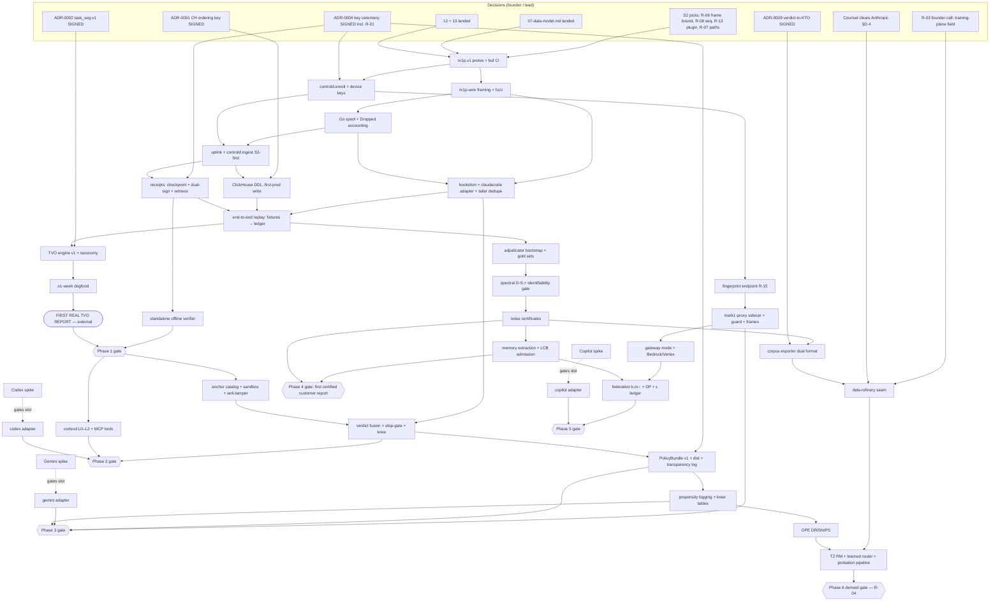

# 14 — Delivery Plan

**Status:** Authored 2026-08-28 against the frozen execution plan (`docs/spec/execution-plan-v2.md`), `02-requirements.md` §10, and `RECONCILIATION.md`. Where this document and any of those disagree, they win.
**Function:** the plan fixed *what* and *in what order*. This document adds *who decides what by when*, the real dependency edges, effort, elapsed time under three staffing scenarios, and the risks — so the founder can decide whether to hire against it.
**Freshness caveat:** the doc set was still landing while this was written (10, 11 and ADR-0001 arrived mid-authoring; 07, 12, 13 had not landed). Section 10's status marks are as of 2026-08-28 15:30 and must be re-checked at reconciliation. Per `02` §12, the milestone table in section 6 is **provisional until R-04 (the Phase 6 gate) is resolved**.

---

## 0. How to read this, and what is fixed vs what is scheduling

**Fixed, not up for revision here:**

- The six assembly phases, their order, and their bold **Gate:** sentences (plan §"Assembly order"). Phase 6's gate is derived, not verbatim — see R-04.
- The nine Phase 1 critical files and their build order (plan §"Critical files, in build order").
- The component registry (9 deployables + 4 client crates), the compliance enforcement points, and the verification obligations.
- The four founder ADRs named in "Decisions to make before code", plus the three tracked founder/counsel items (AIOS one-question email, counsel review of Anthropic §D.4, a16z traction blanks).

**What this document adds:** workstream decomposition (§1), the real blocking edges and the critical path (§2), pre-Phase-1 blockers (§3), per-phase task lists with effort (§4), the Phase 1 week-by-week (§5), milestones under three staffing scenarios (§6), the risk register (§7), this plan's own failure modes (§8), the decision calendar (§9), and the design-phase definition of done with live status (§10).

**The gate rule.** A phase is done when — and only when — its requirement-ID checklist in `02` §10 is entirely green, verified by the named tests in `12-testing-and-quality.md`. No demo, no judgment call, no partial credit. P1/P2 work scheduled inside a phase but absent from the gate list does not block the gate; it also does not silently disappear — it moves to the next phase's task list with its ID intact.

**The staffing rule.** This is a founder-led build. No headcount is invented here. Effort is stated in engineer-weeks (ew); elapsed time is derived per scenario in §6. Where a task cannot be parallelized no matter the staffing, this document says so instead of pretending otherwise.

**The scope rule.** Build cost is not a constraint; end-state integrity is. Nothing below cuts scope. Where the plan's own sequencing permits safe deferral (a P2 inside a phase, a spike whose no-go closes a slot), that is marked; where it does not, the item is on the critical path and stays there.

---

## 1. Workstreams

Nine workstreams that can progress independently once their entry conditions hold. A workstream is not a phase: most span several phases, and inside a phase several run in parallel. Each owns its components exclusively — two workstreams never edit the same module.

| # | Workstream | Owns | Components | Specified by | Entry condition | Exit condition |
|---|---|---|---|---|---|---|
| WS-1 | **Spine / protocol** | `m1p.v1` schema, framing, spool, uploader, ingest, ledger, receipts, witness, offline verifier | `proto/m1p/v1`, `m1p-wire`, `mark1d.{spool,uplink}`, `controld.ingest`, `mark1-receipt`, `python/shared/mark1_receipts`, `tools/verifier`, migrations | 07, 08 §2/§4, 04 (spool), 05 (ingest), ADR-0001/-0004 | S2 findings R-06/R-08/R-13 picked; ADR-0001 + ADR-0004 signed before prod writes / schema freeze | FR-SPINE-001…026 green; offline verify with servers unreachable (FR-SPINE-020) |
| WS-2 | **Edge capture** | Agent adapters, hookshim, tailers, provisioning, coverage accounting | `mark1-hookshim`, `mark1d.{adapters,tailers,capture,coverage,supervise}` | 04, 08 (hook contracts), FR-AGENT-* | WS-1 local fabric framing exists (M1PL + UDS); per-agent spike go artifact for each non-Claude-Code slot | One trajectory schema across all live adapters (FR-AGENT-005); fixture replay green per pinned agent version |
| WS-3 | **Verification** | Anchor catalog/consent/sandbox, anti-tamper, verdict fusion, stop-gate, knee governor, adjudication, gold sets, noise certificates | `mark1d.{anchors,verdict}`, `adjudicator-svc` | 04 §anchors/fusion, 06 (ADJUDICATE, D-S, certs), FR-VERIFY-* | WS-1 event families landing in the ledger; ADR-0002 for denominator joins | First noise-certified report (Phase 4 gate); identifiability gate operating honestly (`bootstrapping` below threshold) |
| WS-4 | **Cortex** | Repo intelligence L0–L3, session-start maps, MCP pull tools | `cortexd` | 04 (cortexd), 08 (MCP tools — R-09's six names) | Workspace enable/consent surface from WS-6 (CLI); L0 root hash contract shared with WS-3 anti-tamper | FR-CORTEX-001…008 green; uplift measurable as a ledger query |
| WS-5 | **Proxy / wire** | API-key micro-proxy, dialect frames, provenance guard, redaction linkage, model rewrite, gateway mode | `mark1-proxy`, `mark1-frames`, `mark1-redact` (shared with WS-2) | 04 §3/§7.1, 10 §3/§4, FR-ROUTE-005, CON-001/-002/-015 | WS-1 fabric + WS-6 enrollment fingerprints (FR-ENROLL-006, R-15 endpoint); golden transcripts recorded | Phase 3 gate (zero client-visible regressions under chaos; guard canary green); Phase 5 gateway additions |
| WS-6 | **Control plane** | Enrollment/revocation, CLI, policy bundles, distribution, ACK ledger, transparency log, query chokepoint | `controld.{enroll,policydist,querychoke}`, `go/mark1` CLI, `mark1-policy` | 05, 08 §3 (incl. the R-15 fingerprint endpoint), FR-ENROLL/CLI/POLICY-* | 08 contracts frozen; ADR-0004 for bundle-key split | FR-POLICY-001…010 green; fail-static chaos-proven; `mark1 off` byte-equality snapshot green |
| WS-7 | **Intelligence** | TVO engine, waste taxonomy, memory extraction/admission/delivery, policy compiler, OPE, corpus exporter, federation math | `mark1-intel` (five modules), `controld.dprelease` | 06, ADR-0002/-0003/-0009, FR-REMEMBER/LEARN/FED-*, FR-SPINE-021/-022 | ADR-0002 signed (customer-visible numbers); certified verdicts flowing (WS-3) for memory/corpus stages | Per stage: TVO v1 (Ph1), memory (Ph4), federation + corpus (Ph5), OPE (Ph5) |
| WS-8 | **Infrastructure** | AWS/EKS/RDS/ClickHouse/S3+KMS, Helm+GitOps, CI (3-OS, fuzz, benchmarks, SLSA/SBOM), packaging/signing/update channels, monitoring | `deploy/`, `migrations/` plumbing, repo CI | 09, 13, 11 (alerts/SLOs), R-17 | R-05 answered for anything beyond prod-only; 13 landed for the scaffold | Every gate's named CI checks exist and run; edge distribution signed + SLSA-attested |
| WS-9 | **Compliance / verification-of-claims** | Conformance corpus (golden SSE, hook fixtures, token-shape canary), tenant-isolation negative suites, chaos suites, claim discipline on customer artifacts, subprocessor register | `conformance/`, `12`'s suites, report-generator review gate | 12, 10 §12 control matrix, CON-014 | 12 landed; runs from Phase 1 day one — it is not a late phase | Every control row in 10 §12 has a green named test; every AIOS-facing number traces to a ledger query |

Two deliberate couplings, so nobody "discovers" them later: `mark1-redact` is owned by WS-5 but linked by WS-2's hookshim (CON-008 — even emergency spill is sanitized), and cortexd's L0 merkle root is consumed by WS-3's anti-tamper envelope (FR-CORTEX-001). Changes there require both workstreams' sign-off.

---

## 2. The dependency graph

Real blocking edges between milestones — "X cannot start until Y", not the phase list restated. Nodes are milestone-grained, not task-grained.

**The critical path** (longest chain of hard edges, Phase 1 through first certified report):

> S2 picks + 07/12/13 landed → protos → m1p-wire → spool → (enroll ∥) ingest → receipts (needs ADR-0004) → end-to-end replay → TVO (needs ADR-2) → **≥1-week dogfood (elapsed time, not effort — cannot be compressed by staffing)** → Phase 1 gate → anchors → fusion/stop-gate → Phase 2 gate → adjudicator → spectral D-S → noise certificates → Phase 4 gate.

Notable: **the proxy (Phase 3) is not on the critical path to the first certified report** — Phases 3 and 4's workstreams are largely disjoint (WS-5/WS-6 vs WS-3/WS-7), so with ≥2 engineers Phase 4's adjudication work can begin the moment Phase 2's fusion is live, overlapping Phase 3. The phase order stays authoritative for *gating* (Phase 4's gate cannot pass before Phase 3's), but the *work* overlaps.

**What has slack:** cortexd (independent of the spine until Phase 2 gate), the three adapter spikes (must merely land before their slots — weeks of slack), the offline verifier (parallel to hookshim once receipts exist), TVO engine scaffolding (can develop against synthetic events before E2E), all of WS-8's SLSA/SBOM work (must exist by first external artifact, not by first commit). **What has none:** everything on the chain above, and every founder decision in §3 — a decision has zero staffing elasticity.

---

## 3. Pre-Phase-1 blockers

What must be true before the first line of Phase 1 code. Ordered by how much work is parked behind each.

### 3.1 Hard blockers — code may not start (or may not pass a boundary) until resolved

| # | Blocker | Who decides | What is blocked behind it | Cost of deferring |
|---|---|---|---|---|
| B1 | **`07-data-model.md`, `12-testing-and-quality.md`, `13-repo-scaffold.md` land** (in flight at time of writing; `.parts/` exists) | lead (authoring already delegated) | B1 blocks the *first commit itself*: 07 carries the actual `m1p.v1` proto definitions, 13 the scaffold, 12 the tests every gate points at | Every day of delay is a day of delay on the whole plan; nothing else compensates |
| B2 | **ADR-0004 — key ceremony, containing R-01 (AWS KMS cannot do Ed25519)** | **founder** | Receipt schema columns (`key_id`, rotation), device enrollment key custody, bundle-key split, witness target — i.e. critical files 5–7 of nine, and the offline verifier's algorithm set. The plan's receipt section currently asserts two incompatible things (Ed25519 chain primitives AND KMS-resident keys) | Deferral stalls the critical path at the receipts node. Deciding *wrong* is worse: receipts are the sales claim ("verify Omium"), and a key-scheme migration after external witnesses exist is a chain restart. Options per RECONCILIATION: (a) 09's split — P-256 in KMS server-side, Ed25519 on devices, algorithm-prefixed `key_id`, verifier implements both; (b) Ed25519 everywhere via CloudHSM/self-managed KMS; (c) P-256 everywhere, dropping the vendored reuse. (a) is the only one that neither adds an HSM operational burden nor discards the vendored, battle-tested `keys.py` |
| B3 | **ADR-0001 — ClickHouse ordering key** | **founder** | The first *production* write, the ledger DDL, FR-SPINE-013/-014. Draft exists (`adr/0001-clickhouse-ordering-key.md`, landed 2026-08-28) but is unsigned | Dev-environment writes may proceed; the prod migration is CI-blocked until the DDL cites the signed ADR. Deferring past week ~4 stalls the ingest→E2E edge. This is the plan's *one irreversible decision* — an hour of founder attention versus a ledger rebuild later |
| B4 | **S2 contract picks: R-06 (frame bound 1 vs 4 MiB), R-07 (socket paths), R-08 (who stamps `seq`), R-13 (Python proto plugin)** | lead — hours of work, not days | The protos, the framing fuzz corpus policy, the first `buf generate` — i.e. critical file #1 | Near-zero if done now; expensive if discovered mid-build because each is baked into fuzz corpora and conformance vectors. R-08 recommendation: ratify 07's placement (`mark1d` stamps `seq`; shim stamps `event_id` only) — per-session monotonicity is only well-defined at the single writer |
| B5 | **ADR-0002 — `task_seg.v1` merge rules** | **founder** | Customer-visible TVO numbers, NFR-CORRECTNESS-002 golden values. Per `02` §12: dogfood may run earlier with a draft algorithm **labeled draft** | Soft-blocks Phase 1's exit, not its start: the gate requires ADR-0002 signed and the dogfood TVO report is the external artifact. Sign by week 6 at the latest so the golden tests freeze before the TVO engine does |

### 3.2 Decisions needed before *later* boundaries — schedule now, decide cheaply

| # | Item | Who | Blocks | By when |
|---|---|---|---|---|
| B6 | **R-03 — the one additive `completion: Option<String>` field on `VerifiedTrajectory` in `omium-training-plane`** — the single cross-repo change Mark 1 needs, vs. having the exporter write the trainer's shape directly and skip the refinery | **founder** (it breaches the standing "zero changes outside omium-mark1" constraint; only the founder can waive it) | Phase 5's refinery seam (FR-LEARN-006); without a decision the Mark 1 corpus either loses its completions in round-trip or bypasses the refinery | Before Phase 5 planning; deciding now costs nothing and unblocks 06 §12's conformance test design. The field is additive and serde-defaulted — the honest note is that the *authorization* is the event, not the code |
| B7 | **R-02 / ADR-0009 — verdict→KTO label mapping** (what happens to `refused`/`error` at export) | **founder** | Corpus exporter (Phase 5), FR-LEARN-002 | Before exporter code. 07's in-document resolution (exclude both) is sound but is currently a document author's decision, not a recorded one — and it has a second-order effect worth the founder's eyes: excluding `error` biases the corpus toward environments where the toolchain works |
| B8 | **ADR-0003 — the Shapley game** | **founder** | Nothing in Phases 1–4 (the deterministic taxonomy ships regardless; Shapley code is *banned* pre-ADR) | Lowest urgency of the four ADRs; before any Shapley work is scheduled |
| B9 | **R-04 — ratify or rewrite the Phase 6 gate** | **founder** | Freezing §6's milestone table (per `02` §12) | At reconciliation. Ten-minute decision |
| B10 | **R-05 — establish staging truth** (`envs/staging` says TBD; `values.staging.yaml` pins a live-looking account) | estate owner | Nothing in Phase 1 (09 targets prod-only); the promotion path for Phase 3+ | Before Phase 3's control-plane deploys need an environment story |
| B11 | **Counsel review of Anthropic §D.4** | **founder + counsel** | All FR-LEARN-003+ work — the entire training leg (Phases 5–6) | Already tracked; unchanged. Start it early: counsel latency is not staffing-elastic, and a late "no" reshapes Phase 6 |
| B12 | **AIOS one-question email (API-key vs subscription seats)** | **founder** | Which deployment profile and which capture regime the AIOS demo targets — i.e. whether the demo needs the proxy (Phase 3) at all, or Phase 1–2 subscription capture suffices | Send now. The answer determines whether the AIOS demo lands at the Phase 1 exit (subscription capture + TVO report) or must wait for Phase 3. This one email may move the first revenue event by a full phase |

**The blunt summary:** B1 is in flight and self-clearing; B4 is an afternoon of the lead's time; B2, B3, B5 are together perhaps one founder-day of decisions and they bracket the entire Phase 1 critical path. There is no version of this plan where Phase 1 starts properly without that founder-day.

---

## 4. Phase-by-phase plan

Effort numbers are engineer-weeks (ew), estimated bottom-up per task with the reasoning stated once here: they assume an engineer already fluent in the language of the component, working from complete LLDs (the whole point of the design phase), and they *include* the tests the gate names — a task is "done" when its named tests in `12` are green, not when the happy path runs. Estimates carry ±40% until Phase 1 calibrates them; §8 says which are least trustworthy.

### Phase 1 — Spine + subscription-legal capture

> **Gate (verbatim): end-to-end certified usage events, verifiable offline by the customer.**

Exit checklist: `02` §10 Phase 1 list (CON-003/-004/-005/-006/-008/-010/-012; FR-SPINE-001…022/-024/-026; FR-AGENT-001…004/-010; FR-CLI-001/-002/-003/-006/-007; FR-ENROLL-001…004; the named NFRs; ADR-0001 + ADR-0002 signed; ≥1-week dogfood → first real TVO report).

| # | Task (build order per plan §"Critical files") | ew | Depends on | "Done" means |
|---|---|---|---|---|
| 1.0 | Repo scaffold per 13, CI skeleton: 3-OS matrix, buf lint/breaking, cargo/go/uv gates, lockfile OTel scan (CON-005) | 1.5 | B1, B4 | A PR to an empty package fails on any of: fmt, clippy `-D warnings`, buf breaking, OTel dep, missing platform |
| 1.1 | `proto/m1p/v1/*.proto` — envelope + all event families from 07 | 1.5 | 1.0 | `buf breaking` (WIRE_JSON, per R-12) wired; prost/protoc-gen-go/python outputs committed; conformance vectors v0 |
| 1.2 | `m1p-wire`: prost codegen + M1PL framing, bounded `len`, fuzz target | 1.5 | 1.1 | Fuzz green in CI (NFR-CORRECTNESS-004); Rust/Go decoders agree on shared vectors (NFR-CORRECTNESS-005) |
| 1.3 | `mark1d/internal/spool`: 64 MiB segments, crc32c, mmap ledger, per-class full policy, `Dropped{}` accounting, decoder fuzz | 2.5 | 1.2 | kill -9 chaos test loses zero billing-grade events (FR-SPINE-024); 95%-disk hard stop test; drop-newest vs block-on-full both exercised |
| 1.4 | `controld.enroll` + device identity: OIDC device-code, ≤24 h tokens, revocation, keychain/TPM with 0600 floor | 2.0 | 1.1, B2 (custody) | Device-code conformance test; revocation negative test; expired token parks uploads (fail-open capture) |
| 1.5 | `mark1d.uplink` + `controld.ingest`: S3-first, token-stamped tenancy, idempotent upsert, pre-egress scanner, CH async-insert; retry/backoff/park/quarantine | 2.5 | 1.3, 1.4 | Acked batch recoverable from S3 alone; envelope-disagreement → reject + security event; tenant-isolation negative suite turns on and runs on every PR from here forward |
| 1.6 | `migrations/` + ClickHouse DDL citing signed ADR-0001; Postgres receipt/registry schema with RLS + `*_app` roles | 1.5 | 1.5, B3 | CI blocks the CH migration until the DDL cites the signed ADR; BYPASSRLS negative test green |
| 1.7 | Receipts: vendor `canonical.py`/`keys.py`, checkpoint Merkle, dual-sign, `key_id`/rotation columns, hourly external witness | 2.5 | 1.6, B2 | Cross-language hash equality (NFR-CORRECTNESS-006); append-only enforced three ways; witness heads publishing |
| 1.8 | `tools/verifier` — standalone offline verifier | 1.5 | 1.7 | Validates a real chain with every Omium server unreachable (FR-SPINE-020); it is open-source-able as-is |
| 1.9 | `mark1-hookshim` + `adapters/claudecode`: hooks, transcript tailer, `(message.id, requestId)` sidechain dedupe, fenced provisioning, `mark1 enable/status/off/doctor` surfaces | 3.5 | 1.2, 1.3 (parallel to 1.6–1.8) | Golden fixture replay per pinned CC version; overcount replay produces exactly one `Usage` per key (NFR-CORRECTNESS-001); `mark1 off` byte-equality snapshot |
| 1.10 | `intel/tvo` v1: TVO closed form, coverage metric, deterministic waste taxonomy | 2.0 | 1.1 (schema), B5 for final numbers | Paper I worked-example golden test (NFR-CORRECTNESS-002); report refuses guarantee-grade below coverage floor |
| 1.11 | End-to-end: fixtures → mark1d → controld → ClickHouse → TVO → receipts → offline verify; kill -9 mid-batch drill | 1.0 | all above | The gate sentence, literally executed |
| 1.12 | **Dogfood ≥1 week on our own repos** → first real TVO report | 0.5 ew effort, **1+ week elapsed, incompressible** | 1.11 | A TVO report on the founder's own $10–15k/month spend, coverage band and cost basis on every figure — the first external-facing artifact |
| 1.13 | Concurrent spikes: Codex `TokenCountEvent`, Copilot `events.jsonl`, Gemini `BeforeModel`-in-OAuth | 3 × 1.0 | none (parallel; gate adapter *slots*, not this phase) | Each produces a written go/no-go artifact (FR-AGENT-011/-012/-014) |

**Phase 1 total: ≈ 27 ew** (24 core + 3 spikes). **Demo-able artifact:** a live session on our own repo producing certified usage events; `mark1 verify-receipts` run on a laptop with Wi-Fi off; the first real TVO report. This is also the earliest credible AIOS demo *if* their answer to B12 is subscription-side.

### Phase 2 — VERIFY provisional loop + Cortex push

> **Gate (verbatim): retry loops demonstrably arrested at the knee on live sessions; Cortex uplift measurable in the ledger.**

Exit checklist: `02` §10 Phase 2 list. Evidence artifact: the A/B on our own tasks with/without the stop-gate, iteration-count delta with confidence intervals.

| # | Task | ew | Depends on |
|---|---|---|---|
| 2.1 | Anchor catalog + consent flow + sandboxed runner (network-denied, env-scrubbed, read-only outside worktree, resource-capped, kill-switched) | 3.0 | Phase 1 gate |
| 2.2 | Anti-tamper envelope: effective-execution hashes, env scrub attestation, worktree merkle (consumes cortexd L0) | 2.0 | 2.1, 2.4 |
| 2.3 | Verdict fusion in `mark1d` (log-space NB over bundle matrices), fast/slow split, cached gate reads, stop-gate on Claude Code, knee governor + hard caps + off-check ordering | 3.0 | 2.1 |
| 2.4 | `cortexd` L0–L2, budgeted session-start map, six scoped MCP pull tools (R-09) | 5.0 | none (slack — can start during Phase 1 with spare capacity) |
| 2.5 | `adjudicator-svc` bootstrap: weighted majority + priors, gold-set bootstrap, `bootstrapping` cert status | 3.0 | Phase 1 ledger |
| 2.6 | Codex adapter (on spike "go"; bundle field maps, ~80% vocabulary reuse) | 1.5 | 1.13-codex |
| 2.7 | Verification: anti-tamper suite (3 independent `tamper` raises), stop-gate A/B with CIs, cortex uplift ledger query | 1.5 | all above |

**Phase 2 total: ≈ 19 ew.** **Demo-able artifact:** a live session where a retry loop is stopped at the knee with the verdict and evidence surfaced — the single most demonstrable thing the product does; this is the demo that sells Mark 1 to a developer audience.

### Phase 3 — Wire proxy + ROUTE

> **Gate (verbatim): zero client-visible streaming regressions under chaos; guard canary green.**

Exit checklist: `02` §10 Phase 3 list.

| # | Task | ew | Depends on |
|---|---|---|---|
| 3.1 | `mark1-proxy` sidecar, Anthropic dialect: provenance guard (M1-Cred-Ref, no override path), tripwire, bytes-forward + tee-on-clone, `Secret<T>` discipline, inline redaction | 5.0 | fingerprint endpoint (R-15) via WS-6 |
| 3.2 | Conformance + chaos: golden SSE byte-exact suite, stall/reset/slow-client chaos, ≤1 ms CI benchmark, ≤35 MB RSS, token-shape canary failing CI on classifier miss, no-unprovisioned-credential negative test | 2.5 | 3.1 |
| 3.3 | PolicyBundle v1: canonical CBOR, section-split signing, transparency log, Etag/SSE distribution, ACK ledger, canary widening, fail-static behavior | 4.0 | ADR-0004 |
| 3.4 | `intel/policy_compiler` v1 (CPVS/knee/ladders → signed bundles) | 1.5 | 3.3 |
| 3.5 | Propensity + `fidelity` logging from first routed request; knee tables with dual cost basis | 1.5 | 3.3 |
| 3.6 | Gemini adapter (on spike "go") | 1.5 | 1.13-gemini |

**Phase 3 total: ≈ 16 ew.** **Demo-able artifact:** an API-key session through the proxy with a wire-level model rewrite, byte-identical streaming to the client, and a receipted guard refusal of an OAuth credential. This is the AIOS demo if their answer to B12 is API-key-side.

### Phase 4 — Adjudication at strength + REMEMBER

> **Gate (verbatim): first noise-certified customer report with a coverage band.**

Exit checklist: `02` §10 Phase 4 list. Note the overlap opportunity from §2: with ≥2 engineers, 4.1–4.2 start when Phase 2's fusion is live, concurrent with Phase 3.

| # | Task | ew | Depends on |
|---|---|---|---|
| 4.1 | Spectral Dawid–Skene behind the identifiability gate, global estimation + hierarchical shrinkage, crowd-kit as test oracle only, Paper II posterior/verdict reproduction | 3.0 | 2.5 |
| 4.2 | Noise certificates: server-selected edge-indistinguishable gold sets, size/freshness preconditions, honest `uncertified/bootstrapping` | 2.5 | 4.1 |
| 4.3 | T1 judges: client-side default through customer's key, E0/E1 tiers, subprocessor register + consent + region pinning for cloud path | 2.5 | 2.5 |
| 4.4 | Memory: typed artifacts, nightly Batch-API extraction cascade, tenant-scoped ADMIT-LCB, delivery (TaskOpen packs, reactive pitfalls), pgvector `halfvec` for error signatures, per-event receipts | 4.0 | 4.2 (certified-only extraction) |
| 4.5 | opencode adapter (on spike "go"; spike itself runs earlier with slack) | 1.5 | spike artifact |
| 4.6 | The customer report generator at guarantee grade: certified verdicts, coverage band ≥ floor, cost basis, ledger-traceable figures | 1.5 | 4.2, CON-014 review gate |

**Phase 4 total: ≈ 15 ew.** **Demo-able artifact:** the first noise-certified customer report — the second externally visible milestone, and the artifact that fills the a16z brief's traction blanks with numbers that survive diligence.

### Phase 5 — Enterprise + federation + LEARN

> **Gate (verbatim): first cross-org artifact published through the full k,m∩ / DP / LCB / review pipeline.**

Exit checklist: `02` §10 Phase 5 list. Hard external precondition: **counsel §D.4 clearance (B11) before any training-leg work**, and R-03 + ADR-0009 decided before the exporter/refinery seam.

| # | Task | ew | Depends on |
|---|---|---|---|
| 5.1 | Gateway mode: mTLS, Bedrock/Vertex/Azure dialects, by-reference credentials, `(upstream, credential-identity)` pools, Bedrock observe-only | 5.0 | 3.1 |
| 5.2 | Copilot BYOK + Cursor observe/gate adapters (on spike "go"s) | 3.0 | spike artifacts |
| 5.3 | Federation: k≥25 / m≥5 intersection-reconstruction as `HAVING` + trigger, collusion collapse, DP release + ε ledger, human review queue | 5.0 | 4.4 |
| 5.4 | Corpus exporter: receipted Parquet + KTO `manifest.json`/`rows.jsonl` pair, one receipt covering both | 2.0 | ADR-0009 (B7) |
| 5.5 | data-refinery `mark1-parquet` seam (constructor + method pair on `CorpusReader`; the R-03 field if authorized) + round-trip conformance test | 1.5 | B6, B11 |
| 5.6 | OPE (DR/SNIPS) over `WIRE_ENFORCED` decisions | 2.0 | 3.5 |

**Phase 5 total: ≈ 18.5 ew.** **Demo-able artifact:** a cross-org artifact carrying its full receipt trail — (k,m) evidence, DP debit, LCB admission, review sign-off. Externally visible to enterprise security reviewers as the federation proof.

### Phase 6 — Learned members + certified tier + self-host

> *(Derived gate, per R-04 — the frozen plan states no bold Gate: sentence for Phase 6. From `02` §10: "first learned component promoted to `active` through probation → shadow → LCB → canary, with cross-tenant training and T3 runs opt-in-gated." This wording is **not plan-verbatim** and must be founder-ratified before this phase's milestone freezes.)*

| # | Task | ew | Depends on |
|---|---|---|---|
| 6.1 | T2 reward model (Qwen3, vLLM, shared A10) entering via probation → shadow → LCB promotion | 5.0 | 5.4/5.5, GPU trigger (~300 K verifications/mo or first learned verifier) |
| 6.2 | Learned Cortex ranker | 2.0 | 6.1 pipeline |
| 6.3 | Learned router via OPE + canary | 2.5 | 5.6 |
| 6.4 | Cross-tenant training: opt-in, DP-SGD + ε ledger, canary memorization release gate | 3.0 | B11, 5.3 |
| 6.5 | T3 Firecracker certified runs (rent E2B/Daytona first) | 3.0 | opt-in flow |
| 6.6 | NATS/MSK evaluation ADR when second ledger consumer exists (estate MSK evaluated first, per grounding delta 3) | 1.0 | trigger event |
| 6.7 | Self-host SKU (helm profile, key custody variant, docs) | 4.0 | everything fail-static proven |

**Phase 6 total: ≈ 20.5 ew.** **Demo-able artifact:** a learned component measurably beating its incumbent on held-out OPE before canary — the flywheel's first full revolution.

**Grand total: ≈ 116 ew** across six phases, ±40% until Phase 1 calibrates. Nothing here is deferred *out* of the plan; the only deferrals are the plan's own (Shapley behind ADR-0003, NATS behind the second consumer, GPU behind the T2 trigger, adapters behind spikes).

---

## 5. Phase 1 in detail

Phase 1 is next, so it gets a week-by-week. **Reference staffing: 2 engineers** (A: Rust/Go systems; B: Go/Python + cloud) — the most likely shape if the founder hires one strong systems engineer. Scaling notes at the end. Weeks count from the day §3's B1–B4 are clear.

| Week | Engineer A | Engineer B | CI gate that turns ON this week | Deliverable at week's end |
|---|---|---|---|---|
| **W0** (pre-week) | — | — | — | Founder decision day: ADR-0001 signed, ADR-0004 signed (R-01 resolved), ADR-0002 draft accepted for dogfood, B4 picks ratified. B12 email sent to AIOS |
| **W1** | Repo scaffold per 13; `proto/m1p/v1` from 07 | CI: 3-OS matrix, buf lint/breaking (WIRE_JSON), lockfile OTel scan, fmt/clippy/vet gates | `buf breaking`, OTel-dependency fail, 3-OS build | First commit: protos + committed codegen for prost/Go/Python; conformance vectors v0 |
| **W2** | `m1p-wire`: framing + bounded len + fuzz target | `controld.enroll` start: OIDC device-code, token issuance | cargo-fuzz smoke in CI; Rust/Go decoder conformance-vector check | Framed events over UDS on all 3 OSes (named pipe on Windows) |
| **W3** | Spool: segments, crc32c, mmap ledger | enroll: revocation, keychain/TPM + 0600 floor; `mark1 enroll` CLI | spool decoder fuzz | Spool accepting framed writes; enrollment end-to-end against dev IdP |
| **W4** | Spool: per-class full policy, `Dropped{}`, kill -9 chaos test | `controld.ingest`: S3-first landing, token-stamped tenancy, idempotent upsert | **kill -9 chaos test** (billing-grade classes lose nothing); 95%-disk stop test | Batch survives daemon murder; S3 objects are the replay log |
| **W5** | Uplink: retry/backoff/park/quarantine; joins ingest | ingest: pre-egress scanner, CH async-insert; migrations + CH DDL citing signed ADR-0001; PG schema with RLS + `*_app` | **tenant-isolation negative suite** (PG + CH + S3), BYPASSRLS negative test, DDL-cites-ADR check | Events flowing laptop → S3 → ClickHouse with stamped tenancy |
| **W6** | `mark1-hookshim` start: static binary, bundle field maps, 50 ms fire-and-forget, sanitized spill | Receipts: vendor `canonical.py`/`keys.py`, checkpoint Merkle, dual-sign, chain schema (`ro_012` template + `checkpoint_seq`/`inclusion_path`/countersign) | cross-language receipt-hash equality; append-only negative tests | First dual-signed checkpoint receipt over real events |
| **W7** | claudecode adapter: transcript tailer, `(message.id, requestId)` + sidechain dedupe | Receipts: external witness publishing (hourly heads); `tools/verifier` start | **overcount conformance test** (exactly one `Usage` per key on recorded session with streamed partials + sidechain) | Witnessed chain heads landing externally |
| **W8** | claudecode adapter: hook wiring, fenced provisioning, `mark1 enable/status/doctor/off` | `tools/verifier` complete | **`mark1 off` byte-equality snapshot test**; golden hook-fixture replay per pinned CC version | **Offline verify:** verifier validates the chain with Omium servers unreachable |
| **W9** | E2E hardening: fixture replay through the full path; fix fallout | `intel/tvo` v1: TVO closed form, coverage metric, waste taxonomy | Paper I golden TVO test; coverage-floor refusal test | Hand-computed Paper I values match engine output |
| **W10** | **End-to-end drill:** golden fixtures → mark1d → controld → ClickHouse → TVO → receipts → offline verify; kill -9 mid-batch during the drill | Same drill, cloud side; `mark1 report` (draft-labeled, per ADR-0002 status) | full-path E2E job in CI | The Phase 1 verification section executed literally, in one run |
| **W11–12** | **Dogfood on our own repos, ≥1 week elapsed** (both engineers fix what it surfaces; historically dogfood always surfaces something) | same | — | **The first real TVO report** on the founder's own agent spend — coverage band + cost basis on every figure. Earliest external-facing artifact |

Spikes (1.13) are slack-scheduled: each is ~1 ew, runnable in W2–W8 gaps or by the founder in parallel; each must produce its go/no-go artifact before Phase 2 planning (Codex) / Phase 3 (Gemini) / Phase 5 (Copilot).

**The five Phase 1 verification obligations, mapped to weeks:** golden fixtures replayed end-to-end (W10), standalone verifier with the Omium server offline (W8), fuzz targets green (W2–W4, then continuously), kill -9 mid-batch losing nothing billing-grade (W4, re-run W10), ≥1-week dogfood → first real TVO report (W11–12).

**Scaling this schedule:**
- **1 engineer (founder solo):** the two columns serialize; ~20–24 working weeks *at full focus*. At a realistic 0.5–0.6 FTE (the founder also runs the platform, AIOS, YC), **Phase 1 alone is 8–10 calendar months**. That number is the strongest argument in this document for hiring.
- **2 engineers:** ~12 weeks as tabled (24 ew / 2, with the dogfood week incompressible).
- **4 engineers:** ~8–9 weeks, not 6 — W1–W5 is a serialized spine (protos → wire → spool → ingest) that extra hands cannot shorten; engineers 3–4 usefully pull cortexd (2.4) and the adjudicator bootstrap (2.5) forward from Phase 2 instead. Phase 1 has a **parallelism ceiling of ~2.5**.

---

## 6. Milestones and the calendar

No fixed dates: dates depend on a hiring decision that has not been made and on the founder-decision day (§3) that has not happened. Elapsed times below are from the decision day, per staffing scenario. Overhead assumptions: solo-at-realistic-focus = 0.5–0.6 FTE effective; 2 engineers = ÷1.8 (coordination tax); 4 engineers = ÷3.0 where the graph permits, with §5's Phase 1 ceiling and Phase 3/4 overlap applied. **This table is provisional until R-04 is resolved** (per `02` §12).

| # | Milestone | Gate / evidence | Depends on | Cum. ew | Solo (realistic) | 2 eng | 4 eng | Externally visible? |
|---|---|---|---|---|---|---|---|---|
| M0 | Founder decision day | ADR-0001/-0004 signed, ADR-0002 accepted, B4 ratified, B12 email sent | founder calendar | 0 | week 0 — **staffing does not move this** | wk 0 | wk 0 | no |
| M1 | First commit | protos + buf CI green | M0, 07/12/13 landed | 3 | ~wk 5 | wk 1 | wk 1 | no |
| M2 | First certified event, end to end | E2E drill: fixtures → ledger → receipt → offline verify | M1 | 23 | ~wk 34 | wk 10 | wk 7 | no |
| M3 | **Phase 1 gate + first real TVO report** | `02` §10 Ph1 list; ≥1-wk dogfood (incompressible) | M2 | 27 | **~wk 40 (≈9–10 mo)** | **wk 12 (≈3 mo)** | **wk 9 (≈2 mo)** | **YES — first external artifact; a16z traction input** |
| M4a | AIOS demo, subscription answer to B12 | Phase 1–2 capture + TVO report on their workflow | M3 (credible), M5 (compelling) | — | wk 40–60 | wk 12–19 | wk 9–13 | **YES — revenue event** |
| M5 | Phase 2 gate: stop-gate live | retry loops arrested at knee; A/B with CIs; cortex uplift in ledger | M3 | 46 | ~wk 68 (≈16 mo) | wk 19 (≈4.5 mo) | wk 13 (≈3 mo) | partially (demo material) |
| M6 | Phase 3 gate: proxy + bundles | chaos-clean streaming; guard canary green | M5 (gating), WS-5/6 work can pre-start | 62 | ~wk 92 | wk 26 (≈6 mo) | wk 17 (≈4 mo) | no (enables M4b) |
| M4b | AIOS demo, API-key answer to B12 | proxy demo + routed TVO | M6 | — | ~wk 92 | wk 26 | wk 17 | **YES — revenue event** |
| M7 | **Phase 4 gate: first noise-certified customer report** | certified verdicts, coverage band ≥ floor, cost basis | M5 (+ M6 for gate order; work overlaps M6 at ≥2 eng) | 77 | ~wk 114 (≈2.2 yrs) | wk 32 (≈7.5 mo) | wk 21 (≈5 mo) | **YES — the diligence artifact** |
| M8 | Phase 5 gate: first cross-org artifact | full k,m∩ / DP / LCB / review trail | M7, B6/B7/B11 decided | 95.5 | not credible solo | wk 42 (≈10 mo) | wk 27 (≈6.5 mo) | **YES — enterprise/federation proof** |
| M9 | Phase 6 derived gate (R-04) | first learned component promoted via probation → shadow → LCB → canary | M8, GPU trigger, counsel clear | 116 | not credible solo | wk 53 (≈12–13 mo) | wk 33 (≈8 mo) | yes (flywheel proof) |

**How to read the solo column honestly:** it is not a plan, it is a warning. Solo, the first *certified customer report* (M7) is over two years out and Phases 5–6 are not credible at all — the corpus flywheel needs verification volume that one founder's spend alone reaches slowly, and the founder's effective FTE will drop further as AIOS onboards. **The schedule-shaped decision in front of the founder is therefore not "when do we start" but "at what team size":** the 2-engineer column delivers the AIOS demo in ~3 months and the diligence artifact in ~7.5; the 4-engineer column buys ~10 weeks on M7 at double burn and real onboarding drag in a codebase that does not exist yet. The step from 1→2 buys more calendar time than the step from 2→4.

**External milestones to protect at all costs:** M3 (first TVO report — the earliest thing AIOS and investors can see), M4 (AIOS demo — timing set by their B12 answer, not by us), M7 (first noise-certified report — the artifact that converts claims into diligence-grade numbers).

---

## 7. Risk register

Probability/impact on a L/M/H scale, judged against the 2-engineer reference schedule. Owner is who watches the early-warning signal, not who fixes the incident.

| Risk | Category | P | I | Early-warning signal | Mitigation (in the design already) | Contingency (if it fires anyway) | Owner |
|---|---|---|---|---|---|---|---|
| **Founder-bandwidth exhaustion.** On a solo or near-solo build this is the single highest-probability risk: the founder runs the platform, AIOS, YC, counsel, and this build; every §3 decision and every hiring loop lands on the same person. Named here rather than omitted for politeness. | People | **H (solo) / M (2 eng)** | H | §3 decisions slipping past their §9 dates; dogfood week deferred twice; commits clustering at 2 a.m. | The decision calendar (§9) batches founder decisions into scheduled days; delegation of authoring already proven in the docs phase | Hire earlier than planned; explicitly park Mark 1 phases rather than thin-slice everything; the plan's phase gates make parking safe (each phase ends revenue-relevant) | founder |
| **Vendor format change breaks capture** — hooks and transcript formats are not contracts; Claude Code ships weekly. The most likely *recurring* risk in the product's life. | External | **H (recurring)** | M per event | Pinned-version fixture replay fails on a new agent release; `Dropped{unsupported_agent_version}` spikes in the ledger | FR-AGENT-001: field maps ship as bundle data — a format break is a bundle push, not a release; FR-AGENT-002 version-sniffing never parses blind; per-pinned-version conformance fixtures | Bundle push within hours; if structural (surface removed, not renamed), adapter enters degraded capture and the coverage band reports it honestly — coverage accounting turns a capture gap into a visible, receipted number instead of silent data loss | WS-2 |
| **An adapter spike comes back no-go** (Codex `TokenCountEvent`, Gemini `BeforeModel`, Copilot `events.jsonl` — all currently unverified) | Product | M (each) | M | The spike artifact itself — that is what it is for | FR-AGENT-011/-012/-014: the slot stays closed and is re-planned, not worked around; phases do not gate on adapter slots | Re-plan the slot (different surface, later phase, or proxy-only capture for that agent); the seven-agent roadmap flexes, the one-schema invariant does not | founder + WS-2 |
| **OAuth guard classifier misses** — a subscription-shaped credential slips past provenance detection | Legal/compliance | L | **H (product-killing per CON-001)** | Weekly token-shape canary fails CI; tripwire fires on an upstream subscription-marker response | Provenance is primary (not shape-guessing); no override path in the binary; contamination ⇒ session kill + config rollback + receipted `oauth_contamination` P0 | Halt proxy rollout, ship canary fix, review sampled guard receipts to bound exposure, disclose to affected tenant — the receipted guard makes the refusal *and* the incident provable | WS-5 |
| **ClickHouse single-node loss** (deliberate day-one shape) | Infra | M | L–M | node health alerts (R-17: Mark 1 lands its own monitoring); ingest error rate | S3-first ingest means the ledger is *rebuildable by replay* — the node is a cache of the truth, not the truth; receipts live in Postgres, not CH | Replay from S3 into a fresh node; TVO reports pause during rebuild (hours, not days); replication is the scaling trigger recorded in 09 | WS-8 |
| **Identifiability gate never clears** — certificates stay `bootstrapping` because verifier correlation groups never reach ≥3 effectively independent | Statistical | M | H (Phase 4 gate slips indefinitely) | Spectral diagnostics flat across weeks of dogfood + early-tenant volume; gold-set freshness aging out | Honest `bootstrapping` status is designed in (C5) — the product keeps working, verdicts just do not gate memory/corpus | Grow anchor diversity (more independent groups: tests as own group, judges, consistency); if structurally stuck, the Phase 4 gate slips and *we say so* rather than certifying on an unidentifiable model — CON-014 forbids the alternative | WS-3 |
| **Corpus never reaches supercriticality** — per-tenant volume too thin for the flywheel; k≥25 / m≥5 federation thresholds never met | Business | M | H (Phases 5–6 premise) | Verification volume curve vs the ~300 K/mo T2 trigger; tenant count vs k=25 | Per-tenant training first (FR-LEARN-003) delivers value below federation thresholds; the moat accrues per-tenant even if federation waits | Sell more tenants (this is a GTM problem wearing an engineering costume); thresholds are contractual/statistical floors and must **not** be lowered to force the milestone | founder |
| **AIOS churns while waiting** | Business | M | H (first revenue + reference) | Response latency to the B12 email; demo date pushed twice | B12 email sent at M0; M4a path exists at wk 12 (2-eng) — the schedule is built so *something demonstrable* exists each phase end | Demo the Phase 1 artifact early (real TVO report on our own spend is credible); offer design-partner terms tied to the milestone table; if lost, dogfood population still proves the product | founder |
| **Counsel blocks or heavily conditions the training leg (§D.4)** | Legal | M | M (H for Phase 6) | Counsel's first read; any Anthropic terms update | Training leg is structurally isolated (Phases 5–6, separate legal regime, opt-in); nothing in Phases 1–4 depends on it | Ship Phases 1–4 as the product (capture/verify/route are unaffected); restrict training to non-Anthropic-derived trajectories or per-tenant-only; the corpus retains value as evaluation data even if training is barred | founder + counsel |
| **R-01 decided late or wrong** (KMS/Ed25519) | Technical | M (late) / L (wrong) | H | ADR-0004 unsigned by W0+2 weeks | §3 puts it on the founder decision day; 09's split (option a) is pre-analyzed | If late: receipts stall at W6 and the critical path slips week-for-week. If wrong: chain restart before external witnesses exist is cheap, after is not — decide before W7's witness publishing | lead |
| **Estimate blowout on the proxy** (chaos-clean streaming + ≤1 ms + guard, in Rust, is the hardest engineering in the plan) | Delivery | M | M | 3.1/3.2 burning past 6 ew combined; chaos suite red for consecutive weeks | linkerd2-proxy proves the budget is achievable; golden-transcript suite catches regressions early; proxy is off the M7 critical path (§2) | Let Phase 4 work proceed in parallel (graph permits); do not ship the proxy until chaos-clean — a flaky proxy violates NFR-AVAILABILITY-002's promise and one incident poisons the wedge | WS-5 |
| **Dogfood TVO report shows little waste to cut** — the founder's own workflows may already be efficient | Product | L–M | M (narrative) | The W11–12 report itself | The report is also the *instrument* proof: certified, offline-verifiable measurement is the Phase 1 claim, not savings size | Recruit 2–3 friendly external dogfood repos immediately (AIOS's own workflows are the obvious candidates); waste taxonomy tells us *where* to look next rather than guessing | founder |

Not in the table because they are enforced structurally rather than watched: bundle-channel RCE (deleted by schema — no code field exists), cross-tenant leakage (negative suites on every PR from W5), plaintext secret persistence (no code path + CI negative test). If any of those *does* fire it is a build defect against a CON, handled as a P0 incident, not a scheduled risk.

---

## 8. What could go wrong with this plan itself

The section a good investor reads first. The plan above can be executed exactly as written and still mislead; here is where.

**Where the sequencing is fragile.**
- **Phase 1 W1–W5 is a pure chain.** Protos → wire → spool → ingest has no parallel escape. Any defect discovered late in the chain (a framing flaw found during ingest work) rolls the whole front of the schedule. Leading indicator: conformance-vector churn after W2 — if the vectors are still changing in W4, the protos were frozen too early and everything downstream is building on sand.
- **The Phase 3/4 overlap is an assumption about people, not the graph.** The graph permits WS-3/WS-7 to run concurrently with WS-5/WS-6, but only if the two engineers actually split cleanly across those stacks (Rust proxy vs Python adjudication). One engineer strong in both is one engineer, and the overlap evaporates. Leading indicator: at hiring time, whether candidate #2's profile covers the *other* half of the stack from the founder's.
- **Everything before M3 assumes the doc set is genuinely done.** The docs were still landing while this was written. If 07's DDL or 12's test names shift after W1's protos commit, "design-then-build" silently degrades into "design-while-building" — the exact failure mode Appendix A exists to prevent. Leading indicator: any PR that edits 07/08 *after* M1 without a reconciliation entry.

**Which estimates are least trustworthy, and why.**
1. **cortexd (5 ew)** — the widest error bars in the plan. Tree-sitter across polyglot repos, PPR tuning, incremental merkle on three OSes; genuinely novel integration with no estate precedent. Could be 3, could be 10. It is deliberately off the critical path so a blowout costs Phase 2 quality, not the schedule spine.
2. **Proxy chaos-hardening (3.2, 2.5 ew)** — writing a proxy is fast; making a chaos suite *pass* is where unknown-unknowns live (platform-specific socket semantics, SSE edge cases per dialect). The linkerd2-proxy precedent bounds feasibility, not our hours.
3. **Federation (5.3, 5 ew)** — intersection-reconstruction with collusion collapse has no reference implementation anywhere; the estimate is an educated guess dressed in a number. It is 2+ phases away, so Phase 1–2 actuals will recalibrate it before it matters.
4. **The ±40% band itself** — bottom-up estimates by the same mind that designed the system share the designer's blind spots. The first three Phase 1 tasks are the calibration set: if W1–W4 actuals run >30% over, re-baseline the whole table then, not at the phase end.

**The assumption that would damage the schedule most if false:** *that Claude Code's hook and transcript surfaces remain stable enough to build a product on.* Every Phase 1–2 deliverable leans on surfaces Anthropic can change without notice (they are not contracts — plan §risk, FR-AGENT-001's whole reason to exist). The design absorbs *drift* (bundle-shipped field maps); it cannot absorb *removal* — if hooks or on-disk transcripts went away, the subscription regime loses its capture substrate and only the API-key/proxy regime survives. Leading indicators: Anthropic changelog watch (weekly, automatable), fixture-replay failures on each pinned-version bump, and the token-shape canary. Worth stating plainly: this risk is *why the corpus is the moat* — capture surfaces are commoditizable and revocable; the accumulated outcome-labeled data is neither.

**The second most damaging assumption:** that the founder-decision cadence in §9 will actually be met. Every prior section treats decisions as instantaneous once scheduled. The estate's history (two open founder decisions gating the previous plan for weeks) says otherwise. A decision that slips a week slips the calendar a week; there is no engineering mitigation for an unsigned ADR. Leading indicator: M0 itself — if the decision day hasn't happened within two weeks of this document landing, treat every date in §6 as already slipped.

**And the quiet one:** this plan measures its own product honestly (coverage bands, `bootstrapping` certs, draft-labeled TVO) but has no equivalent honesty mechanism for *itself* beyond §6's table. Mitigation adopted here: at each phase gate, this document's actuals-vs-estimates are appended to §6 and the remaining phases re-baselined. A delivery plan that is never re-baselined is a work of fiction with a Mermaid diagram.

---

## 9. Decision calendar

Every decision this plan needs, by when (relative to M0 = the founder decision day), by whom, and what sits blocked behind it. "By when" is the last responsible moment, not the ideal one — decide earlier wherever the founder's calendar allows.

| Decision | Who | By when | Blocked behind it | Ref |
|---|---|---|---|---|
| **ADR-0001 — ClickHouse ordering key** (draft exists, unsigned) | founder | **M0** | first production write; CH DDL; FR-SPINE-013/-014 | B3 |
| **ADR-0004 — key ceremony, resolving R-01** (KMS has no Ed25519; recommend 09's P-256/Ed25519 split) | founder | **M0** | receipt schema freeze (W6), witness provisioning (W7), enrollment custody (W2), bundle-key split (Phase 3) | B2, R-01 |
| **ADR-0002 — `task_seg.v1` merge rules** (draft acceptable for dogfood, labeled draft) | founder | M0 accepted-as-draft; **signed by W6** | customer-visible TVO numbers; NFR-CORRECTNESS-002 goldens; Phase 1 gate | B5 |
| **S2 batch: R-06 frame bound, R-07 socket paths, R-08 seq placement, R-13 Python plugin, R-09 tool names, R-10/R-11 spec fixes, R-15 endpoint adoption** | lead | **before W1's first commit** | protos, fuzz corpora, 08 conformance, spec consistency | B4 |
| **AIOS one-question email — API-key vs subscription seats** | founder | **send at M0; answer chased weekly** | which demo (M4a vs M4b) and which deployment profile AIOS gets; possibly a phase of revenue timing | B12 |
| **Staffing decision — 1 / 2 / 4 engineers** | founder | within 2 weeks of M0 (hiring latency runs concurrent with W1–W5, which the founder can execute alone or nearly so) | every elapsed-time column in §6; the Phase 3/4 overlap; realistically, whether M7 lands in 2026 | §6 |
| **Counsel review of Anthropic §D.4** | founder + counsel | **start at M0** (latency not controllable); concluded before any FR-LEARN-003+ work (Phase 5) | the entire training leg; R-03's usefulness | B11 |
| **R-03 — authorize the one-field `omium-training-plane` change, or exporter writes trainer shape directly** | founder | with the Phase 5 planning review (end of Phase 3); costs nothing to decide at M0 | FR-LEARN-006 refinery seam; 06 §12 conformance test design | B6 |
| **R-02 / ADR-0009 — verdict→KTO mapping** (ratify or amend 07's exclude-both) | founder | before corpus-exporter code (Phase 5); cheap to decide at M0 | FR-LEARN-002 | B7 |
| **ADR-0003 — the Shapley game** | founder | before any Shapley work is scheduled (no phase depends on it; taxonomy ships regardless) | a future FR-SPINE-0xx only | B8 |
| **R-04 — ratify or rewrite the Phase 6 gate** | founder | at reconciliation of the doc set | freezing §6's milestone table | B9 |
| **R-05 — staging truth** | estate owner (founder hat) | before Phase 3 control-plane deploys | promotion path in 09; nothing in Phase 1 (prod-only) | B10 |
| **Deployment-profile decision for AIOS** (dev sidecar vs VPC gateway) | founder, informed by B12's answer | before the AIOS demo build starts | demo scope; whether gateway work (Phase 5) pulls forward as a paid engagement — the one legitimate way Phase 5 work may re-order, and it needs a deliberate decision, not drift | — |
| **a16z brief traction blanks** | founder | when M3's TVO report exists (the first honest number available) | the brief; nothing engineering | tracked |
| **Re-baseline checkpoint** | founder + lead | at every phase gate | credibility of §6 for the next phase | §8 |

One scheduling note: five of these are ten-minute decisions (R-04, ADR-0009, R-03, ADR-0003 deferral, S2 ratifications) and three are heavy (key ceremony, ordering key, staffing). Batch the ten-minute ones into M0 regardless of their last responsible moment — a decision made is a risk retired.

---

## 10. Definition of done for the design phase

The checklist from the plan's Appendix A ("Verification — how we know this phase is done"), with each item's status **as of 2026-08-28 15:30** — the doc set was actively landing while this was written, so several marks below are expected to flip within days; reconciliation re-checks all of them.

| # | Appendix A criterion | Status | Evidence / what's missing |
|---|---|---|---|
| 1 | Every component in the plan's registry has an LLD section; every LLD section names its types, failure modes, and tests | **AMBER** | 04 (edge: mark1d, proxy, hookshim, cortexd + four crates), 05 (controld's five modules), 06 (adjudicator, intel, training seam) landed and substantive. 10 landed mid-authoring. Failure-mode/test naming completeness is reconciliation's to confirm, and test names point at a `12` that has not landed |
| 2 | Every table in the plan's data-stores section has real DDL in `07`, every RLS policy a matching negative test named in `12` | **RED** | `07-data-model.md` not on disk (fragments in `docs/.parts/`; RECONCILIATION cites its parts, so drafts exist unlanded). `12` not on disk. This is B1 — it blocks the first commit |
| 3 | Each of the six phase **Gate:** lines resolves to a numbered, checkable acceptance criterion in `02` | **GREEN, one asterisk** | `02` §10 decomposes all six into requirement-ID checklists against §9's criteria. The asterisk: Phase 6's gate is derived, not verbatim (R-04) — founder ratification pending |
| 4 | Each of the seven in-code compliance points has a row in `10`'s control matrix and a named test in `12` | **AMBER** | `10` landed (carries all ten spec points, a superset per R-18) with its §12 control matrix; but the named tests live in the unlanded `12`, so the control→test edges cannot be verified yet |
| 5 | All eight ADRs written with a decision recorded; the four founder ADRs signed before Phase 1 begins | **RED** | `docs/adr/` contains exactly one file: ADR-0001, drafted 2026-08-28, unsigned. ADR-0002…0008 unwritten; ADR-0009 (R-02) added to the set by reconciliation; ADR-0004 must additionally resolve R-01 before it can be signed |
| 6 | No document references OpenTelemetry as a dependency anywhere | **GREEN, verify at reconciliation** | Grep across the landed set finds OTel mentions only in negative space (CON-005, "self-monitoring without OpenTelemetry", ADR-0005 rationale) — references *about not depending on it*, which the criterion permits. Reconciliation must re-run the check once 07/12/13 land |
| 7 | A cold reader can go from `01-introduction.md` to writing `proto/m1p/v1/*.proto` without asking a question | **RED, mechanically** | The path is 01 → 02 → 07; it cannot exist until 07 lands. Once it does, the check is a live exercise — give the doc set to someone who has not seen this project and have them draft the envelope message; their first question is the finding |
| — | *(This document's own gate, from `02` §12)* — §6's milestone table freezes only after R-04 resolves | **AMBER by construction** | Stated in the header and §6 |

**Bottom line:** the design phase is not done. It is close in the way that matters — the load-bearing documents (01, 02, 03, 04, 05, 06, 08, 09, 10) exist and are substantive, and the RECONCILIATION ledger proves the contradiction-hunting is real — but the definition of done fails today on 07/12/13 landing, eight-plus ADRs, and four founder signatures. Every one of those appears in §3 as a pre-Phase-1 blocker with an owner and a date. When this table is all green, Phase 1 is mechanical, which was the entire point of the design phase.

---

*End of 14 — Delivery Plan. Re-baseline at every phase gate (§8); freeze §6 only after R-04 (§9); the first commit waits on §3 and nothing else.*
