# 05 — Low-Level Design: The Control Plane (`controld`)

**Status:** Authored 2026-08-28 against the frozen execution plan (`docs/spec/execution-plan-v2.md`) and the architecture spec v2.0 (`docs/spec/architecture-spec.md`). Where this document and either of those disagree, they win.
**Contracts:** this document designs the *implementation* of surfaces that `08-api-contracts.md` owns. Wire shapes, status codes, and every `M1E-*` code cited here are defined in `08` and are not restated. Storage DDL — the ClickHouse table and MVs, the PolicyBundle CBOR schema, the S3 bucket layout, the Postgres tables — is owned by `07-data-model.md` (ClickHouse/bundle/S3 material in its part-3 analytics section, cited below as `07`).
**Scope:** the five modules of `controld` (`ingest | enroll | policydist | dprelease | querychoke`), the process substrate they share, and nothing else. `adjudicator-svc` and `mark1-intel` are `06`; the edge is `04`; infrastructure is `09`.

---

## 0. Scope and the one-binary decision

### 0.1 Why five modules in one binary

`controld` is **one Go binary, five modules**, not five services. The reasons, each of which would have to be re-argued to split:

1. **One deployment surface.** The estate's GitOps convention is one values file, one `imageTag: "<sha7>"` pin, one Helm entry per service. Five services means five pins, five HPAs, five sets of pod-annotation scrape targets, and five ways for staging and prod to skew. At pilot volume (§8) the entire control plane fits in one pod spec.
2. **Shared token verification, verified once.** Every module authenticates the same two token kinds (device, operator — `08 §3`). One binary means one verification middleware, one revocation cache with one staleness bound (≤60 s, §3.4), and no possibility of two modules disagreeing about whether a device is revoked. Split services would each need their own revocation cache and the disagreement window between them would be a security bug we chose not to be able to have.
3. **No internal network hop.** `querychoke` is the only ClickHouse principal, and the report endpoints (`08 §3.3`) need it on every request. In one binary that is a function call; across services it is a second authenticated API that would itself need a tenancy-propagation contract — a new place to repeat the estate's header-trust mistakes.
4. **One release, one conformance surface.** The Go bundle decoder, the ingest scanner ruleset, and the query templates version together. A fleet where `ingest` is at release N and `policydist` at N−1 is a state we simply never have to test.

The cost — one module's bug can crash the others' pod — is accepted deliberately: Kubernetes restarts are cheap, the S3-first ack (§2) means a crash loses nothing, and the failure-mode catalog (§9) shows no module failure whose blast radius is widened by cohabitation.

### 0.2 The seam that keeps split-out possible

Any module can be extracted later without a rewrite because of one enforced rule:

> **Module-boundary rule (normative).** A module may import only the shared substrate packages (`config`, `server`, `auth`, `obs`, `pg`) and its own subtree. **Modules never import each other.** Anything one module needs from another travels through a durable store (Postgres, S3, ClickHouse) or not at all.

Consequences, which are the seam:

- `ingest` never calls `policydist`; it writes rows that `policydist` reads.
- `dprelease` never calls `querychoke`; its cross-tenant aggregation reads Postgres directly under the worker role (§7.3) — the one sanctioned bypass, justified there.
- The **only** in-process call across a module boundary is the report handlers invoking `querychoke`'s builder — and that call goes through the exported `querychoke.Runner` interface, defined in `querychoke`, consumed by `server`'s route table, so extracting `querychoke` means implementing `Runner` over HTTP and changing zero call sites.
- Each module registers its routes under its own path prefix on the shared mux, owns its own readiness contributor (§1.6), and owns its own Prometheus metric namespace (`controld_<module>_*`). Splitting a module out is: copy its subtree + the substrate, give it a `main.go`, move its routes. The CI check that enforces the rule is a `go list`-based import-graph test (`12` names it; it fails the build on any `internal/<moduleA>` → `internal/<moduleB>` edge).

### 0.3 Go package tree

Mirrors the estate's Go layout (`policy-engine`, `checkpoint-manager`: go 1.25, `cmd/main.go` + `internal/…`, an `obs` package dropped in verbatim, Prometheus, `replace` to generated contracts):

```
go/controld/
├── cmd/controld/main.go            # boot order in §1.2; nothing else lives here
├── go.mod                          # go 1.25; replace → proto/m1p gen (buf, committed outputs)
└── internal/
    ├── config/config.go            # env-driven config, derived DSNs (§1.3)
    ├── server/                     # mux, TLS termination behind the LB, middleware chain,
    │   ├── server.go               #   route registration, drain logic (§1.5)
    │   └── middleware.go           # auth → tenancy stamp → obs → rate-limit, in that order
    ├── auth/                       # device/operator token verify, claim extraction,
    │   ├── verify.go               #   revocation cache (≤60 s), nonce store
    │   └── revocation.go
    ├── obs/obs.go                  # the estate file, identical bytes (omium_http_* metrics)
    ├── pg/                         # pgx pool construction + tenant-GUC helpers (§7.2)
    │   ├── pool.go
    │   └── tenant.go
    ├── ingest/
    │   ├── pipeline.go             # the §2 stage chain, one function per stage
    │   ├── scanner/                # independent second redaction ruleset (§2.3 stage 7)
    │   ├── s3land/                 # S3-first landing, conditional PUT, key derivation
    │   ├── chproj/                 # protobuf → ClickHouse row projection
    │   └── sidefx/                 # Postgres side-effects: checkpoint leaves, coverage
    ├── enroll/
    │   ├── devicecode.go           # the §3 state machine
    │   ├── tokens.go               # issue/refresh, proof-of-possession
    │   └── fingerprints.go         # enrollment credential fingerprints (§3.6)
    ├── policydist/
    │   ├── catalog.go              # bundle catalog reads, ETag/SSE serving
    │   ├── ack.go                  # ACK ledger writes
    │   ├── canary.go               # cohort assignment, widen/halt controller (§4.3)
    │   ├── tlog/                   # transparency-log appender + proof server (§4.4)
    │   └── signing.go              # KMS-resident section-split signing (§4.5)
    ├── dprelease/
    │   ├── intersect.go            # (k,m) intersection-reconstruction (§5.4)
    │   ├── mechanisms.go           # Google DP Go integer mechanisms (§5.2)
    │   ├── epsledger.go            # composition accounting (§5.5)
    │   └── reviewq.go              # human review queue seam (§5.7)
    └── querychoke/
        ├── builder.go              # the construction proof (§6)
        ├── templates.go            # the closed template registry
        ├── runner.go               # exported Runner interface — the extraction seam
        └── chconn/                 # the ONLY ClickHouse client in the codebase; importable
                                    #   solely by querychoke + ingest/chproj (INSERT path) —
                                    #   enforced by the import-graph CI test (§6.4)
```

`internal/` visibility is load-bearing twice: nothing outside `controld` can import any of this, and `querychoke/chconn` being a subpackage of `querychoke` is what §6's "no escape hatch" claim compiles down to.

---

## 1. Process model and shared substrate

### 1.1 `cmd/controld/main.go`

The main is deliberately boring — the estate's `policy-engine` shape with the boot refusals made explicit. Order matters and is fixed:

```go
func main() {
    cfg := config.MustLoad()                  // 1. env → struct; any missing required ⇒ log.Fatal
    obs := obs.Config{ServiceName: "controld", MetricsPort: cfg.MetricsPort}

    pgApp    := pg.MustOpenApp(ctx, cfg)      // 2. request-path pool (controld_app role) — §7.2
    pgWorker := pg.MustOpenWorker(ctx, cfg)   //    worker pool (controld_worker) — §7.3
    pg.MustAssertNoBypassRLS(ctx, pgApp)      // 3. boot refusal: app role with BYPASSRLS ⇒ Fatal
    ch  := chconn.MustOpen(ctx, cfg)          // 4. asserts async_insert=1 + wait_for_async_insert=1
                                              //    on the m1p_ingest profile (07) — mismatch ⇒ Fatal
    s3c := s3land.MustOpen(ctx, cfg)          // 5. HeadBucket on the ingest bucket; KMS alias probe
    kms := signing.MustOpen(ctx, cfg)         // 6. DescribeKey on every section key + update key

    tmpl := querychoke.MustLoadTemplates()    // 7. boot refusal: any template without the tenant
                                              //    marker, or containing ';' or comment tokens ⇒ Fatal
    mods := server.Register(                  // 8. each module contributes routes + readiness
        ingest.New(…), enroll.New(…), policydist.New(…),
        dprelease.New(…), querychoke.New(tmpl, ch))

    obs.StartMetricsServer(mods.Health)       // 9. /metrics /healthz on MetricsPort (pod-annotation scrape)
    server.Run(ctx, cfg, mods)                // 10. serve; block on SIGTERM → §1.5 drain
}
```

### 1.2 Boot-time refusals (crashloop on purpose)

The estate convention — deliberately un-caught boot refusals so the pod crashloops and the deploy is visibly broken instead of quietly degraded — applies to `controld` with this exact refusal list. Each is a `log.Fatal` before the listener opens:

| # | Refusal | Why it must be fatal, not degraded |
|---|---|---|
| R1 | Required config absent (any of §1.3's non-defaulted keys) | A control plane guessing its own S3 bucket is worse than none. |
| R2 | Request-path Postgres role has `rolbypassrls = true` or `rolsuper = true` (queried from `pg_roles` at boot) | The RLS-inert-via-`rds_superuser` failure, made structurally unrepeatable — the binary refuses to run as a role that would make its RLS decorative. |
| R3 | ClickHouse `m1p_ingest` settings profile missing `async_insert=1, wait_for_async_insert=1` (asserted per `07`, deliberately redundant with the server-side profile) | A silent revert to synchronous small-part inserts is a slow-motion outage. |
| R4 | Any query template fails the tenant-marker/character-class validation (§6.3) | A tenant-less template must never be registerable, even transiently. |
| R5 | KMS `DescribeKey` fails for any signing key, or update key id == any bundle section key id | Update key ≠ bundle key is a spec invariant; boot is the cheapest place to prove it. |
| R6 | Ingest S3 bucket missing, or its bucket policy probe shows the per-tenant-KMS deny statement absent | The "cross-tenant encryption is a write failure" property (`07` S3 layout) is assumed by §2; run without it and every ack is a false promise. |
| R7 | UDS/TLS/listener misconfiguration (port collision, bad cert ref) | Standard. |

There is **no** `--skip-checks` flag. A refusal that can be skipped in an incident becomes a refusal that is skipped in production.

### 1.3 Configuration

The pydantic-settings equivalent in Go: one `config` package, env-driven, typed struct, defaults inline, DSNs as **derived values** so `sslmode=require` cannot be forgotten per-deployment (the estate learned this: asyncpg's default `prefer` silently falls back to plaintext; `lib/pq`/`pgx` default likewise permits it).

```go
type Config struct {
    // listeners
    Port        string // CONTROLD_PORT          default "8080"
    MetricsPort string // METRICS_PORT           default "9092"

    // Postgres — components, never a pasted DSN (the DSN is derived, sslmode pinned)
    PGHost, PGPort, PGDB         string // POSTGRES_{HOST,PORT,DB}     no default for HOST in prod
    PGAppUser, PGAppPassword     string // POSTGRES_APP_{USER,PASSWORD}     required
    PGWorkerUser, PGWorkerPassword string // POSTGRES_WORKER_{USER,PASSWORD} required

    CHAddr, CHIngestPassword, CHQueryPassword string // CLICKHOUSE_*   required

    IngestBucket, QuarantinePrefixOK bool-ish… // S3_INGEST_BUCKET etc. required
    KMSTenantKeyAliasPrefix string // KMS_TENANT_ALIAS_PREFIX  default "alias/mark1-tenant-"
    SigningKeyRefs          map[string]string // one env per section key + update key   required

    RevocationCacheMaxAge time.Duration // REVOCATION_CACHE_MAX_AGE  default 60s, max 60s (clamped down, never up)
    DrainTimeout          time.Duration // DRAIN_TIMEOUT             default 25s (< pod grace 30s)

    // C4-only dev seam, REQUIRED until enroll's Ed25519/OIDC verifier lands (WS-6):
    // the HMAC key behind the interim device-token implementation. Listed here because
    // a config the code requires but the doc omits is how a deploy learns its env vars
    // from a crashloop instead of from this section.
    AuthDevTokenHMACKey string // AUTH_DEV_TOKEN_HMAC_KEY   required; DELETED in the same commit that lands enroll
}

// The derived value — the whole point:
func (c Config) AppDSN() string {
    return fmt.Sprintf("postgres://%s:%s@%s:%s/%s?sslmode=require",
        url.QueryEscape(c.PGAppUser), url.QueryEscape(c.PGAppPassword),
        c.PGHost, c.PGPort, c.PGDB)          // sslmode=require is NOT configurable
}
```

Secrets arrive as env from External Secrets Operator → AWS Secrets Manager → IRSA, per estate convention (`09` owns the wiring). Nothing in config is read after boot; there is no hot-reload — a config change is a rollout, which is what makes R1–R7 sufficient.

### 1.4 Health vs readiness

The training-plane estate lesson ("`/readyz` lies") is answered by making readiness mean exactly one thing: **can this pod truthfully ack an ingest batch right now.**

- `/healthz` — process liveness. 200 once the listener is up; only deadlock/panic takes it down. Kubernetes liveness probe target.
- `/readyz` — the AND of per-module contributors, where each contributor probes the dependency it actually needs to honor its own contract:
  - `ingest`: Postgres app-pool ping **and** a cached (≤30 s) S3 `HeadBucket` on the ingest bucket. **ClickHouse is deliberately NOT in ingest readiness** — the ack promise is S3-durability, and §2.2's design point is that ingest keeps working (and keeps its promise) through a ClickHouse outage. Putting CH in readiness would convert a degraded ledger view into a full capture outage, inverting the fail-open posture.
  - `enroll`, `policydist`: Postgres ping. `policydist` additionally reports (metric, not readiness) KMS signability — signing happens at publish time in `mark1-intel`'s compile flow and at tlog head time, not per-request.
  - `querychoke`: ClickHouse ping. A CH outage makes report endpoints 503 (`M1E-9500` semantics, retryable) while ingest stays ready — the two postures are different on purpose.
  - `dprelease`: Postgres worker-pool ping.

Both endpoints are unauthenticated by design (`08 §3.5`).

### 1.5 Graceful shutdown and in-flight drain

On SIGTERM (the estate pattern, plus drain):

1. Flip `/readyz` to 503 immediately (LB stops routing; SSE clients see it on reconnect).
2. Close SSE policy streams with a final `event: ping` and connection close — clients fall back to the jittered poll, which is the correctness path anyway (`08 §3.2`), so a deploy costs latency, never policy correctness.
3. Stop accepting new requests; let in-flight requests complete under `DrainTimeout` (default 25 s < the pod's 30 s grace). The one request class that matters here is an ingest batch mid-pipeline: the S3 PUT either completes (ack sent, edge deletes segments) or it doesn't (no ack, edge retries under `08 §2.5` — at-least-once + idempotent landing makes the retry safe). **There is no state in which a batch is half-acked.**
4. Abort background workers (checkpoint builder, canary controller, tlog head publisher) at their next iteration boundary; all are idempotent-resumable because their cursors live in Postgres, not memory.
5. Close pools, exit 0.

### 1.6 Shared Postgres pools and the tenant GUC discipline

Two `pgxpool` pools, opened once at boot, injected into modules (full mechanics in §7):

- `pgApp` — role `controld_app`, `NOBYPASSRLS`. Every request-path query runs inside a transaction that has set `app.tenant_id` transaction-locally from the **verified token claim** (never from a path/body value). This is the Go analogue of the estate's asyncpg `setup=`/dependency pair, specified in §7.2.
- `pgWorker` — role `controld_worker`, `BYPASSRLS`. Reachable only from the packages named in §7.3; a CI grep-gate plus an import-graph test keep it that way.

### 1.7 Metrics — Prometheus, no OpenTelemetry, no ServiceMonitor

Self-monitoring is the estate's exact shape: the shared `obs` package (identical file, `omium_http_*` / `omium_grpc_*` metric families) plus module-scoped `controld_<module>_*` metrics registered with `promauto` at package init. Scraping is **by pod annotation** (`prometheus.io/scrape: "true"`, `prometheus.io/port: "9092"`) — the estate has no ServiceMonitor objects and Mark 1 introduces none. There is zero OpenTelemetry anywhere in `controld`: no OTel SDK, no OTLP endpoint, no collector assumption. Per-stage metrics are named inline in §§2–6 as each stage is specified; the consolidated catalog, SLIs, and alert rules are `11`'s to own.

---

## 2. `ingest` — the pipeline, stage by stage

The wire contract — request shape, response statuses, retry automaton — is `08 §2` and is not restated. This section is the server-side pipeline that honors it. The governing invariant, from the frozen plan: **the ack happens only after the batch object lands in S3, and that object IS the replay log.** Everything downstream of the landing is a *view* that can be rebuilt; everything upstream of it is stateless.

### 2.1 Stage table

Stages run strictly in order; each row names input → output, the failure posture (what the client sees, per `08 §2.4`'s table), and the stage metric.

| # | Stage | Input → output | On failure | Metric (`controld_ingest_*`) |
|---|---|---|---|---|
| 1 | **TLS / transport admission** | TCP → HTTP request. TLS terminates at the NLB/ingress (`09`); `controld` additionally enforces `Content-Length` presence and the compressed-size cap (8 MiB compressed; the 32 MiB bound is on *decoded* size at stage 4). | 413 `M1E-2004` / 400 `M1E-2001` | `requests_total{stage="admit"}` |
| 2 | **Device-token verification + claim extraction** | `Authorization: Bearer` → verified claims `{tenant_id, device_id, key_id, exp}`. Ed25519-signed token verified against the server key set; then the **revocation check** against the ≤60 s cache (§3.4). Fail-closed class. | 401 `M1E-1002` (bad/expired), 403 `M1E-1003` (revoked) | `auth_failures_total{reason}` |
| 3 | **Tenant/device stamping + disagreement reject** | claims + raw body sniff → the *stamp* `{tenant_id, device_id}` attached to the request context. If the envelope carries `tenant_id`/`device_id` anywhere and either disagrees with the claims: **reject 403 `M1E-8003` + a `GuardDecision`-class security event row**. The envelope is never the identity source — the stamp is. | 403 `M1E-8003` + security event | `identity_disagreements_total` (any nonzero value pages — `11`) |
| 4 | **zstd decompression with bomb guard** | compressed body → decoded bytes. Streaming decoder with three simultaneous bounds: decoded size ≤ 32 MiB (hard stop mid-stream, not after), expansion ratio ≤ 100:1, decoder window ≤ 64 MiB. Trip any bound ⇒ abort the read. WHY ratio *and* size: a 300 KiB body expanding to 32 MiB is legal for token-dense batches; a 1 KiB body expanding to 32 MiB is an attack. | 400 `M1E-2001`, quarantine-and-report at edge | `zstd_bomb_trips_total` |
| 5 | **Protobuf decode with size/count bounds** | bytes → `m1p.v1.Batch`. Bounds: ≤ 10,000 events per batch, ≤ 1 MiB per event (mirrors the M1PL frame bound), ≤ 1,000 `dropped[]` entries, recursion depth capped by the generated decoder. Unknown *fields* are retained (proto semantics); unknown *event types* within the major are skip-and-retain (`08 §10.2` — stored in the landing object, deferred from projection; the skip itself happens at stage 10 and is counted there as `ch_project_unknown_event_types_total`, not here — reconciled 2026-09-15). | 400 `M1E-2001` | `decode_failures_total` |
| 6 | **Invariant checks** | Batch → validated Batch. `batch_id` present and equals `M1P-Batch-Id`; every event carries `event_id` (UUIDv7) + `seq`; every `Usage` event carries `idem_key` (the ~2.5× overcount defense is enforced here, not trusted). Violations name the offending `event_id`s. | 422 `M1E-2006` (named events quarantine at edge, remainder re-sent once) | `invariant_violations_total{kind}` |
| 7 | **Independent second redaction scan** | validated Batch → `{clean | flagged}`. The pre-egress scanner: a ruleset **independently maintained** from the edge's `mark1-redact` (different pattern source, different review cadence — two teams' mistakes have to coincide for a secret to pass). Scans every string field of every event. High-confidence hit ⇒ the batch is **flagged**, with the hit event_ids recorded. | flagged path in §2.3 | `scanner_hits_total{class}`, `scanner_scan_seconds` |
| 8 | **S3-first landing** | Batch (raw post-decompression bytes, byte-identical to what the device sent after transport decompression) → durable object. Key and semantics in §2.2. **The HTTP response is written only after this PUT returns.** | 5xx (retryable) — see §2.2 | `s3_land_seconds`, `s3_land_failures_total` |
| 9 | **Ack** | landing confirmation → `200`/`202` response body (`accepted`, `duplicates`, `quarantined[]`, `checkpoint_hint`). | — | `ack_seconds` (histogram; **the** SLI) |
| 10 | **ClickHouse projection** (post-ack, asynchronous) | landing object → `mark1.m1p_events` rows via `chproj`. Insert through the `m1p_ingest` CH user with `async_insert=1, wait_for_async_insert=1` (asserted at boot, R3). Idempotency: `event_id` under `ReplacingMergeTree` — replays collapse at merge; readers dedupe with `LIMIT 1 BY event_id` forms (`07`). | retry from the landing object (§2.5); never affects the ack | `ch_project_seconds`, `ch_project_lag_seconds` (gauge: newest landed vs newest projected) |
| 11 | **Postgres side-effects** (post-ack, same worker as 10) | projected batch → receipt-checkpoint leaves (`event_id`s appended to the pending-leaf set for the tenant's next checkpoint, `07` part-2 receipts schema), `CoverageTransition` rows, device `last_seen_at`. All idempotent upserts keyed by `event_id`. | retry from the landing object; never affects the ack | `sidefx_seconds`, `checkpoint_pending_leaves` |

### 2.2 The S3-first landing, precisely

- **Key:** `t/<tenant>/ingest/v1/dt=<YYYY-MM-DD>/hh=<HH>/<batch_uuidv7>.m1p.zst` in the ingest bucket — layout, object-lock and retention are `07`'s S3 section. `<tenant>` comes from the stage-3 stamp, never the envelope. Date/hour from **the `batch_uuidv7`'s embedded timestamp**, never server receipt time: `batch_id → key` must be a pure function or the idempotency story below is false at every hour boundary — a retry of a 13:59:58 batch arriving at 14:00:04 would miss the `If-None-Match` on a fresh key, double-land in the replay log, and let a corrupted re-send (same `batch_id`, different bytes) dodge the 409. This clause originally said "server receipt time", which contradicted `08 §2.3`, `07`'s S3-layout idempotency claim, and the 412 reasoning three bullets down; the seventh-pass build proved the boundary case and the pure-function form won. Skew cost: replay listings by date window are approximate to the edge's clock, which replay tolerates by construction.
- **Encryption:** SSE-KMS under the tenant's dedicated key `alias/mark1-tenant-<tenant_uuid>` for organization tenants; personal tenants (`m1_tenants.kind = 'personal'`, ADR-0011) share the pooled `alias/mark1-personal`, selected by tenant kind from the enrollment row, never from the request. The bucket policy denies any PUT whose KMS key doesn't match the prefix (`07`) — per-tenant statements for organizations, one `t/*` prefix statement for the pooled key — so a stamping bug upstream becomes a write *failure*, not a cross-tenant write. An unknown tenant kind refuses the upload (fail closed).
- **Idempotent landing:** PUT with `If-None-Match: *` (S3 conditional write). Three outcomes:
  - PUT succeeds → first landing; proceed to ack.
  - PUT fails with 412 → the batch_id already landed. GET the existing object's checksum and compare against this body's SHA-256: **identical ⇒ return the original response** (re-POST of an acked batch, `08 §2.3`); **different ⇒ 409 `M1E-2003`** — a batch_id reused with different bytes indicates edge spool corruption, and we never overwrite a landed batch.
  - PUT errors (throttle, 5xx, KMS throttle) → the batch has NOT landed; respond 503 (`M1E-9500`), the edge retries under its backoff. No partial state exists.
- **When the ack is sent:** after the PUT's 200 (which S3 returns only after durable multi-AZ persistence). Not before, not concurrently, not on a queue. A `200`/`202` from ingest means *"Omium can no longer lose this data"* — which is precisely what licenses the edge's whole-file ack-then-delete on its spool.
- **All-or-nothing landing:** the batch object is atomic — there is no per-event landing. Partial-batch semantics exist only at two layers above and below: stage 6 can 422 *before* landing (nothing landed, named events quarantined edge-side, remainder re-sent as a new batch), and projection (stage 10) is per-event idempotent *after* landing. In between, a batch either fully exists in S3 or doesn't. WHY: per-event landing would make the replay log's unit of replay ambiguous and turn the 409 corruption check into a diff problem.

### 2.3 The quarantine path (flagged batches)

When stage 7 flags a batch, fail-closed for secrets overrides the normal landing:

1. The batch object lands under `t/<tenant>/quarantine/v1/dt=<date>/<batch_id>.m1p.zst` **instead of** the ingest prefix. WHY not land-then-tag: the ingest prefix is replayed *mechanically* (§2.5, ADR-0001's migration path) — a secret in the replay log would resurface on every rebuild forever. The quarantine prefix is never replayed automatically.
2. The response is **202** with `quarantined[]` naming the flagged `event_id`s (`08 §2.4`) — the data is durably held (nothing lost), but nothing from the batch is projected to ClickHouse or Postgres. The edge deletes its spool segments (the 202 is still a durability promise) and emits `Dropped{reason: quarantined}` for the affected events in its next batch.
3. A tenant alert fires (`controld_ingest_quarantines_total` + the tenant-visible surface via `mark1 status`).
4. **Triage release:** a tenant operator (or Omium under the tenant's direction) reviews; release re-runs the batch through stages 5–11 from the quarantine object with each flagged span replaced by `⟨redacted:class:hash⟩` — the clean events lose nothing, the secret never enters the replay log, and the release action is receipted. A batch not released is deleted at 30 days by controld's quarantine sweep, which writes a `quarantine_deletion` receipt row in the same transaction as the tombstone update (`07`; founder ruling 2026-09-16, D-EI); the S3 lifecycle at 32 d is only the backstop. The edge applies the same 30-day window to its own quarantine directory with a device-signed receipt (`QuarantineDeletion`, envelope arm 23).

### 2.4 Backpressure and rate limiting

- Per-device and per-tenant token buckets, by event **category** (the `M1P-Rate-Limits` grammar of `08 §2.6`): defaults `usage:10000:60`, `verdict:5000:60`, `route:5000:60`, `diagnostic:2000:60`, per device; tenant buckets at 20× the device bucket. Exceeding a bucket ⇒ 429 with `Retry-After` and the per-category header — the edge composes future batches around the tight category.
- **Billing-grade classes are never shed server-side.** A 429 is backpressure, not loss: the edge spool blocks-on-full for usage/verdict/receipt-checkpoint classes, so the data waits at the edge. Diagnostics are the shed class, and they shed at the *edge* (drop-newest with `Dropped{}` accounting) — the server's only lever is the 429.
- In-process: the pipeline runs on a bounded worker pool (§8.1); when the pool is saturated the listener sheds by 503 early (before stage 4's decompression spend) rather than queueing unboundedly — a fast honest 503 beats a slow timeout because the edge's backoff automaton handles it correctly.

### 2.5 Replay

`ingest/replay` (a worker entrypoint, not an HTTP route) lists the ingest prefix for a `(tenant, date-range)` and re-runs stages 5, 10, 11 from the landing objects. Used for: ClickHouse recovery/rebuild, the ADR-0001 re-key migration, and skip-and-retain re-projection after a server upgrade (`08 §10.2`). Replay is idempotent end-to-end because every downstream write keys on `event_id`. Lexicographic key order ≈ chronological replay order (uuidv7 in the key) — a design property of the key scheme, not a coincidence.

### 2.6 Sequence diagram

```mermaid
sequenceDiagram
    participant E as mark1d uploader
    participant I as controld.ingest
    participant S as S3 (ingest bucket, tenant KMS)
    participant C as ClickHouse (m1p_ingest user)
    participant P as Postgres (controld_app)

    E->>I: POST /m1p/v1/ingest (zstd protobuf, Bearer device token)
    I->>I: verify token, revocation (≤60s cache)
    I->>I: stamp {tenant,device} from claims; envelope disagreement ⇒ 403 + security event
    I->>I: zstd (bomb guard) → proto decode (bounds) → invariants
    I->>I: independent redaction scan
    alt scanner hit
        I->>S: PUT quarantine/…/batch.m1p.zst (If-None-Match:*)
        S-->>I: 200 (durable)
        I-->>E: 202 + quarantined[] — nothing projected
    else clean
        I->>S: PUT ingest/…/batch.m1p.zst (If-None-Match:*)
        S-->>I: 200 (durable) — the replay log grows
        I-->>E: 200 {accepted, duplicates, checkpoint_hint}
        Note over E: whole-file ack-then-delete on the spool
        par post-ack, from the landing object
            I->>C: INSERT (async_insert=1, wait_for_async_insert=1), dedupe on event_id
        and
            I->>P: checkpoint leaves, coverage rows, last_seen (idempotent on event_id)
        end
    end
```

### 2.7 Throughput target

Pilot target, stated so `12` can benchmark it: **1,000 events/s sustained per pod (2,000 burst), p99 ack latency ≤ 800 ms** — the budget is dominated by the S3 PUT + KMS encrypt (~150–400 ms), which is the price of the S3-first promise and is paid knowingly; the edge uploader is asynchronous to the agent, so ack latency buys durability, not UX. Measured at `controld_ingest_ack_seconds` (stage 1 entry → response write), which is the ingest SLI `11` builds its SLO on. ClickHouse projection lag (`ch_project_lag_seconds`) has its own SLO (p99 ≤ 60 s) but is not on the ack path by construction.

---

## 3. `enroll` — identity and revocation

The wire surface (endpoints, request/response shapes, error codes) is `08 §3.1`. This section is the state machine's implementation, the trust decisions inside it, and the abuse analysis.

### 3.1 The device-code flow as a state machine

```mermaid
stateDiagram-v2
    [*] --> PENDING : POST /enroll/device/start\n(device_pubkey registered NOW,\nbound to the device_code)
    PENDING --> EXPIRED : 15 min, no approval\n(terminal; restart flow)
    PENDING --> DENIED_APPROVAL : user denies at IdP\n(403 M1E-1005 on poll; terminal)
    PENDING --> APPROVED : user approves at tenant IdP\n(OIDC device-code grant completes)
    APPROVED --> ACTIVE : first poll after approval\n→ device_id minted, first ≤24h token issued,\nendpoints + key_manifest_uri delivered
    ACTIVE --> ACTIVE : token refresh (proof-of-possession\nover a server nonce, §3.3)
    ACTIVE --> DORMANT : refresh absent 30 d\n(bookkeeping only — nothing is trusted more or less)
    DORMANT --> ACTIVE : refresh succeeds
    ACTIVE --> REVOKED : operator revoke / offboarding\n(receipted; terminal)
    DORMANT --> REVOKED : same
    REVOKED --> [*]
```



Every transition writes the device row (Postgres, `07` part-2 registry schema) **and** a receipt — enrollment and revocation are per-event receipt classes because identity changes are exactly the events a customer auditing "who could upload as us" needs to be unforgeable.

### 3.2 Tenant IdP integration

Enrollment runs the **OIDC device-authorization grant against the tenant's own IdP** — the tenant registry row carries `{issuer, client_id, jwks_uri, device_authorization_endpoint, token_endpoint}` discovered from the issuer's OIDC metadata at tenant onboarding and refreshed daily. `enroll` proxies the grant: `/enroll/device/start` calls the IdP's device-authorization endpoint and returns the IdP's `user_code`/`verification_uri` verbatim (`08 §3.1`); `/enroll/device/poll` polls the IdP's token endpoint server-side, validates the resulting ID token (`iss`, `aud`, `exp`, signature against the tenant's JWKS), and only then mints Mark 1's own device identity. WHY proxy rather than letting the CLI talk to the IdP directly: the device key must be bound to the approval *server-side* (§3.6's fingerprint story), and the CLI never needs to hold an IdP client secret.

Two identities result, deliberately distinct:
- The **user** who approved (IdP `sub`, stored on the device row as `approved_by`) — for the offboarding sweep (§3.5, abuse case 3).
- The **device** (`device_id`, minted by us; `device_pubkey`, generated on-device at `mark1 enroll`, keychain/TPM-held, 0600 file floor) — the identity everything else keys on.

### 3.3 Tokens: issue, lifetime, refresh

- **Device tokens** are Ed25519-signed by the server (stateless verification at ingest — no DB hit on the hot path except the revocation cache), carrying `{tenant_id, device_id, key_id, iat, exp}` with `exp − iat ≤ 24 h`, always. The ≤24 h ceiling is a design floor: a stolen token dies within a day even if every revocation mechanism fails simultaneously.
- **Refresh** is proof-of-possession, not a refresh token: the daemon fetches a single-use nonce (`/enroll/nonce`, 60 s TTL), signs `nonce ‖ device_id ‖ requested_at` with the device key, and posts it (`08 §3.1`). The server verifies against the registered `device_pubkey` and checks state = ACTIVE/DORMANT. WHY PoP over refresh tokens: a refresh token is a second bearer secret with a longer life — exactly the artifact the ≤24 h ceiling exists to avoid; the device key already exists and is non-exportable where the platform allows.
- The refresh response is also the fleet-management heartbeat: it carries `server_min_edge` and the key-manifest URI, so every edge re-reads both at least daily (`08 §10.1`).

### 3.4 Revocation and its fail-closed propagation

- **Authority:** the `devices` row (state = REVOKED) plus a monotonically increasing `revocation_epoch` per tenant, bumped on every revoke.
- **Enforcement point:** the shared `auth` middleware (all five modules — one binary, one cache). The cache holds the revoked-device set + current epoch, refreshed every 30 s and **never served beyond 60 s stale** — if the cache cannot refresh for 60 s, token verification for cache-dependent decisions fails closed (401 responses with `Retry-After`) rather than serving possibly-revoked devices. WHY the hard ceiling: a revocation that "propagates eventually" is the fail-open version of a fail-closed requirement.
- **Worst-case timeline for a revoked device:** revoke commit → ≤60 s until every `controld` instance rejects it (`403 M1E-1003`) → additionally, `policydist` pushes `event: revocation {revocation_epoch}` on every live SSE stream immediately, so *edges* learn within seconds when connected.
- **What the edge does on learning** (device-side contract, stated here because the server designs for it): capture continues locally (fail-open for availability — a revoked laptop's developer can still code), but the daemon stops uploading, stops requesting bundles, **immediately purges any secret-bearing deliveries** (memory-artifact cache re-check is the fail-closed exception named in the spec §6.3), and surfaces re-enrollment. There is no un-revoke: re-enrollment mints a new `device_id` + key; the old chain stays attributable to the old identity forever.
- Per-event receipt on every revoke (`08 §3.1` shows `receipt_seq` in the response) — revocation is auditable against Omium, not just by Omium.

### 3.5 Abuse cases

| Case | Attack | What stops it, in order |
|---|---|---|
| **Stolen device token** | Exfiltrated bearer token used from attacker infra | (1) ≤24 h hard expiry; (2) it cannot refresh — refresh needs the device *key*, which never leaves keychain/TPM; (3) operator revoke ⇒ ≤60 s cutoff; (4) what a token can do is only *upload as that device* and *read that tenant's bundles* — it cannot read the ledger (operator-token surface), cannot enroll siblings, cannot touch receipts retroactively (the chain is append-only and device-countersigned). Anomaly signal: ingest from a new ASN/geo for a known device is a ledger-visible event for `11` alerting. |
| **Replayed device code** | Attacker replays a captured `device_code` to bind their own device | The `device_pubkey` is registered at `/start`, **before** the user approves, and the eventual device identity binds to *that* key — a replayed code at `/poll` yields a device the attacker cannot refresh (no key) and cannot use past 24 h. The code itself is single-use (consumed at first successful poll), 15 min TTL, and rate-limited per IP at `/start` (429 `M1E-9001`). Residual risk — attacker substitutes their pubkey at `/start` and phishes the user into approving *their* pending enrollment — is the classic device-flow phishing case: mitigated by the IdP's own `user_code` confirmation screen and by the enrollment receipt naming platform + hostname-hash, which `mark1 status` shows the user. `10` carries the full analysis. |
| **A device that outlives its user** | Employee offboarded at the IdP; their enrolled laptop keeps a valid device identity | Device tokens are *ours*, not the IdP's, so IdP offboarding alone does not cut them. Closure: (1) the **daily reconciliation sweep** — for every ACTIVE device, `enroll` re-validates `approved_by` against the tenant IdP (OIDC token introspection where offered, else a directory lookup contract chosen at onboarding); a departed `sub` ⇒ auto-revoke + receipt; (2) tenants with SCIM/webhook deprovisioning get event-driven revocation (minutes, not hours); (3) the operator device list (`GET /enroll/devices`, with `last_seen_at`) is the manual backstop. Worst case with none configured: ≤24 h of token life past the sweep that catches it. |
| **Replayed refresh** | Captured PoP signature re-posted | The nonce is single-use and 60 s TTL; the signature covers the nonce, so replay yields nothing. |

### 3.6 The enrollment fingerprint (what the proxy guard matches)

The OAuth-non-interception guard (`spec §9.1`) needs a server-registered anchor: the proxy forwards only credentials named by an `M1-Cred-Ref` that `mark1d` provisioned after `Detect()==apikey`, **HMAC-fingerprint-matched to enrollment**. `enroll` owns the registration half:

- When `mark1d` provisions an API-key credential for proxying, it computes `fp = HMAC-SHA256(k_device, credential_bytes)` — keyed by the device key, so the fingerprint reveals nothing about the key and two devices' fingerprints of the same credential don't correlate — and registers `{fp, upstream_class, provisioned_at}` on its device row (`POST /enroll/fingerprints`, device-token auth; additive to `08 §3.1`'s surface and recorded there as part of the device registry contract).
- The credential bytes never travel: only `fp` does. The server stores fingerprints as opaque values on the device row.
- At request time the guard's check is **edge-local** (the proxy matches `M1-Cred-Ref` → local provision table → fp equality); the server-side registration exists so that (a) a re-supervised/restarted daemon re-verifies its provision table against the authoritative set, (b) revoking a device atomically orphans its fingerprints — a revoked device's proxy has no valid provision set and therefore, by the guard's construction, forwards nothing — and (c) sampled `GuardDecision` receipts can bind a refusal to a registered fingerprint, making "we never touched OAuth traffic" *provable* per the compliance plan.

---

## 4. `policydist` — distribution, ACK ledger, transparency log

`policydist` distributes what `mark1-intel.policy-compiler` produces. The bundle schema (canonical CBOR, six sections, decode-time rejection rules) is `07`'s; the HTTP/SSE surface and ACK contract are `08 §3.2`; the per-section skip-and-retain ladder is `08 §10.3`. This section is the server mechanics.

### 4.1 Publication and the monotonic seq

- The bundle catalog (Postgres, `07` part-2) holds one row per published bundle: `(tenant_id, channel, seq, bundle_hash, prev_hash, issued_at, max_age, s3_key?, cbor_bytes)`. `seq` is allocated **inside the publication transaction** with `SELECT … FOR UPDATE` on the `(tenant, channel)` head row — the same locked-head pattern as the receipt chain, deliberately not a sequence, so a gap is impossible and `prev_hash` is computed against the row the lock proves is latest.
- Publication is `mark1-intel.policy-compiler` → `policydist`'s internal publication path (in-repo, not a public route): validate the CBOR against the reference decoder (the Go twin of `mark1-policy`, conformance-vector-locked), verify **no command string can decode** (the structural rule — a compiler bug that emits one must die here, at publish, not at ten thousand edges), sign each section via KMS (§4.5), append to the transparency log (§4.4), then commit the catalog row. Order matters: **a bundle is never servable before it is in the log**, so an edge can always demand an inclusion proof for anything it is offered.
- Every publication writes a per-event receipt (`bundle_publication` class) — bundles are one of the rare, high-stakes receipt classes.

- **Amended 2026-09-26 (ADR-0013 §8–§9):** publication withholds the optional `route.knee.basis` from the signed bytes whenever a non-revoked device of the tenant is known not to decode it (`m1_devices.bundle_features`, stamped from `X-Mark1-Bundle-Features` on every poll), and records the producer's word (`policy_bundles.knee_basis_intended`) beside what the bytes carry (`knee_basis`). An idempotent resync (every rollout sweep, and any poll that changes a device's word) republishes a head whose key disagrees with the fleet, and re-issues a `stable` head still at the pre-ADR-0013 bootstrap (seq 1, no recorded word) as the current bootstrap at seq 2 — each a normal publication. The GET path never serves a head carrying the key to a poll that did not advertise it: it republishes without the key first.

### 4.2 Serving: ETag poll + SSE push

- `GET /policy/bundle` serves from an in-memory per-`(tenant, channel)` cache of the latest catalog row (invalidated by publication; TTL 5 s as a backstop). ETag is `"t<n>-<channel>-<seq06>"`; `If-None-Match` hit ⇒ 304 with no body — the poll is designed to be cheap enough that the whole fleet polling at the jittered 5-minute interval is noise (§8.2 sizes it).
- `GET /policy/stream` (SSE) pushes `bundle` hints (seq + etag — never the bundle body; the GET stays the single fetch path so there is exactly one verification code path at the edge), `revocation` epoch bumps (§3.4), and 30 s `ping`s. The stream is advisory: a dead stream degrades bundle latency from seconds to ≤5 minutes, never correctness. Connections are bounded per pod (§8.2) and closed on drain (§1.5).
- Serving order guarantee: `policydist` never serves seq N before N's inclusion proof is servable (§4.1's publication order), and never serves N−1 after N to the same `(tenant, channel)` — the cache is invalidated transactionally with the catalog commit.

### 4.3 The ACK ledger and canarying

Every edge ACKs `(channel, seq, bundle_hash, result: applied|rejected|partial, sections_skipped[], reject_code)` (`08 §3.2`). The ledger row adds `device_id` (from the token stamp), `edge_version` (from the `X-Mark1-Edge-Version` header the ACK POST carries like every other edge request — `08 §10.1`), and `acked_at`. `bundle_acks` is therefore exactly the six wire fields plus **four** the client cannot assert — those three and `tenant_id`, stamped from the verified token like every other tenancy decision in this service. And **`bundle_acks.result` is this same three-value vocabulary, stored verbatim** — the ledger used to keep a second one (`verified_active`/`verify_failed`/`stale_rejected`) whose mapping to this one was cited by two documents and written by neither. `reject_code` now carries that distinction at finer grain, and the old vocabulary had no value for `partial`, which is the one rule (b) below actually counts.

The **canary controller** (a background loop in `policydist`, cursor in Postgres, idempotent per §1.5) drives rollout per `(tenant, bundle seq)`:

1. **Cohorts.** Devices are hash-assigned (`HMAC(tenant_salt, device_id) mod 100`) to stable percentiles. A publication targets the `canary` channel first; the controller widens `stable` exposure through fixed steps **5% → 25% → 100%**, holding each step for a soak window (default 60 min, bundle-metadata-tunable). Canary cohorts double as OPE randomization units (spec §6.3), so cohort assignment is logged to the ledger, not ephemeral.
2. **Widen condition.** A step widens only when, within the soak window: ACK coverage ≥ 90% of the cohort's devices seen in the last 24 h, zero `rejected` ACKs, and the health signals (below) show no regression versus the un-widened remainder.
3. **Automatic halt.** The controller halts the rollout — freezes exposure and pages — on any of: **(a)** any ACK with `reject_code = M1E-3005` (a command string reached an edge decoder: this is a compiler P1 per `08 §9`, and one occurrence is one too many); **(b)** `rejected` ACKs > 0.5% of the cohort or `partial` (`sections_skipped`) > 20% — skipped sections count as *non-adoption*, so a bundle nobody can fully parse never reaches 100% by definition; **(c)** a **health-signal rise**: the cohort-vs-control deltas on `gate block rate`, `Dropped{}` rate, and fused-`violated` rate, each computed from the ledger by a fixed `querychoke` template, exceeding 2σ of the trailing-7-day baseline for two consecutive evaluation ticks (ticks every 5 min). WHY ledger-derived health rather than edge self-report: a bundle bad enough to break ACKing itself still shows up as missing ACKs (condition b), and a bundle that ACKs fine but degrades outcomes shows up in (c) — the two failure shapes need two detectors.
4. **Halt action = rollback by append** (§4.6): publish the previous content under `seq+1` to the affected channel. The controller never mutates or unpublishes.

### 4.4 The transparency log

- An append-only Merkle log (RFC 6962 shape: leaves are `SHA-256(bundle canonical bytes)`, plus key-manifest snapshots and hourly receipt chain heads — one log, three leaf kinds, kind-tagged). Backing store is Postgres (a `tlog_leaves` table with a dense `leaf_index`), with the current signed head `(size, root, sig)` recomputed on append and served from `/.well-known/mark1-keys` and `tlog.mark1.omium.ai` (`08 §3.5`, public by design).
- **Inclusion proofs** are computed on demand from the leaf table (log₂(n) hashes; cached for the latest head). The bundle response carries its proof in `X-Mark1-Tlog-Proof` (`08 §3.2`) so the edge verifies without a second round trip.
- **Consistency:** heads are published hourly to the witness bucket (`witness/heads/…`, COMPLIANCE-locked, `07`) and to any customer object-lock bucket configured. A forked log — serving different views to different audiences — is thereby *detectable by comparison* (the verifier's `--against-witness` mode); the log does not prevent forks, it makes them evidence.
- Signing the head uses the **update/log key class**, not a bundle section key (§4.5) — a bundle-key compromise must not allow rewriting log history, and vice versa.

### 4.5 Signing keys

- All signing keys are **KMS-resident** (Ed25519, sign-only key policy; private key never exportable, never in process memory). `controld` holds `kms:Sign` on exactly the keys its IRSA role names (`09` owns IAM), rate-limited at KMS and budgeted in §8.
- **Section-split:** one key per bundle section class (`verify`, `route`, `memory`, `cortex`, `gates`, `agent_maps`) — a compromise of the cortex-budget key cannot alter gate behavior; the edge's `mark1-policy` decoder verifies each section against its own key from the key manifest.
- **Update key ≠ bundle key** (boot refusal R5 enforces distinctness): the key that signs edge release/update artifacts shares nothing with policy distribution. Both key sets, plus the server chain key, live in the public key manifest with `key_id`, validity windows, and cross-signatures for rotation (`08 §3.5`); rotation ceremony is ADR-0004.

### 4.6 Edge failure handling and the rollback story

What the edge does — specified in the `mark1-policy` decoder, restated here because the server is designed against it:

| Edge observation | Behavior | Code (`08 §9`) |
|---|---|---|
| Signature invalid on any section | Reject whole bundle; keep last-known-good; ACK `rejected` | `M1E-3001`, fail-static |
| `seq` ≤ last-accepted (regression/replay) | Reject; keep LKG; ACK `rejected` | `M1E-3002`, fail-static |
| Inclusion proof missing or invalid against the pinned log head | Reject; keep LKG; ACK `rejected` | `M1E-3003`, fail-static |
| `prev_hash` mismatch vs last-accepted | Reject; keep LKG; ACK `rejected` (a fork indicator — also a security event) | `M1E-3001` family |
| Bundle past `max_age`, control plane unreachable | Fall to conservative built-in defaults; verdicts flagged `stale_cert` | `M1E-3006` |

**Rollback = a new, higher-seq bundle carrying the old content.** Bundles are append-only; there is no "unpublish" verb anywhere in the system. Why this matters, concretely: (1) the edge's anti-replay check stays a single `>` comparison with no exception path — an exception path for rollbacks would *be* a replay vulnerability, since anything that can legitimately lower seq can be replayed to lower it maliciously; (2) stragglers need no special handling — an edge that never saw the bad seq N applies N+1 like any other update (`08 §10.3` notes the same for skipped sections); (3) the transparency log stays truthful — the bad bundle remains in the log as evidence of what was published, and the rollback is itself a logged, receipted publication, so an auditor sees the incident, not a gap; (4) the ACK ledger's per-seq adoption picture stays monotone, which is what lets the canary controller reason about it.

---

## 5. `dprelease` — differential privacy and the ε ledger

`dprelease` is the only path by which anything derived from more than one tenant's data becomes visible to anyone (spec §9.7: only its outputs have a route — `08 §3.6`). It is a Phase 5 module; it ships in the binary from day one as registered-but-inert (no federation rows exist until then), because retrofitting a legality boundary is how legality boundaries get holes. One disambiguation up front: **the ε in this section is the differential-privacy budget.** It is unrelated to the routing-exploration ε, which defaults to 0 with exploration as a per-tenant contractual opt-in — that ε lives in bundles (`07` route section) and never passes through this module.

### 5.1 Pipeline position

Input: tenant-scoped candidate artifacts and their exact contribution counts (Postgres `artifact_contributions`, `07` part-2 — exact distinct counts, `uniqExact` discipline, never sketches, because a legality gate computed on an approximation is not a gate). Output: `federation releases` rows + the published artifact body. Order of gates, each a hard precondition for the next:

```
candidate cluster
  → (k,m)-anonymity gate            §5.3   fail: not released, no ε spent
  → intersection-reconstruction     §5.4   fail: not released, no ε spent
  → contribution bounding + pre-thresholding + DP noise on released stats   §5.2
  → ε-ledger commit (same transaction as the release row)                   §5.5
  → human review queue              §5.7   fail: withdrawn before publication
  → per-event receipt + publication
```

### 5.2 Mechanisms — Google DP Go, integer, and the parameter table

The noise layer uses `github.com/google/differential-privacy/go` (the library's Go module), **integer mechanisms only** (`BoundedSumInt64`/`CountInt64` with discrete Laplace noise) — every released statistic is a count or an integer sum, floats invite floating-point DP attacks the discrete mechanisms close, and δ stays 0 (pure ε-DP; no Gaussian, no δ bookkeeping to get wrong).

| Parameter | Default | Meaning / WHY |
|---|---|---|
| `k` | **25** | Minimum distinct contributing tenants in a candidate cluster before it is even evaluated. Tenant-visible (per spec §9.7). |
| `m` | **5** | Minimum *verified orgs* independently producing a span for that span to publish (§5.4). Counted post-collusion-collapse: orgs sharing billing identity or verified domain collapse to one. |
| `ε_release` | **0.25** | Per released artifact's statistics (matches `08 §3.6`'s worked example). |
| `ε_budget` | **4.0 per tenant per calendar year** | Basic (linear) composition — conservative on purpose; advanced-composition accounting is a future ADR, not a tunable. |
| Contribution bound `C` | **1** | Each tenant contributes at most once per `(cluster, statistic)`; enforced by clamping before aggregation (`uniqExact` per tenant then cap), so no tenant's weight in a released number exceeds any other's. |
| Pre-threshold `τ` | **= k, applied to the raw (pre-noise) distinct-org count** | Partitions below τ are dropped *before* any mechanism runs — thresholding on noisy counts leaks the partitions' existence through the threshold test itself; pre-thresholding on the k-gate keeps partition selection out of the ε accounting because the k-gate is an anonymity property, not a DP release. |
| δ | **0** | Discrete Laplace only. |

Sensitivity per released statistic is `C = 1` by construction, so the mechanism parameterization is fixed, auditable, and not data-dependent.

### 5.3 The (k,m)-anonymity gate as a precondition

The gate is *structural*, not procedural, exactly as the frozen plan's compliance §6 demands: a `HAVING count(DISTINCT org_id) >= k` clause on the candidate-selection query **plus a trigger constraint** on the release table (`07` part-2) that refuses any insert whose recorded `k`/`m` are below floor — so even a bug in `dprelease`'s Go code cannot commit an under-k release; the database rejects it. `invariant`-kind artifacts are excluded **by schema** (the release table's `artifact_kind` enum simply lacks the value; `08 §3.6` reflects this) — invariants encode tenant-specific facts and are structurally unfederatable.

### 5.4 Intersection-reconstruction — precise enough to implement

The published body is **reconstructed from spans that ≥ m tenants independently produced** — it is never any single tenant's artifact with the serial numbers filed off. Algorithm, normative:

1. **Span decomposition.** Each contributing tenant-local artifact body (workflow template / pitfall-remedy text) is decomposed deterministically into spans: normalized sentence-or-step units — whitespace-collapsed, case-folded, identifier-and-literal slots masked to typed placeholders (`⟨ident⟩`, `⟨path⟩`, `⟨num⟩`) by the same structural normalizer the error-signature path uses. Normalization runs **before** comparison so that trivially different phrasings of the same step intersect.
2. **Cross-tenant span counting.** For each normalized span, count `distinct verified orgs` (post-collusion-collapse) whose artifacts contain it. This computation is server-side over Postgres artifact rows under the worker role (§7.3) — it is the one place cross-tenant plaintext comparison is licensed, inside this module, on this table, for this purpose. Per-tenant HMAC-salted digests are *not* used here (they are cryptographically designed to prevent exactly this join); globally-joinable digests of the surviving spans exist only *after* the gate passes, per the spec's invariant.
3. **Survival.** A span survives iff its org count ≥ m. Spans below m are **elided** — replaced by a typed hole (`⟨step: fewer-than-m sources⟩`), never paraphrased (paraphrase is a leak with better grammar).
4. **Reassembly.** Surviving spans are reassembled in majority order (the ordering most contributing artifacts exhibit; ties broken lexicographically for determinism). If survivors cover < 80% of the median contributing artifact's spans, or the reassembled body fails the artifact-kind's structural validator (a workflow template with holes where its steps were is not a workflow), **the artifact does not publish** — there is no minimum-viable-leak fallback.
5. **Why no single tenant's text can leak, stated as the proof obligation:** every character of a published body belongs to a span that ≥ m independent orgs produced verbatim-post-normalization. A string unique to one tenant — a secret, an internal hostname surviving redaction, an idiosyncratic identifier — is by definition a 1-org span and cannot survive step 3. The adversarial reading (a tenant *deliberately* seeding m−1 sock-puppet orgs to launder a target span) is closed by `m` counting billing/domain-**verified** orgs with collusion collapse, which prices the attack at m−1 real, distinct, paying corporate identities. `10` carries the residual analysis.
6. Released alongside the body: DP-noised statistics only (org counts, outcome rates via §5.2's mechanisms). The exact counts computed in step 2 are gate inputs, retained in `artifact_contributions`, and are never released.

### 5.5 The ε ledger and composition accounting

- One Postgres table (`07` part-2): `(tenant_id, ts, mechanism, epsilon, release_id)`, append-only by trigger, surfaced verbatim at `GET /federation/epsilon` (`08 §3.6`).
- **Accounting rule:** a tenant's spent budget is the plain sum of `epsilon` over the accounting window (calendar year) across every release *whose input set included that tenant* — every contributing tenant is charged the full `ε_release`, because under DP composition each release is a query against each contributor's data. Charging only the "publishing" cluster would under-count exposure; linear composition over-counts slightly versus advanced composition and that direction of wrongness is the safe one.
- **The commit is atomic with the release:** the ε-ledger insert and the release row are one transaction. A release without a ledger entry, or a ledger entry without a release, cannot exist — the trigger constraint on the release table checks the ledger row is present in-transaction.
- The ledger survives tenant offboarding (`07`'s deletion section): the spent-privacy-budget record must outlive the data it governed, or the budget was never real.

### 5.6 Budget exhaustion — refuse, never degrade

When a candidate release would push any contributing tenant past `ε_budget`: **the release is refused outright.** Specifically: the candidate is parked in the review queue with state `blocked_epsilon`, naming the binding tenant(s) by internal id only; no noise is drawn, no ledger entry is written, no artifact publishes, and — critically — the system does not fall back to publishing with "just a little more" ε, a larger noise scale, or the tenant silently dropped from the cluster (dropping a tenant changes the intersection counts and would let budget pressure reshape published content, a side channel). Capture, per-tenant memory, and everything else continue untouched — exhaustion blocks *release*, never *capture* (`08 §3.6` states the same from the API side). Unblocking is human: budget renewal at the window boundary, tenant consent to a raised budget (contractual), or the candidate expiring. This is the refusal-by-design posture (`M1E-5004` pattern); if the surface needs a machine-readable code, that is a new `08 §9` row first, per `08`'s own rule.

### 5.7 The human review queue seam

Every gate-passing candidate stops in a review queue before publication (spec S1-8). The seam is deliberately thin: a Postgres table (`review_queue`: candidate id, gate evidence — k, m, surviving-span coverage, ε to be spent — state `pending|approved|rejected|blocked_epsilon|expired`, reviewer, decided_at), a `querychoke`-independent operator surface (it reads Postgres, not ClickHouse), and a 14-day expiry default (unreviewed ⇒ expired, never auto-approved). Approval executes §5.5's atomic commit; rejection is receipted with a reason. The queue is a seam in the literal sense: Phase 5 staffs it with humans, and any future automation slots in as a reviewer identity whose decisions are receipted identically — the queue's contract does not change.

---

## 6. `querychoke` — the construction proof

`querychoke` is **the only ClickHouse principal.** Both CH users (`m1p_ingest`, INSERT-only; `m1p_query`, SELECT-only, readonly profile — `07`) have their credentials held solely by `controld`, and within `controld`, solely by `querychoke/chconn` (ingest's projector borrows the insert path through `chconn` under `ingest`'s package — the one wiring exception, INSERT-shaped, no SELECT surface). Row policies are absent by design (`07`): the isolation mechanism is this module, and only this module, so nobody can mistake a decorative control for a real one — the anti-`rds_superuser` answer for ClickHouse.

### 6.1 The claim being proven

Not "every query *is checked* to have a tenant predicate" — "a query without a tenant predicate **cannot be constructed**." Checking is a convention; conventions are what failed the estate. The proof is by construction, in three layers, each of which would independently have to break:

1. **Type layer:** the only value that can execute is produced by a builder whose constructor requires a `TenantID`, and the builder itself writes the predicate — no caller ever writes `WHERE`.
2. **Template layer:** the only things the builder can render are members of a closed, boot-validated template registry (`08 §3.3`: named templates only, "the chokepoint refuses, it does not improvise"). Every template carries a mandatory tenant-predicate marker; a marker-less template is a boot refusal (R4), not a runtime check.
3. **Visibility layer:** the CH client handle lives in `internal/querychoke/chconn`. Go's `internal` rule seals it from everything outside `controld`; within `controld`, the §6.4 import-graph test (a per-PR build gate, not a review convention) confines it to `querychoke` itself plus `ingest/chproj`'s INSERT-only projector — so no other code can reach ClickHouse even with a hand-built string.

### 6.2 The builder API

```go
// TenantID is a validated newtype: constructible ONLY via FromClaims (the §2 stage-3
// stamp) or FromOperatorToken. There is no FromString. The zero value is invalid and
// every constructor rejects the nil UUID — a "forgot to set it" bug cannot type-check
// into a wildcard.
type TenantID struct{ id uuid.UUID /* unexported */ }

// Template is an opaque handle into the closed registry. The ONLY way to obtain one
// is by name lookup against the boot-validated set:
func Lookup(name string) (Template, error)        // unknown name ⇒ M1E-2008, refused

// Query is the executable value. Its only constructor:
func Build(t TenantID, tpl Template, p Params) (Query, error)
// Params is a map of typed values (uuid, date, enum, int bounds) validated against the
// template's declared parameter schema — a string parameter is escaped AND checked
// against its declared character class; there is no free-text parameter type at all.

// Runner is the §0.2 extraction seam and the only execution surface:
type Runner interface {
    Run(ctx context.Context, q Query) (Rows, error)
}
// Note what does NOT exist: Run(ctx, sql string). No variadic raw fragment, no
// Unsafe*, no debug bypass, no test hook that accepts a string. The fact that the
// escape hatch is absent — rather than present-but-discouraged — is the design.
```

Inside `Build`, the render is:

```go
// every template body MUST contain the literal marker exactly once:
//   …WHERE {{tenant_pred}} AND day BETWEEN {from:Date} AND {to:Date}…
// Build substitutes:
//   {{tenant_pred}}  →  tenant_id = {tid:UUID}
// binding tid from the TenantID — the caller has no parameter slot for it and no
// way to omit it: a template with zero or two markers failed boot (R4); a rendered
// query therefore contains the predicate iff it rendered at all.
```

Plus render-time invariants (defense in depth below the type layer, cheap so kept): the rendered statement is exactly one statement (no `;`), contains no comment token (`--`, `/*`), and every identifier in it appears in the template's declared read set. Violation ⇒ the render errors and increments `controld_querychoke_render_refusals_total` — it cannot happen if the boot validation is correct, which is why it also pages if it ever does.

**Why a tenant-less query cannot be expressed, end to end:** to execute you need a `Query`; to get a `Query` you need `Build`; `Build` needs a `TenantID`; a `TenantID` needs verified claims; and the predicate text is emitted by `Build` itself at the marker the boot check proved exists. Every link is a compile-time or boot-time fact, not a code-review promise. The deliberate carve-outs are named, bounded, and equally structural: the two **write-shaped** templates — the offboarding deletion mutation (`07`'s deletion path) and the `tvo_rollup_tenant_day` insert (ADR-0010 §2, driven by `mark1-intel` which holds no ClickHouse credential of its own), both still built through `Build` with the same mandatory marker — and cross-tenant *ops* templates (fleet health, e.g. the §4.3 canary signals), which require the distinct `OpsScope` capability type instead of `TenantID` — obtainable only from an internal-operator identity, never from any tenant-facing route, so "forgot the tenant" and "meant fleet-wide" are different types, not different intentions.

### 6.3 The template registry

Templates are Go-embedded (compiled in, not loaded from disk — a runtime-writable template store would be the escape hatch reborn). Each declares: `name`, `params` schema, `read set` (tables/columns), `row limit`, `timeout class`, and whether a date range is **required** — session-scoped templates require one and the builder widens it ±1 day (the ADR-0001 midnight-split rule, `07`). The v1 template set is exactly what `08 §3.3` exposes plus internal consumers: `tvo_report`, `interventions`, `usage_by_session`, `coverage_band`, the three §4.3 canary-signal templates, and `dropped_by_tenant_day`. Two further entries are **write-shaped** and carry a `write: true` flag the registry validates separately — `offboard_delete_tenant` (`07`'s deletion path, `OpsScope` + the two-person offboarding role) and `tvo_rollup_tenant_day` (ADR-0010 §2, driven by the `mark1-intel` job that holds no ClickHouse credential of its own). Both take the same mandatory `{{tenant_pred}}` marker as every read template; the flag exists so "this template writes" is a declared, greppable, separately-tested property rather than something a reviewer infers from the SQL. Adding a template is a PR that adds a registry entry + its negative tests — reviewed as a security change, because it is one; adding a *write-shaped* one is an ADR.

### 6.4 Fuzz and negative tests (must exist; `12` owns the gates)

- **Predicate fuzz:** for every template × fuzzed valid params, render and *parse* the SQL (a real SQL parser, not a regex), asserting the tenant equality predicate is present in the top-level WHERE conjunction and references the bound UUID. Runs on every PR.
- **Marker negative:** registering a template without the marker, with two markers, with a `;`, or with a comment token must fail `MustLoadTemplates` — asserted by test, so R4 can't rot.
- **Type negative:** compile-fail tests (build-tagged files that must not compile) proving `TenantID{}` literal construction and any `Run(string)` call site are impossible outside the package.
- **Import negative:** the import-graph test asserting `chconn` (and the `clickhouse-go` module itself) is imported only under `internal/querychoke` and `internal/ingest/chproj`.
- **Live negative (the estate's decorative-RLS test, CH edition):** integration test seeds two tenants' rows, runs every template as tenant A, asserts zero tenant-B rows in every result — on every PR, against a real ClickHouse.

### 6.5 Result limits, timeouts, cost guards

| Guard | Value | Enforced at |
|---|---|---|
| Row limit | 100,000 rows/query (template may declare lower; never higher) | builder-appended `LIMIT` + `m1p_query` profile `max_result_rows` |
| Timeout | 30 s report class / 5 s interactive class | context deadline + profile `max_execution_time` |
| Read bound | `max_rows_to_read = 5e9`, `max_bytes_to_read = 50 GiB` | `m1p_query` settings profile |
| Memory | `max_memory_usage = 10 GiB` per query | profile |
| Concurrency | 8 concurrent choke queries per pod (§8.1); excess queues 5 s then 503 | semaphore in `Runner` |
| Pagination | cursor = last ordering-key tuple, re-rendered into the next query's range — never OFFSET (OFFSET re-reads everything it skips) | builder |

Profile-level guards are deliberately redundant with builder-level ones — the profile catches the builder's bugs, the builder catches the profile's misconfiguration (asserted at boot, like R3).

---

## 7. Data access, migrations and RLS

Postgres DDL — tables, indexes, RLS policies, role creation — is `07`'s part-2 Postgres section. This section fixes how `controld` *uses* it: which role, where the GUC is set, and the tests that make the estate's decorative-RLS failure structurally unrepeatable.

### 7.1 Roles

| Role | Attributes | Used by | Why it exists |
|---|---|---|---|
| `controld_app` | `NOBYPASSRLS`, no superuser, no DDL | Every request-path query in all five modules | The `*_app` convention from `omium-gitops/prod/schema/07_service_roles.sql`, adopted verbatim. RLS is `ENABLE` + `FORCE` with the platform's exact policy form `tenant_id = NULLIF(current_setting('app.tenant_id', true), '')::uuid` — the `NULLIF` makes an **unset GUC match nothing**, so a forgotten tenant context returns zero rows, never all rows. |
| `controld_worker` | `BYPASSRLS`, no superuser, no DDL | §7.3's enumerated paths only | Some jobs are cross-tenant *by specification*; giving them a distinct role makes that an auditable grant instead of an accident. |
| `controld_migrate` | Table owner; DDL | The migration Job only (§7.4) | Never present in the runtime pod's environment. |

The RLS-inert-via-`rds_superuser` lesson, applied three ways: the app role can't bypass (attribute), the binary refuses to boot if it somehow could (R2 queries `pg_roles` at startup), and CI proves it stays true (§7.5).

### 7.2 Where the tenant GUC is set — the Go analogue of the asyncpg `setup=` callback

The estate's Python shape is `tenant_guc_setup` as the asyncpg pool `setup=` callback plus a FastAPI dependency, with workers using `set_local_tenant` (`set_config(..., true)` inside the transaction). The direct `pgx` analogue:

```go
// pg/pool.go — pool construction (the setup= analogue, connection-scoped):
cfg.AfterConnect = func(ctx context.Context, c *pgx.Conn) error {
    // NOT for tenant identity — connections are pooled and shared across tenants,
    // so a session-level tenant GUC would be a cross-tenant leak by connection reuse.
    // AfterConnect does connection hygiene + the per-connection safety assertion:
    var bypass bool
    if err := c.QueryRow(ctx,
        `SELECT rolbypassrls OR rolsuper FROM pg_roles WHERE rolname = current_user`,
    ).Scan(&bypass); err != nil { return err }
    if bypass { return errBypassRLSRole }          // refuse the connection ⇒ R2 posture, continuously
    _, err := c.Exec(ctx, `SET application_name = 'controld'`)
    return err
}

// pg/tenant.go — the request-path discipline (the set_local_tenant analogue,
// transaction-scoped; the ONLY sanctioned way request code touches pgApp):
func WithTenant(ctx context.Context, pool *pgxpool.Pool, t querychoke.TenantID,
    fn func(pgx.Tx) error) error {
    return pgx.BeginFunc(ctx, pool, func(tx pgx.Tx) error {
        // set_config(..., true) = transaction-local: rolls back with the tx and can
        // never outlive it onto a reused pooled connection.
        if _, err := tx.Exec(ctx,
            `SELECT set_config('app.tenant_id', $1, true)`, t.String()); err != nil {
            return err
        }
        return fn(tx)
    })
}
```

Two rules ride on this: **(a)** `WithTenant` takes the same validated `TenantID` newtype as §6.2 — the GUC value comes from verified claims via the type system, never from a string a handler assembled; **(b)** `pgApp` is not exported from `pg` raw — modules receive a `pg.TenantDB` wrapper whose only query methods are `WithTenant`-shaped, so "forgot the GUC" is not writable on the request path. (Transaction-local rather than asyncpg's connection-`setup=` placement is deliberate: Go pools multiplex harder than the Python services do, and the tx boundary is the only scope that provably matches request lifetime.)

### 7.3 The worker role's `BYPASSRLS` — every justified path, enumerated

`pgWorker` is injectable only into these packages (import-graph-tested, like `chconn`):

| Path | Why RLS-bypass is *specified*, not convenient |
|---|---|
| `dprelease/intersect.go` + `epsledger.go` | Cross-tenant span counting and the (k,m) gate are cross-tenant by definition (§5.4); the DP layer is the privacy control here, not RLS. |
| `policydist/canary.go` (fleet health reads) | Cohort-vs-control comparisons span tenants; tenant-facing outputs never leave the module. |
| `enroll`'s daily reconciliation sweep (§3.5) | Iterates all tenants' devices to re-validate `approved_by`. |
| The offboarding/deletion job (`07`'s deletion path) | Deletes across FORCE-RLS tables for the named tenant under dual control. |
| `ingest/sidefx` checkpoint builder | Builds per-tenant checkpoints for all tenants on one timer; each write is still tenant-keyed. |

Everything else — including every HTTP handler in all five modules — sees only `pg.TenantDB`. A new worker-role consumer is a PR that extends this table and the import test together, reviewed as a security change.

### 7.4 Migrations in prod

Estate conventions verbatim: plain numbered idempotent `.sql`, service-prefixed `m1_0NN_<name>.sql` in `omium-mark1/migrations/`, applied by the `tools/migrate-db.sh` pattern tracking `schema_migrations` keyed `"m1__${filename}"`. In prod they run as an **Argo CD Sync-hook `Job`** (the `omium-gitops/prod/db-migrate-job.yaml` pattern): `PreSync` hook, runs as `controld_migrate`, sync fails visibly if the Job fails — the deployment cannot proceed past a failed migration, which is the per-service-migration-gap lesson closed by construction. Role/RLS-policy migrations are migrations like any other (numbered, idempotent), so the negative tests below run against exactly what prod will execute.

### 7.5 The CI negative tests that make decorative RLS impossible to repeat

Named here, owned and gated by `12`, run on every PR against a real Postgres (env-DSN-gated, per estate test style):

| Test | Asserts |
|---|---|
| `test_rls_cross_tenant_denied` | Connect as `controld_app`, set tenant A's GUC, `SELECT` every FORCE-RLS table seeded with tenant B rows ⇒ zero B rows. Runs table-list-driven from `pg_policies`, so a new table without a policy **fails the test by omission**. |
| `test_rls_unset_guc_matches_nothing` | Same connection, GUC unset ⇒ zero rows from every RLS table (the `NULLIF` form doing its job). |
| `test_rls_forced_for_owner_paths` | Every tenant-scoped table has `relforcerowsecurity = true` (plain ENABLE without FORCE is the decorative mode). |
| `test_app_role_nobypassrls` | `pg_roles` shows `rolbypassrls = false AND rolsuper = false` for `controld_app` — the direct regression test for the estate's `rds_superuser` incident. |
| `test_write_rls_denied` | As `controld_app` under tenant A, `INSERT`/`UPDATE` rows stamped tenant B ⇒ policy violation error (RLS `WITH CHECK` holds for writes, not just reads). |
| `test_worker_role_confinement` | The import-graph test: `pgWorker` reachable only from §7.3's package list; plus a DSN-grep gate that no handler package references the worker user's env vars. |
| `test_append_only_receipts` | UPDATE/DELETE/TRUNCATE on receipt-chain and ε-ledger tables fail by trigger regardless of role (the `ro_012` discipline, inherited via `07`). |

---

## 8. Concurrency, limits and capacity

All numbers are per pod unless stated; `09` owns replica counts and node sizing, `11` owns the alert thresholds derived from these.

### 8.1 Worker pools and queue depths

| Pool | Size | Queue depth | Overflow behavior |
|---|---|---|---|
| Ingest pipeline (stages 1–9) | 64 goroutines | 128 requests (listener backlog) | 503 **before** stage-4 decompression spend (§2.4) — the edge's backoff handles it; cheap refusal beats expensive queueing |
| CH projection + PG side-effects (stages 10–11) | 16 workers | 1,000 landed-batch keys (in-memory; the durable queue is the S3 prefix itself — on restart the worker resumes from the projection cursor in Postgres) | Backpressure onto nothing: the ack already happened; lag shows in `ch_project_lag_seconds`, alarmed at 5 min |
| Enroll (IdP round trips) | 16 | 64 | 429 `M1E-9001` |
| Policy SSE streams | 5,000 concurrent connections | — | New connections 503; edges fall back to polling, which is the correctness path |
| Policy poll/ACK handlers | shared HTTP pool | — | Per-device rate limit below |
| `querychoke` executions | 8 concurrent | 5 s wait | 503, retryable (`M1E-9500` semantics) |
| Canary controller / tlog head publisher / checkpoint builder / reconciliation sweep | 1 each (singleton loops, Postgres advisory-lock-guarded so multi-replica deployments elect one runner) | — | Skipped tick = next tick catches up (all idempotent, §1.5) |
| `dprelease` gate evaluation | 2 | 16 candidates | Candidates wait; release latency is measured in days (review queue), not seconds |

### 8.2 Rate limits

| Limiter | Default | Response |
|---|---|---|
| Ingest, per device per category | `usage:10000:60 · verdict:5000:60 · route:5000:60 · diagnostic:2000:60` (events/min) | 429 + `Retry-After` + `M1P-Rate-Limits` |
| Ingest, per tenant | 20× device limits, summed | 429 |
| Enroll `/start`, per IP | 10/hour | 429 `M1E-9001` |
| Enroll `/poll` | the flow's own `interval` (5 s); faster ⇒ | 429 `M1E-9001` |
| Token refresh, per device | 12/day (≈2× the daily need) | 429 |
| Bundle poll, per device | 4/min (the jittered 5-min poll needs ~0.2) | 429 |
| ACK, per device | 10/min | 429 |
| Report/query endpoints, per operator token | 60/min | 429 |
| KMS signing (server-side budget) | 50 sign ops/min across publication + tlog heads — publication batches section signs; a stuck retry loop cannot drain the KMS quota that revocation-critical paths share | Internal queueing; publication is not latency-sensitive |

Buckets live in-process per pod (token-bucket, lazily created, LRU-evicted at 100k keys). At pilot's single-digit pod count, per-pod limits multiplied by replicas are within tolerance; a shared limiter store is the trigger-gated upgrade (`ponytail:` per-pod buckets — add a shared store only when replicas × tolerance actually breaks a tenant contract).

### 8.3 Timeouts at every hop

| Hop | Timeout | Retry (server-side) |
|---|---|---|
| Inbound request (server read/write) | read header 5 s, full request 60 s, response write 30 s | — |
| Postgres, request path | 5 s per query, 2 s pool-acquire | none — fail the request, edge/client retries |
| Postgres, workers | 30 s | per-loop, idempotent |
| S3 PUT (landing) | 10 s per attempt, 2 retries (SDK), total ≤ 25 s | then 503 to edge |
| KMS (per-tenant data keys via S3 SSE) | inside the S3 budget | — |
| KMS Sign (bundles/tlog) | 5 s, 3 retries | publication retries; never blocks serving |
| ClickHouse insert | 30 s | replay-from-S3 loop (§2.5) |
| ClickHouse select | 30 s report / 5 s interactive (§6.5) | none |
| Tenant IdP (enroll) | 10 s | surfaced to CLI, which is polling anyway |
| SSE write | 10 s per event; slow consumer ⇒ close stream | edge reconnects or polls |

### 8.4 Shed-load policy under overload

Priority order under CPU/memory/pool saturation, highest protected first:

1. **Never shed:** ingest of billing-grade categories (usage / verdict / receipt-checkpoint), revocation processing, the revocation cache refresh, `/healthz` + `/readyz`. These degrade only by 429/503 *with retry semantics* — the data waits in edge spools that block-on-full for exactly these classes; nothing is dropped server-side, ever. What the client sees: slower acks, then 429/503; `mark1 status` shows spool depth rising; developers see nothing (capture is fail-open and local).
2. **Shed second-to-last:** enroll (new devices can wait; existing tokens live ≤24 h so refresh outranks `/start` — refresh 429s only after `/start` is fully shed).
3. **Shed early:** diagnostic-category ingest (tighter 429s — the edge's drop-newest + `Dropped{}` accounting is built for this), report/query endpoints (503 — dashboards are the load we own), SSE streams (close; polling survives), `dprelease` evaluation (pause; releases are not time-critical).
4. **The floor:** if Postgres itself is the bottleneck, ingest sheds *before* enroll's revocation writes — losing ingest throughput costs latency; losing revocation costs a fail-closed guarantee.

### 8.5 Capacity model (pilot)

Sized for the founder population + AIOS: ~200 devices, ~2,000 sessions/day, ~2M events/day (≈23/s mean, 100× diurnal burst to ~2,300/s fleet-wide) — one pod meets §2.7's 1,000 ev/s with headroom; run **2 replicas** for deploys/AZ loss (every component above is either stateless, cursor-resumable, or advisory-lock-elected, so 2 is free). Scaling triggers: sustained ingest > 40% of per-pod target ⇒ add replica (HPA on the `ack_seconds` SLI, not CPU); SSE > 3,500/pod ⇒ add replica; CH projection lag SLO breach ⇒ raise projector workers before replicas (the bottleneck is CH parts, not controld CPU). Cost math and node placement: `09`.

---

## 9. Failure-mode catalog

Postures are the frozen matrix: **fail-open for availability, fail-static for policy, fail-closed for legality and secrets.** Test names are the IDs `12` owns; each is a chaos or negative suite entry, not a unit test.

| Failure | Detection | Posture | Client-visible effect | Recovery | Test in `12` |
|---|---|---|---|---|---|
| **S3 unavailable** (ingest bucket) | `s3_land_failures_total` spikes; `ingest` readiness contributor drops (HeadBucket probe) | Fail-open for availability: **no ack is ever sent for an unlanded batch** — the promise is kept by withholding it | 503s on ingest; edge backs off per `08 §2.5`; billing-grade classes accumulate in edge spools (block-on-full); developers unaffected | S3 returns → edges drain spools; parked batches re-queue on the 6 h cycle; no data loss by construction | `chaos_s3_outage_no_false_ack` — kill S3 access mid-load, assert zero acks without objects, zero billing-grade loss after heal |
| **ClickHouse unavailable** | CH ping fails; `ch_project_lag_seconds` climbs; `querychoke` readiness contributor drops | Fail-open: ingest **keeps acking** (S3-first — CH is not in ingest readiness, §1.4); reports fail | Ingest unaffected; report/query endpoints 503; `mark1 report` retries/errors | Projector resumes from Postgres cursor and replays the landing prefix (§2.5); lag drains; nothing re-requested from edges | `chaos_ch_outage_ingest_unaffected` — down CH under load, assert ack SLI holds and post-heal ledger equals landed objects |
| **Postgres failover** (multi-AZ RDS, ~30–60 s) | Pool errors; both readiness contributors drop | Fail-open for capture, fail-closed for identity: acks continue during failover (stages 1–9 touch PG only via the revocation cache, and side-effects are post-ack) while the ≤60 s revocation cache stays fresh; past 60 s stale, token verification fails closed — 401/503 + `Retry-After` | Brief 503/401 window (≤ failover + 60 s); edges retry; enroll and policy writes pause | Pools reconnect (pgx retry on `AfterConnect`); singleton loops re-elect via advisory locks; cursors resume | `chaos_pg_failover_bounded_window` — trigger failover, assert recovery < 120 s and revocation staleness never exceeds 60 s |
| **KMS throttling** | S3 SSE-KMS PUT errors (`ThrottlingException`); sign-queue depth | fail-closed for ingest (as S3-unavailable: no ack without landing); fail-static for signing (publication queues, §8.2) | Ingest 503s for affected tenants (per-tenant keys ⇒ per-tenant blast radius); bundle publication delayed, edges fail-static on LKG | Backoff drains; request KMS quota raise (`09` capacity note) | `chaos_kms_throttle_tenant_isolated` — throttle one tenant's key, assert other tenants' acks unaffected |
| **Poison batch** (decodes but crashes projection) | Projector panic-recover + `ch_project_failures_total{batch}`; batch retried ≤3 then parked | Fail-open with quarantine: the ack already happened (data is safe in S3); the *projection* parks the batch in a dead-letter list (Postgres) and continues | None (ack was sent); ledger has a hole the coverage/`Dropped` accounting does not hide — the batch's events are absent, flagged in `mark1 status` for the tenant after triage | Fix projector, replay parked batch from its landing object; idempotency makes re-projection safe | `negative_poison_batch_parks_not_loops` — inject a crash-inducing payload, assert 3-strikes park, no projector crashloop, replay-after-fix completeness |
| **Clock skew** (edge clock wrong) | `sent_at` vs server receipt time; per-device skew gauge | fail-open (tolerate + record): ordering within a session rides the pair `(session_epoch, seq)`, never `occurred_at` and never `seq` alone (07 §2, normative — dev clocks drift is a design assumption, and `seq` restarts at 1 on daemon reboot); server computes and stores skew; skew > 24 h flags the device in doctor | None immediate; grossly-skewed devices get a `mark1 doctor` warning (their date-partitioned queries may straddle partitions) | Edge NTP; no server action | `conformance_skewed_device_ordering` — replay fixtures with ±26 h skew **and a mid-session epoch bump**, assert per-session ordering by `(session_epoch, seq)` survives both and TVO joins still resolve |
| **Duplicate flood** (edge replay bug re-sends history) | `duplicates`/`accepted` ratio per device; rate limiter | Fail-open + idempotent: re-landed batches return original responses (§2.2); re-sent events dedupe at `event_id` (PG upserts, CH replacing-merge) | 429s once category limits trip; `accepted: 0, duplicates: n` bodies | Nothing corrupts by construction; persistent flooding ⇒ operator notified, device revocable | `negative_duplicate_flood_no_double_count` — replay a full day twice, assert ledger counts and TVO outputs byte-identical |
| **Compromised device token** | §3.5 row 1; anomaly signals (new ASN/geo) in ledger | **Fail-closed** (revocation class): revoke ⇒ ≤60 s server cutoff; ≤24 h absolute ceiling regardless | Attacker: 403 `M1E-1003`. Legitimate user: re-enrolls (new device identity); old chain remains attributable | Rotate: revoke + re-enroll; receipts make the compromise window auditable (what it uploaded is exactly enumerable) | `negative_revoked_token_60s_cutoff` — revoke under load, assert no request succeeds past the cache ceiling |
| **Envelope/token identity disagreement** | Stage 3; `identity_disagreements_total` | **Fail-closed**: 403 `M1E-8003` + security event | Batch quarantined edge-side; `mark1 status` surfaces it | Investigate (it is either an edge bug or an attack; both are P1) | `negative_envelope_tenant_spoof_rejected` — the tenant-isolation suite's ingest arm |
| **Transparency log unavailable** (serving side) | tlog endpoint 5xx; head-publish loop errors | Fail-static downstream: edges keep LKG bundles (missing proof ⇒ `M1E-3003` reject of *new* bundles); **publication halts** (§4.1's order: never servable before logged) | Bundle updates delayed fleet-wide; nothing else | Restore; head publisher resumes; witness continuity verifiable across the gap | `chaos_tlog_outage_publication_halts` — assert no bundle serves without a servable proof |
| **Budget-exhausted ε ledger** | §5.6; `blocked_epsilon` queue state | fail-closed (refusal by design) | Federation release blocked; `GET /federation/epsilon` shows exhaustion; capture and per-tenant features untouched | Window renewal or contractual raise | `negative_epsilon_exhaustion_refuses` — drive spend to budget, assert refusal with zero noise drawn and zero ledger write |

One deliberate asymmetry worth naming: every *availability* failure resolves to "the edge waits and nothing lies," and every *integrity* failure resolves to "the request dies loudly" — there is no failure in this table whose handling is "log a warning and proceed," because that is the posture that produced the estate's fail-open default.

---

## 10. Security surface

The full threat model — STRIDE per boundary, key ceremony, abuse economics, the compliance control matrix — is `10`'s. This section fixes only what each `controld` module *trusts*, where the trust boundaries fall, and the per-module control list, so `10` has an authoritative inventory to attack.

### 10.1 Trust boundary crossings

| # | Boundary | Crossed by | What is trusted on the far side |
|---|---|---|---|
| B1 | Internet → `controld` | Every device/operator request | Nothing. Identity comes only from verified token signatures + the revocation cache; envelope identity fields are actively distrusted (§2 stage 3). |
| B2 | `controld` → tenant IdP | Enroll's device-code proxying (§3.2) | The IdP's signed tokens, validated against the JWKS pinned at onboarding — trust in the *tenant's* identity authority, scoped to that tenant's enrollments only. |
| B3 | `controld` → AWS (S3/KMS) | Landing, signing | IAM/IRSA-scoped credentials (`09`); per-tenant KMS keys mean a stamping bug is a write failure (R6), not a leak. |
| B4 | `controld` → Postgres / ClickHouse | §7 roles; §6 chokepoint | The stores enforce their own layer (RLS-with-NOBYPASSRLS, readonly/insert-only CH profiles) — the app distrusts its own bugs. |
| B5 | Publication path → the fleet | Signed bundles via `policydist` | Edges trust *signatures + seq + inclusion proof*, never the transport — so this boundary's server side is the KMS key policy, not the HTTP endpoint. |
| B6 | Cross-tenant plane | `dprelease` only | Nothing crosses B6 except §5's gated outputs; no other module can express a cross-tenant read a tenant could receive (§6.2's `OpsScope` split, §7.3's enumeration). |

### 10.2 Per-module trust and controls

**`ingest` trusts:** the token verifier's claims; S3's durability semantics; nothing else — not the envelope, not the edge's redaction (independent second scan), not even its own stamping (bucket-policy KMS deny as backstop).
Controls: stage-3 disagreement reject + security event · zstd bomb guard (3 bounds) · decode bounds (10k events / 1 MiB event / depth cap) · `Usage.idem_key` enforcement · independent scanner + never-replayed quarantine prefix · conditional-PUT idempotency + 409 on byte divergence · per-category rate limits · no ack before durability.

**`enroll` trusts:** the tenant IdP for *user* approval (B2); keychain/TPM device keys for *device* identity; its own Postgres rows for state.
Controls: pubkey-at-`/start` binding (replay-proof device codes) · single-use 15-min codes · ≤24 h token ceiling · PoP-only refresh (single-use 60 s nonces, no refresh tokens) · ≤60 s revocation cache with fail-closed staleness · daily IdP reconciliation sweep + SCIM path · per-IP `/start` limits · per-event receipts on every identity transition · fingerprint registration for the proxy guard (§3.6).

**`policydist` trusts:** KMS to keep signing keys unexportable; the transparency log's append-only table + external witness for its own honesty; the ACK ledger for rollout evidence.
Controls: publish-validate with the conformance-locked decoder (command strings die at publish) · log-before-serve ordering · section-split keys, update ≠ bundle ≠ log key (R5) · monotonic seq allocated under a locked head · rollback-by-append only · canary auto-halt (§4.3) · KMS sign-rate budget.

**`dprelease` trusts:** the exact-count contribution table; billing/domain verification for org identity (the collusion-collapse input); the review queue's human.
Controls: k/m as HAVING + trigger constraint (DB-enforced, not code-enforced) · intersection-reconstruction (§5.4 — no single-tenant span can publish) · contribution bound C=1 · pre-thresholding before noise · integer mechanisms, δ=0 · atomic ε-ledger commit · refuse-on-exhaustion with no degrade path · `invariant` kind excluded by schema · worker-role confinement to this module's enumerated files.

**`querychoke` trusts:** the `TenantID` newtype's provenance (verified claims only); the boot-validated template registry; the CH profiles as its own backstop.
Controls: construction proof (§6.1's three layers) · no raw-SQL surface anywhere · closed template set, refusal on unknown (`M1E-2008`) · `OpsScope` type split for fleet reads · row/time/read/memory guards doubled at builder and profile · per-PR predicate fuzz + live cross-tenant negative + import-graph confinement.

**Shared substrate trusts:** External Secrets/IRSA for secret delivery; the pod security context (estate helpers: `runAsNonRoot`, uid 65532, read-only rootfs, drop-ALL, seccomp RuntimeDefault) for process containment — both `09`'s to wire, both assumed here.
Controls: boot refusals R1–R7 · `NOBYPASSRLS` verified at boot **and** per-connection (§7.2) **and** in CI (§7.5) · tx-local GUC via `pg.TenantDB` (unset-GUC-matches-nothing floor) · single mux, single auth middleware, single revocation cache — one place to be right.

What `controld` never holds, by design, closing the doors `10` would otherwise have to analyze: no customer LLM credentials (edge/gateway concern; referenced, never persisted, never transit here), no raw code or prompts (typed evidence + digests only; excerpts are opt-in blobs on a different path), no private signing keys in memory (KMS-resident), no ClickHouse credentials anywhere but `chconn`, and no pre-redaction plaintext (two independent scanners stand between a secret and the replay log).

---

*End of 05 — Low-Level Design: The Control Plane. Wire contracts: `08`. Storage DDL and schemas: `07`. Intelligence services: `06`. Edge: `04`. Infrastructure: `09`. Threat model: `10`. Metrics catalog and SLOs: `11`. Every test named here: `12`.*
