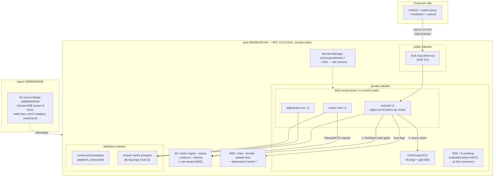

# 09 — Infrastructure Design

**Status:** design record, authored 2026-08-28. Conforms to `spec/execution-plan-v2.md` (frozen) and to the verified estate conventions in its Appendix A. Data-plane schemas (ClickHouse DDL, S3 key layout, retention matrix, corpus schemas) are owned by `07-data-model.md` and are **cited here, never restated**.

---

## 0. Scope, principles, and what is reused vs new

Mark 1's cloud plane is nine deployables' worth of Kubernetes workloads, one new analytical store, one new relational database, four new S3 buckets, and a family of KMS keys — landing inside an estate that already has a working account structure, VPC, EKS cluster, GitOps tree, secrets pipeline, and registry discipline. The design principle is subtraction: every piece of infrastructure Mark 1 does not build is a piece that cannot drift from the platform's conventions.

**The one hard rule: Mark 1 changes nothing in `Omium-platform`.** Not a module, not a variable default, not a Helm template, not a values line. This is the frozen plan's scope discipline ("Zero changes to Omium-platform") made physical. Concretely:

- Mark 1's Terraform lives in **`omium-mark1/deploy/terraform/`** — its own root modules, its own state keys (`mark1/prod/terraform.tfstate`) in the **same** backend bucket/lock table/KMS key as the platform, applied with the same profiles. It reads what it needs from the platform layer via `terraform_remote_state` (the prod root exports `vpc_id`, `private_subnets`, `rds_master_user_secret_arn` — verified in `Omium-platform/infrastructure/terraform/envs/prod/outputs.tf`) and via `data` sources for the few things not exported (the EKS OIDC provider, the node security group). Read-only coupling; the platform state is never written.
- Mark 1's Helm chart lives in **`omium-mark1/deploy/helm/omium-mark1/`** (the frozen plan's `deploy/helm/`), not in `Omium-platform/infrastructure/helm/`.
- Mark 1's GitOps wiring is **additive files in `omium-gitops/`** — a new `mark1/` kustomize tree and two new Application manifests in `argocd-prod/`. The app-of-apps root (`bootstrap/prod-root.yaml`) syncs the whole `argocd-prod/` directory, so adding a file there registers the app without editing anything that exists. `omium-gitops` is the deployment repo; additive files are what it is for. Nothing existing in it is modified either.

**Inherited unchanged** (and relied upon exactly as found):

| Thing | Where it lives | What Mark 1 does with it |
|---|---|---|
| AWS org + accounts + SSO profiles | `global/{bootstrap,org}`, live backends | Deploys into the existing prod account; no new accounts |
| Prod VPC (10.0.0.0/16, 3-tier, 3 AZ, NAT/AZ, S3 gateway endpoint, flow logs) | `modules/network` | All Mark 1 components land in existing subnets |
| EKS cluster `omium-prod` (1.31 live), system pool m6i.2xlarge×3, Karpenter `general` NodePool (on-demand, ≥4 vCPU/≥8 GiB) | `modules/eks`, `modules/cluster-bootstrap` | Runs Mark 1 pods; no cluster changes |
| Argo CD, app-of-apps from `bootstrap/prod-root.yaml`, plain Applications, `automated: {prune, selfHeal}`, `ServerSideApply=true` | `omium-gitops` | New child apps attach to the existing root |
| ESO + `ClusterSecretStore omium-aws-secrets` (IRSA JWT auth) | `omium-gitops/prod/secret-store.yaml` | Cluster-scoped; Mark 1's `ExternalSecret`s reference it as-is |
| ECR discipline: `IMMUTABLE` tags, scan-on-push, `<sha7>` pins, no `latest` (retired 2026-08-13) | `modules/ecr`, `helm/values.prod.yaml` | Mark 1 CI pushes only `:<sha7>`; new repos follow the same shape |
| Prometheus scraping by pod annotation (no ServiceMonitor objects exist anywhere) | `modules/observability`, every chart template | Mark 1 pods carry `prometheus.io/scrape` annotations, nothing else |
| gp3 (encrypted) default StorageClass | `modules/cluster-bootstrap` | Used by nothing in Mark 1 day one (no in-cluster state) |
| Helm helpers: `omium.podSecurityContext` / `omium.containerSecurityContext` / `omium.spread`, PDB pattern | `helm/omium-platform/templates/_helpers.tpl` | Vendored verbatim into Mark 1's chart (a chart cannot include another chart's helpers without a dependency; §7 notes the duplication and its source) |

**Extended** (existing mechanisms, new instances): new namespace `omium-mark1`; new Secrets Manager entries under the estate's `omium/prod/<name>` convention (`omium/prod/mark1-clickhouse`, `omium/prod/mark1-db-service-credentials`, …) seeded with the platform's seed-only `ignore_changes` pattern; new IRSA roles following the exact shape of `envs/prod/training_plane_irsa.tf`; new ECR repositories `omium/mark1-controld`, `omium/mark1-adjudicator`, `omium/mark1-intel`; new `ExternalSecret`s at sync-wave −1; a migration Sync-hook Job cloned from `prod/db-migrate-job.yaml`'s posture.

**Genuinely new** (does not exist anywhere in the estate today, verified by the 2026-08-28 scans):

1. **ClickHouse** — no ClickHouse module or manifest exists in any Terraform module or GitOps file. §4 writes the module. NATS does not exist either, **but MSK/Kafka does** (3 brokers, IAM auth, TLS, KMS, both envs — `modules/msk`); the standing decision, recorded here and in ADR form: **when a second independent ledger consumer appears, the existing MSK is evaluated before NATS is introduced.** No event bus exists at pilot at all — `async_insert=1, wait_for_async_insert=1` removes the day-one need (07 §ClickHouse).
2. **A dedicated Mark 1 RDS instance** (§3) — separate PITR blast radius for the receipt chain.
3. **Four S3 buckets with object-lock postures** and **per-tenant KMS keys** (§5), plus **KMS-resident signing keys** (§6).
4. **An edge distribution channel** (§11) — the estate ships services to a cluster it owns; Mark 1 ships signed binaries to machines it does not.

**What "no token metering exists in the estate" means here:** Mark 1 is not carving a slice out of an existing pipeline. Every byte-path in this document is new, which is why the design leans so hard on inherited *conventions* — they are the only part of the estate that transfers.

---

## 1. AWS account and network topology

### 1.1 The accounts as they actually are — and a drift finding

The live account IDs come from the backend configs and provider files, **not** from `Omium-platform/infrastructure/terraform/README.md`, whose IDs have drifted from every live backend. Cite these:

| Role | Live account ID | Evidence |
|---|---|---|
| Management (TF state, org) | **169805602430** | Backend in `envs/{prod,staging}/versions.tf`: bucket `omium-tfstate-169805602430`, KMS `arn:aws:kms:us-east-1:169805602430:key/a18f7b9a-…`, profile `omium-mgmt` |
| Production | **965384155704** | `envs/prod/providers.tf` (`# production account 965384155704`); ECR URL in `omium-gitops/helm/values.prod.yaml`; every prod IRSA role ARN |
| Staging | **contradictory — see below** | — |

**Finding (drift, must be fixed in the platform repo — by its owners, not by Mark 1):** `terraform/README.md` claims management = 765471447605, prod = 650790810654, staging = 910900236780. None of the first two match any live backend. The chart's default `values.yaml` also carries 650790810654 as the "NEW prod account". The likely history is the "lost IaC, spin up a new account" event the README itself warns about; whatever the cause, **765471447605 and 650790810654 do not appear in any live wiring and must not be used**.

**The staging contradiction, stated honestly:** `envs/staging/providers.tf` says `profile = "omium-stg" # staging account TBD (waiting for AWS org quota increase)` and `deploy-prod.yml` says "TBD - staging account not yet created" — yet `omium-gitops/helm/values.staging.yaml` pins account **910900236780** with concrete RDS (`omium-staging-postgres.ccjae0iegf10…`) and Redis endpoints, and a full `argocd/omium-staging-*` app tree exists. The AWS-verified state (2026-08-10) found a **two-account org: management + prod, no staging account**. Mark 1 therefore treats **prod as the only environment with verified live compute** and does not gate any Phase 1 work on staging existing (§9).

### 1.2 Region, VPC, and where Mark 1 lands

Everything is **us-east-1**. Mark 1 introduces no new VPC: the prod VPC (`10.0.0.0/16`, `modules/network`) already has the three tiers Mark 1 needs, with flow logs (ALL traffic, 60 s aggregation, S3 destination) and an S3 gateway endpoint — which matters more to Mark 1 than to the platform, because the S3-first ingest path (07 §S3 layout) writes every batch to S3 before acking, and the gateway endpoint keeps that entire hot path off the NAT gateways.

| Tier | CIDR slices | Who is in it today | What Mark 1 adds |
|---|---|---|---|
| Public (`10.0.1-3.0/24`) | ALB/NLB, NAT | Kong's LB | The ingest NLB/ALB target for `m1p.omium.ai` (edge → controld); TLS terminates at the ALB with an ACM cert, plain HTTPS per the M1P transport contract (08) |
| Private (`10.0.11-13.0/24`) | EKS nodes, MSK, Redis | All pods | All Mark 1 pods (namespace `omium-mark1`) + the **ClickHouse EC2 instance** (§4) |
| Database (`10.0.21-23.0/24`) | RDS | `omium-prod-postgres` | `omium-mark1-postgres` (§3), same subnet group |

ClickHouse goes in the **private** tier, not the database tier: the database subnets' route table has no NAT route by design, and the ClickHouse host needs outbound HTTPS for package installs, `clickhouse-backup` S3 pushes (via the gateway endpoint) and SSM. It is still fully private — no public IP, SG-locked (§4.4).

### 1.3 Topology



### 1.4 Security groups and endpoints

Mark 1 adds three SGs (all in `deploy/terraform/`, all carrying the estate's `Service`/`Purpose` tags — CI in the platform repo enforces those on platform resources; Mark 1's root adopts the same rule from day one):

- **`omium-mark1-clickhouse`** — ingress 8123 (HTTP) + 9000 (native) **from the EKS node security group only**, egress all. Honest caveat: the node SG admits *any pod on the cluster*, not just controld, because the estate's NetworkPolicies are currently inert (the `vpc-cni` `enableNetworkPolicy` flag is authored in `modules/eks` but deliberately not yet applied). Until that flips, network-level isolation to "only controld" is not achievable without inventing per-pod SGs the estate doesn't use. The actual isolation control is therefore credential custody: the only two ClickHouse users are held solely by controld (07 §ClickHouse), and §13 lists the CNI flag as the upgrade that makes the network match the intent.
- **`omium-mark1-rds`** — mirrors `modules/rds`: 5432 from the VPC CIDR. Same breadth as the platform's, same reasoning (RLS + role custody is the isolation layer, the SG is the perimeter).
- **`omium-mark1-ingest-alb`** — 443 from `0.0.0.0/0` (developer machines are the clients; there is no CIDR to write down), forwarding only to controld's ingest port.

No new VPC endpoints are needed: S3 (gateway) exists; Secrets Manager, KMS, STS and ECR are reached via NAT today platform-wide, and Mark 1 follows suit rather than introducing interface endpoints the platform then doesn't share — at Mark 1's call volumes (§10) the NAT processing cost of those control-plane calls is cents. Revisit only if flow-log review shows KMS chatter from per-tenant data keys becoming material (S3 Bucket Keys, §5, exist to prevent exactly that).

---

## 2. EKS and workload placement

### 2.1 The node landscape Mark 1 inherits

Two pools exist on `omium-prod`, both shaped by incidents worth knowing before placing anything:

- **`system` managed node group** — m6i.2xlarge ×3 (min 3, max 6), AL2023, encrypted 50 GiB gp3 roots, label `omium.ai/pool: system`. It was m6i.large until 2026-08-18, when a routine Karpenter consolidation left five services `FailedScheduling` because the three system nodes sat at 95–97 % CPU *requests* (while using ~700m for real) **and** the VPC CNI capped an m6i.large at 29 pods — two independent ceilings that both read as capacity exhaustion. The upgrade moved both ceilings together (7910m allocatable, 58 pod slots).
- **`general` Karpenter NodePool** — owned by Terraform (`modules/cluster-bootstrap`, applied via `kubectl_manifest`; **never** add it to an Argo overlay — dual reconcilers flip the spec hash and Karpenter rolls the fleet continuously). On-demand only (spot removed 2026-08-13 after both replicas of a request-path service landed on the cluster's only spot node), instance categories m/c/r generation >5, floors of ≥4 vCPU and ≥8 GiB (a c8a.medium once reached its 8-pod ENI cap while idle), `consolidationPolicy: WhenEmpty`, disruption budget 1 node.

Mark 1 pods carry **no nodeSelector**: they land on `general` capacity via Karpenter like every other workload, and the system pool's taints/absence-of-taints arrangement is the platform's business. What Mark 1 *does* carry, on every Deployment, is the spread + PDB discipline below — because the incident that produced it is precisely the failure mode a billing-grade ingest path cannot have.

### 2.2 Spread and disruption: the 2026-08-13 lesson, applied

On 2026-08-13, 8 of 17 platform services had **both** replicas on a single node — including Kong, the sole ingress. `replicas: 2` without a spread constraint is two copies of the same single point of failure. The platform's answer is the `omium.spread` helper (maxSkew 1 on `kubernetes.io/hostname`, `whenUnsatisfiable: ScheduleAnyway`) paired with PDBs (`maxUnavailable: 1`) for voluntary disruption. Mark 1's chart vendors both helpers and applies them to all three Deployments (§7). `ScheduleAnyway` rather than `DoNotSchedule` for the same reason the platform chose it: a hard constraint makes rollouts wedge on a cordoned node; the PDB supplies the hard guarantee where it belongs (the eviction API), and the spread is a scoring preference that fixes the actual observed failure.

For **controld specifically** the values overlay sets `whenUnsatisfiable: DoNotSchedule` (the per-service override the helper supports). controld is Mark 1's Kong: it is the only ingest ack path, and edge spools mean a brief scheduling delay during a rollout costs nothing (devices retry with backoff and their spool absorbs the gap), whereas co-located replicas during a node loss costs ingest availability. The trade the platform refused for 17 services is correct for this one.

### 2.3 The GPU pool and its attachment trigger

**The GPU pool does not exist and must not exist before its trigger.** The trigger, from the frozen plan: **~300 K verifications/month or the first learned verifier** (the T2/LEARN rung — a Qwen3-based reward model on vLLM). Before that point there is no workload that can use a GPU, and the estate's own discipline (Recovery-Redesign §8.3: no GPU spend before the cost crossover; a forgotten idle GPU is the costly failure mode) applies unchanged.

When the trigger fires, the mechanism is already written: `omium-gitops/deferred/gpu-nodepool.yaml` — a Karpenter `EC2NodeClass` + `NodePool` for g5.xlarge/2xlarge, on-demand, 200 Gi encrypted gp3, hard limits (`nvidia.com/gpu: "2"`), `consolidateAfter: 5m`, and the taint that is the spend guardrail:

```yaml
taints:
  - key: nvidia.com/gpu
    value: "true"
    effect: NoSchedule
```

Only a pod that both requests `nvidia.com/gpu` and tolerates the taint can ever land there; nothing can drift onto GPU capacity by accident. Mark 1's activation is the file's own documented path (move into the synced tree + add to the kustomization), pointed at the prod cluster's discovery tags rather than staging's, plus the T2 serving Deployment in Mark 1's chart gated behind `t2Serving.enabled: false` until then. The deferred file targets `omium-staging` discovery tags — one of the reasons §13 lists it as *shape to reuse, not file to move verbatim*.

### 2.4 Per-workload requests and limits

Numbers, with the reasoning. The estate's own comment ("requests are ~12× measured usage and that is worth fixing on its own merits") is a warning against copying the platform's inflated requests; Mark 1 starts from what each process actually does. All Go/Rust images are distroless (`gcr.io/distroless/cc-debian12:nonroot`), all Python is the recovery-orchestrator skeleton — neither has meaningful idle overhead.

| Workload | Replicas | Requests | Limits | Why these numbers |
|---|---|---|---|---|
| `controld` | 2 (HPA → 6) | 250m / 256Mi | 1000m / 512Mi | The hot path is zstd decompress + protobuf decode + S3 PUT + CH async-insert — I/O-bound Go. At pilot rates (§10: single-digit batches/s) one core is generous. Memory is bounded by in-flight batches (≤10 MiB each, a handful concurrent); 256Mi leaves 10× headroom. The limit is 2× request so a burst compresses latency, not OOMs. |
| `adjudicator-svc` | 2 | 250m / 512Mi | 1000m / 1Gi | numpy spectral Dawid–Skene over verifier-vote matrices: bursty CPU, matrices of (verifiers × tasks) floats — thousands × thousands doubles ≈ tens of MB. 512Mi holds several concurrent certifications; Python baseline ~120Mi. |
| `mark1-intel` | 2 | 500m / 1Gi | 2000m / 4Gi | Embedded DuckDB batch jobs over Parquet are the sizing driver — DuckDB spills gracefully but performs at memory. 4Gi limit lets a tenant-month aggregation run in-memory at the 1 000-dev tier (§10: ~600 MB/day raw across all tenants); revisit alongside the CH cluster trigger. |
| migrate Job | 1 (hook) | 50m / 64Mi | 200m / 128Mi | `psql -f` over a ConfigMap; the platform's Job runs unbounded but this is its measured shape. |

Every Deployment gets a PDB (`maxUnavailable: 1`) and the HPA shown in §7 (controld only day one — adjudicator and intel are batch-shaped; scaling them on CPU utilization would thrash on every nightly run, so they scale by values-file replica bumps until a queue-depth metric exists to scale on honestly).

---

## 3. RDS Postgres

### 3.1 A dedicated instance, and why

Mark 1 gets its own instance, `omium-mark1-postgres`, not a database on `omium-prod-postgres`. The platform instance is nearly idle (its data plane is empty), so this is not a capacity decision — it is a **PITR blast-radius decision**. The receipt chain's integrity claim is "per-tenant gap-free sequence, externally witnessed"; a point-in-time restore of a *shared* instance performed to fix some platform defect would silently roll the Mark 1 chain back to an earlier head, and the witnessed heads would then prove *us* inconsistent. The chain must be restorable on its own timeline or the witness becomes a liability. Secondary benefits — separate parameter surface, separate connection budget, and no entanglement with the platform's master-credential rotation — follow for free.

Shape mirrors prod conventions exactly (same module, same posture):

```hcl
# omium-mark1/deploy/terraform/envs/prod/rds.tf
module "rds" {
  # Same upstream the platform wraps (modules/rds pins ~> 6.9); Mark 1 vendors
  # an identical module under deploy/terraform/modules/rds rather than
  # source-ing across repos — the platform repo is not a Terraform registry,
  # and a cross-repo relative path would couple applies to checkout layout.
  source = "../../modules/rds"

  environment          = "mark1-prod" # names become omium-mark1-prod-*
  vpc_id               = data.terraform_remote_state.platform.outputs.vpc_id
  vpc_cidr             = "10.0.0.0/16"
  db_subnet_group_name = "omium-prod" # the existing group in the database tier

  instance_class          = "db.r6g.large"
  multi_az                = true
  allocated_storage       = 100
  max_allocated_storage   = 1000
  backup_retention_period = 14
  deletion_protection     = true
  skip_final_snapshot     = false
}
```

`db.r6g.large` multi-AZ from the first production write, matching the platform's prod posture — not because pilot volume needs it (§10: Postgres grows single-digit GB/month even at 10 000 devs) but because the receipt chain is the sales claim and "the chain store was single-AZ to save $180/month" is not a sentence to say to AIOS. Engine: **Postgres 15**, the estate pin. `manage_master_user_password = true` puts the master credential in the RDS-managed secret, which ESO extracts exactly as the platform does (`dataFrom.extract` on the `rds!db-…` key).

### 3.2 Parameters that matter

The platform runs the default `postgres15` family unmodified; Mark 1 needs a custom parameter group for exactly three settings — everything else stays default, deliberately:

```hcl
  create_db_parameter_group = true
  parameters = [
    # The chain is only as good as its transport. asyncpg's default sslmode
    # 'prefer' silently falls back to plaintext (grounding facts); the app
    # sets sslmode=require, and this makes the server refuse plaintext even
    # if some future client forgets.
    { name = "rds.force_ssl", value = "1" },
    # Receipt writes are many small transactions (checkpoint heads, ACK
    # ledger). synchronous_commit stays ON — the default — and is listed
    # here as a tripwire: turning it off is the classic "make inserts fast"
    # change and it converts the gap-free-sequence guarantee into a lie on
    # crash. apply_method=pending-reboot not needed; it is dynamic.
    { name = "synchronous_commit", value = "on" },
    # Chain verification and TVO backfills read in seq order; a modest
    # work_mem bump keeps those sorts off disk. 16MB, not the default 4MB;
    # per-sort, so bounded by the small connection count below.
    { name = "work_mem", value = "16384" }, # kB
  ]
```

**pgvector** ships with RDS PG15 (verified in `modules/rds`'s own header — "no special parameter group needed"). Enablement is one migration statement, `CREATE EXTENSION IF NOT EXISTS vector;`, owned by the migrations dir (07 defines the single `halfvec` HNSW column on memory artifacts — the only vector case in Mark 1).

Two constraints ride on that statement, and neither is visible from the statement itself. **pgvector is not a *trusted* extension** — `vector.control` carries no `trusted = true` — so `CREATE EXTENSION` requires a superuser, not merely a database owner. On RDS that is satisfied because the migration Job runs as the master user; anywhere the migration runs as an unprivileged role, **the platform must supply the extension and the migration's `IF NOT EXISTS` is a no-op**. And the version floor is **0.7**, not "whatever the distro packages": `halfvec` did not exist before it, and Ubuntu noble's archive stops at 0.6.0. `deploy/compose` and the native `stores-up` lane both pin **0.8.6** (PGDG); RDS PG15 is above the floor.

### 3.3 Roles and connections

The RLS lesson is the estate's hardest-won fact: 61 FORCE-RLS tables were decorative because every service connected as the master user, which inherits `rds_superuser` → effective BYPASSRLS. Mark 1 enforces the fix **from day one, structurally**:

- Migrations create `controld_app`, `adjudicator_app`, `intel_app` — `LOGIN NOBYPASSRLS NOSUPERUSER`, created passwordless in the migration (mirroring `07_service_roles.sql`), passwords injected by the migrate Job from the ESO-synced `mark1-db-service-credentials` secret via the platform's `ALTER ROLE … PASSWORD :'pw'` heredoc pattern (`prod/db-migrate-job.yaml` does exactly this for `recovery_loop_worker`).
- Services connect **only** as their `*_app` role. Unlike the platform, there is no master-user fallback path in the chart to migrate away from later: the `postgresEnv`-equivalent helper in Mark 1's chart has no unset-role branch. The master credential is mounted in exactly one pod: the migrate Job (DDL needs the table owner).
- CI carries the negative test the platform lacked (12 owns the test list): connect as each `*_app` role with a bogus `app.tenant_id` and assert zero rows on every RLS table. The failure mode was invisible precisely because the policies were correct; only a connection-role test catches it.

Connection budget: `db.r6g.large` (16 GiB) yields `max_connections` ≈ 1 700 by the RDS formula. Mark 1's asyncpg pools are 10 per pod × ~6 pods ≈ 60, plus the CH-adjacent controld modules ≈ 80 total. **No PgBouncer/RDS Proxy day one** — a pooler in front of asyncpg pools at 5 % connection utilisation is a component with no job; the trigger to add RDS Proxy is sustained `DatabaseConnections` > 700 (≈ 40 % of max, i.e. an order-of-magnitude pod-count growth) or a demonstrated failover-reconnect storm.

### 3.4 Backups and the migration model

Backups: automated, 14 days, PITR at 5-minute granularity (RDS default), deletion protection, final snapshot on destroy — all inherited from the module block above. §12 has the restore procedures and the chain-consistency check that must follow any restore.

Migrations execute exactly as the estate's prod migrations do — **an Argo CD Sync-hook Job over a kustomize-generated ConfigMap** (`omium-gitops/mark1/prod/`):

- `configMapGenerator` with `disableNameSuffixHash: true` builds `mark1-schema` from `omium-mark1/migrations/*.sql` mirrored into `omium-gitops/mark1/prod/schema/` (numbered, service-prefixed, idempotent — `m1_001_registry.sql`, `m1_002_receipts.sql`, …).
- The Job carries `argocd.argoproj.io/hook: Sync` + `hook-delete-policy: BeforeHookCreation` (a Job's pod template is immutable; delete-and-recreate per sync is the platform's documented workaround), sync-wave 1, `backoffLimit` high enough to outwait ESO populating secrets, `linkerd.io/inject: disabled`, uid 65532, `readOnlyRootFilesystem` + a 64Mi `/tmp` emptyDir — a byte-for-byte posture clone of `prod/db-migrate-job.yaml`.
- Every file runs under `ON_ERROR_STOP=1`. The platform's tolerant first pass exists because its consolidated schema predates service-owned tables; Mark 1 has no such history and gets no such tolerance.

**One deliberate divergence, recording a platform scar rather than repeating it:** the platform maintains migrations in each service repo *and* a hand-mirrored copy in the gitops schema dir, and the mirror is the failure point — its own Job comments describe migrations that "were applied nowhere and failed silently" because a file was added to one list and not the other. Mark 1's migrations live in **one place** (`omium-mark1/migrations/`), and the gitops copy is refreshed by a CI check in `omium-mark1` that fails when the two trees differ (`diff -r`), making the mirror mechanical instead of remembered. The kustomization list stays hand-ordered — ordering is load-bearing and a human should see it — but *presence* is machine-checked.

---

## 4. ClickHouse — the new module

Neither ClickHouse nor anything ClickHouse-shaped exists in the estate. This section is the module. Schemas, users, codecs, the ordering-key ADR, MV rollups and retention are **07's** (§ClickHouse, §ADR-0001, §Materialized views); nothing DDL-shaped is restated here.

### 4.1 Single node, argued honestly

**The shape: one EC2 instance, ClickHouse server pinned to an LTS release, data on gp3 EBS, in the private tier.** Per the frozen plan ("ClickHouse (single node day one)").

Why EC2 and not the two alternatives:

- *Not ClickHouse Cloud / Altinity.Cloud:* the ledger holds tenant-stamped usage events under a "raw sessions stay client-side, cloud data is ours to govern" posture; adding a SaaS subprocessor for the most sensitive aggregate store contradicts the subprocessor-minimising stance the judge-evidence tiers (C4) take, and it moves the data out of the VPC that all the isolation reasoning in 07/10 assumes.
- *Not an in-cluster StatefulSet:* the estate's convention is data stores in Terraform (RDS, Redis, MSK modules); the sole in-cluster store is Weaviate, and it is nobody's billing system. A StatefulSet buys automated rescheduling that a **single-node** database cannot use (the EBS volume pins it to one AZ anyway) and costs an operator dependency (Altinity operator) the estate doesn't run. When the cluster trigger fires (§4.5), the operator question reopens with real requirements to weigh it against.

**What single-node buys:** zero coordination machinery (no Keeper ensemble, no replication queues, no `ReplicatedReplacingMergeTree` fencing bugs), one mental model for merges and TTLs, one instance bill, and — decisive at pilot — *no distributed component between the first production write and the ordering-key ADR being proven right*. Every failure is a one-box failure with one log.

**What it costs, exactly:** availability. The failure mode is: instance or AZ dies → the **ledger view** is down until restore. What is *not* at risk: data. The S3-first contract (07 §S3 layout: "controld.ingest ACKs the device ONLY after the object lands") means ClickHouse is a rebuildable downstream view of the replay log, and `wait_for_async_insert=1` means controld's inserts fail loudly during the outage rather than silently dropping — ingest keeps acking (S3 is the ack gate), the CH insert path retries from the landing objects when the node returns. So the exposure is: TVO queries, dashboards and report generation stall; capture, receipts and billing-grade durability do not. RTO figures per tier are in §12.

**The trigger that forces a cluster** (first one to fire wins):

1. A customer contract carries an SLA on ledger/report availability that a single node's honest RTO (§12: 30–60 min snapshot restore) cannot meet.
2. Sustained insert rate approaches ~50 K rows/s (§10 says this is ≳100 000 active developers — not a pilot-horizon number; listed because triggers must be written down before they're near).
3. Storage approaching the practical single-volume ceiling (~70 % of a 16 TiB gp3 volume — the 10 000-dev tier reaches ~4.6 TB steady-state, §10, so this is the plausible one).

### 4.2 The Terraform module

`omium-mark1/deploy/terraform/modules/clickhouse/main.tf` — complete, following every estate convention (wrapped SGs with `name_prefix` + `create_before_destroy`, `Service`/`Purpose` tags with the no-parentheses charset, no `.tfvars`, defaults inline in `variables.tf`):

```hcl
# =============================================================================
# ClickHouse for the Mark 1 token-event ledger. SINGLE NODE BY DESIGN (plan:
# "single node day one"): the S3-first ingest landing is the durability layer,
# so this instance is a rebuildable view, not a system of record. Schemas and
# the ordering-key ADR live in omium-mark1/docs/design/07-data-model.md — this module
# creates the box, the disk, the backup path and the credential plumbing, and
# deliberately nothing schema-shaped.
# =============================================================================

data "aws_region" "current" {}
data "aws_caller_identity" "current" {}

# Pinned AMI: AL2023, same family as the EKS nodes, resolved through SSM so a
# plan never silently picks a new image (the alias is the pin, applies are
# deliberate — same philosophy as the estate's addon pinning).
data "aws_ssm_parameter" "al2023" {
  name = "/aws/service/ami-amazon-linux-latest/al2023-ami-kernel-default-x86_64"
}

resource "aws_security_group" "clickhouse" {
  name_prefix = "omium-mark1-${var.environment}-clickhouse-"
  description = "ClickHouse HTTP 8123 and native 9000 from EKS nodes for the Mark 1 ledger"
  vpc_id      = var.vpc_id

  ingress {
    description     = "ClickHouse HTTP interface from EKS nodes - controld only by credential"
    from_port       = 8123
    to_port         = 8123
    protocol        = "tcp"
    security_groups = [var.eks_node_security_group_id]
  }

  ingress {
    description     = "ClickHouse native protocol from EKS nodes"
    from_port       = 9000
    to_port         = 9000
    protocol        = "tcp"
    security_groups = [var.eks_node_security_group_id]
  }

  egress {
    description = "All outbound - package repos via NAT and S3 via the gateway endpoint"
    from_port   = 0
    to_port     = 0
    protocol    = "-1"
    cidr_blocks = ["0.0.0.0/0"]
  }

  tags = {
    Name    = "omium-mark1-${var.environment}-clickhouse"
    Service = "mark1-clickhouse"
    Purpose = "Security group for the Mark 1 ledger - ingress only from EKS nodes"
  }

  lifecycle {
    create_before_destroy = true
  }
}

# Instance role: SSM (the ONLY login path - no SSH key, no port 22), read the
# two ClickHouse credentials at boot, and write backups. Least privilege per §6.
resource "aws_iam_role" "clickhouse" {
  name = "omium-mark1-${var.environment}-clickhouse"
  assume_role_policy = jsonencode({
    Version = "2012-10-17"
    Statement = [{
      Effect    = "Allow"
      Principal = { Service = "ec2.amazonaws.com" }
      Action    = "sts:AssumeRole"
    }]
  })
  tags = {
    Service = "mark1-clickhouse"
    Purpose = "Instance role - SSM access plus boot-time credential read plus backup writes"
  }
}

resource "aws_iam_role_policy_attachment" "ssm" {
  role       = aws_iam_role.clickhouse.name
  policy_arn = "arn:aws:iam::aws:policy/AmazonSSMManagedInstanceCore"
}

resource "aws_iam_role_policy" "clickhouse" {
  name = "clickhouse-boot-and-backup"
  role = aws_iam_role.clickhouse.id
  policy = jsonencode({
    Version = "2012-10-17"
    Statement = [
      {
        Sid      = "ReadOwnCredentialsAtBoot"
        Effect   = "Allow"
        Action   = ["secretsmanager:GetSecretValue"]
        Resource = [var.credentials_secret_arn]
      },
      {
        Sid      = "WriteBackups"
        Effect   = "Allow"
        Action   = ["s3:PutObject", "s3:GetObject", "s3:ListBucket", "s3:DeleteObject"]
        Resource = [var.backup_bucket_arn, "${var.backup_bucket_arn}/*"]
      }
    ]
  })
}

resource "aws_iam_instance_profile" "clickhouse" {
  name = "omium-mark1-${var.environment}-clickhouse"
  role = aws_iam_role.clickhouse.name
}

# The data volume is a SEPARATE EBS resource, not a root block device: the
# instance can be replaced (new AMI, new size) without touching the data, and
# the volume carries its own snapshot lifecycle below.
resource "aws_ebs_volume" "data" {
  availability_zone = var.availability_zone
  size              = var.data_volume_gb
  type              = "gp3"
  iops              = var.data_volume_iops   # 3000 baseline is free; raise with scale
  throughput        = var.data_volume_mbps   # 125 baseline; async-insert batches are sequential
  encrypted         = true

  tags = {
    Name    = "omium-mark1-${var.environment}-clickhouse-data"
    Service = "mark1-clickhouse"
    Purpose = "Ledger data volume - survives instance replacement"
  }
}

resource "aws_instance" "clickhouse" {
  ami                    = data.aws_ssm_parameter.al2023.value
  instance_type          = var.instance_type
  subnet_id              = var.subnet_id # private tier; AZ must match the volume
  vpc_security_group_ids = [aws_security_group.clickhouse.id]
  iam_instance_profile   = aws_iam_instance_profile.clickhouse.name

  # No key_name on purpose: SSM Session Manager is the only shell. An SSH key
  # is a second credential system with no owner.
  metadata_options {
    http_tokens   = "required" # IMDSv2 only
    http_endpoint = "enabled"
  }

  root_block_device {
    volume_size           = 30
    volume_type           = "gp3"
    encrypted             = true
    delete_on_termination = true
  }

  user_data = templatefile("${path.module}/user_data.sh.tpl", {
    clickhouse_version = var.clickhouse_version # pinned LTS, e.g. "24.8.14.10456"
    secret_arn         = var.credentials_secret_arn
    region             = data.aws_region.current.name
    data_device        = "/dev/sdf"
  })

  tags = {
    Name    = "omium-mark1-${var.environment}-clickhouse"
    Service = "mark1-clickhouse"
    Purpose = "Single-node ClickHouse for the Mark 1 token-event ledger - rebuildable from the S3 replay log"
  }

  lifecycle {
    # Replacing the instance must never take the data with it by accident.
    prevent_destroy = true
  }
}

resource "aws_volume_attachment" "data" {
  device_name = "/dev/sdf"
  volume_id   = aws_ebs_volume.data.id
  instance_id = aws_instance.clickhouse.id
}

# Daily EBS snapshots, 7 kept. This is the OPERATIONAL restore path (fast);
# the S3 replay log is the CORRECTNESS restore path (complete). §12 has both.
resource "aws_dlm_lifecycle_policy" "clickhouse" {
  description        = "Daily snapshots of the Mark 1 ClickHouse data volume"
  execution_role_arn = var.dlm_role_arn
  state              = "ENABLED"

  policy_details {
    resource_types = ["VOLUME"]
    target_tags    = { Name = "omium-mark1-${var.environment}-clickhouse-data" }

    schedule {
      name = "daily"
      create_rule {
        interval      = 24
        interval_unit = "HOURS"
        times         = ["06:00"] # after the 05:00 UTC clickhouse-backup upload
      }
      retain_rule { count = 7 }
      copy_tags = true
    }
  }

  tags = {
    Service = "mark1-clickhouse"
    Purpose = "Snapshot lifecycle for the ledger data volume - 7 daily"
  }
}
```

`variables.tf` defaults (inline, per the no-`.tfvars` convention): `instance_type = "r6i.large"`, `data_volume_gb = 500`, `data_volume_iops = 3000`, `data_volume_mbps = 125`, `clickhouse_version` pinned to the current LTS. **r6i.large (2 vCPU / 16 GiB)** because ClickHouse's working set is mark caches + merge buffers, memory-shaped, and 16 GiB comfortably covers the pilot table set; §10 sets the resize point. **500 GB** holds >2 years at the 100-dev tier (§10 arithmetic) and gp3 resizes online in minutes when it doesn't.

`user_data.sh.tpl` does five things, idempotently: formats/mounts the data volume (guarded by `blkid`), installs the **pinned** `clickhouse-server`/`clickhouse-client` from the official repo, fetches the two users' credentials from Secrets Manager and renders `users.d/m1p-users.yaml` with `sha256_hex` password hashes (`m1p_ingest`: INSERT-only grant + the settings profile forcing `async_insert=1, wait_for_async_insert=1` server-side — the deliberate redundancy 07 specifies; `m1p_query`: SELECT-only), writes `config.d/` with `listen_host: 0.0.0.0`, `path: /var/lib/clickhouse` on the data mount, and installs `clickhouse-backup` with a systemd timer (§12). No DDL: schema is owned by Mark 1's migration flow (a `clickhouse-client --queries-file` step in the same Sync-hook Job, executed as a third, DDL-only user whose credential exists solely in that Job — mirroring "master user for DDL, app roles for runtime").

### 4.3 Credentials via ESO

One Secrets Manager entry, `omium/prod/mark1-clickhouse`, seeded by Terraform with `random_password` values under the platform's seed-only pattern (`ignore_changes = [secret_string]`, so rotation in the console is never reverted by an apply): JSON fields `ingest_password`, `query_password`, `ddl_password`, `host`, `port`. The instance reads it at boot (hash-side); controld receives it via an `ExternalSecret` at sync-wave −1 through the existing `omium-aws-secrets` ClusterSecretStore (client-side). Rotation = update the secret, re-run the boot renderer via SSM document, ESO refresh (≤1 h interval) restarts nothing — controld re-reads on reconnect.

### 4.4 Network isolation, honestly

The SG admits 8123/9000 from the EKS **node** SG — meaning any pod on the cluster can reach the port until the vpc-cni NetworkPolicy flag (authored, unapplied — §1.4) is flipped, after which a NetworkPolicy in `omium-mark1` restricting egress-to-ClickHouse to the controld pods makes the network match the design. Until then the enforced boundary is: (a) nothing outside the VPC can route to it at all, (b) only controld holds a credential, and (c) ClickHouse row policies are **deliberately absent** so nobody mistakes them for the isolation mechanism (07: the query choke is the isolation mechanism; the estate's decorative-RLS scar is why the design refuses a second decorative layer).

### 4.5 The upgrade path to a cluster

What "migrate to replicated" actually involves, so nobody prices it as a config change:

1. **New infrastructure:** 3 × Keeper nodes (t4g.small — Keeper is Raft over tiny state) and a second data node in another AZ; the module grows `replica_count`/`keeper_enabled` variables rather than being rewritten.
2. **New DDL:** `ReplacingMergeTree` → `ReplicatedReplacingMergeTree` **cannot be altered in place**. The mechanics are exactly 07 §ADR-0001's migration playbook: create `m1p_events_v2` as replicated, dual-write in `controld.ingest`, replay the S3 landings oldest-first (idempotent — `event_id` dedupe), verify per-`(tenant, day)` parity, cut query-choke over, drop v1 after a retention cycle.
3. **New client semantics:** controld's inserts gain `insert_quorum` decisions and the query choke learns about replica lag. Both are flag-gated code paths written when needed, not before.
4. **Cost delta:** roughly +1× data node, +3× t4g.small, +cross-AZ replication traffic — ~$450–500/month at the r6i.2xlarge tier (§10 prices it).

The honest summary: the cluster migration is days of careful work made *possible and safe* by the replay log, and the single-node decision is what the replay log exists to de-risk. Deferring the cluster is not deferring safety; it is deferring cost and coordination complexity that pilot volume cannot justify.

---

## 5. S3 and KMS

### 5.1 Buckets

Four buckets, named to the estate convention `omium-<purpose>-<env>-<account>`. The key layout inside each, the tenant-prefix scheme (`t/<tenant_uuid>/…`), and the full object-lock/retention matrix are **07 §S3 layout** — normative there, cited here. What this section owns is the Terraform that realises those postures:

| Bucket | Purpose (07) | Versioning | Object lock | Lifecycle |
|---|---|---|---|---|
| `omium-mark1-ingest-prod-965384155704` | The replay log + quarantine — ack-gate for every batch | On | **GOVERNANCE, 35 d (`ingest/`) / 30 d (`quarantine/`)** | Glacier IR at 90 d, expire at 760 d (`ingest/`); expire 32 d (`quarantine/`, backstop behind controld's receipted 30 d sweep) |
| `omium-mark1-corpus-prod-965384155704` | Parquet mirrors + KTO JSONL/manifest pairs | On | None (receipt-integrity, not lock) | Default expire 400 d, tenant-overridable |
| `omium-mark1-evidence-prod-965384155704` | Opt-in E1/E2 blobs | On | None | Expire 90 d — a hard ceiling, not a default |
| `omium-mark1-witness-prod-965384155704` | Hourly chain heads | On | **COMPLIANCE, 2 y** | None — no delete, ever |

Why GOVERNANCE vs COMPLIANCE is *per bucket* and not a variable: 07's argument is legal, not operational — the replay log must survive an operator mistake but remain deletable under a tenant-offboarding obligation (governance bypass under the dual-control offboarding role), while witness heads are 32-byte hashes whose entire value is that nobody, including us, can delete them. Encoding both behind one toggle invites setting it wrong once and discovering it during an offboarding.

The module (`deploy/terraform/modules/mark1-buckets`) extends the platform's `s3-app-buckets` shape — same public-access-block, same `DenyInsecureTransport` policy, same `abort_incomplete_multipart_upload` — with three additions per bucket class. Shown for ingest; the others differ only in the table's parameters:

```hcl
resource "aws_s3_bucket" "ingest" {
  bucket = "omium-mark1-ingest-${var.environment}-${data.aws_caller_identity.current.account_id}"
  # Object lock MUST be declared at creation - it cannot be retrofitted onto
  # an existing bucket without an AWS support case. This is the one S3 setting
  # that is effectively irreversible-by-omission, hence in the first apply.
  object_lock_enabled = true

  tags = {
    Name    = "omium-mark1-ingest-${var.environment}"
    Service = "mark1-s3"
    Purpose = "M1P ingest landing and replay log - ack gate for every device batch"
  }
}

resource "aws_s3_bucket_object_lock_configuration" "ingest" {
  bucket = aws_s3_bucket.ingest.id
  rule {
    default_retention {
      mode = "GOVERNANCE"
      days = 35
    }
  }
}

resource "aws_s3_bucket_lifecycle_configuration" "ingest" {
  bucket = aws_s3_bucket.ingest.id

  rule {
    id     = "replay-log-tiering"
    status = "Enabled"
    filter { prefix = "" } # tenant prefixes all share the class posture
    transition {
      days          = 90
      storage_class = "GLACIER_IR" # replayable within minutes, 1/6 the storage price
    }
    expiration { days = 760 } # matches the ledger's 25-month TTL (07 §Retention)
    abort_incomplete_multipart_upload { days_after_initiation = 7 }
  }

  rule {
    id         = "quarantine-short-life"
    status     = "Enabled"
    filter { prefix = "" } # refined per-tenant: t/*/quarantine/ via tag-based filter at apply
    expiration { days = 32 } # backstop only: controld's receipted sweep deletes at 30 d (07, D-EI)
  }
}
```

*(Lifecycle rules filter on prefix within the tenant path; since S3 lifecycle prefixes can't wildcard the middle of a key, quarantined objects are tagged `class=quarantine` at PUT by controld and the rule filters on the tag. That's why the rule above shows the intent; the tag filter is the mechanism.)*

Bucket policies carry, beyond `DenyInsecureTransport`, the two statements 07 promises:

```hcl
      {
        Sid       = "DenyUnencryptedOrWrongKeyWrites"
        Effect    = "Deny"
        Principal = "*"
        Action    = "s3:PutObject"
        Resource  = "${aws_s3_bucket.ingest.arn}/*"
        Condition = {
          StringNotEquals = {
            "s3:x-amz-server-side-encryption" = "aws:kms"
          }
        }
      },
      {
        # Cross-tenant encryption is a WRITE FAILURE, not an audit finding
        # (07): a PUT under t/<tenant>/ must name that tenant's key. IAM can't
        # derive the key from the prefix in one condition, so enforcement is
        # split: this statement forces SSE-KMS; controld's writer derives the
        # key alias from the prefix in code; and the per-PR tenant-isolation
        # negative test (12) PUTs t/A/ objects under tenant B's key and
        # asserts the code path refuses. The bucket policy is the backstop
        # that at minimum nothing lands under SSE-S3 or the AWS-managed key.
        Sid       = "DenyAwsManagedKey"
        Effect    = "Deny"
        Principal = "*"
        Action    = "s3:PutObject"
        Resource  = "${aws_s3_bucket.ingest.arn}/*"
        Condition = {
          StringLike = {
            "s3:x-amz-server-side-encryption-aws-kms-key-id" = "*alias/aws/s3*"
          }
        }
      },
```

### 5.2 Per-tenant KMS keys

Every object under `t/<tenant>/` is SSE-KMS under `alias/mark1-tenant-<tenant_uuid>` (07) for organization tenants; personal tenants share the IaC-created `alias/mark1-personal` (ADR-0011: per-person keys cost ~US$1/key/month and the per-tenant deny statements hit the 20 KB bucket-policy cap at a few hundred tenants — personal isolation is prefix + tenant predicate + RLS, and personal deletion is a receipted object delete, not crypto-erasure). Keys are created **at tenant enrollment by `controld.enroll`**, not by Terraform — tenants arrive at runtime, and a Terraform-managed key list would either lag enrollment or grant CI a standing key-creation role. controld's IAM (§6) permits `kms:CreateKey`/`CreateAlias`/`TagResource` **constrained by request tags** (`aws:RequestTag/Service = mark1-tenant-key`), and each key's policy grants usage to controld and intel via **grants** (revocable per-tenant, auditable, and the offboarding path: retire the grants, schedule key deletion, and the tenant's every byte becomes ciphertext with no key — cryptographic erasure that satisfies deletion obligations without touching object-locked replay objects, exactly the reconciliation 07 §Receipts-vs-deletion describes).

**S3 Bucket Keys are enabled on all four buckets** — without them, every PUT/GET is a KMS request and per-tenant keys would turn the request bill into the dominant line; with them, KMS calls amortise per bucket-key-cache window and the marginal request cost is noise.

**Key-count and cost, stated plainly** ($1/key/month + ~$0.03/10k requests, requests suppressed by bucket keys):

| Tenants | KMS key cost | As a share of the tier's total (§10) |
|---|---|---|
| 10 | $10/mo | noise |
| 100 | $100/mo | ~8 % — visible, fine |
| 1 000 | $1 000/mo | ~25–40 % — **the dominant marginal cost of a free-tier tenant** |
| 10 000 | $10 000/mo | untenable for unpaid tenants; the trigger below has long since fired |

**What to do when it becomes untenable — decided now, executed at the trigger (per-tenant key spend > ~$500/mo, ≈ 500 tenants):** tier the custody model. Paid/enterprise tenants keep dedicated CMKs — key-level isolation and grant-revocation offboarding are part of what the SKU sells. Free/trial tenants move to **one shared CMK with per-tenant `EncryptionContext` (`{"tenant_id": "<uuid>"}`)**: the context is cryptographically bound into every ciphertext and enforced on decrypt (a decrypt call scoped to tenant A's context cannot open tenant B's object), IAM conditions on `kms:EncryptionContext:tenant_id` preserve the isolation *test surface*, and the only property lost is per-tenant key *deletion* — free-tier erasure falls back to object deletion + lifecycle, which their terms reflect. The migration is forward-only (new objects under the new scheme; old objects age out through lifecycle), so it never becomes a re-encryption project.

Signing keys — a different KMS population entirely — are §6.4.

---

## 6. IAM and IRSA

### 6.1 The pattern, inherited

The estate's IRSA shape (`envs/prod/training_plane_irsa.tf`) is adopted verbatim: one role per ServiceAccount, trust on the cluster's OIDC provider with **both** the `:sub` (exact SA) and `:aud` (`sts.amazonaws.com`) conditions, inline least-privilege policies, and the role ARN annotated onto the SA in the chart. Mark 1's Terraform obtains the OIDC provider through data sources (the prod root doesn't export it, and Mark 1 doesn't get to add outputs):

```hcl
data "aws_eks_cluster" "prod" { name = "omium-prod" }

data "aws_iam_openid_connect_provider" "prod" {
  url = data.aws_eks_cluster.prod.identity[0].oidc[0].issuer
}

locals {
  oidc_arn = data.aws_iam_openid_connect_provider.prod.arn
  oidc_url = replace(data.aws_eks_cluster.prod.identity[0].oidc[0].issuer, "https://", "")

  controld_sa    = "system:serviceaccount:omium-mark1:controld"
  intel_sa       = "system:serviceaccount:omium-mark1:mark1-intel"
  adjudicator_sa = "system:serviceaccount:omium-mark1:adjudicator"
}

data "aws_iam_policy_document" "controld_assume" {
  statement {
    effect  = "Allow"
    actions = ["sts:AssumeRoleWithWebIdentity"]
    principals {
      type        = "Federated"
      identifiers = [local.oidc_arn]
    }
    condition {
      test     = "StringEquals"
      variable = "${local.oidc_url}:sub"
      values   = [local.controld_sa]
    }
    condition {
      test     = "StringEquals"
      variable = "${local.oidc_url}:aud"
      values   = ["sts.amazonaws.com"]
    }
  }
}
```

### 6.2 Per-service policies, written out

**`omium-prod-mark1-controld-irsa`** — the widest role, because controld is the only component that touches the ingest path, the signing keys, and tenant-key creation. Each statement names its consumer module:

```hcl
data "aws_iam_policy_document" "controld" {
  # ingest: S3-first landing. Write-only on the landing prefix - controld
  # never needs to read batches back on the hot path (replay is intel/ops).
  statement {
    sid       = "IngestLandingWrite"
    effect    = "Allow"
    actions   = ["s3:PutObject"]
    resources = ["${aws_s3_bucket.ingest.arn}/*"]
  }
  # witness publisher: append heads. PutObject only - COMPLIANCE lock means
  # even s3:DeleteObject would be refused, but not granting it keeps the
  # access analyzer clean.
  statement {
    sid       = "WitnessAppend"
    effect    = "Allow"
    actions   = ["s3:PutObject"]
    resources = ["${aws_s3_bucket.witness.arn}/heads/*"]
  }
  # enroll: create per-tenant CMKs (§5.2). Creation is constrained by request
  # tag; Describe/Tag are needed by the same flow. CreateAlias is resource-
  # constrained to the mark1-tenant-* alias namespace.
  statement {
    sid       = "TenantKeyCreate"
    effect    = "Allow"
    actions   = ["kms:CreateKey"]
    resources = ["*"] # CreateKey takes no resource; the tag condition is the constraint
    condition {
      test     = "StringEquals"
      variable = "aws:RequestTag/Service"
      values   = ["mark1-tenant-key"]
    }
  }
  statement {
    sid       = "TenantKeyAlias"
    effect    = "Allow"
    actions   = ["kms:CreateAlias", "kms:TagResource", "kms:CreateGrant", "kms:RetireGrant", "kms:DescribeKey"]
    resources = [
      "arn:aws:kms:us-east-1:${local.account_id}:alias/mark1-tenant-*",
      "arn:aws:kms:us-east-1:${local.account_id}:key/*",
    ]
    condition {
      test     = "StringEquals"
      variable = "aws:ResourceTag/Service"
      values   = ["mark1-tenant-key"]
    }
  }
  # ingest writes: encrypt under tenant keys (via grants created at enroll;
  # this statement is the identity-side half).
  statement {
    sid       = "TenantKeyUse"
    effect    = "Allow"
    actions   = ["kms:Encrypt", "kms:GenerateDataKey"]
    resources = ["arn:aws:kms:us-east-1:${local.account_id}:key/*"]
    condition {
      test     = "StringEquals"
      variable = "aws:ResourceTag/Service"
      values   = ["mark1-tenant-key"]
    }
  }
  # receipts + policy-dist: sign with the KMS-resident keys. Sign ONLY -
  # neither GetPublicKey rotation ops nor ScheduleKeyDeletion; verification
  # uses distributed public keys, and deletion is a human ceremony (ADR-0004).
  statement {
    sid     = "ChainAndBundleSign"
    effect  = "Allow"
    actions = ["kms:Sign"]
    resources = [
      aws_kms_key.server_chain.arn,
      aws_kms_key.bundle_signing.arn,
    ]
  }
}
```

**`omium-prod-mark1-intel-irsa`** — corpus read/write, replay read, tenant-key decrypt (via the same grant mechanism), and nothing signing-shaped:

```hcl
data "aws_iam_policy_document" "intel" {
  statement {
    sid       = "CorpusReadWrite"
    effect    = "Allow"
    actions   = ["s3:GetObject", "s3:PutObject"]
    resources = ["${aws_s3_bucket.corpus.arn}/*"]
  }
  statement {
    sid       = "CorpusList"
    effect    = "Allow"
    actions   = ["s3:ListBucket"]
    resources = [aws_s3_bucket.corpus.arn]
  }
  # Replay/backfill: read-only on the landing log. This is the role the
  # ClickHouse rebuild (§12) runs under.
  statement {
    sid       = "ReplayRead"
    effect    = "Allow"
    actions   = ["s3:GetObject", "s3:ListBucket"]
    resources = [aws_s3_bucket.ingest.arn, "${aws_s3_bucket.ingest.arn}/*"]
  }
  statement {
    sid       = "TenantKeyDecrypt"
    effect    = "Allow"
    actions   = ["kms:Decrypt", "kms:GenerateDataKey"] # GenerateDataKey: corpus writes are also tenant-encrypted
    resources = ["arn:aws:kms:us-east-1:${local.account_id}:key/*"]
    condition {
      test     = "StringEquals"
      variable = "aws:ResourceTag/Service"
      values   = ["mark1-tenant-key"]
    }
  }
}
```

**`omium-prod-mark1-adjudicator-irsa`** — the smallest: read-only on `evidence/` (E1/E2 cloud-judge paths, tenant-consented) plus decrypt on tenant keys. Default judge execution is client-side (C4), so at pilot this role may go weeks without a single API call — which is the correct resting state for it, and a CloudTrail query proving it is part of the compliance story.

Deliberately absent everywhere: `secretsmanager:*` on any service role (ESO materialises secrets; pods read mounted Secrets), `s3:DeleteObject` on ingest/witness (lifecycle deletes, identities don't), any ClickHouse-related IAM (ClickHouse auth is its own credential plane, §4.3), and any cross-account anything.

### 6.3 ESO wiring

Nothing new is needed at the store level: `ClusterSecretStore omium-aws-secrets` is cluster-scoped and its IRSA role (`modules/aws-controllers`) can already read `omium/prod/*`. Mark 1 adds one `ExternalSecret` per Secret in `omium-gitops/mark1/prod/external-secrets.yaml`, each at sync-wave −1, each `dataFrom.extract` on its Secrets Manager JSON — the exact platform shape, including the `ignoreDifferences` jq paths the prod infra Application already carries for ESO's webhook-injected defaults:

| k8s Secret (ns `omium-mark1`) | Secrets Manager source | Consumed by |
|---|---|---|
| `mark1-postgres-credentials` | the RDS-managed `rds!db-…` secret of `omium-mark1-postgres` | migrate Job only |
| `mark1-db-service-credentials` | `omium/prod/mark1-db-service-credentials` (one field per `*_app` role) | all three services + Job (ALTER ROLE) |
| `mark1-clickhouse` | `omium/prod/mark1-clickhouse` | controld (ingest + choke), Job (DDL) |
| `mark1-oidc-client` | `omium/prod/mark1-oidc-client` | controld.enroll |
| `mark1-hmac-pepper` | `omium/prod/mark1-hmac-pepper` (per-tenant HMAC salt derivation root, 07 evidence digests) | controld |

### 6.4 Signing-key custody

Four separate KMS key populations, because the plan's key-separation rules (update key ≠ bundle key; section-split bundle keys; device ≠ server) are load-bearing compliance controls, not preferences:

| Key | KMS alias | Used by | Signs |
|---|---|---|---|
| Server chain key | `alias/mark1-server-chain` | controld (receipts countersign) | Checkpoint receipts — the server half of dual-signing |
| Bundle signing keys (one per bundle section: `verify`, `route`, `memory`, `cortex`, `gates`, `agent_maps`) | `alias/mark1-bundle-<section>` | controld.policy-dist | PolicyBundle sections, split so a single-key compromise cannot forge a whole bundle |
| Update key | `alias/mark1-update` | Release pipeline (via GitHub OIDC role, **not** any service role) | Edge update manifests (§11) — never bundles, so a bundle-key compromise cannot ship code and an update-key compromise cannot alter policy |
| Device keys | — (not in KMS) | mark1d | Origin half of dual-signing; generated on-device, keychain/TPM custody per the plan |

All KMS keys: `customer_master_key_spec = "ECC_NIST_P256"`, `key_usage = "SIGN_VERIFY"`, `enable_key_rotation` not applicable to asymmetric keys — rotation is the ADR-0004 ceremony (new key, cross-sign, `key_id` in every artifact names the signer, verifier accepts the published set).

**⚠ Finding — a contradiction this document must surface rather than paper over:** the frozen plan says "Ed25519 chain primitives" *and* "KMS-resident bundle signing keys… key ceremony." **AWS KMS does not support Ed25519** (asymmetric key specs are RSA, ECC_NIST_P256/384/521, ECC_SECG_P256K1, SM2, and ML-DSA — no EdDSA). Both halves cannot hold. The resolution designed here, for ADR-0004 to ratify: **KMS-resident keys (server chain, bundle sections, update) are ECDSA P-256; device keys remain Ed25519** (they live in keychains/TPMs, where Ed25519 is fine and the vendored `mark1-receipt` primitives apply unchanged). The vendored `keys.py` derivation already prefixes algorithm into `key_id` (`"ed25519:" + sha256(pub)[:16]`), so a `"p256:"` prefix extends the scheme without breaking it, and the standalone verifier carries both verifiers (~40 lines with `ring`/`cryptography`). The alternative — keeping Ed25519 server-side by storing the seed in Secrets Manager — was rejected: it converts "the key cannot leave the HSM" into "the key is readable by any principal with `GetSecretValue`," which is precisely the custody claim KMS-residency was chosen to make. If ADR-0004 instead demands Ed25519 everywhere, the cost is CloudHSM (~$1.4k/month + operational ceremony) and that trade should be priced in the ADR, not assumed here.

---

## 7. Helm charts

### 7.1 Conventions, mirrored exactly

Chart `omium-mark1/deploy/helm/omium-mark1/` (apiVersion v2, `version: 0.1.0`), following every observable estate rule:

- **One YAML file per service** holding Deployment + Service (+ HPA where a service scales): `templates/controld.yaml`, `templates/adjudicator.yaml`, `templates/intel.yaml`. Plus `templates/serviceaccounts.yaml` (the training-plane chart's pattern for IRSA SAs), `templates/poddisruptionbudget.yaml`, `templates/_helpers.tpl`.
- **`_helpers.tpl` vendors** `omium.podSecurityContext`, `omium.containerSecurityContext`, and `omium.spread` **verbatim** from `Omium-platform/infrastructure/helm/omium-platform/templates/_helpers.tpl`, with a header comment naming that source and the vendoring date. This is deliberate duplication: Helm cannot include another chart's helpers without declaring a chart dependency, and depending on the platform chart would drag thirty services' templates into Mark 1's release surface. The helpers are ~80 lines that change never; a stale copy is caught by the same grep that finds a template missing the include.
- **Security defaults** identical to the platform's `values.yaml` `security:` block: uid/gid/fsGroup 65532 (the distroless `nonroot` uid — which is also what Mark 1's images actually run as, so `runAsNonRoot` + `runAsUser` agree with the image), `seccompProfile: RuntimeDefault`, `allowPrivilegeEscalation: false`, `capabilities.drop: [ALL]`, `readOnlyRootFilesystem: true` with **zero overrides** — Go binaries and the Python services write nothing outside explicit emptyDirs, and Mark 1 starts with no legacy write paths to except.
- **Scraping by pod annotation only.** `prometheus.io/{scrape,port,path}` on the pod template. No ServiceMonitor objects — none exist anywhere in the estate, and inventing the first one would silently do nothing until someone also installs a Prometheus Operator config to honour it.
- **Values keys are camelCase per service**, images render as `{{ .Values.imageRegistry.url }}/{{ .Values.imageRegistry.organization }}/<name>:{{ .Values.<svc>.imageTag }}` — and the chart default for `imageTag` is **empty, failing render**, not `latest`. The platform's `| default "latest"` is a fossil from before 2026-08-13; on IMMUTABLE ECR it produces permanent pins that look like pointers, and Mark 1's chart makes the unpinned state a loud error instead.

### 7.2 The representative chart — `deploy/helm/omium-mark1/templates/controld.yaml`

The chart is in the repo and is the authority; this section no longer reprints it. The design sketch that used to sit here was reconciled against the built chart on 2026-09-17 and lost on every point below — recorded so nobody re-derives the sketch from the LLD:

| Sketch said | Chart is | Why |
|---|---|---|
| Two listeners: 8443 `ingest` (M1P/1 HTTPS from an ALB) + 8080 `api`; TLS in-pod; `templates/ingress.yaml` with LBC annotations and an ACM cert | **One** API port, `CONTROLD_PORT` 8080, plaintext in-cluster, no Ingress; `POST /m1p/v1/ingest` and the REST surface share it behind the platform's Kong (`mark1.enabled` in `Omium-platform/.../kong.yaml`, routes `api.omium.ai/m1p/*` and `/api/v1/*`) | The estate terminates TLS once at the edge; a second ALB per plane was a cost line, not a control |
| Metrics on 9090 | `METRICS_PORT` **9092**, pod-annotation scraping (§7.1) | 9090 collides with the platform's Prometheus convention |
| `POSTGRES_USER` / `POSTGRES_PASSWORD` / `POSTGRES_SSLMODE` | `POSTGRES_APP_USER` / `POSTGRES_APP_PASSWORD` (Secret `mark1-db-service-credentials`, key = the role); no sslmode knob — `config.go AppDSN` derives the DSN with `sslmode=require` unconditionally | A knob that can be set to `disable` is a downgrade path (§3.3) |
| `CLICKHOUSE_HOST` from Secret key `host` | `CLICKHOUSE_ADDR` (`host:port`, native 9000, the in-cluster StatefulSet Service) + `CLICKHOUSE_DATABASE` in values; only the three passwords (`ingest_password`, `query_password`, `offboard_password`) come from Secret `mark1-clickhouse` | The address is topology, not a secret |
| `INGEST_BUCKET`; `CHAIN_KEY_ALIAS` (KMS-resident chain key) | `S3_INGEST_BUCKET` + `AWS_REGION`; custody is three Ed25519 **seeds** from Secret `mark1-signing-seeds` — `SERVER_CHAIN_ED25519_SEED`, `AUTH_TOKEN_ED25519_SEED`, `BUNDLE_SECTION_ED25519_SEED` (ADR-0004 key ceremony; KMS signing is the Phase-5 upgrade) | KMS `Sign` per receipt is a latency and cost line the pilot does not need; the seeds never leave Secrets Manager → ESO → the pod env |
| — (absent from the sketch) | `TENANT_HMAC_PEPPER` (Secret `mark1-hmac-pepper`), `OMIUM_USER_ISSUER` + `OMIUM_USER_JWKS_PINNED` (FR-ENROLL-007 user tokens), `PUBLIC_BASE_URL`, `WITNESS_BUCKET` + `WITNESS_TENANTS` (required together — boot refusal R1) + `WITNESS_RETAIN`, `INTEL_SERVICE_TOKEN` + `INTEL_BASE_URL` (the internal seam, ADR-0010 §2.2), `CLICKHOUSE_OFFBOARD_PASSWORD`, `SERVER_MIN_EDGE` | Landed with their features after the sketch was written |
| `/readyz` asserts PG + CH reachability and the async-insert handshake | `/readyz` asserts PG and the S3 `HeadBucket` (R6); the async-insert settings handshake is **boot refusal R3**, and ClickHouse is deliberately excluded from ingest readiness (05 §1.4: ingest is S3-first, CH down must not shed ingest) | A readiness probe that flaps on CH takes ingest down with the ledger |
| "zero `securityContext` overrides" | ClickHouse runs as uid **101**; intel, adjudicator and the migrate Job mount `/tmp` emptyDirs (read-only root fs) | The `omium.containerSecurityContext` helper defaults hold everywhere else |
| intel's `CORPUS_BUCKET` | `INTEL_CORPUS_ROOT_URI` = `s3://<config.s3.corpusBucket>` (a URI, so a local path works in dev); empty ⇒ `corpus.export` parks | — |
| Sketch had no `tenants` | `tenants: []` in values drives `WITNESS_TENANTS`, the canary rollout controller and the quarantine sweep; empty ⇒ those loops stay off. The CronJobs run `--tenant all` and are never suspended: every active tenant from `m1_tenant_directory` (m1_084, the global mirror a trigger on `m1_tenants` keeps) — a tester's tenant born after the list gets its rollups too | 05 §7.3's "no cross-tenant lister" is closed by m1_084 for the schedulers; controld's three loops still read the list |
| No ClickHouse template | `clickhouse.yaml` StatefulSet (26.7, gp3 50 Gi) + `clickhouse-configmap.yaml`; `migrate-job.yaml` is an Argo Sync-hook Job on image `mark1-migrate`; `cronjobs.yaml`, `networkpolicies.yaml`, `poddisruptionbudget.yaml`, `prometheusrule.yaml`, `serviceaccounts.yaml` | §4 (single-node CH day one) |

`adjudicator.yaml` and `intel.yaml` keep the sketch's shape: same skeleton minus the HPA (§2.4: batch-shaped, values-scaled), minus every ClickHouse variable (neither may ever hold a CH credential — that absence *is* the query-choke control).

### 7.3 Values structure and the overlay shape

Chart defaults hold everything env-independent; the gitops overlay (`omium-gitops/helm/values.prod.mark1.yaml`) holds endpoints, IRSA ARNs, and the SHA pins — the exact split the platform uses. Overlay shape:

```yaml
# omium-gitops/helm/values.prod.mark1.yaml — PROD overlay (account 965384155704)
global:
  environment: prod
  namespace: omium-mark1

imageRegistry:
  url: 965384155704.dkr.ecr.us-east-1.amazonaws.com
  organization: omium

config:
  postgresql:
    host: <omium-mark1-postgres endpoint, from terraform output>
    port: 5432
    database: mark1
    sslMode: require
  s3:
    ingestBucket: omium-mark1-ingest-prod-965384155704
    corpusBucket: omium-mark1-corpus-prod-965384155704
    witnessBucket: omium-mark1-witness-prod-965384155704

availability:
  overrides:
    controld:
      whenUnsatisfiable: DoNotSchedule   # §2.2 — the sole ingest ack path

# Promote-by-SHA: every release is a one-line bump here (§8).
controld:    { imageTag: "a1b2c3d", serviceAccountName: controld }
adjudicator: { imageTag: "a1b2c3d", serviceAccountName: adjudicator }
intel:       { imageTag: "a1b2c3d", serviceAccountName: mark1-intel }

serviceAccounts:
  controld:    { roleArn: "arn:aws:iam::965384155704:role/omium-prod-mark1-controld-irsa" }
  adjudicator: { roleArn: "arn:aws:iam::965384155704:role/omium-prod-mark1-adjudicator-irsa" }
  mark1-intel: { roleArn: "arn:aws:iam::965384155704:role/omium-prod-mark1-intel-irsa" }
```

---

## 8. GitOps wiring

### 8.1 Where Mark 1 attaches

The prod app-of-apps root (`bootstrap/prod-root.yaml`) syncs the entire `argocd-prod/` directory. The estate uses **plain Applications, no ApplicationSets** — adding two files registers Mark 1 without touching anything:

```
omium-gitops/
├── argocd-prod/
│   ├── omium-prod-mark1-infra.yaml    # NEW — wave 0, kustomize path mark1/prod
│   └── omium-prod-mark1.yaml          # NEW — wave 1, the Helm release
├── mark1/prod/                        # NEW kustomize tree
│   ├── kustomization.yaml             # namespace, ESO, migrate Job, netpols, schema configMapGenerator
│   ├── namespace.yaml                 # omium-mark1, PSA restricted labels (as prod/namespace.yaml)
│   ├── external-secrets.yaml          # the five ExternalSecrets of §6.3, wave −1
│   ├── db-migrate-job.yaml            # §3.4, Sync hook, wave 1
│   ├── network-policies.yaml          # default-deny + allowlist; INERT until vpc-cni flag (§4.4)
│   └── schema/                        # CI-checked mirror of omium-mark1/migrations/ (§3.4)
└── helm/values.prod.mark1.yaml        # NEW — the $values overlay (§7.3)
```

This is byte-for-byte the training-plane precedent (`omium-prod-training-plane-infra.yaml` + `omium-prod-training-plane.yaml` + `prod/training-plane/` + `values.prod.training-plane.yaml`) — the second product plane to attach this way, not the first.

### 8.2 Sync ordering

Waves compose at two levels, exactly as the estate runs them: **across apps**, infra (wave 0) syncs before the Helm release (wave 1); **inside the infra app**, resource annotations order namespace (−2) → ClusterSecretStore-dependents/ExternalSecrets + default-deny netpols (−1) → migrate Job (+1, as a Sync hook). Net effect: by the time any Mark 1 pod starts, its namespace is PSA-labelled, every Secret is materialised, and both Postgres schema and ClickHouse DDL (§4.2 — same hook Job, `clickhouse-client --queries-file`, DDL credential) have been applied. Migrations run before services structurally, not by convention.

### 8.3 The Application manifests

```yaml
# argocd-prod/omium-prod-mark1-infra.yaml
apiVersion: argoproj.io/v1alpha1
kind: Application
metadata:
  name: omium-prod-mark1-infra
  namespace: argocd
  annotations:
    argocd.argoproj.io/sync-wave: "0"
  finalizers:
    - resources-finalizer.argocd.argoproj.io
spec:
  project: default
  source:
    repoURL: https://github.com/Omium-ai/omium-gitops.git
    targetRevision: main
    path: mark1/prod
  destination:
    server: https://kubernetes.default.svc
  # ESO's mutating webhook injects defaults not present in git; without these
  # the ExternalSecrets read OutOfSync forever (both shapes, per the prod infra
  # app's hard-won comment: an always-OutOfSync resource trains you to read
  # OutOfSync as noise).
  ignoreDifferences:
    - group: external-secrets.io
      kind: ExternalSecret
      jqPathExpressions:
        - .spec.target.deletionPolicy
        - .spec.dataFrom[]?.extract.conversionStrategy
        - .spec.dataFrom[]?.extract.decodingStrategy
        - .spec.dataFrom[]?.extract.metadataPolicy
        - .spec.data[]?.remoteRef.conversionStrategy
        - .spec.data[]?.remoteRef.decodingStrategy
        - .spec.data[]?.remoteRef.metadataPolicy
  syncPolicy:
    automated:
      prune: true
      selfHeal: true
    syncOptions:
      - ServerSideApply=true
      - ApplyOutOfSyncOnly=true
      - RespectIgnoreDifferences=true
```

```yaml
# argocd-prod/omium-prod-mark1.yaml
apiVersion: argoproj.io/v1alpha1
kind: Application
metadata:
  name: omium-prod-mark1
  namespace: argocd
  annotations:
    argocd.argoproj.io/sync-wave: "1"
  finalizers:
    - resources-finalizer.argocd.argoproj.io
spec:
  project: default
  sources:
    # Multi-source: chart from the product repo, values from this repo ($values).
    - repoURL: https://github.com/Omium-ai/omium-mark1.git
      targetRevision: main
      path: deploy/helm/omium-mark1
      helm:
        valueFiles:
          - $values/helm/values.prod.mark1.yaml
    - repoURL: https://github.com/Omium-ai/omium-gitops.git
      targetRevision: main
      ref: values
  destination:
    server: https://kubernetes.default.svc
    namespace: omium-mark1
  syncPolicy:
    automated:
      prune: true
      selfHeal: true
    syncOptions:
      - ServerSideApply=true
```

One prerequisite the estate README already documents for its own repos: prod Argo CD needs read credentials for `omium-mark1` (a third private repo). That is a one-time repo-credential Secret in the argocd namespace, listed in §13.

### 8.4 Releases: promote-by-SHA

Identical to the platform flow, because it is the same machinery: `omium-mark1` CI builds on merge to main, pushes `omium/mark1-*:<sha7>` to the prod-account ECR (repos are IMMUTABLE — a re-push of an existing tag fails, which is the point), and **a release is a one-line `imageTag` bump in `helm/values.prod.mark1.yaml`**. Argo CD (automated, selfHeal, prune) reconciles within its poll interval; the SHA-pin commit *is* the deploy, and `git log` on that file *is* the release history. Rollback is `git revert` of the pin commit — no imperative kubectl anywhere. `latest` never appears: on IMMUTABLE repos it is a permanent pin masquerading as a pointer (retired estate-wide 2026-08-13), and Mark 1's chart refuses to render without an explicit tag (§7.2's `required`).

---

## 9. Environments

### 9.1 What actually exists

The honest statement first: **the estate does not have a separate staging account in the way its README implies.** The evidence is contradictory in the repos themselves — `envs/staging/providers.tf` and `deploy-prod.yml` say the staging account is TBD pending an org quota increase, while `values.staging.yaml` and a full `argocd/omium-staging-*` tree reference account 910900236780 with concrete RDS/Redis endpoints — and the AWS-verified state (2026-08-10) found a **two-account org: management + prod**. Whichever way that resolves (a staging account that was created after the TBD comments were written and the comments never updated, or staging manifests written ahead of an account that never landed), this document refuses to build on it: **Mark 1's Phase 1 targets prod only**, and every staging artifact below is written so it activates without redesign when the staging question is settled.

What "staging" means for Mark 1 day one, honestly ranked by what it actually validates:

1. **`deploy/compose/`** (internal dev, per the frozen plan) — the full pipeline on a laptop: controld + Postgres + ClickHouse + MinIO standing in for S3. Validates code, not infrastructure.
2. **Conformance + golden-fixture CI** (12) — validates protocol behaviour per pinned agent version, on every PR.
3. **Dogfood tenancy in prod** — the founder's own usage as tenant zero, which the plan already designates as the first test population. Real infrastructure, real receipts, blast radius of one friendly tenant. This — not a staging cluster — is what gates the first *external* production write.

### 9.2 What differs when staging exists

The Mark 1 Terraform root already carries `envs/staging/` mirroring the platform's split (same modules, one file of different defaults — no `.tfvars`, per the convention). The deltas, all sizing and blast-radius, never behaviour:

| Thing | Prod | Staging |
|---|---|---|
| RDS | db.r6g.large, multi-AZ, deletion protection, 14 d | db.t4g.medium, single-AZ, 7 d, `skip_final_snapshot` |
| ClickHouse | r6i.large + 500 GB | r6i.large + 100 GB (same instance class on purpose — a smaller class would make staging perf numbers fiction) |
| S3 object lock | GOVERNANCE/COMPLIANCE per §5.1 | **None** — a compliance-locked staging bucket is a 2-year bill for test data; the lock *code path* is exercised in prod by tenant zero |
| KMS tenant keys | Real per-tenant CMKs | One shared key |
| Argo apps | `argocd-prod/omium-prod-mark1*` | `argocd/omium-staging-mark1*`, values overlay `values.staging.mark1.yaml` |

### 9.3 What must be true before Mark 1's first production write

The checklist the phase gate reads (each item is a §13 line or an ADR):

1. ADR-0001 (ClickHouse ordering key) signed — the one irreversible decision.
2. ADR-0004 (key ceremony) signed, including the P-256-in-KMS resolution of §6.4.
3. `mark1/prod` state key applied: buckets with object lock (irreversible-by-omission, §5.1), KMS signing keys, RDS, ClickHouse, IRSA.
4. Witness bucket verified COMPLIANCE-locked by attempting a delete and reading the refusal.
5. The migrate Job green, `*_app` roles password-injected, and the RLS negative test (bogus tenant GUC → zero rows) run against prod as those roles.
6. Monitoring for Mark 1 exists in prod (§13 item 3 — the estate gap Mark 1 must not inherit).
7. The standalone verifier validates a dogfood chain end-to-end with the Omium server offline (the Phase 1 gate itself).

---

## 10. Capacity model and cost estimate

### 10.1 The unit model — show the arithmetic

**Events per developer per active day.** From the M1P event families (07 §protocol): a working session of ~40 turns emits per turn ≈ 1 `Turn` + ~3 `ToolUse` + 2 `ModelRequest/Response` + 1 `Usage` + ~2 debounced `AnchorVote` + ~0.3 `VerdictEvent` ≈ **9–10 events/turn** → ~400/session; at ~6 sessions per active day plus session/task/coverage/`ReceiptCheckpoint` overhead: **≈ 3 000 events per developer per active day.** Assume 70 % of calendar days active → **~2 100/dev/calendar-day**; the tables below use the round 3 000 active-day figure so peaks aren't hidden by averaging.

**Bytes per event.** Wire (zstd protobuf batch, 07's typed-not-free-text discipline keeps events small): **≈ 250 B/event** landed in S3, byte-identical to the wire. ClickHouse compressed (the codec column plan in 07 — Delta/T64/Gorilla/ZSTD over a mostly-empty wide row): **≈ 200 B/event**. Both are estimates to be re-measured in the first dogfood week; every downstream number scales linearly with them, which is why they're isolated here.

**Volume table** (events at 3 000/dev/active-day, 22 active days/month):

| Devs | Events/day | S3 landing/day | CH growth/day | CH growth/year | CH steady state (25-mo TTL, diagnostics — ~40 % of rows — dropping at 90 d ⇒ ×0.7) |
|---|---|---|---|---|---|
| 10 | 30 K | 7.5 MB | 6 MB | 2.2 GB | **~3.2 GB** |
| 100 | 300 K | 75 MB | 60 MB | 22 GB | **~32 GB** |
| 1 000 | 3 M | 750 MB | 600 MB | 220 GB | **~320 GB** |
| 10 000 | 30 M | 7.5 GB | 6 GB | 2.2 TB | **~3.2 TB** |

*(Check: 30 M × 200 B = 6 GB/day. 6 GB × 365 = 2.19 TB/yr. Steady state = 2.19 TB × 25/12 × 0.7 ≈ 3.2 TB.)*

**S3 cumulative** (landing tiers to Glacier IR at 90 d, expires at 760 d): steady state ≈ 90 d × daily rate at $0.023/GB + 670 d × daily rate at $0.004/GB. At 10 000 devs: 675 GB standard ($16) + 5.0 TB IR ($20) ≈ **$36/mo** — S3 storage is never the problem; corpus/evidence add single-digit dollars until Phase 5.

**Postgres growth**: dominated by receipt checkpoints at 1 per ~256 events, ~1 KB/row: 30 M/256 ≈ 117 K rows/day ≈ 120 MB/day ≈ **3.6 GB/mo at 10 000 devs** (350 KB/mo at 10 devs). Registry/certs/bundles/ε-ledger are thousands of rows, not millions. The 100→1 000 GB autoscaling window covers every tier here.

**Ingest compute**: 30 M events/day averages 350 events/s; apply ×8 for working-hours peaking ≈ 2 800 events/s ≈ **6 batches/s at ~500 events/batch** — against a Go handler doing zstd + protobuf + one S3 PUT + one buffered CH insert. Two controld pods idle through the 1 000-dev tier; the HPA exists for the 10 000-dev peak and for backfill storms, not for steady state.

**ClickHouse insert**: 2 800 rows/s peak against a single-node capability in the hundreds of thousands of rows/s with async-insert batching. Insert throughput is **never** the single-node constraint at these tiers — storage (§4.1 trigger 3) and availability SLA (trigger 1) are.

### 10.2 Cost per tier (us-east-1, on-demand, monthly)

Unit prices used: r6i.large $0.252/h = $184; r6i.2xlarge $0.504/h = $368; db.r6g.large multi-AZ ≈ $360 + storage ≈ $25; db.r6g.xlarge multi-AZ ≈ $720 + storage; m6i.large $0.096/h = $70 (marginal Karpenter node); gp3 $0.08/GB; t4g.small $0.0168/h = $12; KMS $1/key.

| Line | 10 devs | 100 devs | 1 000 devs | 10 000 devs |
|---|---|---|---|---|
| ClickHouse (instance + EBS) | r6i.large + 200 GB = **$200** | r6i.large + 500 GB = **$224** | r6i.2xlarge + 1 TB = **$448** | 2× r6i.2xlarge + 3× t4g.small Keeper + 2× 4 TB = **$1 412** |
| RDS `omium-mark1-postgres` | db.r6g.large MAZ = **$385** | **$385** | **$385** | db.r6g.xlarge MAZ = **$790** |
| EKS compute (marginal, Karpenter) | fits existing headroom ≈ **$70** (1 node) | **$70** | 2 nodes = **$140** | 4 nodes = **$280** |
| S3 (all four buckets, steady state) | **$1** | **$4** | **$15** | **$36** |
| KMS (tenants ≈ devs/5; + 8 signing keys) | 2 keys + 8 = **$10** | 20 + 8 = **$28** | 200 + 8 = **$208** | tiered custody (§5.2) caps at ≈ **$500** |
| ALB + NAT + data transfer | **$25** | **$30** | **$60** | **$150** |
| Backups (snapshots + clickhouse-backup S3) | **$5** | **$10** | **$30** | **$120** |
| **Total ≈** | **$700/mo** | **$750/mo** | **$1 290/mo** | **$3 290/mo** |

Two readings of that table worth writing down: (1) **the fixed floor is ~$700/mo** and is dominated by the two multi-AZ/durability decisions (RDS MAZ, dedicated CH box) — both bought deliberately (§3.1, §4.1), both cheaper than one enterprise deal's diligence call; (2) **cost grows ~5× while developers grow 1 000×** — the marginal developer costs cents, which is the unit economics the TVO product needs anyway. GPU serving (post-trigger, §2.3) adds g5.xlarge ≈ $740/mo on-demand when — and only when — the LEARN rung earns it.

### 10.3 Scaling triggers, one per component

The number at which the current shape stops working, and what replaces it — written down now so scaling is a checklist, not a debate:

| Component | Current shape | Trigger (measured, not vibes) | Replacement |
|---|---|---|---|
| controld | 2 pods, HPA→6 | HPA pinned at max for >1 h, or ingest p99 ack > 2 s | Raise maxReplicas; past ~20 pods, shard the ALB by tenant hash |
| ClickHouse | Single r6i.large | Storage >70 % of volume → **resize online (gp3), no migration**; instance CPU/mem sustained >70 % → r6i.2xlarge (stop/start, minutes of ledger-view lag, zero data loss via replay); SLA demand or >50 K rows/s sustained → **cluster (§4.5)** | Bigger volume → bigger box → replicated pair + Keeper |
| RDS | db.r6g.large MAZ | `DatabaseConnections` >700 sustained → RDS Proxy; write IOPS >80 % of gp3 baseline or storage >700 GB → db.r6g.xlarge | Proxy, then vertical |
| KMS tenant keys | 1 CMK/tenant | Key spend > $500/mo (≈500 tenants) | Tiered custody: shared CMK + EncryptionContext for free tier (§5.2, decided) |
| Event bus | None (`async_insert` + S3-first) | **A second independent ledger consumer exists** | **Evaluate the estate's existing MSK first; NATS only if MSK loses that evaluation** (settled: no NATS before that comparison) |
| GPU pool | Does not exist | ~300 K verifications/mo or first learned verifier | `deferred/gpu-nodepool.yaml` shape, prod-pointed (§2.3) |
| S3 | 4 buckets | None foreseeable | It's S3 |

---

## 11. Edge distribution

The estate has never shipped a binary to a machine it doesn't own; this channel is net-new. The components: `mark1d`, `mark1` CLI (Go), `mark1-proxy`, `mark1-hookshim`, `cortexd` (Rust, static-ish against glibc — the estate's `rust:1.91-slim-bookworm → distroless/cc-debian12` pipeline builds the *container* images; edge binaries build from the same workspace with the same `opt-level=2, lto="thin", strip=true` release profile, targeting the platform triples directly).

### 11.1 Packaging per OS

| OS | Artifact | Signing | Channel |
|---|---|---|---|
| macOS | Universal2 binaries (aarch64 + x86_64 lipo'd) in a signed `.pkg`; also a Homebrew tap `omium-ai/homebrew-tap` | Developer ID Application certificate; `codesign --options runtime`, then `notarytool submit` + staple. Notarization is not optional: Gatekeeper quarantines unsigned daemons, and mark1d is precisely the long-lived background process users are trained to distrust | `.pkg` from the release CDN; `brew install omium-ai/tap/mark1` |
| Windows | MSI (WiX), per-machine; also `winget` manifest | Authenticode via **Azure Trusted Signing** — chosen over an EV token because it removes hardware-token custody from a one-founder company and gives CI an OIDC-scoped signing identity, mirroring how the estate already prefers OIDC over static credentials everywhere | MSI from the CDN; `winget install Omium.Mark1` |
| Linux | `.deb` + `.rpm` repos (GPG-signed metadata) and a plain tarball | Repo GPG key for apt/yum; every binary additionally carries a detached signature verifiable by `mark1 verify-release` | `apt`/`dnf` repo; tarball for the allergic |

All three platforms install the same layout (`mark1d` supervises the rest, per the plan) and CI builds/tests on macOS/Linux/Windows from day one (plan §Deployment).

### 11.2 The update channel — and why update key ≠ bundle key

Updates are pulled by `mark1d` from a static, CDN-served **update manifest**: JSON carrying `manifest_seq` (monotonic), per-platform artifact URLs + SHA-256 digests, `min_supported_version`, per-ring version pins, and a signature by the **update key** (`alias/mark1-update`, §6.4, exercised only by the release pipeline's GitHub-OIDC role — no service role can touch it).

The key separation is the security argument, stated once: **a compromised bundle key can steer policy but cannot ship code** (bundles contain no code by construction — no command strings, no `wasm_module`; decode rejects them), and **a compromised update key can ship code only through the staged-rollout + SLSA gate below but cannot silently alter policy** (bundles verify against bundle keys). Collapsing the two keys collapses the two blast radii into one.

Mechanics:

- **Staged rollout by ring**, selected server-side per tenant: ring 0 = Omium dogfood; ring 1 = consenting canary tenants; ring 2 = GA. The manifest carries a version per ring; promotion between rings is a manifest edit — which is itself a git commit in `omium-mark1` (the manifest source is version-controlled and CI-signed), so the release history discipline of §8.4 extends to the edge.
- **Rollback** = publish manifest `seq+1` pointing at the previous artifacts. Monotonic `seq` (persisted by mark1d, same discipline as PolicyBundle seq) means an attacker cannot replay an old manifest to downgrade a client; a *legitimate* downgrade is always a new, signed, higher-seq manifest.
- **Self-update applies to `mark1d`'s supervised set**; installs done via a system package manager (brew/winget/apt) are *notified*, not overwritten — never rewrite a file another owner manages, the same principle the plan applies to agent configs.
- **SLSA**: every release is built by the `omium-mark1` GitHub Actions pipeline with provenance attestation (`gh attestation` / slsa-github-generator); `mark1 verify-release` checks signature **and** provenance (repo, workflow, commit SHA) before any binary is executed. The estate's CI has no SBOM/provenance today (grounding delta 4) — this is new machinery in Mark 1's own CI, specified in 12/13, inherited from nothing.

### 11.3 Version skew against the control plane

The policy, normative here: **the edge may trail controld by at most two minor versions of the M1P contract; controld never trails the edge** (cloud deploys are instant, edge rollouts take weeks — the asymmetry is structural).

- Compatibility substrate: `m1p.v1` protobuf with `buf breaking` in CI; unknown fields skip-and-retain; a breaking change is `m1p.v2`, a new package, never in place.
- controld advertises `min_edge_version` in enroll and policy responses. An edge below it: **capture keeps running and spooling (fail-open for availability), uploads are refused with `426 Upgrade Required` and park in the spool (fail-closed for admission)** — the posture matrix applied to skew, so a lagging edge loses no data and leaks no contract violations. The 2 GiB spool cap bounds how long a client can ignore the 426 before billing-grade classes block, which is deliberate pressure to update.
- PolicyBundles carry `max_age` independently: a stale edge eventually falls to conservative built-in defaults (fail-static), regardless of binary version.

---

## 12. DR and backup

### 12.1 RPO/RTO per store

The architecture already made the big DR decision: **S3-first ingest means the durability story and the availability story are different stores.** Everything below follows from that.

| Store | RPO | RTO | Region failure means |
|---|---|---|---|
| S3 ingest (replay log) | **0** — the ack *is* the landing | n/a (S3 is the availability) | Ingest acks stop; edges spool (2 GiB cap, billing-grade classes block-on-full, `Dropped{}` accounts the rest). An availability event, structurally not a data-loss event |
| ClickHouse | **0 for data** (rebuildable view); ledger *view* lags by outage length | 30–60 min (snapshot path) / hours-to-days (full replay, table below) | Rebuilt in another region from replayed S3 — after S3 CRR exists (§12.4, gap) |
| Postgres | ≤ 5 min (PITR) | Multi-AZ failover 1–2 min; PITR restore 30–60 min | Lost absent cross-region snapshot copies (§12.4, gap). The chain would be *rebuilt* forward from the last witnessed head; witnessed heads make truncation *detectable*, which is the product's actual promise |
| Witness heads | 0 | n/a | Survives by design: COMPLIANCE-locked + mirrored to customer-controlled buckets — deliberately outside Omium's blast radius, including account compromise |
| Edge spools | Not ours; local durability per spool contract (fsync 250–500 ms, crc32c) | — | Unaffected by any cloud failure; that's the point of them |

### 12.2 Backup procedures (the actual commands)

**ClickHouse — two paths, run both, trust them differently.**

Nightly logical backup (systemd timer on the instance, 05:00 UTC, before the 06:00 EBS snapshot so the two never race):

```bash
# /etc/clickhouse-backup/config.yml points remote_storage at
# s3://omium-mark1-backups-prod-965384155704/clickhouse/ (instance role, §4.2)
clickhouse-backup create_remote "nightly-$(date -u +%F)"
clickhouse-backup delete local  "nightly-$(date -u +%F)"   # keep local disk clean
# retention: clickhouse-backup's keep_backups_remote: 14
```

Restore, operational path (new instance attaches the DLM snapshot volume — nothing to run beyond `terraform apply` re-pointing `aws_volume_attachment` — or from the logical backup):

```bash
clickhouse-backup restore_remote --rm "nightly-2026-08-27"
```

Restore, correctness path (**rebuild from the S3 replay log** — the one that makes the ordering-key decision reversible, 07 §ADR-0001):

```bash
# mark1-intel's replay job, run with the intel IRSA role (§6.2 ReplayRead):
#   1. list t/<tenant>/ingest/v1/ objects oldest-first (keys are dt-bucketed,
#      batch ids are UUIDv7 ⇒ lexicographic ≈ chronological)
#   2. decompress zstd → decode M1P → INSERT via m1p_ingest
#   3. idempotent by construction: event_id dedupe + ReplacingMergeTree
mark1-intel replay --bucket omium-mark1-ingest-prod-965384155704 \
                   --from 2024-08-01 --parallel 8
```

**Rebuild-from-replay duration by tier** (the honest numbers; bounded by S3 GET + decode at ~50 MB/s/worker and CH bulk insert at ~200–500 K rows/s on the tier's box):

| Tier | Rows to replay (25 mo) | Landing bytes | Wall clock, 8 workers |
|---|---|---|---|
| 10 devs | ~23 M | ~5.7 GB | **minutes** |
| 100 devs | ~230 M | ~57 GB | **~1 h** |
| 1 000 devs | ~2.3 B | ~570 GB | **~4–8 h** |
| 10 000 devs | ~23 B | ~5.7 TB | **~2–4 days** — at this tier the snapshot path is primary and replay covers only the tail since the snapshot (`--from <snapshot date>`), which drops it back to hours |

That last row is itself a scaling input: past ~1 000 devs, snapshot cadence (daily) plus tail-replay defines effective CH RTO, and the §4.1 cluster trigger conversation should reference it.

**Postgres:**

```bash
# PITR to 3 minutes before the incident:
aws rds restore-db-instance-to-point-in-time \
  --source-db-instance-identifier omium-mark1-prod-postgres \
  --target-db-instance-identifier omium-mark1-prod-postgres-pitr \
  --restore-time 2026-08-28T09:41:00Z \
  --db-subnet-group-name omium-prod --multi-az --profile omium-prod
# Then: repoint the chart's config.postgresql.host via values PR (GitOps, §8.4),
# never by editing the live Deployment.
```

**After any Postgres restore, before services resume writing — the chain-consistency check:** run the standalone verifier against the restored `effect_receipts`-descended chain tables and compare the head with the latest **witnessed** head for every tenant. Three outcomes: heads match → resume; restored head is an ancestor of the witnessed head → the gap is replayed from the S3 landing (receipts are recomputed deterministically from checkpointed batches); restored head *diverges* from a witnessed head → stop, page, treat as the integrity incident it is. This check is what makes "dual-signed, externally witnessed" survive our own restores, and it is a runbook entry in 11, referenced here because DR is where it fires.

**S3:** nothing to back up — versioning is on everywhere, object lock protects the two classes that need tamper protection, and lifecycle is the deletion mechanism. The witness mirror to customer buckets is continuous by controld's publisher.

### 12.3 What a full region failure means

us-east-1 down: ingest acks stop, edges spool and degrade per the posture matrix (capture continues fail-open; gates run last-known-good bundles fail-static; nothing corrupts). Recovery is currently **in-region only** — the estate has no cross-region anything, and Mark 1 day one adds none, on the argument that a multi-hour us-east-1 outage pauses the *view* of a system whose durability floor (edge spools + eventual S3) survives it. What breaks that argument: an enterprise contract with an RTO the spool window can't cover. §12.4 names the pre-provisions.

### 12.4 DR gaps carried forward (deliberate, priced)

1. **No S3 CRR** on ingest/witness. Cheap to add (one rule + a destination bucket; storage ×2 on the replicated classes). Trigger: first contract with cross-region DR language, or Phase 5 federation making the corpus a multi-tenant asset.
2. **No cross-region RDS snapshot copies.** One `aws_db_instance_automated_backups_replication` resource when trigger 1 fires — the chain-consistency check above already makes a cross-region restore safe to reason about.
3. **DR restore is untested until it's tested.** A quarterly game-day (restore CH from snapshot + tail replay; restore PG to PITR; run the chain check) enters the runbook set in 11; the first one runs during Phase 1 dogfood, when the blast radius is one friendly tenant.

---

## 13. Gaps and prerequisites

The honest list — what does not exist, what has drifted, and what must be true before Phase 1's first production write. Items marked **[blocker]** gate the write; the rest are tracked debts with named triggers.

### Drift and contradictions found while writing this document

1. **AWS account IDs in `terraform/README.md` are wrong.** README: mgmt 765471447605, prod 650790810654, staging 910900236780. Live backends: **mgmt 169805602430, prod 965384155704.** The platform chart's default `values.yaml` also carries 650790810654. Fix belongs to the platform repo's owners; this document cites only live values. **[blocker]** only in the sense that no Mark 1 artifact may copy a README ID.
2. **Staging is contradictory** (§9.1): TBD in `envs/staging/providers.tf` and `deploy-prod.yml`; concrete account 910900236780 + live-looking endpoints in `values.staging.yaml`; two-account org per the 2026-08-10 AWS verification. Mark 1 targets prod-only for Phase 1 and does not resolve this — but somebody must, before "staging-proven SHA" means anything for Mark 1 promotions.
3. **Prod has no monitoring kustomization** — `staging/monitoring/` exists, `prod/` has no counterpart, so prod alert coverage is whatever `modules/observability` installs and nothing product-specific. Mark 1 must not inherit this silently: **[blocker]** `omium-gitops/mark1/prod/monitoring/` ships Mark 1's alert rules (ingest ack latency, CH insert failures, spool-park rate via `Dropped{}` telemetry, witness-publish staleness — catalog owned by 11) *with* the first deploy, not after the first incident.
4. **KMS cannot hold Ed25519** (§6.4). The plan's "Ed25519" and "KMS-resident" collide; designed resolution: P-256 in KMS for server/bundle/update keys, Ed25519 on devices, algorithm-prefixed `key_id`. **[blocker]** via ADR-0004 sign-off — this is a plan-level contradiction only the key-ceremony ADR can close.
5. **The deferred GPU nodepool file targets staging discovery tags** (`omium-staging`) — reusable as shape, not verbatim (§2.3). Noted so trigger-day doesn't apply it blind.

### Things that do not exist yet (and their owner/trigger)

6. **ClickHouse** — §4 is the design; **[blocker]** module applied + ADR-0001 signed before the first production write.
7. **The `mark1/prod` Terraform root** — state key, buckets (object lock is creation-time-only, §5.1), KMS keys, RDS, IRSA. **[blocker]**.
8. **Argo CD read credentials for `omium-mark1`** — one repo-credential Secret on prod Argo (§8.3). **[blocker]**.
9. **`omium/mark1-*` ECR repositories** — IMMUTABLE, scan-on-push, created by Mark 1's TF root before first CI push. **[blocker]**.
10. **Mark 1 CI supply-chain gates** — estate CI has no `cargo-deny`, no `govulncheck`, no SBOM/provenance (grounding delta 4); Mark 1's own CI adds them (12/13) because §11's SLSA claim depends on them. **[blocker]** for the first *release*, not the first write.
11. **Edge signing identities** — Apple Developer ID + notarization account, Azure Trusted Signing, Linux repo GPG key (§11.1). Blocker for Phase 1's *dogfood distribution*, not for the cloud write path.
12. **NetworkPolicy enforcement** — ~44 authored policies estate-wide plus Mark 1's are inert until the `vpc-cni` flag (authored in `modules/eks`, deliberately unapplied, founder-gated) flips. Until then ClickHouse isolation = SG + credential custody (§4.4). Not a Mark 1 blocker; a Mark 1 *claim limiter* — 10's threat model must not claim network segmentation before this flips.
13. **Cross-region DR** — absent estate-wide and in Mark 1 day one; triggers in §12.4.
14. **Event bus** — none, correctly (07 §ClickHouse). Standing decision restated once more because it is the kind that gets re-litigated: **at the second independent ledger consumer, the existing MSK (3 brokers, IAM auth, both envs — already paid for, already secured) is evaluated before NATS is introduced.**
15. **EKS access posture** — public API endpoint (IAM-gated) and `API_AND_CONFIG_MAP` auth mode are documented founder decisions in `envs/prod/main.tf`, unchanged by Mark 1; listed because Mark 1's enterprise security reviews will ask, and the answer is the platform's file, not this one.

### The pre-write checklist, compressed

ADR-0001 + ADR-0004 signed → TF root applied (buckets locked, keys minted, RDS up, CH up, IRSA bound) → Argo apps synced (namespace, secrets, migrations green, `*_app` roles injected) → RLS + tenant-isolation negative tests green against prod → Mark 1 monitoring live in prod → witness COMPLIANCE lock verified by attempted delete → dogfood tenant enrolled → **first production write**. Everything after that is §10's table.
